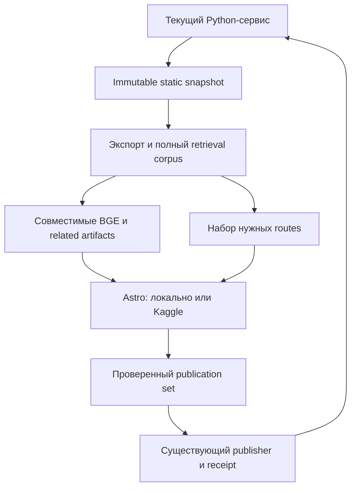

# Ускорение генерации Astro без переработки всего events-bot

Дата: **18 октября 2026**, Europe/Kaliningrad. Статус: **проект реализации, runtime не изменён**.

Основание: актуальный `main@d431b9f86b87999cf27f74b99857d23aedc28f16`, сохранённые измерения и инциденты, уточнения владельца от 17–18 октября. Проверялись код и документы; новые сборки, модельные запросы, Kaggle runs, публикации сайта и проверки production не запускались. Подробное разделение доказательств и гипотез — в [отчёте исследования](../reports/astro-static-generation-design-review-2026-10-18.md). Соседний самостоятельный проект — [Smart Update Ultra](smart-update-ultra-targeted-implementation.md).

## 1. Решение и ожидаемый результат

**Сохранить Astro/TypeScript для сайта и существующий Python-контур подготовки, очередей и публикации. Ускорять повторную работу внутри этих компонентов.** Перевод всего бота на новый язык отложен. Для первой полезной оптимизации Go не требуется: найденные механизмы можно устранить в существующих владельцах, сохранив отлаженные contracts и способы восстановления.

Первый результат проекта — короткий локальный цикл на DevCoveer: изменение компонента или данных быстро видно в браузере, а адресная сборка события не запускает весь производственный конвейер. Второй результат — уменьшение повторного вычисления и передачи данных в production-сборках на Kaggle. Третий, последующий результат — быстро доступная публичная страница события с отдельным обновлением зависимых страниц и связей.

Эти результаты выпускаются последовательно. Ускорение локальной отладки и существующей полной сборки не зависит от готовности Ultra, публичного переключения KenigEvents или переноса всех Telegraph-потребителей. Введённые ограничения production публикации при этом сохраняются.

| Область | Выбранный подход | Причина |
|---|---|---|
| Рендер страниц, компоненты, URL | Astro/TypeScript | Сохраняются действующие страницы, дизайн-система и frontend contracts |
| Индексация и повторное использование каталога | Общий контекст в существующем TypeScript | Убираются повторные полные сортировки и поиски без межъязыковой границы |
| Экспорт, BGE и media metadata | Существующие Python-модули | Сохраняются правила, готовые caches и нативные вычисления библиотек |
| Задания, receipts, leases, публикация | Существующий Python-сервис | Одна ответственность остаётся у проверенного владельца |
| Dev-исполнение | Локально на DevCoveer | HMR, готовые данные и повторно используемое окружение сокращают обратную связь |
| Production-вычисления | Kaggle | Тяжёлая генерация не переносится в постоянно работающий бот |

Фактическая версия по `site/package-lock.json` — **Astro 6.4.8**; `package.json` разрешает диапазон `^6.0.5` и требует Node `>=22.12.0`. Проект исходит из lockfile, а не из нижней границы диапазона. Переход на другую основную версию Astro не является условием первых улучшений. [Manifest][S01], [lockfile][S02].

## 2. Границы и сохраняемые обязательства

Оптимизация не меняет смысл события, его identity, даты, provenance, media approval, группы сеансов, права владельца/партнёра или правила промо. Сохраняются существующие source adapters, Smart Update fallback, уведомления, менеджмент инцидентов и учёт публикационных результатов. Экскурсии и их дайджесты, CherryFlash, партнёрские CherryFlash, CrumpleVideo и полезные collectors остаются действующими потребителями данных и ссылок. Их Kaggle runtimes не входят в переработку генератора.

Supabase Edge остаётся на своём месте. Поисковый writer и персонализация не переводятся на VPS и не получают конкурирующего writer из StaticSiteBuilder. Схема полной переработки events-bot 2.0 больше не служит prerequisite этого проекта: canonical apply и publisher здесь принадлежат текущему Python-сервису.

Последнее требование владельца о полной отмене активного Telegraph сохраняется как конечная цель: необходимые event/month/weekend/festival/thematic страницы и их потребители должны получить KenigEvents-эквиваленты; исторические внешние URL остаются историей. Это не разрешение потерять полезный продукт при удалении провайдера. Сопоставление агрегатов, промо, видео и MCP делается перед соответствующим публичным переключением, **не блокируя первые локальные и вычислительные улучшения**. Ранее предложенное бессрочное сохранение aggregate Telegraph writers отменено. [Уточнения владельца][S03].

У действующего secret-candidate publisher проверен контракт только для `_review/<token>/`. Публичная доступность новых `/sobytiya/...` не считается уже реализованной. Документация atomic-root описывает отдельный default-off путь; наличие кода этого пути не доказывает готовую live инфраструктуру. Запуск публичных landing получит самостоятельный ограниченный контракт маршрутизации и публикации. [Publisher][S04], [операция builder][S05].

## 3. Что ограничивает скорость сейчас

### 3.1. Чистый Astro и полный выпуск — разные измерения

В сохранённом локальном замере 28 июня 2026 сборка 80 событий / 95 страниц заняла 6.57 секунды при примерно 387 MiB Max RSS. Полный активный срез того дня — 386 событий / 403 страницы — занял 20.16 секунды при примерно 522 MiB. Это исторические измерения другого состояния проекта, исключавшие будущие media transformations/mirroring; они не обещают такой результат на современном DevCoveer. Но они показывают, что многоминутный полный pipeline нельзя автоматически считать стоимостью Astro. [Измерения][S06].

Позднее принятый secret candidate содержал 3,305 объектов и 674,467,502 байта. Инцидент 3 августа включает долгую подготовку, gates, upload, timeout, adoption и полный readback. Его временной интервал нельзя назвать временем рендера или ожидаемой экономией от нового языка. Современного сопоставимого профиля всех стадий в исследованных материалах нет. [Incident 3 августа][S07].

### 3.2. Повторное построение индексов в TypeScript

В `site/src/lib/events.ts` `getEvents()` копирует и сортирует каталог. `getEventDetailEvents()` заново строит Map active + archive и сортирует результат; `getEventById()` и `getEventBySlug()` вызывают его для каждого lookup. Related-проекция делает много таких lookup, а detail route отдельно получает наборы из 10 и 30 карточек. Occurrence resolver тоже получает заново отсортированный каталог. Это подтверждённый механизм повторной работы; его доля времени ещё не измерена. [Каталог][S08], [detail route][S09].

`eventPopularityScore()` дополнительно пересчитывает медианы всего активного набора в fallback-ветке. При положительном сохранённом `popularity_signal_score` этот путь не используется, поэтому нельзя объявлять его обязательной стоимостью каждого текущего события.

### 3.3. Три прохода Astro и широкий набор зависимостей

Production-candidate выполняет preview contract build, root-form build и secret-candidate build; root и candidate дополнительно проходят Chromium gates. `build:secret-candidate` действительно запускает Astro заново. Production и candidate scripts сначала генерируют lab/preview routes и затем удаляют лишние результаты. Это разные проверяемые поверхности, однако часть работы можно исключить раньше или вывести из повседневного dev-цикла. [Kernel][S10], [production script][S11], [candidate script][S12].

Каждый kernel выполняет `npm ci`; общий manifest содержит также Appium, Android/iOS drivers, Webdriver и mailbox tooling. Наличие 1,428 package entries в lockfile доказывает ширину набора, а не размер установки или её длительность. Нужные release-проверки сохраняются; их зависимости следует отделить от инструментов, которые данная сборка не запускает. [S01], [S02], [S10].

### 3.4. Exporter и delivery

`collect_images()` повторяет schema checks и per-event queries. Image-dimension probe делает синхронный HTTP Range до 64 KiB с timeout 4 секунды и cache в памяти процесса. В multi-image случае первое изображение может проверяться даже при сохранённых dimensions. Вместе с тем participants и video metadata уже загружаются пакетно — повторно проектировать их batching не нужно. [Exporter][S13].

Publisher уже передаёт PUT из file handle, но последовательно отправляет все объекты, затем последовательно читает каждый GET целиком для hash/MIME-проверки. Следующее улучшение — ограниченная I/O-параллельность и потоковый hash, сохраняя проверку каждого объекта. Доказанного основания переносить этот I/O-код на Go нет. [S04].

## 4. Четыре границы данных

**Snapshot, каталог поиска кандидатов, набор рендера и публикуемый результат имеют разные обязанности.** Их нельзя смешивать одним параметром `limit`.

| Понятие | Состав и роль | Что означает уменьшение |
|---|---|---|
| Immutable static snapshot | Разрешённая проекция canonical SQLite, точная версия и build clock | Экономия служебных данных, без потери обязательных входов exporter |
| Retrieval corpus | Полный совместимый набор допустимых кандидатов для related/collections | Урезание меняет результат рекомендаций и требует отдельного продуктового решения |
| Render set | Конкретные routes/events, HTML которых нужен этому заданию | Позволяет быстро собрать одну страницу при полном candidate universe |
| Publication set | Проверенные objects и адресные изменения публичного состояния | Не означает удаление остальных опубликованных страниц |

Компактный snapshot **уже реализован** как `static_site_projection_sqlite_v1`: table/column allowlist, bounded read transaction, manifests, hashes и `quick_check`. Operational ingestion/outbox/Kaggle tables исключены; source text сохранён в необходимом объёме для provenance/evidence. Transaction закрывается до upload/polling. Разработка продолжает этот контракт, а не возвращает передачу всей production DB. [S04], [S05].

В существующих manifests достаточно добавить необходимые сведения о render scope и зависимостях страницы. Новая БД, второй каталог событий или универсальная платформа execution не нужны. Для cache identity важны данные, модель/документ, политика, шаблон, base path и clock — только там, где они действительно влияют на результат.

Ultra в этой схеме — ещё один producer принятых изменений через текущий сервис. Builder должен продолжать работать от обычного Smart Update, календарного обновления и восстановления.

## 5. Три локальных режима

### 5.1. Повседневная UI-итерация

На DevCoveer используется уже существующий `npm run dev`, запускающий Astro на `127.0.0.1`. Зависимости устанавливаются по изменению lockfile, затем сохраняются. Данные берутся из небольшой представительной fixture или сохранённой разрешённой static projection; clock зафиксирован для воспроизводимости. Исходные UI-компоненты и дизайн-система те же, что в release. [S01], [дизайн-система][S14].

Сохранение CSS/компонента вызывает HMR. Source crawling, экспорт БД, LLM, BGE, upload и Kaggle отсутствуют в этой операции. Это штатная возможность Astro dev, а не новый генератор. Историческая fixture явно помечается: она не должна случайно считаться текущей афишей или подтверждением working Search/персонализации. [Astro CLI][W01].

Один dev process принадлежит одному worktree. Локальные файлы, generated outputs и public credentials должны соответствовать этому worktree, чтобы соседняя задача не подменяла его данные. Локальная отладка не означает public promotion или повторное социальное размещение.

### 5.2. Быстрый build сформированного HTML

Для ошибки, проявляющейся после сборки, нужен адресный render set: событие, группа конкретных страниц или необходимые archetypes. Он использует тот же полный совместимый retrieval corpus и готовые semantic receipts. Локальный просмотр собранного output проверяет реальные assets, canonical/OG, calendar links и особенности static HTML.

Существующий `--include-ids` не даёт такого режима: он приоритизирует preview rows и затем дополняет каталог; full export снимает эту приоритизацию. `getStaticPaths()` сейчас возвращает весь detail catalog. Новый route selector должен явно ограничивать output, сохраняя данные для связей и lookup. Поддерживаемая Astro-модель `getStaticPaths()` позволяет выбирать динамические URL. [S09], [S13], [routing][W02].

Статические нерелевантные routes тоже необходимо исключать до рендера. Реализация route profile должна использовать общие components и data modules; отдельная копия page template с постепенно расходящимся поведением не принимается. Нельзя выдавать урезанный render set за full-catalog release.

### 5.3. Проверка совместимости с production

После полезной локальной итерации выполняется faithful build на современной frozen projection: те же pinned runtime, exporter, policy hashes, data contracts и необходимые release checks. На этой стадии проверяются реальные generated pages. HMR-успех не закрывает static-release acceptance.

Стратегия браузерных, Android/iOS, auth и других проверок остаётся в существующем каноническом комплекте. Этот проект добавляет проверки своей границы, не создавая конкурирующий список всех E2E продукта. [Release plan][S15], [release gates][S16], [autotest strategy][S17].

## 6. Оптимизация подготовки и рендера

### 6.1. Общий контекст одного build

В `events.ts` один раз строятся sorted active/detail arrays, `byId`, `bySlug`, occurrence index и необходимые агрегаты. Related candidates вычисляются один раз на событие и совместимый контекст; mobile/desktop берут нужную длину из одного результата. Сортировка, tie-breaks, archive preference, eligibility и family collapse сохраняют текущую семантику.

Контекст привязан к immutable input и clock. В dev изменение data module инвалидирует его; в build новый snapshot создаёт новый контекст. Callers, которые сейчас модифицируют возвращённые arrays, получают копию или переходят на readonly API. Нельзя ради экономии начать незаметно менять общий массив из одного компонента.

Удаляется повторное построение тех же индексов, а не проверка существования события. Переход lookup к Map не создаёт нового семантического fallback. Это первый самостоятельный PR с прямой пользой и небольшой областью изменения. [S08].

### 6.2. Пакетный export и подготовленные media facts

Schema/table inventory читается один раз на snapshot; необходимые media/source rows загружаются пакетно. Переиспользуются уже действующие batching participants/videos и provenance rules. Если надо ограничивать память, используется bounded batch, а не один безразмерный объект всей operational DB.

Размеры, approved derivatives и media identity должны приходить от существующего media-owner и сохраняться с immutable asset hash. При неизменном asset exporter не повторяет сетевой probe. Недостающие сведения получают адресную repair-операцию с receipt; unknown сохраняет безопасное визуальное поведение.

Просто включить `--skip-image-probes` для public build недостаточно: нынешний probe защищает hero от слишком маленького первого изображения. Удаление этой работы принимается только при сохранении её полезного результата в metadata. OCR/unknown не превращается в `visual_only` по отсутствию текста; текущие media approval и crop guards остаются. [S13].

### 6.3. Reuse семантики

Существующий `static_event_bge.py` кодирует изменённые text hashes, хранит совместимость document/model/normalization и независимо учитывает prototype bank. UI-изменение не требует BGE; дата/lifecycle может требовать нового eligibility/HTML без нового embedding. Эти правила продолжаются в существующих artifacts. [BGE][S18].

`related_v1` и `collection_semantics_v1` — разные документы. Static BGE-M3 dense 1024 L2 и Gemini Search/pgvector 768 нельзя смешивать по одинаковому имени `related_v1`. Совместимость включает модель, revision, размерность, preprocessing, normalization и document contract. Единственный существующий Search writer сохраняется; StaticSiteBuilder не возобновляет full-catalog write. [S18], [Search writer][S19], [S05].

Модель и тяжелые buffers живут только в нужной стадии. При локальной UI-отладке используются готовые semantic artifacts. Если отлаживается именно BGE, его запуск становится отдельной bounded операцией после быстрой prompt/UI-итерации. Общий model lifetime для совместимых операций внутри одного Kaggle-run допустим, но разные document kinds сохраняют отдельную identity и результаты.

### 6.4. Зависимости и build profiles

Разделить runtime/build dependencies и инструменты mobile/mail E2E. Требуемый Chromium gate сохраняет свои pinned browser/OS dependencies. Локально зависимости переиспользуются; для Kaggle отдельно сравнивается цена доставки совместимого package cache с новой установкой. Cache привязывается к lockfile, Node, OS/architecture; смена identity его инвалидирует.

Переделка трёх release-проходов начинается с исключения нерелевантных routes до generation. Dev-режим выполняет один нужный build. Сокращение числа production proofs допустимо только после переноса их защитной обязанности на реальные проверяемые поверхности. Root и secret candidate имеют разные base path, canonical, robots и runtime mode; blind string replacement не считается эквивалентной сборкой. [S10], [S11], [S12].

Встроенные experimental incremental builds появились только в Astro 7.2. Текущая 6.4.8 ими не располагает. Даже после будущего upgrade потребуется корректный `cacheKey` данных и сохранение cache между kernels; отдельные static routes всё равно рендерятся. `astro build --timings` появился лишь в 7.4 и не включается в команды проекта для 6.4.8. [Incremental builds][W03], [CLI][W01].

## 7. Быстрая landing и зависимые обновления

В production полезно разделить готовность конкретной страницы и обновление всего каталога. Первая страница получает проверенные core facts, media, CTA, calendar и SEO; используется минимальный landing profile без общей шапки-бирки, острова и footer. Принятые совместимые связи сохраняются. Новый ещё не проверенный related block не подменяется случайными карточками ради заполнения.

Рекомендуемый продуктовый вариант — публиковать корректную core landing до завершения нового similar block. Это предложение, требующее принципиального решения владельца; оно не ослабляет действующие full-site gates автоматически. Для разрешённого пользователя сохраняется необходимый путь сообщения об ошибке. URL резервируется после принятого доменного apply, когда сервис подтвердил Event ID и его каноническую revision; для анонса URL пригоден только после успешной публикации и public readback.

Полный refresh затем учитывает связанные страницы, date listings, festivals, collections и aggregates. Изменение B способно сделать его новым top-K кандидатом для A, даже если A раньше на B не ссылалось. Поэтому список прежних соседей не достаточен для пересчёта влияния. Полный active-corpus reconciliation остаётся; изменять можно число реально перерендеренных страниц после сравнения их результатов и зависимостей. [Linked events][S20], [S13].

В BGE candidate chain сейчас используется блоковое сравнение 256×N и top40, а признак сильной связи допускает cosine ≥0.72 **или** общую category/facets. Это механизм получения кандидатов, а не доказательство действительно похожего события. Сохраняются четыре публичных понятия: other occurrences, semantic related, broad discovery и personalization. Принадлежность фестивалю/площадке сама по себе не становится relation edge. [S13], [S20].

Dependency key страницы включает собственную public revision, media, occurrence members, relevant neighbor lifecycle/revisions, relation policy/generation, template и clock, если он влияет на output. Если B отменено, а A не изменилось, встроенная в A карточка B всё равно устаревает. Изменение общей поддержки факта без изменения видимого результата, напротив, не должно автоматически обнулять полезный неизменный HTML.

## 8. Публикация и восстановление

Публикацией управляет один существующий Python owner. Kaggle возвращает проверяемые artifacts; количество remote executors не создаёт несколько независимых writers публичного состояния. Новые поля дополняют текущий release manifest/receipt и durable queue.

Первое изменение publisher — bounded parallel PUT/GET и streaming hash. Сохраняются create-only semantics immutable prefixes, проверка размера/hash/MIME каждого объекта, exact-run binding и публичная проверка. Финальный publisher проверяет действующее поколение своей lease/операции; старый executor после takeover не получает права изменять публичное состояние. Уже успешные uploads согласуются по фактическим объектам; потерянный ACK не запускает модель или новую сборку. Транспортный concurrency увеличивается только в рамках CPU/RAM/bytes-in-flight, а не по числу тысяч файлов. [S04].

Следующий этап уменьшает payload: неизменные допустимые публичные code/media assets переиспользуются по content hash, pages передают ссылки. Secret content не помещается в общий public cache. Retention защищает current, rollback и незавершённые обязательства; UNKNOWN не считается мусором. Существующие scratch/lease guards сохраняются после исторических disk incidents. [S05], [disk incident][S21], [overlay incident][S22].

Перед final promotion проверяется **весь** dependency manifest. Поздний full build не перезаписывает свежую адресную страницу и не удаляет новые страницы, отсутствующие в его старом snapshot. Несовместимая часть остаётся pending для адресного восстановления. Если canonical revision меняется во время сетевого PUT, receipt отражает действительно опубликованную версию, а новая требует refresh; не обещается атомарность SQLite, CDN и Object Storage.

Public-ready требует readback именно пользовательского URL с действующей cache policy. Наличие object key или HTTP 200 от другого prefix недостаточно. Приёмка нового public prefix проверяет routing, canonical/OG, assets, missing/negative cache, права publisher и совместимость с текущим root. Это будущая реализация, а не объявление нынешнего `_review` потока публичным.

## 9. Расписание и совместный запуск с Ultra

Для новой автоматической полной сборки сохраняется **strict trailing `latest_effect_at + 15m`**. Каждый новый public effect переносит одну pending работу; в running build snapshot не меняется, накапливается один successor. Operator/calendar/startup triggers сохраняют immediate поведение. Поздняя инцидентная поправка прямо отменила временный 30-minute cap, хотя ранний абзац в runbook остался. [Debounce incident][S23], [тесты][S24].

Heartbeat, polling, no-op и postprocess собственной страницы не считаются новым semantic effect. Настоящие непрерывные изменения могут откладывать общий refresh: это известная цена принятой политики, которую быстрые landing уменьшают, но не отменяют. Новое ограничение максимального ожидания потребовало бы явного изменения продуктового правила.

**Adoption уже готового точного output не ждёт нового quiet window.** Инцидент 3 августа показал starvation, когда continuing Smart Update отодвигал recovery после успешного kernel. Восстановление продолжает прежний run/handoff, не создаёт новый kernel и не смешивается с очередью свежего rebuild; оно проходит те же проверки действующего ownership и полного dependency manifest. [S07].

После независимой отладки Ultra и builder можно объединить их работу в одном Kaggle-run: принятые через сервис изменения → BGE delta → небольшой render set → staging. Сервис немедленно сохраняет результаты стадий и возвращает receipts. Ошибка Astro не отменяет принятые факты; ошибка related не повторяет import. Общий kernel экономит возможные cold-start/staging, но увеличивает общий memory/failure scope, поэтому это отдельный проверяемый этап. Обязательного общего запуска для первого выпуска нет.

## 10. Цели, ресурсный бюджет и оценка эффекта

Числа ниже — **предлагаемые цели приёмки**, не результаты измерений и не гарантия любого объёма каталога.

| Цель | Точная граница измерения | Условие |
|---|---|---|
| Warm HMR ≤2 s | Сохранение локального UI-файла → видимое обновление открытой страницы | Готовое окружение и фиксированные данные, без external prep |
| 1–10 pages ≤10 s | Запуск адресного render → готовый локальный static output | Готовые inputs/dependencies, отдельно от browser gate и сети |
| Zero unchanged BGE encode | Повторный semantic prep того же совместимого документа | Encoder/document/model hashes не изменились |
| Zero candidate RPC при related cache hit | Полный warm-related lookup | Совпадают принятые corpus/policy/cache contracts |
| Zero Kaggle push на принятом no-op | Effect/request reconciliation | Есть совместимый успешный fingerprint/receipt |
| Меньше повторной доставки | Байты и объекты до подтверждённого public-ready | Проверка целостности и required consumers сохранены |

На современной frozen projection фиксируются исходный и новый код, Node/lock identity, machine resources, число active/archive events, routes и bytes. Сравниваются одинаковые cold/warm сценарии. При небольшой серии публикуются значения и диапазон; убедительный p95 из пары запусков не заявляется. Результат dev HMR не смешивается с production end-to-end.

Локально по умолчанию выполняется один тяжёлый build/gate этап одновременно; BGE, Chromium и несколько Astro builds не стартуют совместно без доказанной необходимости. Проверяются RSS всего дерева процессов, CPU, scratch и I/O; heap Node не равен полной RAM. Сохранённые 387/522 MiB не являются текущим лимитом. Этот проект **не обещает уложить весь существующий бот в 2 GB RAM**: его RAM измеряется отдельно, а здесь сокращаются принадлежащие генерации затраты.

Go возвращается к рассмотрению только при конкретном оставшемся измеренном hotspot и достаточно крупной полезной границе. Сетевое ожидание не ускоряется сменой языка, BGE/NumPy уже используют нативные вычисления, а новый service boundary добавляет контракт и эксплуатацию. Первые PR должны сначала убрать доказанную повторную работу.

## 11. План самостоятельных PR

| PR | Изменение и существующий seam | Самостоятельный результат |
|---|---|---|
| A | `events.ts`: общий immutable context; локальный reuse data/clock; существующий Astro dev | Быстрая UI-итерация, меньше повторных sort/lookups |
| B | `export-production-preview-data.py`: batch schema/media/source metadata, reuse asset dimensions | Warm export меньше зависит от сети и повторных SQL |
| C | `getStaticPaths`, build scripts: render manifest и route profiles | Адресная локальная сборка с полным retrieval corpus |
| D | package manifests/kernel bootstrap: build/QA dependency separation | Быстрое повторное окружение без удаления required gates |
| E | `publish_secret_candidate_archive`: bounded streaming delivery | Ускорение существующего candidate без нового public cutover |
| F | Public landing profile, dependency-aware publication и aggregate mapping | Проверенный URL для анонса; совместимость всех затронутых consumers |
| G | Опциональный shared Ultra/Kaggle stage plan | Дополнительная экономия после независимой приёмки двух проектов |

A–E не ждут F–G. В каждом PR показывается удалённая повторная работа, сохранённая защитная обязанность и измерение затронутой стадии. Старый working path остаётся доступен до доказательства эквивалентности; rollback не восстанавливает прежний DB snapshot поверх новых событий. После принятого полного отказа от Telegraph rollback соответствующего публичного этапа также не должен возвращать активный Telegraph writer.

Минимальные различающие проверки: одинаковый event/order/family output до и после index change; media с сохранёнными dimensions и missing metadata; новый сосед ранее неизвестному anchor; отмена соседа без собственного изменения; clock rollover; old full build после fresh landing; upload до потерянного ACK; ready output adoption без повторного debounce. Проверяется конкретная изменённая граница, затем необходимые existing release gates. Повторять весь live E2E ради каждого cache helper не требуется.

## 12. Принципиальный открытый вопрос

**Принимается ли публикация корректной core landing до появления нового проверенного блока «Похожие события»?** Рекомендация — да: сохранить совместимые принятые связи, а новый блок обновить после общего reconciliation. Это ускоряет готовый URL без выдуманных рекомендаций. Ответ влияет на public stage F, но не блокирует A–E.

Остальные перечисленные неопределённости — инженерные проверки: современная доля времени стадий, реальная стоимость caches, public-prefix routing и ресурсный запас DevCoveer. Их нужно закрыть реализацией и измерениями, а не превращать в дополнительные разрешения на уже порученное проектирование.

## Источники и продолжение

Факты текущего кода закреплены на одном SHA; старые замеры помечены датами. Полный разбор ограничений доказательств — [отчёт](../reports/astro-static-generation-design-review-2026-10-18.md). Общие semantic/apply/recovery правила Ultra — [соседний проект](smart-update-ultra-targeted-implementation.md).

[S01]: https://github.com/onedayonemasterpiece/events-bot-new/blob/d431b9f86b87999cf27f74b99857d23aedc28f16/site/package.json
[S02]: https://github.com/onedayonemasterpiece/events-bot-new/blob/d431b9f86b87999cf27f74b99857d23aedc28f16/site/package-lock.json
[S03]: https://github.com/onedayonemasterpiece/events-bot-new/blob/57638a89014a839b071d7d6268b17200495dc0f8/docs/architecture/events-bot-2.0-owner-requirements-review-20261017.md
[S04]: https://github.com/onedayonemasterpiece/events-bot-new/blob/d431b9f86b87999cf27f74b99857d23aedc28f16/static_site_release.py
[S05]: https://github.com/onedayonemasterpiece/events-bot-new/blob/d431b9f86b87999cf27f74b99857d23aedc28f16/docs/operations/kaggle-static-site-builder.md
[S06]: https://github.com/onedayonemasterpiece/events-bot-new/blob/d431b9f86b87999cf27f74b99857d23aedc28f16/docs/features/static-site-pages/astro-preview.md
[S07]: https://github.com/onedayonemasterpiece/events-bot-new/blob/d431b9f86b87999cf27f74b99857d23aedc28f16/docs/reports/incidents/INC-2026-08-03-static-site-builder-failure-storm.md
[S08]: https://github.com/onedayonemasterpiece/events-bot-new/blob/d431b9f86b87999cf27f74b99857d23aedc28f16/site/src/lib/events.ts
[S09]: https://github.com/onedayonemasterpiece/events-bot-new/blob/d431b9f86b87999cf27f74b99857d23aedc28f16/site/src/pages/sobytiya/[slug].astro
[S10]: https://github.com/onedayonemasterpiece/events-bot-new/blob/d431b9f86b87999cf27f74b99857d23aedc28f16/kaggle/StaticSiteBuilder/static_site_builder.py
[S11]: https://github.com/onedayonemasterpiece/events-bot-new/blob/d431b9f86b87999cf27f74b99857d23aedc28f16/site/scripts/build-production.mjs
[S12]: https://github.com/onedayonemasterpiece/events-bot-new/blob/d431b9f86b87999cf27f74b99857d23aedc28f16/site/scripts/build-secret-candidate.mjs
[S13]: https://github.com/onedayonemasterpiece/events-bot-new/blob/d431b9f86b87999cf27f74b99857d23aedc28f16/site/scripts/export-production-preview-data.py
[S14]: https://github.com/onedayonemasterpiece/events-bot-new/blob/d431b9f86b87999cf27f74b99857d23aedc28f16/docs/features/static-site-pages/design-system/README.md
[S15]: https://github.com/onedayonemasterpiece/events-bot-new/blob/d431b9f86b87999cf27f74b99857d23aedc28f16/docs/features/static-site-pages/release-plan.md
[S16]: https://github.com/onedayonemasterpiece/events-bot-new/blob/d431b9f86b87999cf27f74b99857d23aedc28f16/docs/features/static-site-pages/release-autotest-gates.md
[S17]: https://github.com/onedayonemasterpiece/events-bot-new/blob/d431b9f86b87999cf27f74b99857d23aedc28f16/docs/operations/static-site-autotest-strategy.md
[S18]: https://github.com/onedayonemasterpiece/events-bot-new/blob/d431b9f86b87999cf27f74b99857d23aedc28f16/site/scripts/static_event_bge.py
[S19]: https://github.com/onedayonemasterpiece/events-bot-new/blob/d431b9f86b87999cf27f74b99857d23aedc28f16/scripts/sync_event_search_vectors_to_supabase.py
[S20]: https://github.com/onedayonemasterpiece/events-bot-new/blob/d431b9f86b87999cf27f74b99857d23aedc28f16/docs/features/linked-events/README.md
[S21]: https://github.com/onedayonemasterpiece/events-bot-new/blob/d431b9f86b87999cf27f74b99857d23aedc28f16/docs/reports/incidents/INC-2026-07-18-static-snapshot-disk-pressure.md
[S22]: https://github.com/onedayonemasterpiece/events-bot-new/blob/d431b9f86b87999cf27f74b99857d23aedc28f16/docs/reports/incidents/INC-2026-07-19-static-builder-root-overlay-recurrence.md
[S23]: https://github.com/onedayonemasterpiece/events-bot-new/blob/d431b9f86b87999cf27f74b99857d23aedc28f16/docs/reports/incidents/INC-2026-07-20-static-claim-lost-health.md
[S24]: https://github.com/onedayonemasterpiece/events-bot-new/blob/d431b9f86b87999cf27f74b99857d23aedc28f16/tests/test_static_site_build_debounce.py
[W01]: https://docs.astro.build/en/reference/cli-reference/
[W02]: https://docs.astro.build/en/reference/routing-reference/
[W03]: https://docs.astro.build/en/reference/experimental-flags/incremental-build/
