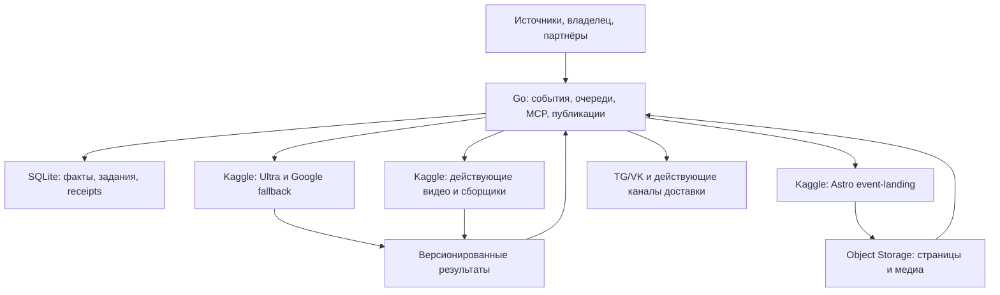

# Events-bot 2.0: целевая архитектура и программа безопасной переработки

**Статус:** предложение для обсуждения, не разрешение на production-переключение.  
**Дата исследования:** 17 октября 2026 года.  
**База исследования:** `main` репозитория `onedayonemasterpiece/events-bot-new`, commit `d431b9f86b87999cf27f74b99857d23aedc28f16`; отдельно обозначены незамерженные материалы Ultra.  
**Назначение:** определить состав 2.0, архитектуру, порядок доказательства качества и миграции, а также принципиальные вопросы владельцу. Реализация, модельные прогоны и изменение production в это исследование не входят.

## 1. Решение, которое предлагается

Events-bot 2.0 — **единое модульное Go-приложение для управления событиями, очередями, публикациями и MCP**, с существующей SQLite и тяжёлыми исполнителями на Kaggle. Это новая реализация работающей предметной модели; её накопленные правила и защиты становятся требованиями к новой реализации.

**Astro сохраняется.** На Kaggle он собирает отдельный профиль посадочных страниц событий. Go владеет данными, заданиями и подтверждённым состоянием публикации; Astro отвечает за HTML. Переписывание проверстанных событийных страниц на Go-шаблоны в первую очередь не предлагается.

Приоритет — сохранить полезный результат при меньшем постоянном потреблении ресурсов. Выигрыш должен получиться из сочетания компактного серверного процесса, ограниченных очередей и буферов, устранения повторной работы, выборочной статической сборки и сохранения тяжёлых вычислений на Kaggle. Сам по себе компилируемый язык не исправит неверный merge событий, потерянный результат ноутбука или повторную публикацию.

### 1.1. Зафиксированные требования владельца

| Требование | Проектное следствие |
|---|---|
| Целевое 1 CPU / 2 GB RAM | В этом бюджете проверяется весь обслуживающий процесс с дочерними процессами и SQLite; для размещения на общем RunCoveer отдельно учитываются ОС и соседние службы. |
| Сначала отработать промпты Ultra субагентами Codex | Первая содержательная стадия — лаборатория промптов и эталонных случаев, затем проверка реальных Kaggle-исполнителей, затем сборка комплекса. |
| Ultra, включая фестивальную очередь, на Kaggle | Детекция, извлечение, сопоставление и подготовка итогового текста выполняются там; сервер применяет проверенный план короткой транзакцией. |
| Сохранить Google Smart Update как fallback | Это самостоятельный семантический исполнитель общего контракта, работоспособный без доступного OpenCode. |
| Генерация статического сайта на Kaggle | На RunCoveer и DevCoveer не появляется постоянная Astro/Node-сборка. |
| Первая версия без полного KenigEvents | Публикуются событийные посадочные страницы без шапки-бирки, плавающего острова навигации и подвала. |
| В ежедневных анонсах ссылки на kenigevents.ru | Новую ссылку можно выдать после подтверждения публичной страницы, а не после постановки сборки в очередь. |
| Owner MCP, partner MCP, промо | Сохраняются полномочия, ограничения, состояние операций и бизнес-правила. |
| CherryFlash и CrumpleVideo | Существующие Kaggle-рантаймы не меняются; переносится управляющая обвязка с совместимыми контрактами. |
| Полезная информация с Kaggle | Сохраняются действующие сборщики, чтение комментариев и статистики, данные для популярности и видео. |
| БД пригодна для многолетней эксплуатации | Ограничивается техническая история и временные артефакты; полезные события, ссылки и доказательства не удаляются произвольным общим TTL. |
| Не переносить неиспользуемый функционал | Для исключения требуется свидетельство об отсутствии действующего обязательства; статус документа или отсутствие недавнего запуска сами по себе недостаточны. |
| Не деградировать реально работающие функции | Перед переключением нужна матрица соответствия и проверяемый перенос всех оставленных сценариев. |
| Supabase Edge остаётся на своём месте | Переработка не меняет размещение существующих Edge-функций, владельцев Supabase/YDB и контур персонализации. |

### 1.2. Что меняется относительно прежних материалов Ultra

Ветка Ultra описывала более ранний вариант развития действующего бота. Здесь требования владельца уточняют её: фестивали входят в обязательный объём 2.0; writer тоже работает на Kaggle; каноническими записями управляет Go; новые страницы событий публикуются на KenigEvents. Нельзя механически принять старую последовательность стадий или место исполнения writer как уже согласованное решение для 2.0. [S02]

### 1.3. Что считается завершением проекта

Проект завершён, когда сохранён согласованный набор действующих пользовательских сценариев, подтверждён ресурсный бюджет, проверено восстановление после сбоев, сохранены старые идентификаторы и публичные обязательства, а новый бот единолично управляет production-записями. Написанный Go-код, успешный prompt demo или запущенный стенд отдельно этого не доказывают.

## 2. Основания и границы исследования

Исследованы документация функций, управляющий код и договорённости репозитория, статический сайт, MCP, сохранённые материалы Smart Update Ultra и 18 отобранных записей об инцидентах. Это анализ текущего кода и исторических свидетельств; он не является новым production-бенчмарком или утверждением, что каждый исторический дефект воспроизводится сейчас. Статусы инцидентов в приложении отражают записи, а не результат повторного закрытия инцидентов. [S01] [S02] [I01]–[I18]

| Наблюдение | Что из него следует и чего оно не доказывает |
|---|---|
| Владелец подтверждает более года полезной работы бота | Предметную модель и накопленные защиты нужно сохранять. Это не означает, что каждая новая функция из реестра уже год работает в production. |
| Реестр содержит реализованные функции, research/rollout и черновики | Нельзя составить список удаления по одному перечню директорий. В частности, качественный анализ комментариев и уже работающие счётчики комментариев — разные возможности. [S01] |
| PR #723 и #724 Ultra на дату исследования открыты и не замержены | Это материал для проекта, а не принятая production-реализация. В #723 статус draft. [S02] [S03] |
| В лабораторных материалах Ultra есть пять нативных модельных trials и 21 unit test вспомогательного кода | Это не 21 доказательство семантического качества и не проверенный holdout всего конвейера CREATE/MERGE/replay/recovery. [S03] |
| Инцидент 14 октября зафиксировал около 881 MiB SQLite и около 3.3 GiB промежуточных PNG | Размер файла БД не равен RAM процесса. Здесь важная причина отказа — заполнение диска артефактами; quick_check БД прошёл. [I18] |
| В текущем коде уже есть защиты replay, отдельное соединение на транзакционный контекст и восстановление scheduler | Их нужно перенести, а не открывать заново под названием новой архитектуры. [S04] [S05] [S06] |

**Не установлены новым измерением:** реальное распределение заявленных 3 GB RAM по процессам/кэшу/дочерним задачам; достижимая память Go-версии; текущая частота использования всех периферийных функций; задержки и доступная ёмкость Kaggle в целевом режиме; RPO фактической цепочки резервного копирования. Числа ресурсного бюджета ниже — критерии проектирования и будущей приёмки, не результаты измерений.

В части эксплуатационных документов ещё встречается Fly-процесс выпуска, хотя текущая исследованная ветка уже содержит перенос и восстановление RunCoveer. Перед реализацией миграционный runbook нужно сверить с действующим владельцем запуска, а не восстановить старый Fly autostart по старой инструкции. [S07] [I17] [I18]

## 3. Состав первой версии

### 3.1. Сохраняемые и изменяемые возможности

| Возможность | Решение для 2.0 | Что обязательно сохранить |
|---|---|---|
| Telegram/VK/web/manual intake | Перенести управление и приём результатов | Источники, курсоры, частичный прогресс, альбомы, ссылки, правки, роли учётных записей; активные специализированные парсеры и обогащение билетных ссылок. |
| Smart Update | Два исполнителя: Ultra и Google fallback | CREATE/MERGE/NOOP, факты и provenance, identity, несколько событий из одного источника, сеансы/даты, отмены и переносы, approved media, содержательные логи результата. |
| Фестивальная очередь | Обязательна с первого принятого Ultra-контура | Целевая модель: серия → выпуск → программа → дочерние события; сохранение production-связей, отдельное состояние источников и детей; различение программы, отчёта, логистики и нового анонса. |
| Дайджесты и исходящие публикации | Перенести действующие варианты | Daily, weekend/month/thematic и отдельные TG/VK-посты; расписание, формат, медиа, premium/custom emoji там, где используются, исправления и ссылки. |
| Страницы событий | KenigEvents landing вместо новых Telegraph event pages | Текст, факты, даты/место, медиагалерея, билетные/регистрационные ссылки, OG/SEO, достоверный lifecycle и стабильный URL. |
| Агрегатные Telegraph-страницы | Сохранить до отдельной замены | Month/weekend/festival-страницы не исчезают вследствие замены event detail. Старые опубликованные ссылки продолжают обслуживаться. |
| Owner MCP и partner MCP | Перенести бизнес-сервис и совместимые инструменты | Аутентификация, actor/portfolio/scopes, ограничения, prepare/commit/status, история внешних операций, публикационная готовность. |
| Промокампании | Перенести | Период, eligibility, caps, fairness, подтверждённые размещения и их учёт, будущие фестивальные события, разрешённые партнёрские поверхности. |
| CherryFlash / CrumpleVideo | Сохранить notebook/runtime; перенести адаптер | Схема задания, выбор входных данных, run/kernel identity, итоговый артефакт, per-target publication receipts, повторная публикация без повторного рендера. |
| Статистика TG/VK | Сохранить сбор и потребителей | Просмотры, комментарии, реакции/лайки/репосты, покрытие, время наблюдения, популярность; NULL при отсутствии данных не превращается в ноль. |
| Kaggle status framework | Сохранить совместимость, упростить лишнее | Точные run tokens, heartbeat, terminal result, leases, восстановление по готовому результату и резервным JSONL-свидетельствам. |
| Telegram Business / stories | Сохранить действующий контракт | Webhook types, защищённое состояние business connections, цели публикации, корректные частичные результаты fan-out. |
| Операторские функции | Перенести действительно используемые | Ручное исправление, recent imports, управление очередями, источниками, промо и публикациями, объяснимый статус операции. |

Основания перечня: реестр функций, документация источников, публикаций, фестивалей, промо, статистики, видеоконвейеров и MCP. Он является начальным реестром переноса, который дополняется фактическими callers/schedules и потребителями данных перед реализацией. [S01] [S08] [S09] [S10] [S11] [S12] [S13]

### 3.2. Что не входит в первую публичную поверхность

Полный каталог KenigEvents, глобальный поиск, персональная лента, авторизация/онбординг сайта, клубы и другие функции полного сайта не становятся зависимостями первой событийной посадочной страницы. Существующие реализации, данные и договорённости этих проектов сохраняются. Это ограничение поверхности запуска, а не решение уничтожить персонализацию или перенести её backend на VPS. [S14]

`event-comment-feedback` описывает отдельный будущий анализ обсуждений; его нельзя выдавать за уже доказанный обязательный production-конвейер. При этом чтение комментариев и счётчики, нужные существующим потребителям, сохраняются. Producer `my-data-hub` с режимом default-off также не следует объявлять активно используемым без соответствующих свидетельств. [S01] [S15]

### 3.3. Как исключать ненужное без скрытой регрессии

Для Preview3D, Kenigsberg Stories, guide monitoring, VK cover, RegionTalk и других самостоятельных модулей нужен короткий паспорт: пользователь/потребитель, вход, результат, расписание/вызов, последние успешные и неуспешные операции, активные обязательства, сезонность, стоимость хранения. «Давно не запускалось» не доказывает ненужность сезонной функции. [S01]

Возможны четыре решения: перенести в Go; сохранить внешний исполнитель с совместимым Go-адаптером; отложить отдельную ещё не запущенную функцию; вывести из эксплуатации с явным основанием. Пока основание отсутствует, работающая возможность остаётся обязательством миграции. Нельзя назвать 2.0 завершённым, если её единственный исполнитель — старый бот, продолжающий независимо писать в ту же БД.

## 4. Целевая архитектура

Диаграмма показывает ответственность, а не обязательный новый транспорт. Существующие callbacks, datasets, object storage и публичный publisher используются там, где они уже дают нужный контракт.

| Часть | Место | Ответственность |
|---|---|---|
| Одно Go-приложение | RunCoveer | Bot/API/MCP, scheduler, durable queue/outbox, адаптеры, лимиты, применение событий, согласование результатов и публикаций. |
| SQLite и ограниченный рабочий диск | RunCoveer | Единственная каноническая запись событий и управляющего состояния; короткие транзакции, резервные копии, контролируемый retention. |
| Ultra и Google fallback | Kaggle | Модельная работа, recall/resolution и writer по общему контракту; нет прямого доступа на запись в production SQLite. |
| Astro event-landing | Kaggle | Сборка выбранных публичных событий из фиксированного snapshot и сохранение готовых артефактов. |
| CherryFlash, CrumpleVideo, полезные collectors | Kaggle, как сейчас | Существующие вычисления и результаты; перенос управляющего адаптера без переписывания runtime. |
| Публичные страницы и долговечные объекты | Существующее объектное хранилище / действующий publisher | Доставка страницы читателю, неизменяемые версии медиа, доказательства и архивы по политике хранения. |
| Общие квоты и существующие Supabase/YDB/Edge-сервисы | У текущего владельца | Go становится совместимым клиентом, не создаёт независимую конкурирующую власть над теми же данными и лимитами. |

### 4.1. Почему Go и почему единый модульный процесс

В целевом сервере основная задача — координация I/O, сравнительно короткая обработка структурированных данных и надёжное хранение переходов состояния. Go подходит для компактного исполняемого приложения с явными контрактами, ограниченной конкуренцией и диагностикой CPU/heap. Он позволяет переносить крупный связный backend без отдельного Python RPC-сервиса на каждую операцию.

Это архитектурный выбор, не измеренный коэффициент ускорения. Если задержка операции определяется Kaggle-очередью, моделью или внешним API, её не устранит замена языка. Rust имеет смысл как отдельная альтернатива при доказанном CPU/memory bottleneck, который Go не укладывает в бюджет; оснований одновременно вводить Go и Rust для данного проекта сейчас нет.

Модули внутри приложения: события и источники; scheduler/jobs; publishers; MCP/actors; promo; Kaggle adapters; storage/retention; quota client. Они используют один предметный сервис. Не вводятся обязательные Redis/Kafka, брокер микросервисов или новая распределённая транзакционная платформа. Существующая удалённая граница Kaggle остаётся границей тяжёлой работы.

### 4.2. Инварианты, которые важнее языка

1. Подтверждённый capture имеет долговечный серверный receipt и сохранённый источник либо проверенную ссылку на durable object. ACK и продвижение курсора происходят после согласованной регистрации; не сохранённые вложения остаются явными gaps. Окончание ноутбука не является единственным местом сохранения прогресса.
2. Один пост может описывать несколько самостоятельных событий или сеансов. URL источника не является уникальным ключом единственного Event.
3. Факт связан с источником, его ревизией, кандидатом/сеансом и ролью. Контекст фестивальной программы не доказывает тождество всех её детей.
4. Exact replay уже принятого результата при той же релевантной версии контракта возвращает прежний receipt без новых модельных вызовов и доменных/публикационных эффектов. Failed/incomplete стадии продолжаются адресно. Переоценка новой версией промпта/модели имеет отдельное основание и сохраняет исходную candidate identity.
5. Event, применённые факты, привязки источников, receipt применения и outbox-задания фиксируются одной короткой транзакцией одной БД.
6. Модель и сетевой вызов не выполняются внутри этой транзакции. Медленный внешний исполнитель не удерживает SQLite write lock.
7. Просроченный исполнитель не может применить результат после смены поколения задания; права и ревизии проверяются при commit.
8. Неизвестный результат внешней отправки сначала согласуется с провайдером. Тайм-аут не равен доказанному отсутствию публикации.
9. Построенная страница, загруженный видеофайл, запланированная публикация и публично доступный результат — разные факты.
10. Сбой одного источника, одного канала или housekeeping не уничтожает полезный результат соседних задач и не прекращает scheduler навсегда.

Основания: текущие state machine и replay-защиты, callbacks и публикационные контракты, а также инциденты источников, identity и восстановления. [S04] [S05] [S06] [S16] [I02] [I08] [I10] [I12] [I16] [I18]

### 4.3. Минимальный протокол работы

Источник сохраняет вход и медиа с hash/revision, затем выдаёт кандидаты. Планировщик выдаёт ограниченный lease с поколением и ссылками на необходимые данные. Kaggle возвращает валидируемый план изменения и сохранённый текст; Go проверяет права, входную и событийную ревизии, актуальность recall и поколение lease. После атомарного применения независимые outbox-потребители готовят страницу и выполняют допустимые публикации.

Имена `SourcePacket`, `SourceDecision`, `Recall`, `ChangePlan` описывают логические контракты. При реализации они сопоставляются существующим сущностям и ключам; ради терминов не создаются четыре новых сервиса или четыре дублирующие БД. Candidate/attempt ledger можно обновлять по стадиям независимо от Event, но окончательное применение и его receipt не расходятся.

**Гонка двух разных источников:** два задания могут одновременно не найти событие и создать дубль даже при безупречной идемпотентности каждого задания. Начальная простая стратегия — один активный resolver в домене сопоставления и версия identity-каталога, которую увеличивают все writers, включая ручной MCP. Изменение каталога между recall и commit делает решение устаревшим и требует повторного сопоставления. Транзакция сериализует только проверку и apply; ожидание модели происходит снаружи. Позднее ограничение можно разделить на независимые области после измерения реального bottleneck. [I02] [I08]

Доставка результатов — повторяемая; применение — идемпотентное. Обещание «exactly once» для Telegram/VK и сети не используется. У каждого внешнего результата есть правильное пространство идентификаторов: provider, target, вид объекта/namespace и native ID; scheduled и history нельзя смешивать. [I10] [I11]

## 5. Smart Update Ultra: сначала качество, затем комплекс

### 5.1. Лаборатория промптов Codex

Первый этап не требует переноса всего бота. Он создаёт версионированный набор входных свидетельств, ожидаемых доменных результатов и промптов. Исходные материалы инцидентов особенно полезны, потому что содержат ошибки, которые общий synthetic benchmark легко пропустит.

Работу можно разделить между Codex-субагентами: автор контракта/промпта, независимый проверяющий исходные факты и исследователь расхождений с legacy. Эталон формируется по источникам и правилам продукта. Ответ модели не становится эталоном только потому, что его согласовали другие модели; автор не является единственным судьёй своей версии.

Корпус делится по независимым группам источников и семействам событий. Один и тот же концерт в разных перепечатках не должен одновременно обучать настройку DEV и изображать независимый HOLDOUT. Случаи из прошлого запускаются с зафиксированным временем `as_of`, иначе фильтр «прошедшее событие» испортит сравнение. Число повторов модели и число независимых случаев отчёт показывает отдельно.

| Группа случаев | Требуемое различение |
|---|---|
| Один пост, несколько сеансов | Две реальные сессии не склеиваются и не теряются из-за UNIQUE(source_url). |
| Несколько источников одного концерта | Alias площадки, doors/start, разные билетные поставщики и новая редакция поста не создают лишние события. |
| Фестивали | Серия, выпуск, общая программа, дочерний анонс, отчёт и логистика имеют разные роли. |
| Изображения и альбомы | Даты и события на разных карточках не смешиваются; неполный OCR не превращается в выдуманный факт. |
| Неполный или поздний вход | Последний пост канала, задержавшаяся карточка альбома, правка источника и промежуточный результат дают объяснимое ожидание/обновление. |
| Билеты и регистрация | Сохраняются реальные URL, бесплатность/цена/условия, различаются отсутствие сведений и доказанное «бесплатно». |
| Identity и replay | Контекстная ссылка не даёт права merge; повтор и stale recall не портят идентичность. |
| Fallback | Чужой текст, оборванный JSON и семантически неверное предложение не принимаются как успех. |
| Промо фестивалей | Новый подходящий ребёнок становится eligible; концерт не подменяет образовательное событие. |

Это набор обязательных классов покрытия, а не произвольное требование одинакового количества примеров. Особо опасные ошибки — ложный merge, потеря реального ребёнка, выдуманная дата/цена и неверная публикация — рассматриваются отдельно от стилистического качества текста. Порог «средняя accuracy 95%» без структуры ошибок здесь непригоден. [I01] [I02] [I04] [I05] [I08] [I16]

### 5.2. Переход от промптов к реальному Kaggle

После стабилизации промптов фиксируются schema/version, ограничения входа и ожидаемая интерпретация ответа. Проверка повторяется на фактических разрешённых OpenCode-моделях и на Google fallback в Kaggle: изображения/альбомы, context/output limits, truncation, tools, тайм-ауты и реальная тарификация попыток могут отличаться от Codex-лаборатории. Успех Codex не подменяет эту стадию. Нельзя обходить отклонённый режим провайдера подменой клиентской идентичности. [S02] [S03]

Пригодная начальная конфигурация — ограниченные detector/resolver с одним OpenCode runtime в рамках соответствующего Kaggle-запуска, а не новый runtime на каждый фрагмент. Точная конкуренция выбирается после измерения. Для входа с изображениями первый содержательный vision-проход возвращает decision, прочитанный OCR и initial facts с привязкой к изображениям; resolver использует сохранённый результат. Дополнительное чтение изображений допускается при записанной причине неразборчивости или неоднозначности. Один содержательный проход не обязательно равен одному физическому API-запросу. [S02] [S03]

После модельной проверки небольшой Go-контур применяет планы к изолированной копии БД. Проверяются уже CREATE/MERGE/NOOP, конкуренция и recovery. Только затем переносится весь бот. Так пользовательское требование «сначала промпты» сохраняется, а успешный prompt demo не превращается в необоснованное разрешение строить весь продукт на непроверенном apply.

### 5.3. Общий контракт Ultra и Google Smart Update

Legacy-путь содержит не только запрос к модели, но и накопленную бизнес-логику. Его надо разобрать на семантическое решение и детерминированное применение. Google-исполнитель возвращает тот же тип плана, проходит те же identity/media/permissions-проверки и использует тот же commit. Вызов старой монолитной функции после Ultra опасен, если она самостоятельно снова пишет Event или публикует результат. [S04]

При сопоставлении с legacy проверяются факты, события, даты, ссылки, медиа и внешние эффекты. Байт-в-байт равенство сгенерированного текста не нужно. Подтверждённый старый дефект не становится требуемым поведением только потому, что это результат legacy.

### 5.4. Фестивальная очередь

Фестиваль хранит серию и конкретный выпуск; программа даёт общий контекст, а отдельные анонсы — кандидатов дочерних событий. Прогресс фиксируется по источнику, ревизии и ребёнку. Повторная обработка программы не должна пересоздавать всех детей, а появление нового ребёнка не должно требовать полного пересчёта уже принятых.

Это целевая нормализованная модель: текущий production хранит выпуски через существующий `festival`, а полная `festival-edition-v2`/programme-модель обозначена preproduction. Миграция сохраняет действующие связи и идентичности. Экспериментальный non-social collector без принятого public apply и ещё не запускавшийся production Kaggle-collector не объявляются уже работающими обязательными функциями. [S09]

Успешные дети сохраняются независимо; parent не объявляется полностью завершённым, пока обязательные children/lifecycle actions не разрешены. Для оставшихся явно фиксируется продолжимое состояние; частичный успех не стирается при повторном запуске родителя.

Recap прошлого мероприятия, предупреждение о парковке и будущий анонс различаются по смыслу. Дата общего фестивального окна не превращается автоматически в точное время каждой лекции. Промо использует живую eligibility-проверку по выпуску и типу события, сохраняя фактические caps; зафиксированный однажды список ID не исключает новых подходящих детей. [S09] [S10] [I03] [I04] [I05]

## 6. Fallback и недоступность ресурсов

| Отказ | Поведение |
|---|---|
| OpenCode недоступен или исчерпал разрешённый бюджет, Kaggle работает | Незавершённая работа переходит Google Smart Update с общим контрактом. |
| OpenCode вернул неверное решение | Повторяется нужная семантическая стадия по сохранённому источнику; неверный Ultra-план не принимается за надёжную основу fallback. |
| Google временно недоступен, OpenCode-стадии Ultra работают | Продолжаются независимые допущенные стадии. Если недоступен обязательный Google writer, факты сохраняются, но новая публичная ревизия ждёт writer; ранее готовые публикации продолжаются. Замена writer другой моделью требует предварительной приёмки. |
| Оба модельных ресурса недоступны, Kaggle доступен | Источник и задание остаются сохранёнными; показывается реальное ожидание. Работа с уже готовыми данными продолжается. |
| Kaggle целиком недоступен | Ни Ultra, ни размещённый там Google fallback не работают. Статическая сборка тоже ждёт; текущие публичные страницы остаются. |
| Модельный результат готов, callback потерян | Сначала ищется и принимается точный готовый результат; новый модельный прогон не является первым способом восстановления. |
| RunCoveer/каноническая БД недоступны | Исполнитель может сохранить результат, но не объявляет его применённым. Повторная доставка после восстановления проходит тот же idempotent commit. |
| Общая власть квот недоступна | Новые платные/ограниченные модельные вызовы не выполняются вслепую. Чтение, готовые материалы и независимые операции не обязаны останавливаться. |

Переключение исполнителя — смена исполнителя **того же задания**, а не параллельный второй импорт. Прекращается выдача старых leases, согласуются неизвестные результаты, истекает или отзывается lease, повышается поколение; поздний ответ прежнего поколения не может записать результат. Подтверждённые OCR/факты переиспользуются, незавершённые стадии продолжаются, а не обнуляется весь процесс.

Сохраняемый проектный выбор writer в Ultra — Google; меняется его место выполнения на Kaggle. Поэтому два маршрута не полностью независимы и по этому ресурсу. Недоступность общего writer/limiter не маскируется словом fallback. [S02]

Google fallback регулярно включается в проверку совместимости релизов и на фиксированных контрольных случаях. «Запасной» код, не проходивший реальный путь месяцами, не считается доказанной страховкой. При этом такая проверка не означает постоянный двойной прогон каждого production-события и двойную стоимость.

**Принципиальная граница:** размещение обоих исполнителей на Kaggle защищает от нехватки OpenCode, но не от недоступности Kaggle как платформы. Этот проект не добавляет скрытый VPS-исполнитель или перенос Edge. Продуктовое поведение при общем простое описано в разделе 17.

## 7. Посадочные страницы KenigEvents и роль Astro

### 7.1. Что уже есть и что действительно нужно отделить

Существующая страница `site/src/pages/sobytiya/[slug].astro` уже содержит основу события. Но `EventLayout.astro` подключает глобальные элементы и runtime полного сайта: навигацию, PWA, авторизацию, персонализацию, онбординг и другие зависимости. Удаление видимых шапки и подвала само по себе не устраняет эти подключения. [S17]

Основной текст, факты, медиа, даты и действия уже формируются из статического snapshot; авторизация посетителя для выдачи этого содержимого не требуется. [S17]

Нужен явный профиль `event-landing` или отдельный минимальный layout, который использует общий дизайн и событийное содержимое. Выключенные возможности отсутствуют в HTML, импортах, preload, клиентских скриптах и сетевых запросах, а не спрятаны через CSS. Изменение оформляется как поддерживаемый профиль существующего сайта; копирование всей страницы в независимый визуальный fork создаст последующее расхождение исправлений. [S14] [S17]

| Оставить на landing | Не подключать ради запуска первой версии |
|---|---|
| Название, достоверный текст, даты/сеансы, место, возраст/условия при наличии фактов | Глобальную шапку-бирку, плавающий остров навигации, подвал |
| Approved media, галерею, источник там, где он публично допустим, билетную/регистрационную ссылку | Runtime персонального профиля и авторизации, онбординг, персональную ленту |
| Мобильную/desktop-доступность, понятные действия, OG, canonical, структурированные данные | Каталог/клубы/прочие страницы полного сайта как обязательную часть каждой сборки |
| Поддерживаемые календарные действия, перенос/отмену, стабильные идентификаторы | Кнопки с обещаниями ещё не подключённой функции и скрытые тяжёлые SDK |

Содержательные удобства страницы нельзя удалить под видом отсутствия навигации. Например, существующую регистрацию или актуализацию отмены нельзя заменить чисто декоративной карточкой. Дополнительный транспортный блок может оставаться статическим при наличии принятых данных; он не должен заставлять запускать поиск/ML ради обычного просмотра события.

### 7.2. Почему сборка может стать быстрее без замены Astro

В исследованном пути production candidate есть несколько последовательных Astro-сборок для разных поверхностей; библиотека событий повторяет сортировки и построение структур поиска; build-зависимости включают инструменты, нужные более широкому тестовому окружению. Это конкретные кандидаты на уменьшение работы, а не измеренный выигрыш новой сборки. [S18]

Предлагается:

1. Экспортировать компактный неизменяемый snapshot только нужных событий и зависимостей, с ревизиями и hash. Kaggle не держит открытую production-транзакцию на всё время сборки.
2. Создавать индексы `byId`/`bySlug` один раз на snapshot; не сортировать каталог и не создавать полные копии для каждого detail lookup.
3. Объединять накопленные изменения в ограниченные пакеты. Отмена/перенос имеет повышенный приоритет, но новый пост не создаёт немедленно ещё одну полную сборку всего сайта.
4. Для `event-landing` иметь собственный route manifest и сборочную команду. Уже существующий `getStaticPaths`, перечисляющий все события, сам по себе не станет инкрементальным от смены переменной окружения.
5. Кэшировать зависимости по lockfile, разделить build и mobile/browser test environment. Не скачивать ненужные Appium-компоненты в каждый рабочий build.
6. Проверять контракт landing: ссылки, медиа, семантические данные, public scope, мобильное/desktop-отображение и фактическую доступность. Глобальные условия ещё не выпускаемого полного сайта не превращаются в три обязательных полных сборки landing. Изменение профиля проверки должно быть явным, а не скрытым ослаблением проверок.
7. При потерянном callback принимать уже готовый артефакт. Одинаковый детерминированный отказ на том же SHA и snapshot не должен порождать шторм одинаковых пересборок. [I06] [I07]

Измерять нужно отдельно queue/startup, install, export, render, upload и public verification. Если доминирует ожидание Kaggle, ускорение шаблонов не даст аналогичного ускорения от правки события до публичного URL. Для быстрой отладки нужен маленький фиксированный preview-набор и повторное использование окружения; production и preview имеют раздельные цели публикации.

### 7.3. Стабильные ссылки и подтверждение публикации

Публичный путь закрепляется за событием и не меняется при исправлении заголовка. Сохраняются Event ID, существующие публичные связи и registry slugs/aliases. Merge оставляет корректный alias/redirect, отмена обновляет страницу и поддерживаемый календарный статус, завершённое событие становится честным архивом. Реальное удаление имеет отдельную политику; массовый redirect старых событий на главную не является сохранением ссылок.

У страницы есть подтверждённая публичная ревизия. `built` и `secret preview published` не равны `promoted/public`. Текущий MCP уже различает подобные состояния и не должен утечь preview-токеном в партнёрский `public_url`. [S13]

Порядок публикации: сохранить неизменяемые зависимости, затем HTML/указатель версии, проверить доступность публичного результата, сохранить receipt с event revision и manifest hash. Предыдущая хорошая версия остаётся доступной до подтверждения следующей. Публикация ограничена собственным prefix/manifest событий и не удаляет главную страницу или посторонние объекты сайта.

Это требование, а не утверждение о готовой атомарной возможности текущего publisher. При реализации надо проверить его реальные гарантии. Для независимых event pages может быть достаточно атомарной замены отдельного объекта и версионированных assets; атомарность всего каталога при этом не обещается. Новый полный инфраструктурный blue/green-комплекс вводить без необходимости не следует.

### 7.4. Замена ссылок в анонсах

В действующем коде выбор ссылки различается: daily, другие digests, event utilities и promo/media-пути используют разные приоритеты Telegraph и источников. Глобальный поиск и замена `telegraph_url` может повредить provenance или рабочие агрегатные страницы. [S19]

Нужен один предметный resolver с назначением ссылки: detail события, первоисточник, native social post или aggregate page. Для нового event detail он возвращает подтверждённую landing page. Изменение проверяется на всех потребителях: TG/VK daily, отдельные посты, weekend/month/thematic, promo, видео и MCP — в пределах того, где они действительно публикуют detail URL.

Исторические опубликованные сообщения не редактируются массово. Старые Telegraph event pages обслуживают уже выданные ссылки; создание новых переключается после готовности landing. Обвязку Telegraph можно удалять только после ухода её последнего действующего потребителя, включая агрегаты и media extraction. Прежний 10-дневный план cutover — историческое предложение полного сайта, а не автоматически принятый график этого проекта. [S14] [S19]

### 7.5. Ежедневный слот и недоступный builder

Страницы подготавливаются до слота, а готовые результаты принимаются прежде новых запусков. Для уже опубликованного события можно использовать подтверждённую текущую страницу, если она не содержит критически устаревших условий: отмена, перенос или неверная регистрация требуют отдельного решения, а не слепого `last good`.

Для нового события, ещё не имеющего страницы, одновременные обещания «сборка только Kaggle», «все ссылки уже KenigEvents» и «любой ежедневный выпуск всегда вовремя и полностью» несовместимы с общим простоем Kaggle. Предложение для согласования: выпускать готовую часть в слот, незавершённые события сохранять как явное обязательство дополнительного выпуска, сообщая владельцу причину. Это **не принятое разрешение сокращать анонс**: фундаментальный выбор фиксируется в разделе 17 до cutover.

## 8. MCP, промокампании и сохраняемые Kaggle-функции

### 8.1. Owner и partner MCP

Обе поверхности используют один доменный сервис Go. Актор определяется проверенной авторизацией; model input не может сам назначать себе tenant, владельца события или scopes. Ограничения портфеля и разрешённые действия повторно проверяются при commit, включая случаи изменения прав между подготовкой и выполнением.

Сохраняются аудитория токена, PKCE/expiry/refresh rotation, связи партнёра, права доступа и подготовленные операции. Owner, partner и read-only Codex не сливаются в роль «MCP user». Production-доступ Codex к доказательствам не превращается в право редактирования только из-за использования Codex в лаборатории промптов. [S13] [S20]

Статус операции различает принятие команды, применение данных, сборку страницы, постановку публикации и фактический результат. Загрузка медиа привязана к principal, digest и сроку; target передаётся в проверенном контексте, не наследуется случайно от последнего запроса. UNKNOWN-send согласуется перед повтором. Партнёрские promo-поверхности `video_general` и `vk_repost` не расширяются автоматически при переносе. [S10] [S13] [I11]

Owner Social Workspace — целевые чтения TG/VK, комментарии, аналитика, медиа и разрешённые социальные действия — инвентаризируется отдельно и не удаляется автоматически как дублирующая поверхность. Объявленный набор capabilities конкретного текущего подключения — свидетельство доступного контракта, а не доказательство выполнения отправки или общего состояния publisher бота. [S13]

Официальный Go SDK MCP уже существует; при реализации нужно выбрать закреплённую версию, совместимую с реально используемыми клиентами и OAuth-потоком. Самостоятельная реализация протокола с нуля не является целью проекта. В текущих материалах принятие ядра partner operations и не выполненная live-проверка конкретного партнёрского провайдера обозначены отдельно; их нельзя объединять в «всё уже проверено годом эксплуатации». [S13] [W04]

### 8.2. Промокампании

Сохраняются намерение кампании, интервалы, допустимые типы событий, приоритеты, caps и история фактических выходов. Участие в построенном плане не равно показу: расход кампании фиксируется по принятому контракту фактического размещения. Повторный delivery receipt не расходует cap ещё раз; UNKNOWN остаётся на согласовании.

Единица promo exposure означает предусмотренное контрактом размещение, а не измеренное число браузерных просмотров. Viewer-facing результат определяется контрактом и receipt, не только названием статуса: некоторые legacy test-публикации тоже были видны аудитории. [S10] [S13]

Для фестиваля eligibility вычисляется по живому составу и условиям кампании. Новая лекция может войти позже, но это не разрешает заменить её любым концертом того же фестиваля. Отдельные consumer-пути должны использовать общий selection contract, иначе одна и та же кампания снова будет вести себя по-разному в video, digest и native publication. [S10] [I03] [I04]

### 8.3. CherryFlash и CrumpleVideo

Рантаймы на Kaggle остаются прежними. Для Go-адаптера фиксируется краткий контракт каждого: входной dataset и его версия, kernel/run identity, роли сессий, callbacks/heartbeat, признаки готовности, итоговые artifacts и допустимые внешние действия. Неизменный notebook не спасёт функцию, если host передал другой target или смонтировал вчерашний input. [S11] [S12]

Адаптер учитывает пагинацию результатов, проверку фактически смонтированного входа и прикладную ошибку Kaggle внутри формально успешного HTTP-ответа. Завершённый рендер сохраняется независимо от успешности доставки. При сбое одной публикационной цели используется готовое видео и её receipt; Blender и модели повторно не запускаются. На сервер забираются нужные итоговые файлы, а не весь каталог PNG-кадров. [I18]

Приёмка сначала читает сохранённые реальные входы/выходы новым адаптером, затем проверяет ограниченный интеграционный сценарий на правильной тестовой цели. Изменение runtime CherryFlash/CrumpleVideo не включается скрыто в проект как условие оптимизации сервера.

### 8.4. Комментарии, статистика и другие полезные collectors

Сохраняются данные и их потребители, а не только названия cron-задач. Для статистики важно различать источник и собственную публикацию, сохранять наблюдаемый момент, полноту покрытия и отсутствие данных. Группировка запросов по платформе/читателю и короткие пакетные записи уменьшают работу без потери смысла.

Reader-учётные записи отделены от publisher. Ошибка или cooldown статистического VK-читателя не должны блокировать ежедневный publisher; общая Telegram auth session не используется одновременно независимыми активными исполнителями. Общий cooldown действует между запусками одной resource lane, а успех одной платформы не маскирует отказ другой. [S08] [S21] [I14]

Эта же таблица контрактов применяется к каждому сохранённому вспомогательному Kaggle-job: зачем нужен результат, кто его потребляет, где сохраняется прогресс и как принимается уже готовый результат. Удаление «обвязки» допускается только после проверки, что полезные комментарии, статистика и downstream ranking не исчезнут.

## 9. Лимиты, очереди и справедливое распределение ресурсов

Существующий Google-контракт `reserve → mark_sent → provider → finalize` сохраняется с общей властью лимитов. Scope квоты задаётся реальным Google project/model, а не новым именем API-ключа. Go-клиент не заводит собственные несогласованные счётчики. Logical request ID и ID фактически отправленной попытки различаются; смена модели правильно отражается в учёте. [S20] [S22] [I15]

Три ресурса планируются раздельно: локальные CPU/RAM/I/O; Kaggle slots/время исполнителя; разрешённые модельные квоты. Освободившаяся квота модели не означает, что доступен Kaggle-slot. Время ожидания сохраняется как `next eligible`, не удерживая рабочую goroutine, сеть или lease вычислителя без необходимости.

У логического задания один ограниченный бюджет попыток и deadline. Нельзя получить произведение retry SDK × retry adapter × retry worker. 429 и временная недоступность ведут к продолжимому ожиданию, а не к `no_event`/успешному завершению. Неизвестный результат фактической отправки не списывается в ноль при переключении route.

Текущие обязательства — ежедневная публикация, критическая отмена/перенос, принятие готового результата — получают приоритет над повторным запуском фоновой работы. При этом у фестивальной очереди, статистики, видео и housekeeping остаётся гарантированный доступ к ресурсу: бесконечный поток срочных заданий не должен навсегда остановить остальные.

Учитываются фактические helper-model calls OpenCode, truncation и полезный завершённый результат. Снижение допустимого output только ради прохождения reservation не является оптимизацией, если оно приводит к повторному запуску. Запасной маршрут использует только уже разрешённые ресурсы, без автоматического перехода на произвольную платную модель. Никакой дополнительный универсальный routing-framework не нужен, пока это можно выразить существующим authority и несколькими типами заданий.

## 10. SQLite, хранение и резервное восстановление

### 10.1. Сохранить SQLite, изменить дисциплину работы

Менять одновременно язык, движок БД и предметную модель — увеличивать количество независимых причин миграционного сбоя. Для одного управляющего приложения с короткими записями SQLite остаётся подходящим первым выбором. Переход к иной БД требует конкретного измеренного ограничения, которого это исследование не установило.

Текущая конфигурация использует WAL, `synchronous=NORMAL`, `NullPool`, настройку page cache порядка 40000 KiB, `temp_store=MEMORY` и mmap 128 MiB. Это настройки отдельных ресурсов, а не доказательство такого же постоянно занятого RSS. Текущий `raw_conn` уже выделяет соединение на контекст; перенос старой глобальной connection-модели был бы регрессией. [S05]

В Go один владелец записи и небольшой ограниченный read pool; все соединения получают нужные pragmas, foreign keys и bounded busy handling. SQL-миграции сохраняют ID и семантику NULL/отсутствия, времени/часовых поясов, денежных значений и JSON. Финальная критическая транзакция не пересекает несколько независимо коммитящихся SQLite-файлов.

WAL допускает параллельное чтение, но writer в каждый момент один; длительные читатели могут мешать checkpoint. Поэтому Kaggle получает согласованный immutable export, а не живую БД по сетевой файловой системе. В WAL требуется общий локальный host. [W01]

Для подтверждений, которые должны пережить внезапный сбой питания/ОС, предлагается оценить `synchronous=FULL` и подтверждать durable ACK только после успешного commit. `NORMAL` в WAL защищает согласованность, но имеет другую гарантию сохранения последних commit при таком сбое. Это не заменяет off-host backup и не обещает нулевую потерю при физической утрате диска. [W01] [W03]

Выбор SQLite-драйвера Go включает проверку фактически встроенной версии SQLite, а не только версии Go-модуля. Официальная WAL-документация описывает исправление редкого WAL-reset дефекта в 3.51.3 и соответствующих backport-релизах; версия действующего runtime этим исследованием не измерялась, поэтому вывод о его уязвимости не делается. Выбор cgo/другого драйвера определяется совместимостью и измерением, не лозунгом «один бинарник». [W01]

В `Database.__init__` обнаружен путь перехода в временную директорию при `PermissionError` создания каталога, помеченный комментарием для локальной работы. Это наблюдение кода, не установленная причина production-инцидента. Для 2.0 production-путь БД должен быть однозначным: недоступная каноническая БД делает readiness отрицательным, а не незаметно создаёт пустую временную БД. Test fallback допускается только явно в тестовом окружении. [S05]

### 10.2. Хранить разные классы данных по разным правилам

В октябрьском снимке крупные части SQLite включали raw VK packets около 199 MiB, events 102 MiB, candidate state 95 MiB, Kaggle history 42 MiB, ops 32 MiB. Эти значения относятся к конкретному историческому состоянию; они не являются сегодняшним RAM-профилем и не объясняют весь размер БД. Августовская доля raw packets 96.82% относилась к отдельному интервалу роста, а не ко всей БД на все времена. [I09] [I18]

| Класс | Политика 2.0 |
|---|---|
| Канонические события, текущие факты, Event ID, URL/aliases, публикационные IDs | Сохраняются на срок существования бизнес-обязательства. Старое опубликованное событие имеет компактную архивную страницу. |
| Source bindings, применённые revision hashes, минимальные receipts/tombstones | Хранят возможность распознать допустимый исторический replay; срок не короче реального окна replay. Архивные идентичности не исчезают из-за TTL диагностических логов. |
| Pending/UNKNOWN/активные leases и незавершённые обязательства | Не удаляются общим возрастным правилом. Сначала согласование/явное завершение с минимальным доказательством. |
| Крупные raw packets, OCR и исходные доказательства | Переносятся в content-addressed object storage без потери содержимого; SQLite хранит locator/hash/revision и нужные индексы. Сначала проверяется запись и чтение архива, затем удаляется крупная горячая копия. |
| Успешные подробные traces/attempt history | Ограниченное окно для разбора, затем компактные агрегаты и необходимые receipts. Конкретные TTL выбираются по replay/debug obligations и измеренному объёму. |
| Failed/partial traces | Сохраняется полезное доказательство до разрешения и установленного grace-периода; большие дубли не обязаны копиться бесконечно. |
| Heartbeats | Текущее состояние обновляется компактно; избыточная история успешных завершённых запусков ограничивается. |
| Кэши и embeddings/projections | Key включает версии источника/модели/промпта; byte cap, TTL/LRU и безопасное восстановление. Локальные ML-модели ради кэша не появляются. |
| Render frames, временные datasets/outputs | Удаляются после подтверждённого результата и grace-периода; для publish-only retry сохраняется нужный конечный файл. |
| Public assets и last-good страницы | Сохраняются пока на них ссылаются страницы, действующие jobs или обязательства rollback/backup. |

В текущем коде уже есть узкий retention для успешных heartbeat/alive-записей старше 30 дней с ограниченным batch; failed/partial/unknown не вычищаются тем же правилом. Эту осторожность следует сохранить, расширяя политику по классам данных. [S23]

Удаление объектов учитывает активные leases, ещё не завершённые загрузки, текущие и предыдущие публичные версии, backups. Схема «объект не найден в таблице — сразу удалить» способна уничтожить upload между записью объекта и commit ссылки. Нужны согласованные ссылки, grace и повторяемый mark/sweep в существующем maintenance, а не новая платформа хранения.

Долгосрочная экологичность означает ограниченный рабочий набор и предсказуемый рост полезного архива. Полезный архив реальных событий может расти; обещание постоянного объёма всех данных при бесконечном поступлении событий было бы ложным. Контроль показывает строки/bytes по классам, размер индексов, WAL/checkpoint age, свободный диск, объём временных outputs и скорость прироста.

### 10.3. Maintenance и backup

VACUUM выполняется по потребности и при достаточном свободном пространстве; текущая безопасная процедура уже учитывает дополнительное место и checkpoint. Нельзя регулярно запускать полный VACUUM без бюджета или удалять WAL-файл вручную как способ очистки диска. [S05]

Существующий RunCoveer backup использует SQLite Backup API и проверку копии; выгрузка в Kaggle имеет защищённый dataset и сохранённое намерение/результат. Но сохранение всех dataset versions без удаления требует отдельной ограниченной политики удалённой истории. [S24] [W02]

Резервирование должно охватывать согласованную БД, долговечные blobs/manifest, нужную конфигурацию и секреты в защищённом хранилище. Успешный upload или `quick_check` отдельно не доказывает восстановление предметной целостности: пробное восстановление проверяет source bindings, outbox/UNKNOWN, aliases и доступность нужных assets.

Если резервная копия существует только в Kaggle, отказ платформы затрагивает и путь восстановления. Следует оценить использование уже имеющегося объектного хранилища для зашифрованной независимой копии. Периодичность определяется согласованным RPO и стоимостью/дисковым запасом; произвольная часовая полная копия почти гигабайтной БД не объявляется бесплатной. Решение об RPO вынесено в раздел 17.

## 11. Ресурсная модель 1 CPU / 2 GB RAM

### 11.1. Откуда ожидается экономия

| Изменение | Ожидаемый механизм | Что измерить |
|---|---|---|
| Единый Go backend | Уменьшение постоянного runtime/import footprint и лишних процессов | Idle/steady/peak память всей службы; CPU на одинаковый полезный объём |
| Ограниченные очереди, страницы SQL, потоковое media I/O | Устранение полного каталога, всех медиа и результатов в RAM | Peak memory при большом импорте и медленном downstream |
| Durable progress и reuse результатов | Меньше повторных модельных запусков и рендеров | Calls/CPU-seconds/bytes на успешно принятый источник и публикацию |
| Выборочная Astro-сборка на Kaggle | Меньше маршрутов, повторных индексов, install и сборочных проходов | Время от изменения до verified public page; доли queue/install/render |
| Retention и bounded disk artifacts | Нет отказа scheduler из-за бесконтрольных временных файлов | Свободный диск, retained intermediates, темп роста БД и архива |

**Ни коэффициент сокращения RAM, ни ускорение ×N этим документом не обещаются.** Заявленные 3 GB текущего размещения ещё нужно сопоставить с измерением процессов, cgroup, файлового кэша и дочерних задач. Меньший image/binary не равен меньшему RSS, а меньший heap не равен меньшей памяти всей службы.

Go GC также расходует CPU и память. `GOMEMLIMIT` — мягкий лимит runtime, а не жёсткий предел всего процесса; native/SQLite memory и отдельные процессы требуют запаса. Современный Go учитывает CPU quota при выборе `GOMAXPROCS`, но конкретный runtime и фактическую настройку в 1 CPU окружении всё равно фиксируют и проверяют. [W05] [W06]

### 11.2. Предварительный бюджет общего RunCoveer

Ниже пример распределения **2000 MB**, а не измерение текущего хоста и не уже выставленные лимиты. Если провайдер предоставляет 2 GiB, учёт при приёмке ведётся в байтах; обозначения GB/GiB не смешиваются.

| Назначение | Проектный резерв |
|---|---:|
| ОС, базовые службы, файловый/сетевой запас | 350 MB |
| Соседние постоянные службы, включая Kotopogoda при совместном размещении | 200 MB |
| Events-bot со SQLite и всеми дочерними процессами, рабочий peak envelope | 850 MB |
| Нераспределённый запас на пики и отличие реального профиля | 600 MB |
| Всего | 2000 MB |

Значения уточняются по измерениям соседа и приложения. Если уже нужный сосед превышает резерв, это не разрешение выключить его: пересматривается бюджет/реализация. Цель экономии проверяется по cgroup/службе и хосту, не по одному графику Go heap. Неограниченные headless browsers, локальные модели, Astro build и загрузка всех кадров видео не должны быть скрытой частью сервера. Если действующему нужному parser действительно требуется браузер, перенос его выполнения во внешний ограниченный исполнитель должен сохранить тот же результат.

На одном CPU конкуренция помогает переживать сетевое ожидание, но не создаёт вычислительные ядра. Число одновременно выполняемых CPU/DB/media-работ ограничено; крупные партии режутся так, чтобы команды и публикационный слот продолжали обслуживаться. Уменьшение памяти не должно достигаться бесконечным ожиданием очереди.

### 11.3. Что будет проверяться

На одинаковом зафиксированном входе и наборе включённых функций: полезные события/источники в единицу времени, время p50/p95/p99 стадий, свежесть источников, задержка daily slot, CPU-seconds, peak/steady memory, bytes I/O, число реальных model calls и повторных builds. Для внешних providers отдельно показываются queue/service time, чтобы сеть или новая модель не изображали эффект языка.

Нужен совместный сценарий: крупный импорт, поступление готовых Kaggle-результатов, owner/partner чтение/команда, статистика и наступивший daily slot. Проверка в пределах 1 CPU/2 GB включает backlog drain и отсутствие OOM/неограниченного роста, а не только пустой idle. Длительная проверка охватывает повторяющиеся расписания и housekeeping; конкретная длительность определяется покрытием реальных циклов, а не обещанием «год надёжности» по суточному smoke.

## 12. Стенд DevCoveer и порядок реализации

DevCoveer — временное место проверки, а не перенос production и не новое место тяжёлых вычислений. Первый стенд содержит только Ultra, Google fallback, общий Go-apply и необходимые read/status-инструменты. Он использует отдельную SQLite-копию, отдельные очереди/leases, dataset prefixes, callback identity и тестовые назначения; public publisher по умолчанию заменён сохраняющим намерения test adapter.

Продакшен-сессии Telegram не копируются в одновременно работающего активного клиента; credentials минимальны и соответствуют роли. Из копии данных исключаются ненужные секреты. Результат лаборатории нельзя доставить в production по совпадению event ID или run ID: окружение входит в проверенный контекст доступа и задания. [S20]

Для совместного размещения на DevCoveer предварительный стартовый предел такого стенда — до 0.5 CPU и 768 MB всей службы, включение по необходимости. Это ограничение лаборатории, а не замер достаточности и не окончательный capacity gate. Локальные модели, Astro build и медиарендер туда не добавляются. Задачи Миры с голосом/RAG и работа разработки сохраняют свой ресурсный запас; итоговая проверка полного 1 CPU/2 GB профиля проводится отдельно в подходящем изолированном окне, без попытки воспроизвести всю нагрузку рядом с активными аудиосоединениями.

### 12.1. Стадии и проверяемые результаты

| Стадия | Результат | Условие перехода |
|---|---|---|
| A. Зафиксировать обязательства | Реестр функций/потребителей, input-output contracts, различающие incident cases, контрольный snapshot | Для всех явно запрошенных функций известен результат; неизвестный периферийный scope явно отмечен. |
| B. Codex prompt lab | Версионированные промпты, источник эталонов, DEV/HOLDOUT, журнал ошибок и исправлений | Нет неразобранной критической ошибки в обязательных случаях; результат не зависит от утечки holdout или самооценки автора. |
| C. Реальные исполнители Kaggle | Ultra и Google fallback на том же корпусе, фактические model/runtime versions, стоимость и ограничения | Семантика и полнота контракта подтверждены отдельно для обоих путей; отказ доступности не превращается в потерю материала. |
| D. DevCoveer Ultra + fallback | Небольшой Go-apply, изолированная БД, source/identity/replay/lease recovery | Корректные rows/bindings/receipts/outbox, поздние ответы и смена исполнителя безопасны. |
| E. Полный необходимый backend | Управление источниками, scheduler, MCP, promo, сохранённые notebook adapters | Дифференциальная проверка оставленных пользовательских сценариев и правильных target/actor. |
| F. Landing publication | Astro-профиль, стабильные URL, выборочная сборка, preview/public receipts, link resolver | Из анонса открывается подтверждённая страница; site shell отсутствует фактически; отказ builder не теряет последний полезный результат. |
| G. Полный rehearsal | Миграция на копии, recovery, сохранение новых записей при откате, resource/retention/restore report | Все критические обязательства покрыты, 1 CPU/2 GB подтверждены на полной комплектации. |
| H. Контролируемое переключение | Один production writer, сохранённые IDs/очереди/внешние обязательства | Продуктовый readback и восстановление проверены; старый owner не может автоматически ожить. |

Стадии E и F могут частично выполняться параллельно после закрепления контрактов. Обязательная последовательность — сначала смысловой контракт/промпты, затем реальная модельная проверка, затем доверие к production-записи. Это не требует построить новый общий framework до первого полезного результата.

## 13. Миграция и откат без потери работающего

### 13.1. До переключения

Сначала переносится поведение в изолированную реализацию; Python production продолжает работу. Go читает фиксированные копии/сохранённые входы и пишет только своё состояние. Shadow-режим не делает production-send, не резервирует рабочие target-specific задания и не запускает конкурирующий сборщик на той же активной auth session.

Схема меняется добавлениями настолько, насколько возможно; drop/rename старых данных не объединяются с первым переключением. Сохраняются Event IDs, source/occurrence identity, slugs/aliases, external IDs, права, кампании, расписания, очереди и минимальная история применения. Нельзя переимпортировать всё заново с новыми ID и назвать это сохранением данных.

Перед переносом каждого notebook проверяется не только функция парсинга JSON, но и реальные сохранённые вход/выход/ошибки, token/lease ownership и downstream-эффект. Перед заменой конкретной функции есть ссылка на её приёмку; отсутствие реализации закрывается до полного cutover либо отдельно согласованным исключением scope.

### 13.2. Переключение writer

1. Зафиксировать текущий executable/image SHA, схему и restore point; убедиться в наличии места и проверяемой копии.
2. Остановить выдачу новой работы старым scheduler, установить короткое управляемое окно; принять или зарегистрировать уже готовые результаты, зафиксировать active/UNKNOWN и внешние операции.
3. Остановить старого владельца записи и исходящих действий. Проверить autostart, supervisor/container/recovery policies и старые хосты: одного `stop` недостаточно. [I17]
4. Выполнить совместимые миграции, включить нового владельца с нужным поколением leases, принять незавершённые обязательства.
5. Проверить чтение/изменение события, состояние очередей, доступность страниц, правильность target/actor и выполнение текущего публикационного обязательства.
6. Продолжать наблюдение за фактическим прогрессом, повторными callback и backlog; не считать один ответ `/health` доказательством миграции.

Late Kaggle results согласуются с текущим владельцем/поколением; нельзя освободить successor lease запоздавшим terminal callback прежнего запуска. Если callback API URL меняется, прежний допустимый путь приёма на время уже выданных работ должен либо продолжать безопасно маршрутизировать результат, либо иметь явный способ readback; готовые outputs не бросаются. [S16] [I06] [I12]

### 13.3. Что означает безопасный rollback

После новых записей Go **нельзя возвращать вчерашний snapshot БД** как штатный откат: он потеряет события, receipts и уже состоявшиеся внешние публикации. Откат — запуск заранее квалифицированного предыдущего runtime на актуальном состоянии либо forward fix с сохранением данных.

Совместимость включает значения статусов, Ultra/landing/outbox obligations и побочные эффекты. Старый Python, способный открыть SQLite-файл, может не понимать новые задания и снова создать Telegraph или повторно отправить сообщение. Если квалифицированного совместимого runtime нет, это явная граница rollback; требуется подготовленный compatibility release или восстановление вперёд, а не обещание «всегда просто включим старый бот».

Rehearsal обязательно включает новые записи после переключения, незавершённый Kaggle-run и хотя бы одно внешнее намерение/подтверждение. При обратном переключении действует та же последовательность единственного owner. Резервная копия используется для аварийного восстановления с объявленным RPO, а не для незаметного стирания новых данных.

## 14. Уроки инцидентов, которые должны пережить переписывание

| Источники | Вывод | Минимальная будущая проверка |
|---|---|---|
| I13, I16 | Сохранять progress по источнику/пакету до завершения всего notebook; отдельный источник не блокирует остальных | Убить producer между источниками/альбомами; продолжить без потери принятых входов и без replay всего канала. |
| I02, I08 | Широкий recall и строгий identity; один URL не означает одно событие | Два законных сеанса сохраняются; две перепечатки одного концерта объединяются; параллельный stale recall не создаёт дубль. |
| I01, I15 | Fallback сохраняет семантический контракт, роли моделей и корректный quota accounting | Чужой текст отклоняется; смена модели не обнуляет отправленные попытки и не создаёт новый независимый импорт. |
| I03, I04, I05 | Фестиваль имеет детей, контекст, типы и динамическую eligibility | Recap/logistics не создают выдуманный event; новая лекция входит в нужную кампанию; concert не подменяет education. |
| I10, I11, I12 | UNKNOWN требует readback; ID имеют provider/target/namespace; callback может прийти после timeout | Потерянный ACK и обратный порядок callbacks дают один доменный эффект и одну правильную публикацию. |
| I06, I07 | Готовый remote artifact ценнее нового запуска; build и public promotion различаются | Принять завершённую сборку при потерянном callback; сохранить следующую ревизию без шторма одинаковых builds. |
| I03, I14 | Correct media/actor — часть результата, не косметика | Неподходящий постер/дата не возвращаются под новым media ID; статистический reader не занимает publisher identity. |
| I09, I18 | Raw evidence, technical history и промежуточные кадры требуют разных retention | Повторный maintenance сохраняет active/UNKNOWN/provenance и убирает только подтверждённо лишние артефакты. |
| I12, I17, I18 | Scheduler переживает ошибки; старый writer не оживает; recovery повторяемый | Ошибка одной задачи не убивает loop; после redeploy текущий daily slot восстанавливается без дубликата. |

Этот список не требует заново воспроизводить все исторические прогоны и исправлять все incident records в рамках документа. При реализации из него получаются целевые регрессионные сценарии для реально меняемой поверхности.

Важные контрдоказательства: в I02 первоначальная классификация части «дублей» была исправлена — это оказались разные сеансы; их нельзя поместить в эталон как ошибку. В I13 ускорение отдельного canary сопровождалось отличиями модели и условий, поэтому не является прогнозом ускорения Go. В I07 не все многочисленные build failures имели одну причину. В I18 БД прошла проверку, а отказ не доказывает непригодность SQLite. [I02] [I07] [I13] [I18]

## 15. Критерии приёмки 2.0

### 15.1. Функциональная приёмка

- Для каждой сохранённой возможности существует проверка входа, полезного результата, target/actor и восстановления; явно запрошенная функция не исчезает по низкому usage-счётчику.
- Corpus проверяет и Ultra, и Google fallback: события/сеансы, identity, источники, факты, media и внешние намерения. Критические расхождения разобраны; средняя метрика не скрывает ложные merge и потерю событий.
- Exact replay принятого входа с той же релевантной версией контракта не расходует модель и не повторяет доменные/публикационные эффекты; правка входа корректно создаёт новую ревизию, failed/incomplete продолжаются адресно.
- Новые ежедневные detail-ссылки ведут на проверенные KenigEvents-страницы; отмена/перенос и старые ссылки сохраняют корректный смысл.
- Owner/partner права и ограничения выдерживаются по всей операции; секретный preview URL не становится публичным.
- Видеорезультаты и статистика принимаются совместимыми адаптерами; неизвестный outcome согласуется, отдельная цель повторяется без лишнего рендера.

### 15.2. Эксплуатационная приёмка

- Полная конфигурация укладывается в 1 CPU/2 GB с измеренным запасом; отсутствуют OOM, растущие без границы goroutines/буферы/диск, необъяснимое голодание очереди.
- Потеря процесса, callback и сети на важных границах не теряет подтверждённый вход и не создаёт повторную публикацию; недоступность провайдера имеет продолжимое состояние.
- Проверено восстановление из backup и поведение rollback после новых записей; источник каждой записи и незавершённые внешние действия восстанавливаются.
- Retention не удаляет дедупликацию, доказательства и незавершённые обязательства; объём рабочей истории стабилизируется согласно политике, полезный архив растёт измеримо.
- Старый writer/autostart отключён доказуемо, и новая версия выпускается с точным SHA, закреплёнными зависимостями и воспроизводимой конфигурацией.

Конкретные временные SLO формируются от действующего расписания и baseline: задержка импорта, daily slot, готовность landing, recovery и возраст backlog. Нельзя назначить произвольные p95/99.99% и объявить их достигнутыми без исходного измерения. Критерий владельца «не деградировать» проверяется сравнением полного полезного сценария на сопоставимых входах и ресурсах, с отдельно обозначенными внешними задержками.

### 15.3. Долгая эксплуатация

Несколько встроенных показателей должны отвечать на продуктовые вопросы: когда был последний успешный импорт и daily slot; каков возраст самого старого готового/ожидающего задания; есть ли UNKNOWN; какая зависимость блокирует работу; сколько свободного диска и когда проверялось восстановление. Это продолжение существующих границ состояния, а не отдельная платформа observability.

Надёжность «годами» также требует обслуживаемых зависимостей, регулярной проверки запасного маршрута, восстановления резервных копий и обновления провайдерских контрактов. Go уменьшает часть runtime-сложности, но не отменяет изменений Telegram/VK/Kaggle/моделей. Регулярное обслуживание должно быть коротким, повторяемым и сохранять результат; ручная героическая пересборка не считается штатной recovery-стратегией.

## 16. Риски и альтернативы

| Риск/альтернатива | Оценка и решение |
|---|---|
| Полный перенос backend одновременно | Высокий риск потери неявных правил. Снижать через feature matrix, реальные fixtures, общий apply и staged cutover; не делать две конкурирующие production-записи. |
| Оставить Python и только оптимизировать | Допустимая контрольная альтернатива для сравнения затрат. Может дать часть выигрыша ограничением buffers/retention/reuse. Не отменяет выбранное проектирование Go, но защищает от расхода месяцев ради немеренного эффекта языка. |
| Полностью заменить Astro на Go renderer | Дополнительный перенос верстки, JS, SEO, media/calendar semantics без доказанного bottleneck. Отложить, пока облегчённый Astro-профиль не измерен. |
| Оставить монолитный Python Smart Update как fallback с прямой записью | Нарушает единый apply и восстановление. Сохранять его семантическое поведение через общий контракт, а не второй writer. |
| Всё хранить в памяти ради скорости | Противоречит 2 GB и долгому uptime. Bounded buffers, индексы и durable state важнее краткого synthetic peak throughput. |
| Сразу перейти на PostgreSQL/новые микросервисы | Увеличивает объём миграции и постоянный ресурсный бюджет. Возвращаться к альтернативе при измеренной невозможности обслужить нагрузку SQLite. |
| Только Kaggle как вычислитель | Соответствует требованию и экономит VPS, но оставляет общий класс простоя; нужна честная продуктовая политика ожидания. |
| Удалить старый код по названию/возрасту | Можно потерять редкую, но полезную функцию. Решать по obligations/consumers, сезонности и доказанному замещению. |

Объём проекта задаётся не числом строк Python для перевода, а числом предметных контрактов и внешних последствий. После стадий A–D можно составить обоснованную оценку сроков и работ по модулям. Сейчас точное число недель или обещание определённого кратного ускорения не подкреплено данными.

## 17. Открытые вопросы принципиального уровня

Технический выбор Go-библиотеки, размера SQL batch, именования пакетов и настроек GC не требует отдельного решения владельца. Для продолжения важны следующие продуктовые границы.

### Q1. Что важнее в редком общем простое Kaggle: время daily или полнота нового выпуска?

**Предлагаемое решение:** публиковать готовую часть в слот; для новых событий без готовых landing сохранять обязательство и делать дополнительный выпуск после восстановления. Критически устаревшую страницу не считать пригодной только потому, что она открывается. Альтернатива — задерживать выпуск целиком до полной готовности. Автоматически возвращать новые ссылки на Telegraph или выполнять сборку на VPS не предлагается. До выбора нельзя заявлять, что сокращённый выпуск соответствует требованию отсутствия деградации.

### Q2. Какие самостоятельные редакционные продукты входят в обязательство 2.0?

Owner/partner MCP, промо, фестивали, CherryFlash, CrumpleVideo и полезные collectors уже включены по прямому требованию. Неопределённость относится к отдельным продуктам вроде Kenigsberg Stories, RegionTalk, guide monitoring, VK cover и Preview3D. **Предлагаемое правило:** сохранить каждый из них, у которого есть действующий потребитель/обязательство; исключать только после короткого usage/consumer-паспорта. Владелец выбирает продуктовый периметр по этому паспорту, а не просматривает сотни служебных функций.

### Q3. Какой исторический материал должен быть доступен постоянно?

**Предлагаемое решение:** опубликованные события, стабильные ссылки, минимальные facts/provenance и receipts — долгосрочно; крупные исходные доказательства — в дешёвом архиве с возможностью восстановления; подробная успешная диагностика — ограниченное окно. Нужно решить, является ли полная исходная история внешних постов самостоятельной ценностью продукта и какой архив допустимо переводить в более медленный доступ. Это определяет стоимость хранения, а не только технический TTL.

### Q4. Какую потерю при физической утрате сервера и какое время восстановления считать допустимыми?

RPO — допустимый объём последних данных, которые могут отсутствовать в восстановленной копии; RTO — допустимое время восстановления. **Предлагаемое направление:** независимая off-host копия и регулярно проверяемое восстановление; ни одной потерянной подтверждённой записи при обычном перезапуске процесса. Для полной утраты диска нужно выбрать, допустимы ли последние сутки/час либо требуется почти нулевая потеря: последний вариант требует иной частоты/способа резервирования и подтверждённого бюджета. Не объявлять «бэкап есть» достаточным ответом.

Остальные требования уже заданы: Go-кандидат, Astro на Kaggle, Ultra и Google fallback на Kaggle, отсутствие переноса Supabase Edge, 1 CPU/2 GB и сохранение работающего. Эти решения не нужно повторно выносить на подтверждение.

## 18. Ближайший самостоятельный результат следующей работы

Следующий содержательный deliverable — **лаборатория промптов Ultra**, а не deployed Go-бот. Она включает карточки реальных случаев и их источники, разделение DEV/HOLDOUT, версии промптов/контрактов, независимые разборы Codex, таблицу ошибок и критерии передачи на Kaggle. Рядом готовится реестр обязательных функций и сохранённых notebook-контрактов.

После этого — воспроизводимая проверка фактических Kaggle-исполнителей и маленький DevCoveer-пилот Ultra + Google fallback на изолированной БД. Такой порядок даёт ранний ответ на главный риск проекта: можно ли сохранить качество и доказанные правила событий, а затем реализовать их компактно и надёжно.

## Приложение A. Проверенные источники

Ссылки на текущий код ниже закреплены на исследованном commit. Материалы незамерженных PR закреплены отдельно. Внешние документы использованы для свойств технологий, а не для вывода о фактической производительности этого проекта.

| ID | Основание | Связанные материалы |
|---|---|---|
| [S01] | Реестр функций и статусов | — |
| [S02] | Ultra: незамерженный design и уточнения | [README](https://github.com/onedayonemasterpiece/events-bot-new/blob/621e7b38659d50c4005dee84439d6cd6a0c05b79/docs/features/smart-update-ultra/README.md); [pilot](https://github.com/onedayonemasterpiece/events-bot-new/blob/621e7b38659d50c4005dee84439d6cd6a0c05b79/docs/reports/smart-update-ultra/devcoveer-pilot-2026-10-05.md); [PR #723](https://github.com/onedayonemasterpiece/events-bot-new/pull/723) |
| [S03] | Ultra: лабораторные свидетельства, отдельная незамерженная ветка | [PR #724](https://github.com/onedayonemasterpiece/events-bot-new/pull/724) |
| [S04] | Smart Update: identity/state и replay | [README](https://github.com/onedayonemasterpiece/events-bot-new/blob/d431b9f86b87999cf27f74b99857d23aedc28f16/docs/features/smart-event-update/README.md); [smart_event_update.py](https://github.com/onedayonemasterpiece/events-bot-new/blob/d431b9f86b87999cf27f74b99857d23aedc28f16/smart_event_update.py); [smart_update_identity.py](https://github.com/onedayonemasterpiece/events-bot-new/blob/d431b9f86b87999cf27f74b99857d23aedc28f16/smart_update_identity.py) |
| [S05] | SQLite, pragmas, соединения, temporary fallback и vacuum | [sqlite-db-init](https://github.com/onedayonemasterpiece/events-bot-new/blob/d431b9f86b87999cf27f74b99857d23aedc28f16/docs/operations/sqlite-db-init.md); [runtime logs](https://github.com/onedayonemasterpiece/events-bot-new/blob/d431b9f86b87999cf27f74b99857d23aedc28f16/docs/operations/runtime-logs.md) |
| [S06] | Scheduler и recovery ежедневного слота | — |
| [S07] | Действующий repository workflow и исторический release governance | [release governance](https://github.com/onedayonemasterpiece/events-bot-new/blob/d431b9f86b87999cf27f74b99857d23aedc28f16/docs/operations/release-governance.md) |
| [S08] | Источники и статистика | [source parsing](https://github.com/onedayonemasterpiece/events-bot-new/blob/d431b9f86b87999cf27f74b99857d23aedc28f16/docs/features/source-parsing/README.md); [Telegram monitoring](https://github.com/onedayonemasterpiece/events-bot-new/blob/d431b9f86b87999cf27f74b99857d23aedc28f16/docs/features/telegram-monitoring/README.md) |
| [S09] | Фестивали: production и preproduction | [data model v2](https://github.com/onedayonemasterpiece/events-bot-new/blob/d431b9f86b87999cf27f74b99857d23aedc28f16/docs/features/festivals/data-model-v2.md); [festival monitoring debt](https://github.com/onedayonemasterpiece/events-bot-new/blob/d431b9f86b87999cf27f74b99857d23aedc28f16/docs/backlog/features/festival-monitoring-debt/README.md) |
| [S10] | Промокампании | [partner promo](https://github.com/onedayonemasterpiece/events-bot-new/blob/d431b9f86b87999cf27f74b99857d23aedc28f16/docs/features/promo-campaigns/partner-promo.md); [promo.py](https://github.com/onedayonemasterpiece/events-bot-new/blob/d431b9f86b87999cf27f74b99857d23aedc28f16/promo.py) |
| [S11] | CherryFlash | [Kaggle client](https://github.com/onedayonemasterpiece/events-bot-new/blob/d431b9f86b87999cf27f74b99857d23aedc28f16/video_announce/kaggle_client.py); [scenario](https://github.com/onedayonemasterpiece/events-bot-new/blob/d431b9f86b87999cf27f74b99857d23aedc28f16/video_announce/scenario.py) |
| [S12] | CrumpleVideo | [publish-only recovery](https://github.com/onedayonemasterpiece/events-bot-new/blob/d431b9f86b87999cf27f74b99857d23aedc28f16/scripts/run_crumple_story_publish_only_recovery.py) |
| [S13] | Owner/partner MCP и публикационные состояния | [private MCP](https://github.com/onedayonemasterpiece/events-bot-new/blob/d431b9f86b87999cf27f74b99857d23aedc28f16/docs/operations/private-events-mcp.md); [function calls](https://github.com/onedayonemasterpiece/events-bot-new/blob/d431b9f86b87999cf27f74b99857d23aedc28f16/docs/operations/partner-events-conversational-function-call.md); [actors](https://github.com/onedayonemasterpiece/events-bot-new/blob/d431b9f86b87999cf27f74b99857d23aedc28f16/private_events_mcp/actors.py); [publication status](https://github.com/onedayonemasterpiece/events-bot-new/blob/d431b9f86b87999cf27f74b99857d23aedc28f16/private_events_mcp/publication_status.py) |
| [S14] | Статический сайт и прежний план выпуска | [release plan](https://github.com/onedayonemasterpiece/events-bot-new/blob/d431b9f86b87999cf27f74b99857d23aedc28f16/docs/features/static-site-pages/release-plan.md); [data ownership](https://github.com/onedayonemasterpiece/events-bot-new/blob/d431b9f86b87999cf27f74b99857d23aedc28f16/docs/architecture/personalization-data-ownership.md) |
| [S15] | Статусы новых feedback/statistics функций | [my-data-hub producer](https://github.com/onedayonemasterpiece/events-bot-new/blob/d431b9f86b87999cf27f74b99857d23aedc28f16/docs/features/my-data-hub-daily-statistics/README.md) |
| [S16] | Kaggle status/callback contract | [kaggle_status.py](https://github.com/onedayonemasterpiece/events-bot-new/blob/d431b9f86b87999cf27f74b99857d23aedc28f16/kaggle_status.py); [Telegram Business](https://github.com/onedayonemasterpiece/events-bot-new/blob/d431b9f86b87999cf27f74b99857d23aedc28f16/docs/features/telegram-business-stories/README.md) |
| [S17] | Существующая страница и layout | [event page](https://github.com/onedayonemasterpiece/events-bot-new/blob/d431b9f86b87999cf27f74b99857d23aedc28f16/site/src/pages/sobytiya/[slug].astro); [approved media](https://github.com/onedayonemasterpiece/events-bot-new/blob/d431b9f86b87999cf27f74b99857d23aedc28f16/docs/features/event-media/README.md) |
| [S18] | Текущие сборка, lookup и зависимости | [events.ts](https://github.com/onedayonemasterpiece/events-bot-new/blob/d431b9f86b87999cf27f74b99857d23aedc28f16/site/src/lib/events.ts); [package.json](https://github.com/onedayonemasterpiece/events-bot-new/blob/d431b9f86b87999cf27f74b99857d23aedc28f16/site/package.json); [production build](https://github.com/onedayonemasterpiece/events-bot-new/blob/d431b9f86b87999cf27f74b99857d23aedc28f16/site/scripts/build-production.mjs); [secret candidate build](https://github.com/onedayonemasterpiece/events-bot-new/blob/d431b9f86b87999cf27f74b99857d23aedc28f16/site/scripts/build-secret-candidate.mjs) |
| [S19] | Разные потребители публичных ссылок | [digests.py](https://github.com/onedayonemasterpiece/events-bot-new/blob/d431b9f86b87999cf27f74b99857d23aedc28f16/digests.py); [event_utils.py](https://github.com/onedayonemasterpiece/events-bot-new/blob/d431b9f86b87999cf27f74b99857d23aedc28f16/event_utils.py); [promo.py](https://github.com/onedayonemasterpiece/events-bot-new/blob/d431b9f86b87999cf27f74b99857d23aedc28f16/promo.py) |
| [S20] | Правила LLM, полномочий и session boundaries | — |
| [S21] | Раздельные social metrics readers | [collector](https://github.com/onedayonemasterpiece/events-bot-new/blob/d431b9f86b87999cf27f74b99857d23aedc28f16/kaggle/SocialMetricsCollector/social_metrics_collector.py) |
| [S22] | Общая власть модельных лимитов | [Google client](https://github.com/onedayonemasterpiece/events-bot-new/blob/d431b9f86b87999cf27f74b99857d23aedc28f16/google_ai/client.py); [live resources](https://github.com/onedayonemasterpiece/events-bot-new/blob/d431b9f86b87999cf27f74b99857d23aedc28f16/docs/features/llm-gateway/live-resources.md) |
| [S23] | Ограниченный operational retention | — |
| [S24] | Резервирование RunCoveer | [Kaggle backup](https://github.com/onedayonemasterpiece/events-bot-new/blob/d431b9f86b87999cf27f74b99857d23aedc28f16/deploy/runcoveer/kaggle-backup.py); [disk maintenance](https://github.com/onedayonemasterpiece/events-bot-new/blob/d431b9f86b87999cf27f74b99857d23aedc28f16/deploy/runcoveer/disk-maintenance.py) |
| [W01] | SQLite: WAL, concurrency, checkpoints, durability и актуальные исправления | — |
| [W02] | SQLite Online Backup API | — |
| [W03] | SQLite synchronous | — |
| [W04] | Официальный Go SDK Model Context Protocol | — |
| [W05] | Официальное руководство Go GC и memory limit | — |
| [W06] | Официальное описание container-aware GOMAXPROCS | — |

## Приложение B. Разобранные записи об инцидентах

Выборка покрывает identity, фестивали, fallback, источники, публикации, статическую сборку, storage и миграцию. Это 18 отобранных записей, а не заявление о полном аудите каждого инцидента за год. `open` в записи не означает, что её старый симптом воспроизводится в текущем коде.

| ID | Тема | Статус записи |
|---|---|---|
| [I01] | Чужой текст и галлюцинация fallback | open |
| [I02] | Recall, дубли и контрпример двух законных сеансов | open |
| [I03] | Расхождение фестивальных публикационных путей | mitigated |
| [I04] | Промо по фиксированным ID и новые дети фестиваля | open |
| [I05] | Recap и logistics как ложные события | mitigated |
| [I06] | Готовая сборка, stale lease и потеря recovery payload | monitoring |
| [I07] | Повторные неуспешные сборки | closed |
| [I08] | Identity, source replay и ошибочные слияния | open |
| [I09] | Рост данных, артефакты и свежесть ingestion | open |
| [I10] | VK outcome UNKNOWN и согласование | closed |
| [I11] | Scheduled/history namespaces и маршрутизация MCP | closed |
| [I12] | Восстановление после redeploy и поздний callback | open |
| [I13] | Starvation monitoring и частичный прогресс | open |
| [I14] | Reader/publisher credentials и медиапубликация | mitigated |
| [I15] | Перегрузка fallback и учёт попыток/моделей | open |
| [I16] | Stale cursor, cutoff и replay | open |
| [I17] | Возобновление старого владельца при миграции | closed |
| [I18] | Заполнение диска и прекращение daily loop | mitigated |

[S01]: https://github.com/onedayonemasterpiece/events-bot-new/blob/d431b9f86b87999cf27f74b99857d23aedc28f16/docs/features/README.md
[S02]: https://github.com/onedayonemasterpiece/events-bot-new/blob/621e7b38659d50c4005dee84439d6cd6a0c05b79/docs/design/smart-update-ultra-to-be-2026-10-05.md
[S03]: https://github.com/onedayonemasterpiece/events-bot-new/blob/8e95584dd19e4d4da51a0483986a0d90f3a754ce/docs/reports/smart-update-ultra/lab-reproduction.md
[S04]: https://github.com/onedayonemasterpiece/events-bot-new/blob/d431b9f86b87999cf27f74b99857d23aedc28f16/docs/features/smart-event-update/identity-state-machine.md
[S05]: https://github.com/onedayonemasterpiece/events-bot-new/blob/d431b9f86b87999cf27f74b99857d23aedc28f16/db.py
[S06]: https://github.com/onedayonemasterpiece/events-bot-new/blob/d431b9f86b87999cf27f74b99857d23aedc28f16/main_part2.py
[S07]: https://github.com/onedayonemasterpiece/events-bot-new/blob/d431b9f86b87999cf27f74b99857d23aedc28f16/docs/operations/repository-workflow.md
[S08]: https://github.com/onedayonemasterpiece/events-bot-new/blob/d431b9f86b87999cf27f74b99857d23aedc28f16/docs/features/post-metrics/README.md
[S09]: https://github.com/onedayonemasterpiece/events-bot-new/blob/d431b9f86b87999cf27f74b99857d23aedc28f16/docs/features/festivals/README.md
[S10]: https://github.com/onedayonemasterpiece/events-bot-new/blob/d431b9f86b87999cf27f74b99857d23aedc28f16/docs/features/promo-campaigns/README.md
[S11]: https://github.com/onedayonemasterpiece/events-bot-new/blob/d431b9f86b87999cf27f74b99857d23aedc28f16/docs/features/cherryflash/README.md
[S12]: https://github.com/onedayonemasterpiece/events-bot-new/blob/d431b9f86b87999cf27f74b99857d23aedc28f16/docs/features/crumple-video/README.md
[S13]: https://github.com/onedayonemasterpiece/events-bot-new/blob/d431b9f86b87999cf27f74b99857d23aedc28f16/docs/operations/partner-event-operations.md
[S14]: https://github.com/onedayonemasterpiece/events-bot-new/blob/d431b9f86b87999cf27f74b99857d23aedc28f16/docs/features/static-site-pages/README.md
[S15]: https://github.com/onedayonemasterpiece/events-bot-new/blob/d431b9f86b87999cf27f74b99857d23aedc28f16/docs/features/event-comment-feedback/README.md
[S16]: https://github.com/onedayonemasterpiece/events-bot-new/blob/d431b9f86b87999cf27f74b99857d23aedc28f16/docs/features/kaggle-status-framework/README.md
[S17]: https://github.com/onedayonemasterpiece/events-bot-new/blob/d431b9f86b87999cf27f74b99857d23aedc28f16/site/src/layouts/EventLayout.astro
[S18]: https://github.com/onedayonemasterpiece/events-bot-new/blob/d431b9f86b87999cf27f74b99857d23aedc28f16/kaggle/StaticSiteBuilder/static_site_builder.py
[S19]: https://github.com/onedayonemasterpiece/events-bot-new/blob/d431b9f86b87999cf27f74b99857d23aedc28f16/main.py
[S20]: https://github.com/onedayonemasterpiece/events-bot-new/blob/d431b9f86b87999cf27f74b99857d23aedc28f16/AGENTS.md
[S21]: https://github.com/onedayonemasterpiece/events-bot-new/blob/d431b9f86b87999cf27f74b99857d23aedc28f16/social_metrics_kaggle.py
[S22]: https://github.com/onedayonemasterpiece/events-bot-new/blob/d431b9f86b87999cf27f74b99857d23aedc28f16/docs/features/llm-gateway/README.md
[S23]: https://github.com/onedayonemasterpiece/events-bot-new/blob/d431b9f86b87999cf27f74b99857d23aedc28f16/operational_retention.py
[S24]: https://github.com/onedayonemasterpiece/events-bot-new/blob/d431b9f86b87999cf27f74b99857d23aedc28f16/deploy/runcoveer/backup.py
[W01]: https://www.sqlite.org/wal.html
[W02]: https://www.sqlite.org/backup.html
[W03]: https://www.sqlite.org/pragma.html#pragma_synchronous
[W04]: https://github.com/modelcontextprotocol/go-sdk
[W05]: https://go.dev/doc/gc-guide
[W06]: https://go.dev/blog/container-aware-gomaxprocs
[I01]: https://github.com/onedayonemasterpiece/events-bot-new/blob/d431b9f86b87999cf27f74b99857d23aedc28f16/docs/reports/incidents/INC-2026-05-05-smart-update-gemma3-fallback-hallucination.md
[I02]: https://github.com/onedayonemasterpiece/events-bot-new/blob/d431b9f86b87999cf27f74b99857d23aedc28f16/docs/reports/incidents/INC-2026-05-30-active-duplicate-events-recall-gate.md
[I03]: https://github.com/onedayonemasterpiece/events-bot-new/blob/d431b9f86b87999cf27f74b99857d23aedc28f16/docs/reports/incidents/INC-2026-06-08-festival-vk-aggregate-regression.md
[I04]: https://github.com/onedayonemasterpiece/events-bot-new/blob/d431b9f86b87999cf27f74b99857d23aedc28f16/docs/reports/incidents/INC-2026-06-13-kantata-education-promo-id-only-design.md
[I05]: https://github.com/onedayonemasterpiece/events-bot-new/blob/d431b9f86b87999cf27f74b99857d23aedc28f16/docs/reports/incidents/INC-2026-06-14-festival-recap-logistics-false-events.md
[I06]: https://github.com/onedayonemasterpiece/events-bot-new/blob/d431b9f86b87999cf27f74b99857d23aedc28f16/docs/reports/incidents/INC-2026-07-19-static-site-stale-builder-lease.md
[I07]: https://github.com/onedayonemasterpiece/events-bot-new/blob/d431b9f86b87999cf27f74b99857d23aedc28f16/docs/reports/incidents/INC-2026-08-03-static-site-builder-failure-storm.md
[I08]: https://github.com/onedayonemasterpiece/events-bot-new/blob/d431b9f86b87999cf27f74b99857d23aedc28f16/docs/reports/incidents/INC-2026-08-04-smart-update-identity-source-replay-corruption.md
[I09]: https://github.com/onedayonemasterpiece/events-bot-new/blob/d431b9f86b87999cf27f74b99857d23aedc28f16/docs/reports/incidents/INC-2026-08-12-data-volume-ingestion.md
[I10]: https://github.com/onedayonemasterpiece/events-bot-new/blob/d431b9f86b87999cf27f74b99857d23aedc28f16/docs/reports/incidents/INC-2026-08-27-eventsbot-vk-image-publish-outcome-unknown.md
[I11]: https://github.com/onedayonemasterpiece/events-bot-new/blob/d431b9f86b87999cf27f74b99857d23aedc28f16/docs/reports/incidents/INC-2026-08-30-mcp-scheduled-readback-routing.md
[I12]: https://github.com/onedayonemasterpiece/events-bot-new/blob/d431b9f86b87999cf27f74b99857d23aedc28f16/docs/reports/incidents/INC-2026-09-01-prod-redeploy-systemic-recovery.md
[I13]: https://github.com/onedayonemasterpiece/events-bot-new/blob/d431b9f86b87999cf27f74b99857d23aedc28f16/docs/reports/incidents/INC-2026-09-19-tg-monitoring-runtime-starvation.md
[I14]: https://github.com/onedayonemasterpiece/events-bot-new/blob/d431b9f86b87999cf27f74b99857d23aedc28f16/docs/reports/incidents/INC-2026-09-24-vk-afisha-publication-recurrence.md
[I15]: https://github.com/onedayonemasterpiece/events-bot-new/blob/d431b9f86b87999cf27f74b99857d23aedc28f16/docs/reports/incidents/INC-2026-09-28-lite-fallback-overload.md
[I16]: https://github.com/onedayonemasterpiece/events-bot-new/blob/d431b9f86b87999cf27f74b99857d23aedc28f16/docs/reports/incidents/INC-2026-10-01-tg-monitor-stale-cursor-replay.md
[I17]: https://github.com/onedayonemasterpiece/events-bot-new/blob/d431b9f86b87999cf27f74b99857d23aedc28f16/docs/reports/incidents/INC-2026-10-03-fly-autostart-migration.md
[I18]: https://github.com/onedayonemasterpiece/events-bot-new/blob/d431b9f86b87999cf27f74b99857d23aedc28f16/docs/reports/incidents/INC-2026-10-14-scheduler-disk-exhaustion.md

