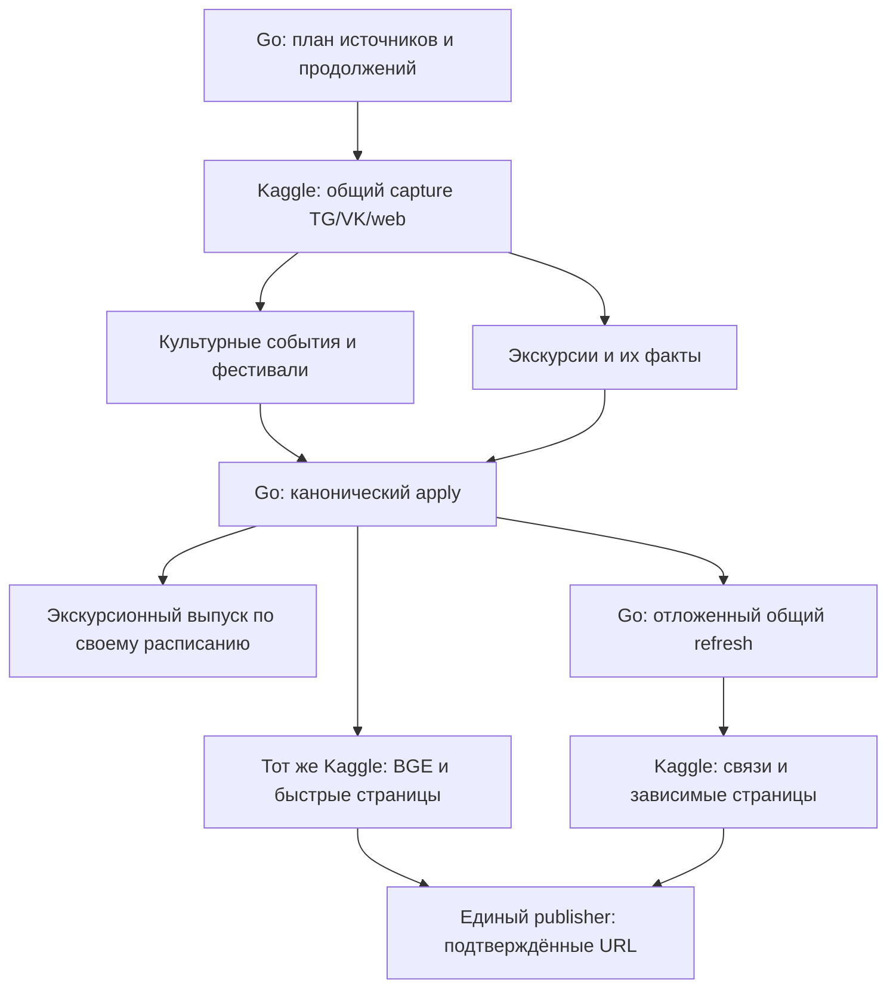

# Events-bot 2.0: единый Kaggle-конвейер, быстрые страницы и согласованное обновление связей

**Статус:** исследованное проектное предложение; реализация и live-приёмка не выполнялись.  
**Обновление:** 17 октября 2026 года, Europe/Kaliningrad.  
**База:** `main@d431b9f86b87999cf27f74b99857d23aedc28f16`; уточняет [основной to-be](events-bot-2.0-to-be.md).  
**Основание:** дополнение владельца о совместном исполнении сбора источников, Ultra, BGE и Astro в одном Kaggle-run, последующем комплексном обновлении и обязательном экскурсионном треке.

**Обязательные уточнения владельца:** [сохранение прогресса, MCP, промо, уведомления, инциденты и полный отказ от Telegraph](events-bot-2.0-owner-requirements-review-20261017.md). Они дополняют условия этого конвейера; сохранение агрегатов Telegraph из ранней версии отменено.

## 1. Вывод и рекомендуемое решение

**Объединение целесообразно:** один Kaggle-исполнитель получает план нужных источников, собирает Telegram/VK/web, выполняет Ultra либо Google fallback, обновляет нужные BGE-производные и выпускает изменённые событийные страницы. Готовая конкретная страница больше не обязана ждать отдельного полного builder-run.

После завершения семантической волны планируется комплексное обновление связей и страниц. Начальный режим — **через 15 минут после окончания последней релевантной волны**, с сохранением принятой политики ожидания окончания серии изменений. Это время допуска отложенного задания, а не обещание готового сайта ровно через 15 минут.

Один Kaggle-run уменьшает число запусков и передач промежуточных данных. Согласованность дают канонические ревизии, сохранённые результаты стадий и один владелец публичного переключения. SQLite, векторы и Object Storage не становятся одной атомарной транзакцией из-за общего notebook.

**Экскурсионный мониторинг и публикация экскурсионных дайджестов входят в обязательный перенос.** Этот трек использует общий сбор источников, но сохраняет собственные данные, правила и публикационные обязательства.

### Что меняется относительно первой редакции проекта

| Было описано недостаточно определённо | Уточнение |
|---|---|
| Отдельно Ultra и Astro-builder | Общий активный Kaggle-run может сразу выполнить быструю страницу; тот же комплект кода имеет отдельный режим отложенного refresh. |
| Сохранить monitoring adapters | Сохранить адаптеры, но после приёмки выключить прежние самостоятельные TG/VK/web monitoring-запуски и их дублирующие scheduler/recovery-входы. |
| BGE не разобран как стадия 2.0 | Переиспользовать существующую общую BGE-границу, hash-bound кэш и её типы документов; отделить её от поисковой Gemini/Supabase-проекции. |
| Guide monitoring в списке уточнения использования | Обязательный самостоятельный предметный трек: intake, факты, occurrences, дайджесты, поддерживаемые каналы доставки. |
| Новая страница ждёт общего build | Первая пригодная страница выпускается по каноническим данным в текущем запуске; необязательные непроверенные рекомендации не блокируют собственные факты. |

## 2. Что подтверждено кодом, а что ещё предстоит доказать

| Основание | Наблюдение | Предел вывода |
|---|---|---|
| Telegram/VK/web intake | Есть специфичные адаптеры, сохранение raw packets, источников и продолжений; часть VK/web чтения сейчас выполняется на host. [U01] [U02] [U03] | Перенос всего capture на Kaggle потребует совместимых стадий, а не только смены имени запуска. |
| Ultra draft | Ранее уже предложены общий capture/API/receipt и небольшие чередующиеся когорты. [U04] | Ветка не замержена; совместный production-run этим не доказан. |
| Общий BGE-модуль | `site/scripts/static_event_bge.py`: BGE-M3, закреплённая ревизия, CPU dense FP32, L2, 1024 измерения; hash-bound документы и векторный кэш. [U05] | Совместимость векторных пространств определяется моделью и подготовкой документа, а не одним размером массива. |
| StaticSiteBuilder | Уже имеет CPU-конфигурацию и установку BGE-зависимостей; экспорт читает immutable SQLite snapshot и переданные кэши. [U08] | Полный Ultra + collectors + BGE + Astro в одном runtime ещё не измерен. |
| Сохранённый collection-run | В отчёте есть проход 377 событий с BGE/QA PASS; общий candidate тогда отклонён позже на независимой проверке Chromium. [U17] | Это доказательство выполненной BGE-стадии на Kaggle, а не принятого всего продукта и не нового benchmark 2.0. |
| Две векторные границы | BGE-артефакты статических потребителей и поисковая Gemini/Supabase-проекция имеют разные исполнение и ownership. [U05] [U07] | Нельзя включить дополнительную запись в Supabase из нового notebook и считать её обновлением BGE. |
| Публикационный барьер | Код допускает base pages без включённого related/vector-режима; полный production-candidate имеет более широкий контракт. [U11] | Для быстрого режима нужен явный новый профиль. Отключение проверок полного сайта флагом не является готовой реализацией. |
| Astro | В manifest указан `^6.0.5`; текущий `[slug].astro` перечисляет все detail events. [U12] | `--include-ids` экспорта лишь приоритизирует ID и не задаёт готовый точечный render-set. [U16] |
| Экскурсии | Актуальные README/код содержат TG/VK intake, guide_* сущности, несколько семейств дайджестов и TG/VK/MAX delivery. [U09] | Историческое «Telegram-only MVP» больше не описывает весь текущий контракт. Фактические production env/слоты в этом исследовании заново не проверялись. |

Дополнительное исследование выполнялось чтением кода, сохранённых отчётов и первичной документации. Новые модели, сборки, публикации и нагрузочные прогоны не запускались. Утверждение «должно поместиться в один Kaggle» остаётся проверяемой инженерной гипотезой.

## 3. Один исполнитель, сохраняемые стадии

Физически тяжёлые стадии общего прохода выполняются в одном Kaggle-run. На RunCoveer остаётся компактный Go-контроль с SQLite, правами, очередью и публикационными подтверждениями. Поздняя комплексная сборка может потребовать следующий Kaggle-run того же комплекта кода — держать первый runtime без работы 15 минут не нужно.

### 3.1. План запуска

Go выдаёт источники, которым действительно подошёл срок проверки, их границы чтения, незавершённые стадии и назначение результатов. Один сигнал о правке события не вызывает обязательный полный перескан всех Telegram/VK/сайтов.

Варианты одного исполнителя: обычная плановая волна; адресный источник/событие; guide light/full; продолжение прерванного capture; продолжение страницы; комплексный refresh. Это параметры существующих заданий, а не независимые платформы или обязательно новые сервисы.

Состав волны конечен: фиксируются источники и frontier наблюдения, бюджет обработки и список продолжений. Новые посты за границей чтения не удлиняют текущий проход бесконечно. Постоянный polling не объявляется вечной незавершённой семантической волной.

### 3.2. Capture и частичный прогресс

Источники читаются небольшими чередующимися порциями. Медленный сайт не должен заставлять ждать всех Telegram- и VK-результатов. Сырой материал и доступные медиа сохраняются до продвижения курсора; серверный receipt указывает сохранённый packet или проверенный durable object. Недоступные вложения и непокрытая часть источника остаются явными gaps.

Cursor подтверждает **сохранённое чтение**, а не успешный writer/BGE/Astro. Иначе отказ страницы заставит повторно читать и интерпретировать уже принятые посты. Для каждого предметного потребителя есть собственное состояние обработки: культурный `no_event` не закрывает экскурсионный материал.

Текущие Telegram и Guide notebooks накапливают существенную часть итогового результата до завершения; в Guide Telegram client создаётся до общего source loop. В объединённой версии этот механизм нельзя переносить целиком: сбой Telegram initialization не должен блокировать независимый VK/web, а смерть kernel — терять прогресс всех предыдущих источников. [U01] [U09]

### 3.2.1. Немедленная доставка каждого результата в БД сервиса

Каждый готовый результат сразу передаётся в сервис и записывается в его БД: факты первого события не ждут остальных событий или завершения Kaggle-run. Файл в Kaggle, final output и даже внешний blob без записи структурированного результата/состояния в БД не заменяют этот контракт. Большие бинарные assets могут храниться отдельно с проверенными ссылками и digest в БД. Сохранение подготовленного результата не обходит проверку перед каноническим apply.

Сохранение не ограничивается capture и окончательным apply. Завершённые ограниченные семантические результаты, включая дорогое модельное предложение/текст, должны получать durable receipt вне Kaggle до продвижения соответствующей стадии. BGE/HTML/публикация сохраняют собственные проверенные артефакты и продолжения. При потере kernel и его локального диска новый runtime читает эти receipts; при потерянном ответе сверяет прежний ключ, а не повторяет весь проход. Неподтверждённая запись остаётся pending, недоступность storage не маскируется успехом. Конкретные размеры порций выбираются реализацией, без новой workflow-платформы. Crash-сценарии и границы обещания — в разделе 1 [уточнения владельца](events-bot-2.0-owner-requirements-review-20261017.md).

ACK означает commit результата/receipt в БД. Потерянный ACK сверяется по прежнему ключу. Серверный рестарт восстанавливает pending/outbox и продолжает доставку, а не ждёт повторного старта всего Ultra. Общая библиотека/доменный сервис доставки и восстановления используется всеми callers; накопленные recovery-правила текущей версии переносятся с их regression tests. При недоступном приёмнике отправитель не подтверждает успех и ограничивает накопление вместо потери всей волны. Сценарии перезапуска до/после commit/ACK/send описаны в §1.2 уточнения владельца.

### 3.3. Применение и право строить страницу

После Ultra или Google fallback Go проверяет права, candidate identity, исходную/предметную ревизию и актуальность сопоставления, затем атомарно сохраняет Event либо соответствующие guide_* сущности, факты, source bindings, receipt и производные задания. Для культурной landing тому же живому Kaggle-run возвращаются подтверждённый Event ID, зарезервированный постоянный адрес и точный snapshot. Адрес ещё не считается публично готовой ссылкой; это подтверждается после публикации.

Страница из ещё не принятого model proposal не публикуется. В момент apply может обнаружиться merge, существующий ID, новая ручная правка или неподходящее медиа. Предварительная подготовка неизменяемых assets допустима; публичное событие обязано соответствовать принятому состоянию.

Один пост с несколькими детьми получает столько необходимых страниц, сколько подтверждено самостоятельных событий/сеансов. Один принятый ребёнок не ждёт обработки всех остальных, если его факты и обязательные связи уже корректны.

## 4. Быстрая страница: два разных набора данных

Для реализации нужны раздельные понятия:

| Набор | Назначение |
|---|---|
| **Каталог сопоставления и рекомендаций** | Актуальные пригодные события, их identity/lifecycle и совместимые векторы. Он может быть полным, даже если строится одна страница. |
| **Набор рендера** | Конкретные новые/изменённые страницы плюс обязательные assets/aliases/calendar-объекты. Он должен быть маленьким в быстром проходе. |

Если сократить каталог сопоставления до одного Event, исчезнут реальные соседи. Если всегда рендерить весь каталог, исчезнет выигрыш быстрого URL. Текущий `--include-ids` не решает это различие: после указанных ID экспорт дополняет каталог. Нужен отдельный render-set и профиль маршрутов. [U12] [U16]

### 4.1. Содержимое первой версии страницы

Обязательны канонические собственные факты, актуальные даты/сеансы, место, approved media, условия и ссылки на запись/билеты, отмена/перенос, постоянный URL и metadata. Подтверждённая принадлежность фестивалю и собственные другие даты передаются по предметному контракту.

Блоки связей используют уже принятую совместимую проекцию либо считаются заново на доступном актуальном каталоге. Если надёжного результата для нового anchor пока нет, **быстрая страница не выдумывает похожие события**. Рекомендация проекта — позволить ей появиться без окончательно пересчитанного рекомендательного блока и дополнить его комплексным проходом. Это предлагаемая продуктовая трактовка ускоренного режима, которую нужно закрепить в его приёмке.

Уже существующая страница при добавлении нового источника не теряет пригодные неизменившиеся связи просто из-за открытия recheck. Но отменённая или перенесённая карточка не сохраняется в рекомендациях только по принципу «last good». Минимальные lifecycle-фильтры применяются сразу.

Быстрый режим не требует полного каталога, онбординга или персональной ленты как публичной поверхности. Сохраняются ранее заданные ограничения landing: без шапки-бирки, плавающей навигации и подвала.

### 4.2. Astro остаётся, точечная сборка проектируется явно

`getStaticPaths()` позволяет задать конкретные динамические пути. Однако остальные статические маршруты проекта тоже могут попасть в build. Профиль `event-landing` должен ограничивать всю сборочную поверхность и использовать общие компоненты, а не только фильтровать один `[slug]`. [U12] [W01]

В актуальной документации Astro есть `experimental.incrementalBuild`, добавленный в 7.2. В исследованном проекте 6.x, поэтому этот механизм не считается уже доступным решением. Начальная реализация опирается на явный профиль, render-set и reuse подготовленных данных. Обновление major-версии не становится обязательным предварительным проектом. [W02]

Небольшие подтверждённые пакеты страниц собираются по мере работы Ultra; не устанавливаются заново Node/Python-зависимости для каждого Event. Где возможно, повторно используется подготовленный bundle и рабочий кэш. Конкретный размер пакета выбирается по задержке первой полезной страницы и цене повторного вызова Astro, а не по произвольному обещанию «страница за секунду».

## 5. BGE, поиск и реальные связи

### 5.1. Что именно обновлять в том же Kaggle

Переиспользуется общая граница `site/scripts/static_event_bge.py`. В исследованной версии это `BAAI/bge-m3`, revision `5617a9f61b028005a4858fdac845db406aefb181`, контракт `bge_m3_cpu_dense_fp32_l2_v1`, 1024 измерения. Есть разные документы: `related_v1` и `collection_semantics_v1`. Их текст и hash формируются разными правилами; один и тот же Event не означает один универсальный embedding для всех назначений. [U05]

В проходе кодируются новые или изменённые документы. Неизменившиеся векторы поднимаются из проверенного кэша. Если изменилась дата, но не текст конкретного embedding-документа, повторное кодирование может не понадобиться; lifecycle/eligibility и страницы всё равно обновляются. Смена model revision, нормализации или подготовки документа требует совместимого нового поколения, а не смешивания массивов.

Если новая BGE-проекция временно не готова, она остаётся незавершённой стадией. В предлагаемом быстром профиле это не блокирует страницу с пригодными собственными фактами: новый неподтверждённый рекомендательный блок ждёт своей проекции. Успех страницы не помечает незавершённый BGE как выполненный.

Обновление вектора и вычисление набора соседей — разные стадии. Для адресного быстрого anchor можно использовать полный пригодный corpus плюс принятые изменения текущей волны. Для самого Ultra recall тоже должен видеть собственные уже принятые события; lag глобального индекса не даёт права создавать дубль. Существующий канонический поиск дополняется текущими принятыми изменениями, сохраняя final identity-check Go.

### 5.2. Не смешивать BGE с поисковым writer

Существуют отдельные поисковые `search_v3`/`related_v1` документы и Gemini embeddings в Supabase-проекции. Их writer и receipt barrier уже имеют собственный контракт. Совпадение имени документа `related_v1` не делает BGE и Gemini одним векторным пространством. [U07]

В истории уже был отказ из-за дополнительного `--sync-pgvector-vectors` внутри Kaggle-builder после работы выделенного владельца проекции. Этот дублирующий write pass отключили. Новый единый конвейер не должен восстановить его под видом «обновления BGE». [U13]

Предлагаемая граница: BGE-артефакты и статические связи вычисляются в общем Kaggle. Существующие поисковые проекции продолжают обновляться своим единственным владельцем. Если позже понадобится перенести именно их вычисление в тот же run, это оформляется как перенос владельца вычисления с теми же контрактами, а не запуск двух writers. Supabase Edge и внешняя ответственность за данные остаются на своих местах.

Быстрая landing page без поиска не обязана ждать готовности всего поискового каталога. Это свойство **нового профиля с ограниченной публичной поверхностью**, а не разрешение ослабить обязательный barrier действующего full-site production-candidate. Отсутствующая поисковая функция не подключается скрыто через общий layout. [U08] [U11]

### 5.3. Какие связи нельзя путать

Канонический контракт уже различает:

| Связь | Значение |
|---|---|
| `same_occurrence_group` | Та же программа/активность в другие дату или время; опирается на подтверждённую identity. |
| `semantic_related` | Действительно похожее самостоятельное событие. |
| `broad_discovery` | Более широкое продолжение выбора; публично «Ещё события». |
| `personalized_feed` | Выдача по совместимому пользовательскому профилю; не свойство обычной анонимной landing page. |

Фестиваль, площадка, источник и рубрика — контекст membership/filter. Они сами по себе не доказывают похожесть. Два дубля одного slot подлежат merge/review, а не показу как «другие даты». [U06]

В текущем BGE candidate-chain есть широкие условия отбора, включая категорию/общие признаки. Поэтому наличие BGE-результата не доказывает качество публичного `semantic_related`. Быстрая интеграция переиспользует принятые правила и проверяет различающие случаи; простая замена pgvector на BGE без оценки не считается сохранением качества. [U16]

### 5.4. Почему второй проход действительно нужен

Новое событие B меняет не только свою страницу. Оно может войти в top-K страницы A, которая раньше вообще не была связана с B. Поэтому пересборка только прежних соседей неполна. Перенос/отмена B также меняет карточки A, где B уже показано.

Комплексный проход рассматривает весь активный corpus, рассчитывает изменения отношений и обновляет фактически зависимые страницы. Для первой реализации допустима полная событийная сборка из переиспользуемых векторов, если она укладывается в бюджет; последующая оптимизация может рендерить только изменившиеся страницы.

Page dependency hash учитывает собственную ревизию, выбранные связи и показанные ревизии соседей, lifecycle, шаблон и нужные общие данные. Собственная ревизия A без зависимостей недостаточна. Публикуемые соседние ссылки также должны вести на уже доступные страницы; новый ещё не опубликованный B не должен появиться как битая ссылка на A.

## 6. Отложенное комплексное обновление через 15 минут

### 6.1. Основание времени

В проекте уже закреплялась strict trailing policy: автоматические изменения сдвигают ожидающую сборку к `latest_effect_at + 15m`, а ручные/calendar/startup-пути имеют отдельное немедленное поведение. В записи инцидента встречается прежний cap 30 минут, но последующее уточнение явно его заменяет. Ссылаться на ранний cap как на действующее требование неправильно. [U13]

Для единого конвейера предлагается уточнить границу окончания: последние семантические apply и завершение соответствующей ограниченной волны зарегистрированы Go; незавершённые материалы сохранены как продолжения. Затем отсчитывается 15 минут. Post-processing самой страницы, heartbeat, статистика просмотров и no-op повтор не должны заново запускать этот таймер.

Завершение полностью no-op волны не сдвигает due_at. Конец волны служит границей активности только если в ней были релевантные семантические изменения; frequent empty monitoring не продлевает ожидание общего refresh.

### 6.2. Поведение scheduler

- Ожидание хранится в существующей durable очереди Go. Kaggle освобождает ресурсы; `sleep(900)` не используется.
- Новые релевантные изменения до запуска объединяются в pending refresh и сдвигают срок согласно strict trailing. Завершение волны и календарное время относятся к Europe/Kaliningrad там, где это продуктовый слот; технические timestamps сохраняются однозначно.
- Пустой polling, ожидание quota/cooldown и незавершённый далёкий источник не притворяются активной бесконечной волной новых Event changes.
- При запуске фиксируется согласованный snapshot и его watermark. Готовящаяся сборка не перезапускается после каждого нового Event.
- Во время сборки новые изменения создают максимум одно накопленное следующее обязательство. На уровне общего refresh — одна выполняемая и одна ожидающая работа.
- Задержка Kaggle-slot видна отдельно: `due_at` не означает `public_at`.

У strict trailing остаётся честный компромисс: если реальные изменения идут непрерывно без пауз, комплексная сборка может долго ждать. Быстрые страницы уже уменьшают ущерб этого ожидания. Возвращать cap скрыто нельзя; требование жёсткой верхней задержки всех взаимных связей в непрерывном потоке означало бы отдельное разрешение строить промежуточный snapshot. Этот проект сохраняет принятую политику и измеряет возраст ожидающего refresh.

## 7. Публичное состояние и защита от перезаписи свежего

Kaggle пишет неизменяемые артефакты в свой staging/версионированный prefix. Единственный существующий publisher принимает результат с event revision, render-set и manifest, проверяет допустимость и меняет публичные ключи. Ему принадлежит сама сериализация финальных записей, а не только предварительное разрешение перед долгой загрузкой.

Допуск учитывает полный page dependency manifest: показанные соседние ревизии и lifecycle, поколение отношений и нужную template/policy revision. У A может не измениться собственная Event revision, но отменённый B в её HTML делает результат устаревшим. Такая A адресно пересобирается; publisher не обещает отфильтровать уже скомпилированный HTML без рендера.

Быстрый и комплексный run не получают право независимо безусловно перезаписывать один `sobytiya/<slug>/index.html`. Иначе старая комплексная сборка может закончиться последней и вернуть старую редакцию события поверх свежей.

При комплексной публикации устаревший объект конкретного Event пропускается/перепланируется, остальные пригодные страницы не обязательно теряются. Это требует scoped manifest и совместимых versioned assets. Нельзя загрузить subset в production с `sync --delete` по всему сайту: отсутствующие в точечной сборке маршруты не являются удалёнными событиями.

Минимальная последовательность: assets готовы → допустимый HTML опубликован → проверена доступность по публичному URL с ожидаемой ревизией → receipt сохранён. Публичная проверка учитывает реальную CDN/cache-политику, включая отрицательный кэш нового URL. Проверка storage object отдельно не доказывает, что читатель уже получил нужную страницу.

Если канонические данные изменились во время сетевой записи, receipt фиксирует фактически опубликованную версию и новое обязательство обновления, не выдавая её за актуальную новую ревизию. Мгновенное атомарное равенство всех хранилищ не обещается. Сериализация publisher запрещает понижение уже опубликованной версии, а повторная проверка currentness не позволяет ложно закрыть pending update.

### Различающие сбои

| Ситуация | Требуемый результат |
|---|---|
| Event применён, kernel умер до BGE/Astro | Событие сохранено; продолжаются только производные задания. |
| BGE рассчитан по отклонённому proposal | Он не становится действующим вектором другого или более нового Event. |
| Страница загружена, callback потерян | Принять готовый manifest/object; повтор Ultra не нужен. |
| Полная старая сборка заканчивается после новой быстрой | Свежая публичная ревизия не понижается. |
| MCP изменил дату/отменил событие во время build | Новая ревизия и lifecycle учитываются при окончательной публикации; старые рекомендации фильтруются. |
| Один source/consumer упал | Независимые принятые результаты сохранены; gap остаётся адресным. |
| Всё Kaggle недоступно | Сохранённые публичные страницы доступны; новые материалы/страницы ждут, а общий daily-outage выбор остаётся открытым. |

Взятие lease, поколение задания и source/event revision используют уже необходимые механизмы to-be. Ради объединения не создаются новая распределённая БД, брокер или ещё один универсальный recovery-framework.

## 8. Источники: что объединить и что сохранить

### 8.1. Telegram и VK

В одном run должен быть один владелец конкретного `remote_telegram_auth_scope`. Культурный и экскурсионный consumers могут пользоваться общим capture, но нельзя запускать два старых notebook entrypoints параллельно с одним auth bundle. Shared session guard продолжает учитывать другие внешние jobs. Telegram lease можно освобождать после подтверждённого disconnect и прекращения чтения. Для этого нынешний whole-run guard должен явно распознавать завершение source-стадии при продолжающемся Kaggle-run; одного локального close недостаточно для изменения общего ownership. До совместимой поддержки такого перехода действует прежняя безопасная граница. BGE/Astro сами по себе не требуют Telegram-сессии. [U10]

Reader и publisher credentials сохраняют разные роли. OpenCode/model subprocess не наследует весь набор токенов источников, публикации и storage. Единый Kaggle увеличивает число доступных интеграций в одном окружении, поэтому явная передача минимального окружения стадиям — часть переноса существующих полномочий.

VK pagination сохраняет provider-specific continuation: durable raw page до offset, границу исходного crawl, продолжение после cap и доказанное условие завершения. Telegram сохраняет альбомы, правки, поздние сообщения и неполный tail. Универсальный «максимальный ID» не заменяет эти разные гарантии. [U01] [U02]

### 8.2. Сайты

Переиспользуются конкретные website adapters. Philharmonia и часть venue catalogs читаются HTTP; отдельные Theatres/Qtickets-пути используют браузер. Не требуется переводить каждый сайт в агентный browser workflow. [U03]

Перенос host-side HTTP в Kaggle отдельно проверяет доступность с нового сетевого окружения, cookies/rate limits, AJAX pagination и формат входа. Browser и тяжёлые embedding/render-стадии не должны бесконтрольно конкурировать за RAM. Повторные установки зависимостей внутри каждого старого entrypoint убираются в общий воспроизводимый bootstrap.

### 8.3. Что выводится из эксплуатации

После приёмки заменяются самостоятельные запускающие цепочки TelegramMonitor, GuideExcursionsMonitor, host VK crawl и отдельных website monitor jobs, включая их cron/watchdog/autostart. Guide light/full остаются режимами и обязательствами общего исполнителя. Адресные команды продолжают работать, формируя узкий план нового исполнителя. Уже выданные старые Kaggle-runs сначала принимаются/согласуются; их outputs и callbacks не бросаются.

Код извлечения и provider contracts переиспользуются как адаптеры. Удалять старый entrypoint безопасно после переноса всех callers и recovery действующих jobs. CherryFlash/CrumpleVideo остаются своими неизменными Kaggle-рантаймами; статистика и другие независимые полезные collectors не исчезают только потому, что ingestion стал общим.

## 9. Экскурсии: обязательный отдельный результат

### 9.1. Предметная модель и фильтры

Сохраняются `guide_*` данные: профили гидов/организаторов, шаблоны маршрутов, конкретные выходы, факты, источники, media и публикационные marks. Обычная культурная афиша и экскурсионный продукт имеют разные правила включения. Регулярная экскурсия может быть исключена из основной афиши, но оставаться полезным подтверждённым выходом специального трека. [U09]

`on_request`, private, описание маршрута без дат и «каждый четверг» не превращаются автоматически в конкретную публичную дату. Multi-date расписание разбирается на самостоятельные occurrences; sold out/cancelled/last seats меняют нужный выход. Повтор от агрегатора не становится новой экскурсией.

В лабораторию Ultra добавляются guide-кейсы и соответствующие промпты. Cultural detector не должен заменить Trail Scout/Route Weaver/Lollipop Trails без проверки их фактических контрактов. Общий packet может иметь несколько consumers, но каждый получает собственный предметный outcome.

### 9.2. Дайджесты и доставка

Обязательны существующие семейства `new_occurrences`, `last_call`, `visual_schedule`, команды `/guide_*`, правильные booking/contact/meeting point, атрибуция и действующие TG/VK/MAX-пути. Published mark ставится только реально вошедшим в выпуск occurrences и предусмотренным dedup siblings. Простая правка `updated_at` не разрешает повторную публикацию. [U09] [U14]

Сохраняются различия Telegram-текста/медиагрупп, VK wall/carousel и MAX через существующую интеграцию VibePublish. У каждой цели собственный receipt; восстановление MAX после успеха TG/VK не повторяет их отправки. Пустой набор не публикуется как служебный пост аудитории.

Для visual_schedule сохраняются отложенный VK wall и предусмотренная последующая Story со своими follow-up jobs/receipts. Это отдельные публикационные интервалы, не таймер 15-минутного refresh сайта. В MAX сохраняются distinct outcomes owner_confirmed_present / complete_with_owner_confirmation: они не переименовываются в provider-verified published и не запускают повторную отправку. [U09] [U14]

Готовый экскурсионный выпуск не ждёт непричастного BGE/Astro refresh культурного каталога. Ссылки на реальные первоисточники и самостоятельные booking/contact links сохраняют назначения; отдельный guide landing не вводится без продуктовой необходимости. Однако полная отмена Telegraph действует и здесь: обнаруженный действующий Telegraph publisher/consumer переносится на новую поверхность, а не сохраняется как исключение.

### 9.3. Расписание и принятый partial

Задокументированные defaults: guide light 09:05 и 13:20, full 20:10, visual digest 10:30 по Europe/Kaliningrad. `new_occurrences` привязан к успешному full scan/import. Это документированные значения, а не новая проверка активных production env. [U09] [U14]

В единой очереди эти слоты сохраняются как обязательства. Light run не закрывает вечерний full; успешный импорт готового full output может закрыть тот же слот без нового чтения. Формирование визуального выпуска и его доставка не считаются выполненными только по факту ingestion.

У guide уже есть принятая политика: отдельные post-level model failures допускают выпуск пригодных полученных occurrences; missing results/import failures и критические недостающие media блокируют соответствующий путь. Writer polish имеет ограниченный бюджет и может использовать уже предусмотренный grounded editorial fallback. Эту политику нужно сохранить; нельзя незаметно распространить её на культурный daily, где допустимость неполного выпуска пока не выбрана. [U09]

## 10. Эффективность и цена объединения

### Где вероятна экономия

- Меньше отдельных Kaggle startup, сборочных handoff и повторной упаковки больших входов.
- Один capture source revision для нескольких законных consumers.
- Повторное использование OCR, исходных фактов, подготовленного окружения и BGE-cache.
- Быстрая страница не ждёт окончания всех источников и полной сборки каталога.
- Повтор после падения возобновляет страницу/вектор/доставку, не весь семантический импорт.

### Где объединение может ухудшить результат

Общий kernel становится общим местом отказа. Одновременно открытые браузеры, BGE, OpenCode и несколько Astro-builds увеличат memory peak; длинный build может задержать capture; конфликт зависимостей ломает раньше независимые стадии. Если на каждое событие запускать полный Astro, экономия на старте notebook может быть потеряна.

Начальный режим: ограниченный сетевой capture; тяжёлые локальные стадии по очереди или с измеренным малым overlap; один encoder на совместимую модельную сессию; браузеры закрываются после чтения; зависимости фиксируются. Завершение подпроцесса может освобождать память между тяжёлыми фазами, оставаясь внутри одного Kaggle-run. Уменьшать качество, длину содержательного ответа или полноту обязательного источника ради красивого memory graph нельзя.

На RunCoveer сохраняется 1 CPU/2 GB-цель. BGE/браузеры/Astro туда не переносятся. Для DevCoveer остаётся ограниченный стенд из основного документа; пробовать весь тяжёлый combined runtime рядом с Мирой/RAG не предлагается.

### Недостающие измерения перед приёмкой

На фиксированном corpus сравнить нынешнюю разделённую цепочку и новый run: время первого публичного URL; время всех нужных страниц волны; CPU/RAM/disk peak Kaggle; active runtime/slots; вызовы моделей; повторные установки; объём входов; долю reused embeddings; задержки полного refresh и guide slots. Cold запуск показывается отдельно от warm с кэшем. Тест общего run должен включать website browser, несколько source consumers и падение после canonical apply.

Сохранённый BGE-проход 377 событий подтверждает пригодность конкретной стадии, но не даёт оценки памяти нового общего процесса. Ускорение и вместимость одного Kaggle не объявляются достигнутыми до этого сравнения. [U17]

## 11. Изменения программы реализации

1. В реестре обязательств закрепить экскурсии и все реально используемые источники/сайты, включая сегодняшние host-side collectors.
2. В Codex prompt lab включить культурные события, фестивали и guide; общие packets и consumer-specific outcomes; различение истинной похожести и broad discovery.
3. На реальном Kaggle сначала подтвердить семантические результаты Ultra и Google fallback. Затем добавить BGE и быстрый Astro на тех же принятых canonical snapshots.
4. На изолированной БД проверить общий capture/apply/projection и поздние ответы; публикацию направлять в отдельный preview prefix.
5. Добавить явный render-set, профиль landing и единственного publisher с защитой от понижения ревизий; проверить живые ссылки из анонсов.
6. Включить отложенный refresh с 15-минутной политикой, правильными обратными зависимостями и максимум одним successor.
7. Проверить guide light/full/visual и per-target recovery отдельно от культурной статики.
8. Перед production-переключением закрыть обязательства старых monitor launches, затем выключить дублирующие scheduler/watchdog. Проверить отсутствие двух активных читателей одной Telegram-сессии и двух writers одной публичной страницы.

### Минимальные различающие сценарии

| Сценарий | Что доказывает |
|---|---|
| Один TG-post даёт два культурных события и guide-кандидат | Нет потери consumer/child, страницы и guide-data имеют правильные IDs. |
| Падает последняя website-стадия | Уже принятые TG/VK и выпущенные страницы сохранены, gap сайта продолжается. |
| OpenCode недоступен | Google обрабатывает сохранённые packets; новый полный мониторинг не нужен. |
| BGE/Astro падает после apply | Восстанавливается только производная стадия. |
| Новый B должен стать рекомендацией A | Комплексный проход находит новую обратную зависимость; собственный hash A не скрывает изменение. |
| Новая быстрая страница и старая полная сборка заканчиваются в обратном порядке | Публичная ревизия не понижается; assets и links остаются доступными. |
| Постоянные heartbeat/no-op и отдельный новый Event | Таймер двигают только релевантные семантические изменения; не стартует лишний full build. |
| Guide full output готов, bot перезапустился между импортом и доставкой | Тот же выпуск публикуется/согласуется без нового scan и повторных успешных целей. |
| Непохожее событие той же категории и другой сеанс того же события | Категория не выдаётся за strict similarity; сеансы не попадают в похожие и не теряются. |

## 12. Принципиальные решения и предел обещания

**Основная рекомендация:** принять быстрый публичный Event с полными собственными фактами и уже подтверждёнными связями; отсутствие нового проверенного рекомендательного блока не задерживает URL. Комплексный refresh дополняет и согласует связи. Если первая страница обязана сразу иметь окончательные рекомендации по всей волне, выигрыш адресного режима будет существенно меньше — это единственное новое продуктовое различие, которое следует явно принять.

Прежний вопрос о культурном daily при общем простое Kaggle остаётся, но относится к аварийному режиму: объединение существенно сокращает штатное ожидание отдельного builder. Оно не устраняет недоступность всей платформы. Остальные открытые вопросы основного документа о необязательных продуктах, архиве и RPO/RTO сохраняются; экскурсии из неопределённого scope исключены и включены в обязательный перенос.

Технические размеры пакетов, версии библиотек, поля hash, режим запуска и порядок освобождения памяти выбираются реализацией в рамках этих контрактов. Они не требуют дополнительных ритуалов согласования. Ближайший полезный результат остаётся лабораторией промптов и общих входов, дополненной guide-кейсами и планом проверки реального комбинированного Kaggle-run.

## Источники

| ID | Источник | Дополнительные кодовые основания |
|---|---|---|
| [U01] | Telegram: существующий capture/import и итоговые bundles | [kaggle/TelegramMonitor/telegram_monitor.py](https://github.com/onedayonemasterpiece/events-bot-new/blob/d431b9f86b87999cf27f74b99857d23aedc28f16/kaggle/TelegramMonitor/telegram_monitor.py); [source_parsing/telegram/service.py](https://github.com/onedayonemasterpiece/events-bot-new/blob/d431b9f86b87999cf27f74b99857d23aedc28f16/source_parsing/telegram/service.py); [source_parsing/telegram/handlers.py](https://github.com/onedayonemasterpiece/events-bot-new/blob/d431b9f86b87999cf27f74b99857d23aedc28f16/source_parsing/telegram/handlers.py) |
| [U02] | VK: raw packets и continuation | [vk_intake.py](https://github.com/onedayonemasterpiece/events-bot-new/blob/d431b9f86b87999cf27f74b99857d23aedc28f16/vk_intake.py); [vk_auto_queue.py](https://github.com/onedayonemasterpiece/events-bot-new/blob/d431b9f86b87999cf27f74b99857d23aedc28f16/vk_auto_queue.py) |
| [U03] | Сайты и HTTP/browser adapters | [source_parsing/venue_catalogs.py](https://github.com/onedayonemasterpiece/events-bot-new/blob/d431b9f86b87999cf27f74b99857d23aedc28f16/source_parsing/venue_catalogs.py); [docs/features/source-parsing/sources/philharmonia/README.md](https://github.com/onedayonemasterpiece/events-bot-new/blob/d431b9f86b87999cf27f74b99857d23aedc28f16/docs/features/source-parsing/sources/philharmonia/README.md); [docs/features/source-parsing/sources/theatres/README.md](https://github.com/onedayonemasterpiece/events-bot-new/blob/d431b9f86b87999cf27f74b99857d23aedc28f16/docs/features/source-parsing/sources/theatres/README.md); [docs/features/source-parsing/sources/qtickets/README.md](https://github.com/onedayonemasterpiece/events-bot-new/blob/d431b9f86b87999cf27f74b99857d23aedc28f16/docs/features/source-parsing/sources/qtickets/README.md) |
| [U04] | Незамерженный проект Ultra | — |
| [U05] | Общая BGE-граница и совместимый векторный кэш | — |
| [U06] | Канонический контракт связанных событий | [docs/features/linked-events/requirements.md](https://github.com/onedayonemasterpiece/events-bot-new/blob/d431b9f86b87999cf27f74b99857d23aedc28f16/docs/features/linked-events/requirements.md); [docs/features/unsigned-personalization/semantic-vector-retrieval.md](https://github.com/onedayonemasterpiece/events-bot-new/blob/d431b9f86b87999cf27f74b99857d23aedc28f16/docs/features/unsigned-personalization/semantic-vector-retrieval.md) |
| [U07] | Отдельный поисковый projector и его потребители | [event_vector_sync.py](https://github.com/onedayonemasterpiece/events-bot-new/blob/d431b9f86b87999cf27f74b99857d23aedc28f16/event_vector_sync.py); [supabase/functions/event-search/index.ts](https://github.com/onedayonemasterpiece/events-bot-new/blob/d431b9f86b87999cf27f74b99857d23aedc28f16/supabase/functions/event-search/index.ts) |
| [U08] | StaticSiteBuilder: CPU, зависимости и immutable export | [kaggle/StaticSiteBuilder/kernel-metadata.json](https://github.com/onedayonemasterpiece/events-bot-new/blob/d431b9f86b87999cf27f74b99857d23aedc28f16/kaggle/StaticSiteBuilder/kernel-metadata.json) |
| [U09] | Актуальный экскурсионный контракт | [kaggle/GuideExcursionsMonitor/guide_excursions_monitor.py](https://github.com/onedayonemasterpiece/events-bot-new/blob/d431b9f86b87999cf27f74b99857d23aedc28f16/kaggle/GuideExcursionsMonitor/guide_excursions_monitor.py); [guide_excursions/service.py](https://github.com/onedayonemasterpiece/events-bot-new/blob/d431b9f86b87999cf27f74b99857d23aedc28f16/guide_excursions/service.py); [guide_excursions/digest.py](https://github.com/onedayonemasterpiece/events-bot-new/blob/d431b9f86b87999cf27f74b99857d23aedc28f16/guide_excursions/digest.py); [guide_excursions/visual_digest.py](https://github.com/onedayonemasterpiece/events-bot-new/blob/d431b9f86b87999cf27f74b99857d23aedc28f16/guide_excursions/visual_digest.py) |
| [U10] | Общий Telegram session guard | [AGENTS.md](https://github.com/onedayonemasterpiece/events-bot-new/blob/d431b9f86b87999cf27f74b99857d23aedc28f16/AGENTS.md) |
| [U11] | Immutable snapshot, barrier и публикационный контракт | — |
| [U12] | Astro: manifest и текущий набор динамических страниц | [site/package.json](https://github.com/onedayonemasterpiece/events-bot-new/blob/d431b9f86b87999cf27f74b99857d23aedc28f16/site/package.json); [site/src/lib/events.ts](https://github.com/onedayonemasterpiece/events-bot-new/blob/d431b9f86b87999cf27f74b99857d23aedc28f16/site/src/lib/events.ts) |
| [U13] | История дублирующего vector writer и последняя strict trailing policy | [tests/test_static_site_build_debounce.py](https://github.com/onedayonemasterpiece/events-bot-new/blob/d431b9f86b87999cf27f74b99857d23aedc28f16/tests/test_static_site_build_debounce.py); [tests/test_static_site_release.py](https://github.com/onedayonemasterpiece/events-bot-new/blob/d431b9f86b87999cf27f74b99857d23aedc28f16/tests/test_static_site_release.py) |
| [U14] | Актуальное начало guide delivery spec и расписание | [guide_excursions/max_digest.py](https://github.com/onedayonemasterpiece/events-bot-new/blob/d431b9f86b87999cf27f74b99857d23aedc28f16/guide_excursions/max_digest.py); [docs/features/guide-excursions-monitoring/README.md](https://github.com/onedayonemasterpiece/events-bot-new/blob/d431b9f86b87999cf27f74b99857d23aedc28f16/docs/features/guide-excursions-monitoring/README.md) |
| [U16] | Экспорт: include-ids и BGE candidate-chain | — |
| [U17] | Сохранённое ограниченное свидетельство BGE на 377 событиях | — |
| [W01] | Astro: getStaticPaths и маршруты | — |
| [W02] | Astro: experimental incremental builds и версия появления | — |

[U01]: https://github.com/onedayonemasterpiece/events-bot-new/blob/d431b9f86b87999cf27f74b99857d23aedc28f16/docs/features/telegram-monitoring/README.md
[U02]: https://github.com/onedayonemasterpiece/events-bot-new/blob/d431b9f86b87999cf27f74b99857d23aedc28f16/docs/features/vk-auto-queue/README.md
[U03]: https://github.com/onedayonemasterpiece/events-bot-new/blob/d431b9f86b87999cf27f74b99857d23aedc28f16/docs/features/source-parsing/README.md
[U04]: https://github.com/onedayonemasterpiece/events-bot-new/blob/621e7b38659d50c4005dee84439d6cd6a0c05b79/docs/design/smart-update-ultra-to-be-2026-10-05.md
[U05]: https://github.com/onedayonemasterpiece/events-bot-new/blob/d431b9f86b87999cf27f74b99857d23aedc28f16/site/scripts/static_event_bge.py
[U06]: https://github.com/onedayonemasterpiece/events-bot-new/blob/d431b9f86b87999cf27f74b99857d23aedc28f16/docs/features/linked-events/README.md
[U07]: https://github.com/onedayonemasterpiece/events-bot-new/blob/d431b9f86b87999cf27f74b99857d23aedc28f16/scripts/sync_event_search_vectors_to_supabase.py
[U08]: https://github.com/onedayonemasterpiece/events-bot-new/blob/d431b9f86b87999cf27f74b99857d23aedc28f16/kaggle/StaticSiteBuilder/static_site_builder.py
[U09]: https://github.com/onedayonemasterpiece/events-bot-new/blob/d431b9f86b87999cf27f74b99857d23aedc28f16/docs/features/guide-excursions-monitoring/README.md
[U10]: https://github.com/onedayonemasterpiece/events-bot-new/blob/d431b9f86b87999cf27f74b99857d23aedc28f16/remote_telegram_session.py
[U11]: https://github.com/onedayonemasterpiece/events-bot-new/blob/d431b9f86b87999cf27f74b99857d23aedc28f16/static_site_release.py
[U12]: https://github.com/onedayonemasterpiece/events-bot-new/blob/d431b9f86b87999cf27f74b99857d23aedc28f16/site/src/pages/sobytiya/[slug].astro
[U13]: https://github.com/onedayonemasterpiece/events-bot-new/blob/d431b9f86b87999cf27f74b99857d23aedc28f16/docs/reports/incidents/INC-2026-07-20-static-claim-lost-health.md
[U14]: https://github.com/onedayonemasterpiece/events-bot-new/blob/d431b9f86b87999cf27f74b99857d23aedc28f16/docs/backlog/features/guide-excursions-monitoring/digest-spec.md
[U16]: https://github.com/onedayonemasterpiece/events-bot-new/blob/d431b9f86b87999cf27f74b99857d23aedc28f16/site/scripts/export-production-preview-data.py
[U17]: https://github.com/onedayonemasterpiece/events-bot-new/blob/d431b9f86b87999cf27f74b99857d23aedc28f16/docs/features/static-site-pages/podborki-to-be.md
[W01]: https://docs.astro.build/en/reference/routing-reference/
[W02]: https://docs.astro.build/en/reference/experimental-flags/incremental-build/

