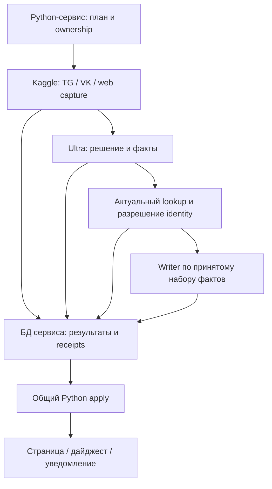

# Smart Update Ultra: самостоятельное внедрение в действующий events-bot

Дата: **18 октября 2026**, Europe/Kaliningrad. Статус: **проект для рассмотрения; реализация и испытания не выполнены**.

Основание — новое решение владельца: отложить переписывание всего бота и независимо внедрить Smart Update Ultra и ускорение Astro. Этот документ заменяет Go-переписывание как предпосылку Ultra. Работающие бот, SQLite, доменные правила, MCP, расписания и доставка остаются основой. Предыдущие исследования [Ultra #723][E01], [пилота #724][E02] и [events-bot 2.0 #746][E03] используются как источники, а не как обязательная программа миграции.

Связанные документы: [отчёт исследования](../reports/smart-update-ultra-design-review-2026-10-18.md), [проект ускорения Astro](astro-static-generation-optimization.md). Действующие предметные правила по-прежнему находятся в [Smart Event Update](../features/smart-event-update/README.md), [identity state machine](../features/smart-event-update/identity-state-machine.md) и [LLM request guide](../llm/request-guide.md). Здесь описана их новая композиция и необходимые расширения, без копирования всей предметной спецификации.

## 1. Рекомендуемое решение

**Первую версию Ultra реализовать компактным Python-исполнителем поверх штатного OpenCode. Запускать его в проде на Kaggle, отлаживать сначала промпты, затем тот же исполнитель локально на DevCoveer. Подготовленные результаты применять через узкое расширение действующего Python-сервиса. Astro оптимизировать отдельным проектом.**

Go не становится обязательным языком этой поставки. Исследование выявило существенные источники затрат: модельные вызовы, размер контекста, повторные стадии, ожидание результатов и подготовку окружения. Их доля в текущем полном времени не измерена. Новый Go supervisor оставил бы рядом OpenCode и Python-адаптеры, добавив ещё один runtime и контракты между процессами. На VPS сам Ultra-исполнитель постоянно работать не должен, поэтому его язык не определяет память всего бота. Это архитектурный вывод по исследованным механизмам, не измеренный benchmark Python против Go. [E04], [E05]

| Часть | Выбор первой поставки | Причина |
|---|---|---|
| Бот, domain apply, SQLite, очереди, MCP | Существующий Python | Сохранение проверенных правил, прав, ID и восстановления |
| Новый Ultra worker | Небольшой Python-пакет, ограниченные очереди и async I/O | Переиспользование source clients, Google boundary и контрактов без импорта всего бота |
| Модельные роли | Штатный OpenCode; Google-клиент для разрешённых стадий/fallback | Управление промптами, моделью, контекстом и квотой на уровне конкретной задачи |
| Промпты и диагностика | Версионированные файлы; Codex/субагенты как инструменты разработки | Быстрая проверка смысловых различий до сборки всего конвейера |
| Полные результаты стадий | Каноническая БД действующего сервиса | Факты доступны и восстанавливаются до окончания Kaggle-run |
| BGE и Astro | Существующие Python/Node реализации, отдельная оптимизация | Они не требуют переписывания bot или Ultra на Go |
| Production execution | Kaggle | Соответствует размещению, выбранному владельцем |

Go можно оценить позднее для конкретного изолированного CPU/RSS-ограничителя. Условие — профиль показывает заметную стоимость именно нового supervisor/адаптера после устранения повторной работы, отдельно от OpenCode, браузера, BGE и ожидания API. Отсутствие такого профиля не задерживает Ultra.

Для масштаба: если некоторая часть занимает 10% полного времени и ускоряется в пять раз, весь процесс ускорится примерно в 1,087 раза: `1 / (0,9 + 0,1/5)`. Это иллюстрация, не оценка доли Python в текущем боте. Обещать кратный выигрыш всего конвейера только от языка оснований нет.

## 2. Что проект должен дать пользователю

Поступивший материал обрабатывается без ожидания всех источников. Законченные факты с происхождением сразу сохраняются в сервисе. Затем определяется существующее событие или необходимость создания, готовится полный редакционный текст и применяется изменение. Результаты разных событий доступны по мере готовности. Отказ writer, BGE, Astro или уведомления не уничтожает уже сохранённые факты и не запускает их извлечение заново.

В операционном статусе различаются:

- материал получен и долговечно сохранён;
- факты/план/текст сохранены как результат своей стадии;
- изменение принято доменным сервисом, известны Event ID и фактическая revision;
- публичная страница проверена и её URL пригоден для отправки;
- требуемые внешние доставки подтверждены, частично выполнены либо требуют согласования UNKNOWN.

Запись proposal не означает создание Event. Зарезервированный URL не означает доступную страницу. Успешный ответ модели не означает принятую семантику. Эти различия отражаются в существующих статусах и receipts, а не в новой административной платформе. [E05], [E06]

Целевой состав сохраняет фестивальную очередь, TG/VK/web-источники, экскурсионный consumer и его дайджесты, Google Smart Update как резерв, необходимые медиа и полезные collectors. Их перенос в общий исполнитель идёт по адаптерам. Первый полезный релиз не требует одновременного переключения каждого источника. Полное завершение проекта не допускает потери перечисленных функций.

## 3. Что подтверждено в нынешнем коде

Исследован `events-bot-new/main` **d431b9f86b87999cf27f74b99857d23aedc28f16**. Это версия исходников; текущий исполняемый production SHA и новая ресурсная серия в этой работе не снимались.

| Механизм | Подтверждение | Следствие для проекта |
|---|---|---|
| `smart_event_update()` принимает candidate и параметры исполнения, без готовых facts/writer | `smart_event_update.py`, вход около 17344 | Прямой вызов после Ultra может повторно выполнить модельную подготовку |
| `_SMART_UPDATE_LOCK` охватывает `_impl`, содержащий LLM | Там же, около 17416 | Удалённая параллельность требует явного разделения подготовки и короткого apply, а не увеличения числа callers |
| Domain commit и terminal candidate ACK разделены | Код около 17496, 21107, 22788; identity state machine | Сохранить accepted result и существующее восстановление `NOOP_EXACT_REPLAY` |
| `candidate_payload` перезаписывается при попытке | `smart_update_state.py`, `begin_candidate_attempt` | Это latest input, а не неизменяемая история готовых стадий |
| `SmartUpdateAttempt` не содержит полного result payload | `models.py`, 1156–1178 | Нужен небольшой долговечный storage для полных результатов |
| Старый source fact log заменяется; есть ограничение 200 символов и initial `[:18]` | `smart_event_update.py`, `_normalize_fact_item`, create, `_record_source_facts` | Нельзя объявить этот UI-log полной фактовой базой Ultra |
| Existing operation receipt связан с MCP operation context | `event_operation_receipts.py` | Нельзя выдать его за готовый общий receipt каждого автоматического Ultra-run |

Основания: [основной код][E05], [state storage][E07], [модели][E08], [точный recovery contract][E06], [operation receipts][E09]. Это механизмы, найденные в коде; их доля в сегодняшнем времени обработки не измерена.

Главная инженерная неопределённость — извлечь небольшой общий apply из большого `smart_event_update.py`, сохранив проверки и эффекты. Проверить эту границу надо рано, после фиксации контрактов. Не следует сначала собирать большой новый мониторинг и только потом обнаруживать, что готовый результат всё равно запускает прежний LLM-конвейер.

## 4. Целевой путь исполнения

Стрелки к БД означают немедленную передачу законченного результата своей стадии. Между стадиями не требуется окончание всего источника или Kaggle-run. Показан логический порядок зависимостей; независимые события проходят его одновременно в разрешённом бюджете. Состояние принятой работы принадлежит сервису, а не процессу Kaggle.

Узкий worker не импортирует `main.py` или весь `smart_event_update.py`. Из монолита выделяется только нужный общий контракт с совместимым re-export для старых callers. Source-specific adapters остаются специализированными. Детектор не получает доступ к production DB, произвольной записи в репозиторий или социальным публикациям.

## 5. Контракт исходного материала

Единица capture — ограниченный, но семантически полный пакет: сообщение/альбом, страница с нужными фрагментами или связанный набор материала. Объём ограничивается bytes, доступной памятью и продолжением, а не незаметным отсечением последних событий.

Пакет сохраняет:

- provider, source identity и locator; исходный message/document ID;
- revision содержимого и hash, время публикации отдельно от времени получения;
- полный нужный исходный текст, найденные части альбома и порядок;
- durable media references, hashes, OCR/транскрипцию с указанием их происхождения;
- pagination/frontier и явно обнаруженные пропуски;
- локальный календарный контекст `Europe/Kaliningrad` и `as_of` для интерпретации относительных дат;
- consumer scopes: культурные события, фестивали, экскурсии — без взаимного подавления.

Одинаковый URL при изменившемся содержимом — новая версия. Разные passages одного URL сохраняют отдельную адресацию. Копия пресс-релиза на нескольких сайтах не превращается в несколько независимых подтверждений.

Источник разрешается считать captured только после сохранения пакета и необходимых media refs. Продвижение capture cursor не ждёт Astro, но требует долговечного учёта незавершённых consumers. Отдельные consumer watermarks не подменяются одним максимальным message ID. Для VK переиспользуется существующий `VKSourcePacket`, где он уже даёт нужный immutable raw/evidence contract; второй raw JSON не сохраняется без необходимости. [E08], [E10]

## 6. Работа с фактами: перенос опыта Street Story

### 6.1. Одно законченное смысловое решение

Первый полезный семантический проход по source packet должен совместно дать: event/non-event или иной consumer outcome, разделение нескольких событий, факты и их предметную привязку. Для изображений первый vision-проход сразу возвращает прочитанный OCR с привязкой к каждому изображению; при подтверждённом событии OCR значимого текста обязателен. Отдельного обязательного повторного vision-вызова ради OCR нет. Проверяется реальный image input, а не название модели «VL».

Изображение открыто и текста нет, текст неразборчив и файл не получен — разные исходы. Технически неполное evidence не превращается в подтверждённое отсутствие события. Один содержательный проход может включать служебные tool steps и не объявляется одним физическим API-вызовом без измерения. Закрытые dispositions/actions, включая `MIXED` и `RESCHEDULE_TIME`, сохраняют действующий source contract. [E16]

Не нужен обязательный второй LLM, который заново читает тот же материал исключительно ради разрешения сохранить уже законченный результат. Неоднозначность identity, существенное противоречие или непригодный ответ вызывают адресную дополнительную работу. Они не вводят постоянного judge для каждого корректного события.

Факт — самостоятельно полезное утверждение со своими необходимыми условиями. Нельзя терять «предположительно», «от 500 рублей», «регистрация на дату публикации», конкретный сеанс или год фестиваля. Одно предложение иногда содержит несколько независимых утверждений; отдельная дата без предмета, напротив, не самостоятельное доказательство. Street Story показал ценность такого контракта и ошибки неверной привязки соседних объектов. [S01], [S02]

### 6.2. Содержимое факта

| Поле/связь | Назначение |
|---|---|
| Устойчивый fact/claim key в пределах consumer и предмета | Различать дополнение поддержки и новое утверждение |
| Полный смысловой текст и структурированные атрибуты | Сохранять нужную полноту, без обрезки под UI-log |
| Subject scope | Event/occurrence, festival edition/programme, venue, guide route/occurrence |
| Временной режим и квалификаторы | Когда утверждение действительно и насколько оно определённо |
| Evidence refs | Конкретные source revisions, passages/изображения, фактически полученные bytes |
| Модельная оценка и provenance | Какой фактический model route, prompt и вход породили результат |
| Связь с прежним принятым basis | Подтверждение, уточнение, реальный конфликт или withdrawal |

Модель не обязана безошибочно перепечатать длинную буквальную цитату как условие истины. Хранится реально полученный immutable фрагмент; короткая объясняющая выдержка — его представление. Механическая нормализация формы допустима, изобретение отсутствующего evidence недопустимо. [S03]

Stable passage/image reference разрешается в действительно сохранённый source/OCR-фрагмент и поступает существующим grounding validators. Новый формат не отменяет их предметных ограничений и не превращает свободный пересказ в буквальное подтверждение. Точный фрагмент можно получить кодом по проверенному locator/span, сохраняя проверки subject, occurrence и источника.

Модельный `claim_key` служит подсказкой для поиска, а не полномочием на `UPSERT` другого утверждения. Эквивалентность адресуется проверенным existing fact ID; изменённый смысл получает новую revision/candidate. Совпадение строки ключа не уничтожает прежнюю опору.

### 6.3. Сохранённая полезность

Совместимое новое подтверждение не отзывает ранее принятый результат. Pending recheck сам по себе не делает Event или страницу пустыми. Смена default модели или prompt-файла также не запускает массовое обнуление пригодных фактов: пересмотр адресуется новой версии материала, существенному контракту или доказанному классу ошибки. Реальная отмена, перенос, неверный предмет или противоречие изменяют только соответствующее утверждение и зависимые данные. Withdrawn-факт не воскресает от обычного refresh старого cache.

В Street Story это выражено через immutable own evidence и сохранение accepted basis при росте поддержки. Для Ultra достаточно перенести смысл этого контракта в существующее хранение и apply. Не требуются отдельный исторический POI graph, book scoring, новый research service или копия всех Street Story reviewers. [S04]

Partial относится к независимым результатам. Можно сохранить подтверждённые факты при неопределённой дате; нельзя из-за этого публично поменять дату произвольного совпавшего события. Неудача одного ребёнка multi-event post не обнуляет пригодных соседей. Политика культурного ежедневного выпуска при неполной обработке источников остаётся отдельным продуктовым решением.

## 7. Немедленное долговечное сохранение

### 7.1. Минимальное расширение БД

Добавить одну таблицу результатов стадий, условное имя **`smart_update_stage_result`**. Это additive storage в нынешней SQLite, без второй канонической БД и нового workflow engine. Существующие candidate/attempt/queue/lease механизмы остаются владельцами работы.

Минимальные поля:

| Группа | Поля |
|---|---|
| Адресация | `result_id`, устойчивый delivery key, `work_key`, consumer, stage |
| Вход | source revision, `input_hash`, IDs предшествующих результатов, optional candidate ID |
| Содержимое | полный структурированный `payload_json`, `output_hash` |
| Версия | contract version, prompt hash, фактический provider/model, параметры исполнения |
| Происхождение и ownership | run/attempt ID, `lease_generation`, время, source/evidence refs |
| Применение | ссылка на accepted domain operation и её revision, если уже существуют |

`work_key` адресует материал и consumer/child; delivery key адресует конкретный законченный результат и сохраняется при его сетевом повторе. Новая фактическая попытка или версия входа получает новый result identity. Один delivery key с другим digest — конфликт, а не last-write-wins.

До получения Event ID facts хранятся с source/consumer/child scope. `candidate_payload` может ссылаться на result ID, но не становится единственной копией. Старый `EventSourceFact` остаётся совместимой UI-проекцией. Полные принятые факты и provenance не сжимаются до его 200-символьных строк. [E07], [E08]

### 7.2. Когда отправляется ACK

Сервис возвращает ACK только после commit payload и его receipt. Exact retry читает прежний результат. Структурное принятие stage payload не выдаётся за semantic acceptance Event.

Отдельно в том же обработчике сервис возвращает пригодные для writer fact IDs/basis по завершённым модельным декларациям, проверке собственных references, предмета и конфликтов. Это локальное принятие результата квалифицированной смысловой роли, без нового второго LLM judge. Writer получает именно эту проекцию; schema-valid, но неподтверждённый proposal остаётся сохранённым материалом. Окончательное изменение Event всё равно проходит общий apply и проверку актуальности.

При изменении authoritative progress и при apply проверяется текущее поколение ownership. Поздний worker после takeover не продвигает cursor и не создаёт доменный эффект. Его законченный материал при допустимом source scope можно сохранить как immutable evidence прошлой попытки; переиспользование принимает действующий владелец без выдуманного нового model verdict. Readback уже сохранённого receipt не теряется из-за смены владельца.

Последовательность обычной порции:

1. Source packet сохранён; его receipt можно прочитать с другого процесса.
2. Готовый OCR/facts result сразу отправлен и сохранён.
3. Готовый resolve proposal сохранён.
4. Готовый writer result сохранён.
5. Применённое изменение имеет domain receipt; дальнейшая доставка учитывается независимо.

Для небольшой единицы работы достаточен законченный ответ модели, который worker сразу доставляет. Если выбран автономный долгий research-turn, его scoped save tool сохраняет готовые порции внутри turn; финальное summary не служит единственным каналом передачи фактов. Не вводить такой tool-hop там, где короткий прямой ответ уже решает задачу. [S03], [S05]

### 7.3. Полная потеря Kaggle и недоступность сервиса

Подтверждённые результаты уже находятся в БД сервиса. Для ещё не подтверждённой порции предусматривается доставка через пригодный существующий durable storage с envelope/key/digest за пределами kernel; конкретный adapter и восстановление необходимо подтвердить. Это временная страховка доставки, а не замена немедленной записи структурированного результата в БД. Готовый универсальный handoff для всех Ultra stages текущим исследованием не доказан; файл только в `/kaggle/working` им не является.

При недоступном сервисе worker пытается доставить готовую порцию, сохраняет доступную durable envelope и ограничивает дальнейшее накопление. Cursor не подтверждается по локальной памяти. При отсутствии и сервиса, и внешнего durable staging работа останавливается с явным pending; нулевая потеря ещё нигде не сохранённого ответа не обещается. Восстановимый source packet позволяет пересчитать именно эту незавершённую операцию.

Нужны проверки потери ACK после commit, потери kernel после facts и одновременного рестарта обеих сторон после подтверждённой порции. Долговечность оценивается чтением из нового процесса, а не наличием файла у старого worker. [E04], [S03]

## 8. Узкая граница применения подготовленного результата

Предлагаемые небольшие модули, названия уточняются при реализации:

- `smart_update_prepared.py`: dependency-light контракт подготовленного изменения;
- `smart_update_stage_store.py`: запись/readback полных результатов;
- handler рядом с существующими Kaggle endpoints: scoped save, lookup, apply и чтение исхода;
- `ultra_runtime/`: worker, роли, thin clients, bounded delivery; без копии доменной логики;
- ограниченное выделение общего apply в нынешнем `smart_event_update.py`.

`PreparedUpdate` содержит: intent, source/consumer/candidate identity, stage result IDs, текущую `lease_generation`, предполагаемый target, версии фактов/источников/target и identity-каталога, доказательства identity/recall, предлагаемое изменение и writer result. Идентификация пользователя/сервиса и поколение владельца проверяются на сервере; присланное поле actor не считается полномочием.

**Legacy подготовка и Ultra подготовка должны сходиться в одном apply.** В нём остаются проверки прав, identity, source replay, фактов, revisions, допустимых изменений и нужных side effects. `ATTACH_CONTEXT` остаётся самостоятельным intent и не даёт источнику контекста власть переопределять identity.

Подготовленный путь не вызывает extraction/writer повторно «на всякий случай». Если source или target существенно изменились, возвращается typed stale/conflict с конкретной зависимостью. Повторяются только зависимые resolve/writer стадии; законченный capture и пригодные факты сохраняются. Актуальный lookup выполняется до решения.

Для CREATE target ещё отсутствует. Отрицательный recall имеет версию предметного набора: если после lookup появилась или изменилась подходящая identity-кандидатура, старый CREATE-план не применяется. Проверяемая identity/catalog revision и короткий commit barrier должны атомарно закрывать это окно; stale возвращает только на resolve. Нынешние claims по source/candidate/occurrence сами по себе не доказывают защиту двух разных TG/VK кандидатов. Этот механизм и охват всех действующих writers входят в U3; нельзя считать проблему уже решённой process-local lock. Семантический повторный resolve выполняется вне DB transaction.

Текущий split domain commit / terminal attempt ACK не нужно насильно заменять глобальной транзакцией через все компоненты. Сохранить рабочее recovery через `NOOP_EXACT_REPLAY`: уже принятое событие не становится failed из-за потерянного terminal ACK. Новый Ultra operation receipt и необходимые следующие обязательства должны фиксироваться с соответствующим domain write либо выводиться из его долговечного change record через существующий восстанавливаемый механизм. После crash не допускается щель «событие принято, но дальнейшая работа навсегда забыта». [E06]

MCP helper `record_event_operation_receipt` используется как образец и переиспользуется только в совместимой части. Automation получает свой проверенный service scope; не надо имитировать owner/partner operation context, чтобы приспособить чужой receipt. [E09]

## 9. Модели, субагенты и денежный бюджет

### 9.1. Ответ на вопрос о разных моделях

**В OpenCode такая схема поддерживается:** зарегистрированному субагенту можно задать собственный `model`; без override он наследует модель primary. Native Codex и OpenCode — разные исполнители. Запуск MiMo из задачи Codex через OpenCode не делает MiMo встроенной native Codex моделью. [W01]

Для prompt lab рекомендуются две равно допустимые организации:

| Организация | Использование |
|---|---|
| Codex помогает писать и разбирать промпты; целевые ответы выполняются отдельными OpenCode-задачами | Простой и хорошо наблюдаемый первый путь |
| OpenCode primary вызывает явно зарегистрированные роли разных моделей | Полезно при подтверждённом task/model binding и ограниченных правах |

Production supervisor не нуждается в LLM-«начальнике» для чтения очереди и запуска следующей стадии. Это обычный код. Агентное исследование применяется к содержанию, где оно полезно.

Ключевая часть возможной конфигурации роли: `mode: subagent`, `model: opencode/mimo-v2.6-flash-free`, отдельный prompt-файл и явные permissions. Это проект конфигурации; установленная версия OpenCode и фактическое делегирование должны быть проверены в локальной квалификации. Текущий Street Story OpenCode research profile отключает `task`, поэтому его нельзя просто скопировать и ожидать nested agents. [S06]

### 9.2. Что известно о доступности сейчас

В ходе этого исследования прочитан подключённый DevCoveer catalogue без inference. Следующие значения — **каталог, не новые успешные модельные прогоны**:

| Route | Наблюдение | Решение проекта |
|---|---|---|
| `opencode/mimo-v2.6-flash-free` | Connected/free/agent eligible | Кандидат для измерения по конкретным ролям |
| `opencode/nemotron-3-ultra-free` | Connected/free, текущий default | Кандидат, не автоматически лучший вариант |
| `opencode/big-pickle`, `opencode/glm-5.3-flash-free`, `opencode/longcat-2.5-preview-free` | Connected/free | Резервные кандидаты; не запускать все по каждому событию |
| `opencode/nemotron-3.5-super-vl-free` | Connected/free | Vision допустим только после actual image-input проверки |
| `opencode/deepseek-v4.1-flash-free` | `probe_due`, есть provider unavailable observation | Не считать подтверждённо доступным |
| `opencode/gpt-6.1-sol` | `free:false` | Не default бесплатного lab; отдельно от native Codex-доступа |
| Рассматриваемые tool-capable Groq-модели: `groq/openai/gpt-oss-120b`, `groq/openai/gpt-oss-20b`, `groq/qwen/qwen3.8-27b` | `free:false`, renewable key pool | Бесплатный план Groq сам по себе не доказывает бесплатность этого account; это не утверждение обо всех speech/compound entries |

Каталог также содержит предупреждение об отсутствии inference-verification receipt и provider-level OpenCode `degraded_observation`. Последнее наблюдение датировано **17 октября 22:12:15.619 UTC / 18 октября 00:12:15.619 Europe/Kaliningrad**. Это не доказательство отказа всех моделей Zen; доступность на Kaggle ещё предстоит проверить. Точный snapshot и его границы описаны в отчёте этого исследования.

Нынешний общий automatic routing имеет цепочку `zen_then_groq_then_nvidia_then_metered`. **Для Ultra и его lab нужен отдельный разрешённый resource profile без наследования платного хвоста.** Исчерпание бесплатного бюджета означает ожидание, разрешённый Google fallback либо другой заранее допущенный маршрут. Оно не разрешает покупку мощности, ротацию аккаунтов для обхода лимита или скрытый NVIDIA/GPT вызов.

Проверяется effective конфигурация, включая `small_model`, title/summary/compaction и plugins. Заявленный `cost=0` отличается от `cost=UNKNOWN`; неизвестная стоимость не считается бесплатностью. Все реальные Google-вызовы проходят существующий общий atomic limiter, в том числе из локального lab и Kaggle. [E11], [W02], [W03]

Исторический пилот получил `403 FreeTierError` у отдельного direct-session эксперимента. Это транспортный отказ, а не плохой prompt. Требуется штатный поддерживаемый OpenCode path; имитировать разрешённый клиент или обходить ограничение нельзя. [E15]

## 10. Быстрая отладка: три уровня с одним набором контрактов

### A. Prompt lab до сборки комплекса

Сначала подготовить небольшой DEV-корпус реальных пакетов и отдельный HOLDOUT. Начальный DEV может состоять из 12–20 различающих случаев; это размер удобной итерации, не доказательство покрытия трафика. HOLDOUT группируется по источниковым репостам, одному фестивалю и одинаковым occurrences, чтобы почти одинаковый материал не оказался по обе стороны.

Обязательные различия: одно/несколько событий, разные сеансы, перенос и отмена, текст с прошлым годом, recap/logistics/non-event, цена с условием, неизвестная дата, альбом на границе выдачи, OCR, фестивальный ребёнок, реальное дублирование, context attachment, экскурсия/private/on-request. Старые известные ошибки не принимаются за золотой стандарт только потому, что их выдаёт старый бот.

Процесс одной итерации:

1. Субагент/автор меняет конкретный prompt и ожидаемые смысловые обязанности на DEV.
2. Целевая модель получает тот же frozen input, schema, разрешённые tools и `as_of`.
3. Сохраняются raw ответ, структурный результат, actual provider/model, prompt hash, latency/usage и причина незавершения. Скрытые внутренние рассуждения не требуются.
4. Независимый разбор сверяет результат с исходным материалом и заранее определёнными ожидаемыми различиями.
5. Исправляется найденный класс ошибки; после стабилизации выполняется blind HOLDOUT. Подсказанный кейс больше не называется blind.

Сильный Codex может помочь обнаружить неоднозначность prompt. Его собственный ответ не доказывает результат MiMo/Groq. Разбор субагентами — инструмент разработки, а не объявление внешней Gemini Pro/Opus приёмки. При необходимости формального external consultant review действует текущая политика репозитория.

Один prompt package используется во всех средах. Не нужен notebook на каждую правку, повторный acquisition неизменного source и весь контекст репозитория для трёх коротких текстов. На выходе: принятый рабочий prompt, непрошедшие случаи, модельный route по роли и честные пробелы.

### B. Локальный OpenCode и изолированный сервис на DevCoveer

Использовать отдельный worktree, закреплённые зависимости и fixture/shadow БД. Тестировать именно новый worker и prepared boundary с теми же контрактами; UI-only симуляция или prompt-only ответ не заменяют этого уровня.

Локально проверяются реальные model/tool bindings, schema/reasoning/output limits, save/readback, kill после facts, потерянный ACK, stale target, quota wait, fallback и отсутствие неразрешённой цены. Для обычной prompt-итерации не запускаются BGE, Astro и все источники. Внешние публикационные credentials отсутствуют у этого профиля.

Для источников с Telegram-сессией сохраняются role-scoped bundles и существующий общий lease. Нельзя параллельно пользоваться production/Kaggle bundle на DevCoveer. Локальный capture проверяется предусмотренной отдельной ролью либо на frozen packets; local success без такой проверки не доказывает Kaggle parity.

### C. Kaggle-квалификация и постепенное подключение

Тот же worker package, prompt hashes, model policy, schema и dependency manifest запускаются в Kaggle сначала на закрытом replay/shadow сценарии. Проверяются реальная сеть, auth, model routing, media, cold dependencies и восстановление на новом kernel. Только после этого выбранная production cohort переключается на Ultra. Ранее действовавший consumer остаётся единственным владельцем остальных cohorts.

Это план будущих испытаний. В рамках настоящего поручения никакие модели, локальные pipeline, Kaggle jobs или production изменения не запускались.

## 11. Ограниченная параллельность и сокращение работы

Смысл оптимизации — увеличить число пригодных результатов на завершённый модельный вызов и уменьшить время до первого сохранённого результата.

| Мера | Какую работу убирает | Что сохраняет |
|---|---|---|
| Один semantic pass decision/OCR/facts, где позволяет роль | Повторное чтение одного материала разными общими агентами | Полный source и нужную предметную оценку |
| Reuse точного принятого stage result | Повторный inference после transport retry | Проверки source/contract/target dependencies |
| Writer получает компактный принятый facts pack | Полный ledger/историю агента в каждом запросе | Полные существенные факты и нужные квалификаторы |
| Независимые source/child stages | Ожидание конца всех источников | Долговечные pending obligations |
| Один dependency environment на worker | Установку pip/npm на каждое событие | Воспроизводимость по hash версий |
| Очереди с ограничением bytes и числа работ | Накопление медиа/ответов всего прохода в RAM | Backpressure и продолжение |

Начальный режим консервативен: одна активная ownership-сессия Telegram, небольшой пул сетевых source reads, отдельные ограниченные слоты модельных ролей по разрешённой квоте. Конкретный concurrency повышается по measured queue age, фактическому числу sends, RSS и 429, а не числу доступных имён моделей. Несколько ключей одного Google project не означают независимый бюджет.

Нельзя держать одновременно без измерения browser crawlers, BGE-модель и несколько Astro builds. В совместном Kaggle-run тяжёлые стадии сериализуются или перекрываются лишь в проверенном memory budget. Общий статус «kernel жив» не заменяет сохранение результата каждой порции.

## 12. Источники, фестивали и экскурсии

| Контур | Переиспользуемая основа | Что обязательно сохранить |
|---|---|---|
| Telegram | `kaggle/TelegramMonitor`, `source_parsing/telegram` | Альбомы, OCR/media, cursor gaps, auth scope и recovery |
| VK | `vk_intake.py`, `vk_auto_queue.py`, source packets | Capture до cursor, bounded continuation, edits и provenance |
| Сайты | `source_parsing/kaggle_runner.py`, `venue_catalogs.py`, действующие парсеры | HTTP/browser различия, pagination, статусы билетов и расписания |
| Фестивали | `festival_queue.py`, существующий festival research/monitoring contract | Parent/edition/child, отдельные сеансы, не превращать recap и логистику в события |
| Экскурсии | `guide_excursions/kaggle_service.py`, `guide_excursions/service.py` | `guide_*` предметы, light/full, routes/occurrences, собственные facts и дайджесты |

Это карта переиспользования, не свидетельство, что все перечисленные modules уже можно импортировать в новый лёгкий worker без выделения зависимостей. Проверяется по одному адаптеру. [E10], [E12], [E13]

Планировщик выдаёт due sources и ограниченную волну. Сигнал одного события не запускает повторное сканирование всех источников. Культурный `no_event` не закрывает guide consumer. Light guide run не закрывает обязательство full; импорт уже готового full output может завершить прежний слот без нового сканирования.

Экскурсионные `new_occurrences`, `last_call`, `visual_schedule`, TG/VK/MAX и отдельный VK Story follow-up сохраняют действующую логику. `owner_confirmed_present` в MAX не переименовывается в provider-verified delivery и не вызывает повторной отправки. Не вводить новые guide landing pages как условие оптимизации, если это не требуется существующим продуктом. [E13]

После принятия нового consumer выключается только конкурирующий launcher/ownership: старые TelegramMonitor, GuideExcursionsMonitor, host VK crawl или отдельный website trigger по мере миграции. Уже запущенные legacy results сначала согласуются. Старые алгоритмы, source contracts, useful statistics/comments collectors и pending deliveries не удаляются вместе с launcher.

CherryFlash, партнёрские CherryFlash и CrumpleVideo продолжают использовать свои работающие runtime и per-track rules. Ultra передаёт им совместимые канонические данные; их переписывание не входит в этот проект. Размещение Supabase Edge сохраняется.

## 13. Google Smart Update как рабочий резерв

Для новых перенесённых фоновых Ultra cohorts Google fallback выполняется в Kaggle над тем же сохранённым материалом и приходит в тот же Python apply. Пока cohort не переключена, прежний бот работает своим существующим путём. Перевод всего бота не является условием этой поставки.

| Отказ | Поведение |
|---|---|
| Бесплатный OpenCode route достоверно `not_sent` или имеет закрытый failed outcome | Другой разрешённый route или совместимая Google-стадия; source не читается заново |
| Модельный send мог состояться, ответ/terminal неизвестен | Сначала readback исходного session/thread/attempt; не запускать конкурирующую копию той же единицы. Независимые units продолжаются, сохранённые порции пригодны даже при UNKNOWN финального хвоста |
| Facts сохранены, writer не завершился | Повтор только writer по тому же пригодному facts pack |
| Ответ недопустим по форме | Сохранить диагностику; механически нормализовать только эквивалентную форму, иначе адресный повтор |
| Реальное semantic/identity uncertainty | Сохранить typed pending/retry, не создавать Event по исчерпанию лимита |
| Google исчерпан или недоступен | Сохранить прогресс и отложить Google-зависимую стадию |
| Kaggle полностью недоступен | Сохранённая работа и статусы остаются; следующие jobs ожидают, публикационная политика определяется отдельно |

Старый Google Smart Update сохраняется как семантическая база резервного пути. Его необходимые model preparation стадии выделяются и переиспользуются, а не вызывается весь host-monolith после готового Ultra результата. При общем Google writer Ultra и Google fallback имеют общую зависимость: такая схема не гарантирует независимость от сбоя Google.

Текущие typed identity outcomes, включая `IDENTITY_FINAL_RETRY`, `IDENTITY_TECHNICAL_FAILURE`, `IDENTITY_SEMANTIC_UNKNOWN` и `DEDUP_ADJUDICATOR_TECHNICAL_FAILURE`, не превращаются в CREATE из-за общего attempt budget. [E05], [E06]

## 14. Связь с Astro без взаимной блокировки

После accepted apply сервис формирует обычное обязательство обновления страницы. И действующий Smart Update, и Ultra должны пользоваться одним оптимизированным builder. Astro можно ускорять и выпускать независимо от готовности Ultra.

Позднее тот же Kaggle-run может после Python ACK получить точную принятую проекцию, обновить изменившиеся BGE-документы и собрать небольшую группу event pages. Это экономит часть startup/подготовки, если подтверждается измерением. Не следует делать общий kernel обязательным условием первого релиза двух компонентов.

Быстрый render set и полный retrieval corpus различаются. BGE1024 статики не заменяет Gemini768 Search; единственный existing Search writer сохраняется. Публичный URL выдаётся для анонса только после проверки страницы существующим publication owner. Нынешний проверенный `_review/<token>` publisher сам по себе не является готовым public `/sobytiya/` publisher; нужная граница описана в [проекте Astro](astro-static-generation-optimization.md).

Полный refresh связей, зависимых страниц и агрегатов следует принятой strict trailing политике `latest_effect_at + 15 минут` в существующем Python scheduler. Реальное новое изменение может передвинуть ожидающий refresh; no-op, heartbeat, статистика и собственный postprocess — нет. Уже готовый immutable output восстанавливается сразу, без повторного ожидания окна. Не удерживать Kaggle посредством `sleep(900)` и не возвращать отменённый 30-минутный cap. [E14]

Целевое полное прекращение активных Telegraph writers для detail и необходимых агрегатов сохранено из уточнений владельца. Оно не ставится предварительным gate перед prompt lab и ускорением локального Astro. На соответствующем этапе публичного cutover все требуемые consumers ссылок получают работающую KenigEvents-поверхность; аварийный fallback не создаёт новые Telegraph страницы. Исторические URL не удаляются массово. [E04]

## 15. Надёжность, рост БД и эксплуатация

Применение нескольких результатов не должно создавать вторую систему notifications, incidents или quota. Переиспользуются существующие owners; добавляются поля корреляции run/result/domain revision там, где их недостаёт.

Success, partial, no changes, failure и recovery имеют честные статусы и необходимые уведомления. Сбой уведомления не повторяет Ultra. Failed page build не откатывает Event. Потерянный ответ внешней публикации сначала согласуется по исходной операции. Rollback приложения не восстанавливает старый снимок SQLite поверх новых принятых данных.

Сохранение полных фактов увеличит объём полезных данных; это намеренное вложение, а не разрешение бесконечного роста. Хранить один экземпляр source/media по version/hash, компактные ссылки между стадиями и полный необходимый payload результата. Не копировать весь source packet в каждый writer response и каждый heartbeat.

Актуальные принятые facts/basis, provenance, pending/UNKNOWN и receipts, необходимые для идемпотентности, не удаляются по общему TTL. Superseded закрытая техническая история может архивироваться по существующей storage-политике с сохранением проверяемой связи и возможности восстановления. Требуется измерять прирост bytes на обработанный packet и Event отдельно от временных media/cache. Новый нормализованный knowledge graph и универсальная аналитическая платформа не требуются.

Сервер не удерживает DB transaction на время модели или Kaggle polling. Lookup/preparation могут выполняться параллельно, окончательный короткий apply остаётся под существующей DB/domain дисциплиной. Нельзя просто снять глобальный lock без сохранения его защитных обязанностей.

## 16. Поставки и ранняя проверка осуществимости

| Поставка | Конкретный результат | Самостоятельное доказательство |
|---|---|---|
| U1. Контракты и prompt lab | Frozen source/fact/writer пакеты, DEV/HOLDOUT, роли и resource profile | Промпты дают проверяемые результаты на целевых моделях; обозначены непрошедшие случаи |
| U2. Сохранение стадий | Additive storage, scoped save/readback, тонкая доставка | Facts видны в БД до writer; kill/ACK replay сохраняют один результат |
| U3. Prepared apply | Один доменный apply для legacy и Ultra | Готовый результат не запускает повторный LLM; stale/identity/replay сохраняют правильные outcomes |
| U4. Локальный worker | Dependency-light Python/OpenCode пакет, bounded execution | Реальный маршрут/модель, полный короткий сценарий через shadow DB, отсутствие платного хвоста |
| U5. Источники и consumers | Последовательное подключение TG/VK/web/festival/guide adapters | Альбомы, cursor gaps, children, light/full и pending obligations совместимы |
| U6. Kaggle parity | Те же contracts/dependencies, запуск через existing registry/lease/status | Потеря kernel и cold start не теряют подтверждённые результаты |
| U7. Ограниченный cutover | Единственный owner каждой cohort, Google fallback и Astro handoff | Рабочие данные и публикационные обязанности сохраняются; новые публичные ссылки проверены |

U2/U3 требуют небольшого отдельного технического доказательства до широкого переноса источников. Если общий apply не выделяется узко, уменьшается первый consumer slice и сохраняется старый путь для остальных. Ответом не должен быть скрытый возврат к полной переписи бота.

U1 и первые независимые Astro улучшения идут параллельно. Окончательное переключение всех источников не требуется для начала получения пользы. Масштабирование проводится по понятным source cohorts с одним владельцем и сохранённой возможностью согласовать незавершённую работу.

## 17. Как оценивать эффективность и принятие

Это **цели и будущие проверки**, а не результаты сегодняшних испытаний.

| Измерение | Требуемый смысл |
|---|---|
| `source_received → first_facts_committed` | Время до первой полезной сохранённой порции, отдельно от конца run |
| `facts_committed → event_accepted` | Стоимость identity/writer/apply с разделением ожидания квоты |
| `event_accepted → public_ready` | Отдельный downstream показатель; не inference latency |
| Accepted source/model units | Реальные независимые входы и завершённые semantic calls; без умножения retries/клонов |
| Exact accepted replay | Ноль новых extraction/writer calls для той же пригодной версии; один логический эффект |
| Контекст и стоимость | Input/output, actual cached units и cost отдельно; UNKNOWN не приравнивается к нулю |
| CPU/RSS | Worker отдельно от OpenCode/browser/BGE и всего VPS; одинаковый warm/cold сценарий |
| Качество | Critical-field/identity errors, сохраняемая полнота, локальные partial и причины отказа |
| Долговечность | Readback подтверждённой порции после полной смены процесса/kernel |

Минимальные различающие сценарии: новый независимый Event; реальный отдельный сеанс; exact replay; новые факты к существующему Event; конфликт источников; правка target во время writer; no-event с пригодной экскурсией; фестивальный multi-child с одним сбойным ребёнком; отказ writer после facts; потерянный ACK после apply; Kaggle restart; исчерпание бесплатного маршрута; Astro failure после accepted Event.

Качество проверяется по исходникам и ожидаемому поведению, а не только schema-valid JSON. Число unit tests не выдаётся за число успешно извлечённых событий. Сопоставимый corpus/clock/model policy фиксируются до сравнения. Для малых выборок показываются отдельные значения и диапазоны, а не убедительный p99 из нескольких примеров.

Первая версия должна показать сокращение повторных semantic calls и раннее сохранение результата. Проценты экономии серверной RAM и кратность полного ускорения до измерений не заявляются. Достижение **1 CPU / 2 GB для всего нынешнего бота** этим узким проектом не подтверждено: он оптимизирует новые фоновые процессы и их связь с ботом, сохраняя существующее приложение.

## 18. Принципиальные открытые решения

1. **Культурный ежедневный выпуск при общем сбое Kaggle:** выпускать подтверждённую часть с последующим дополнением или задерживать выпуск целиком? Guide partial policy не переносится сюда автоматически. Проект рекомендует сохранять пригодный результат и честно отмечать неполноту; способ публичного выпуска требует продуктового выбора.
2. **Быстрая event landing:** можно ли выдавать подтверждённый основной материал и URL до готовности нового блока «Похожие события»? Рекомендация — да, сохраняя совместимые принятые связи и не публикуя непроверенные новые. Это общий вопрос с Astro, не условие начала prompt lab.
3. **Глубина долговечного raw-архива:** какие исходные материалы должны оставаться быстро доступными после завершения события? Подтверждённые facts/basis/provenance и recovery receipts сохраняются; политика тяжёлых superseded raw/media требует отдельного срока.

Выбор Go, начальный размер batch, внутренние имена таблиц и очередность первых узких PR не требуют отдельного продуктового согласования. Они решаются в рамках принятых целей по измеряемому результату.

## Источники и границы доказательств

Точный разбор Street Story, исторические числа и ограничения пилотов — в [отчёте](../reports/smart-update-ultra-design-review-2026-10-18.md). Источники текущего кода закреплены по SHA; неприменённые проекты названы отдельно. Перечень моделей отражает read-only каталог DevCoveer в этой сессии, не новую квалификацию inference.

[E01]: https://github.com/onedayonemasterpiece/events-bot-new/pull/723
[E02]: https://github.com/onedayonemasterpiece/events-bot-new/pull/724
[E03]: https://github.com/onedayonemasterpiece/events-bot-new/pull/746
[E04]: https://github.com/onedayonemasterpiece/events-bot-new/blob/57638a89014a839b071d7d6268b17200495dc0f8/docs/architecture/events-bot-2.0-owner-requirements-review-20261017.md
[E05]: https://github.com/onedayonemasterpiece/events-bot-new/blob/d431b9f86b87999cf27f74b99857d23aedc28f16/smart_event_update.py
[E06]: https://github.com/onedayonemasterpiece/events-bot-new/blob/d431b9f86b87999cf27f74b99857d23aedc28f16/docs/features/smart-event-update/identity-state-machine.md
[E07]: https://github.com/onedayonemasterpiece/events-bot-new/blob/d431b9f86b87999cf27f74b99857d23aedc28f16/smart_update_state.py
[E08]: https://github.com/onedayonemasterpiece/events-bot-new/blob/d431b9f86b87999cf27f74b99857d23aedc28f16/models.py
[E09]: https://github.com/onedayonemasterpiece/events-bot-new/blob/d431b9f86b87999cf27f74b99857d23aedc28f16/event_operation_receipts.py
[E10]: https://github.com/onedayonemasterpiece/events-bot-new/blob/d431b9f86b87999cf27f74b99857d23aedc28f16/docs/features/source-parsing/README.md
[E11]: https://github.com/onedayonemasterpiece/events-bot-new/blob/d431b9f86b87999cf27f74b99857d23aedc28f16/AGENTS.md
[E12]: https://github.com/onedayonemasterpiece/events-bot-new/blob/d431b9f86b87999cf27f74b99857d23aedc28f16/docs/backlog/features/festival-monitoring-debt/README.md
[E13]: https://github.com/onedayonemasterpiece/events-bot-new/blob/d431b9f86b87999cf27f74b99857d23aedc28f16/docs/features/guide-excursions-monitoring/README.md
[E14]: https://github.com/onedayonemasterpiece/events-bot-new/blob/d431b9f86b87999cf27f74b99857d23aedc28f16/docs/reports/incidents/INC-2026-07-20-static-claim-lost-health.md
[E15]: https://github.com/onedayonemasterpiece/events-bot-new/blob/621e7b38659d50c4005dee84439d6cd6a0c05b79/docs/reports/smart-update-ultra/devcoveer-pilot-2026-10-05.md
[E16]: https://github.com/onedayonemasterpiece/events-bot-new/blob/621e7b38659d50c4005dee84439d6cd6a0c05b79/docs/features/smart-update-ultra/README.md
[S01]: https://github.com/onedayonemasterpiece/street-story/blob/bd700adef8cb4e8d1c21ddc30c3c8151fd99c9f2/backend/street_story/review_packets.py
[S02]: https://github.com/onedayonemasterpiece/street-story/blob/bd700adef8cb4e8d1c21ddc30c3c8151fd99c9f2/docs/reports/street-story-codex-continuation-20261016.md
[S03]: https://github.com/onedayonemasterpiece/street-story/blob/bd700adef8cb4e8d1c21ddc30c3c8151fd99c9f2/backend/street_story/agent_evidence.py
[S04]: https://github.com/onedayonemasterpiece/street-story/blob/bd700adef8cb4e8d1c21ddc30c3c8151fd99c9f2/backend/street_story/fact_ledger.py
[S05]: https://github.com/onedayonemasterpiece/street-story/blob/bd700adef8cb4e8d1c21ddc30c3c8151fd99c9f2/backend/street_story/native_fact_contract.py
[S06]: https://github.com/onedayonemasterpiece/street-story/blob/bd700adef8cb4e8d1c21ddc30c3c8151fd99c9f2/backend/street_story/opencode_research.py
[W01]: https://opencode.ai/docs/agents/
[W02]: https://opencode.ai/docs/config/
[W03]: https://console.groq.com/docs/rate-limits
