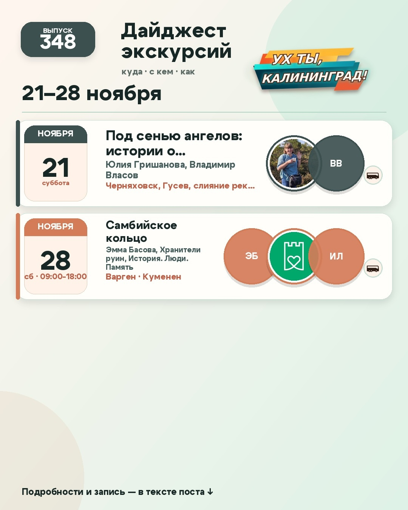
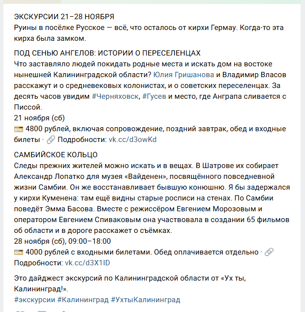
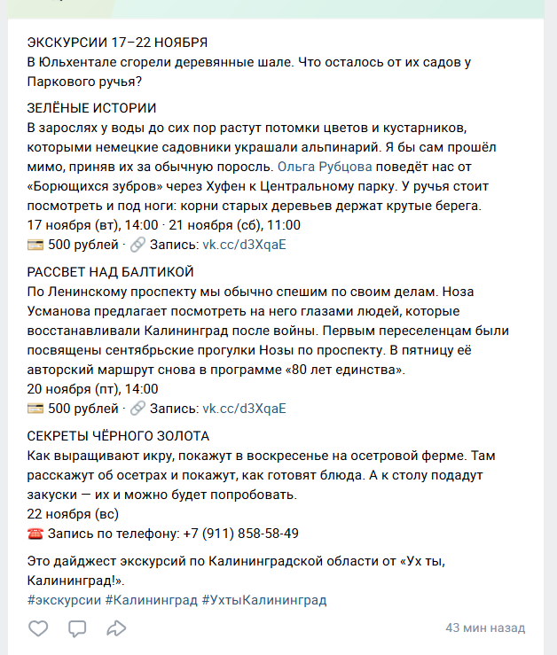

# Повторная экспертиза Fable. Ежедневный дайджест экскурсий для VK

**Запрос владельца от 16 ноября 2026 года.** Оцени, может ли обычный ежедневный генератор самостоятельно собрать достоверный и интересный выпуск на следующей, заранее неизвестной подборке. Владелец доволен абзацем про осетровую ферму в №11. Его замечания к общему зачину, упоминаниям и медальонам относятся к тому, что он увидел в настоящих постах. Ни один из двух отредактированных постов не проходил от выбора источников до отправки без участия редактора.

**Что хотим получить от Fable.** Дай отдельный вердикт о качестве читательских текстов и о готовности автоматизации. Для каждого существенного замечания назови пост, конкретную строку, подтверждение в источнике, место потери в коде и минимальное изменение. Отметь, что стоило бы оставить как есть. В конце расположи исправления по приоритету и опиши, какой результат обычного запуска позволил бы изменить решение о продакшне. Возражения к предложенным ниже гипотезам особенно важны.

**Проверяемая версия.** [PR №1042](https://github.com/onedayonemasterpiece/events-bot-new/pull/1042), код и архив данных на `b6b1ce0a7a6c858e51ce8f17761839b3eb03e0d5`. 54 теста прошли на `c385dcba4`, в том числе тесты, закрепляющие одну тестовую отметку на выпуск. В этой серии тексты Sol получены явным вызовом GPT-6.1 Sol Medium. Ежедневный writer по-прежнему использует маршрут Gemini. [Первоначальные требования](https://mira-projects.slack.com/archives/C0C9LS6L3J8/p1794825818667009) · [Замечания владельца к первым постам](https://mira-projects.slack.com/archives/C0C9LS6L3J8/p1794843689459539) · [Первый вердикт Fable](https://github.com/onedayonemasterpiece/events-bot-new/blob/b6b1ce0a7a6c858e51ce8f17761839b3eb03e0d5/docs/features/guide-excursions-monitoring/vk-narrative-fable-verdict-2026-11-16.md) · [Что проверили после него](https://github.com/onedayonemasterpiece/events-bot-new/blob/b6b1ce0a7a6c858e51ce8f17761839b3eb03e0d5/docs/features/guide-excursions-monitoring/vk-narrative-fable-followup-2026-11-16.md).

## Какие публикации сравнивать

Время выхода указано по Калининграду. У каждого поста одна карточка. Номер поста на стене и номер выпуска на карточке различаются.

| Пост | Происхождение | На что смотреть |
|---|---|---|
| [№7, 20:06](https://vk.ru/wall-243343951_7) | Sol, набор A, выпуск 349. Сборка из сохранённого ответа по входу приложения | Вопрос о корнях получает ответ. Следом у двух туров одинаковое начало про нехватку мест. В «Рассвете» почти исключительно имя и проект. |
| [№9, 20:23](https://vk.ru/wall-243343951_9) | Sol, набор C. Два автобусных выезда | Зачин объявил, что конюшня становится музеем. Сопоставить с анонсом и исправленным №12. |
| [№10, 20:31](https://vk.ru/wall-243343951_10) | Sol, набор F. Пять экскурсий | Четыре абзаца говорят о нехватке мест. «Осталось три места» взято из более раннего объявления. Карточка даёт «активный формат» обычному автобусному выезду. |
| [№11, 20:33](https://vk.ru/wall-243343951_11) | Новая генерация Sol по A с дополнительным материалом о Нозе и повторной редакторской инструкцией. Текст и карточка затем отредактированы вручную | Сопоставить с №7. Убрано впечатление о цветении именно в ноябре. У двух дат одинаково оформлено название. Подмена стоит внутри имени Ольги. |
| [№12, 20:41](https://vk.ru/wall-243343951_12) | Новая генерация Sol по C, затем ручная редактура текста и подписей карточки | Сопоставить с №9. Музей и реставрация конюшни разделены. Лид про Гермау так и не раскрывается. Есть одна подмена на Юлии. |

[Текст, изображение и квитанции №7, №9, №10](https://github.com/onedayonemasterpiece/events-bot-new/blob/b6b1ce0a7a6c858e51ce8f17761839b3eb03e0d5/docs/features/guide-excursions-monitoring/vk-narrative-review-2026-11-16/sol-publications.json) · [Ответы моделей, длительность, сборка и возврат к короткому списку](https://github.com/onedayonemasterpiece/events-bot-new/blob/b6b1ce0a7a6c858e51ce8f17761839b3eb03e0d5/docs/features/guide-excursions-monitoring/vk-narrative-review-2026-11-16/vk-narrative-live-runs-20261116.json) · [Строки и источники шести подборок](https://github.com/onedayonemasterpiece/events-bot-new/blob/b6b1ce0a7a6c858e51ce8f17761839b3eb03e0d5/docs/features/guide-excursions-monitoring/vk-narrative-review-2026-11-16/verified-final-rows.json) · [Дословный вход A](https://github.com/onedayonemasterpiece/events-bot-new/blob/b6b1ce0a7a6c858e51ce8f17761839b3eb03e0d5/docs/features/guide-excursions-monitoring/vk-narrative-review-2026-11-16/vk-fable-input-A-348.json) · [Вход C](https://github.com/onedayonemasterpiece/events-bot-new/blob/b6b1ce0a7a6c858e51ce8f17761839b3eb03e0d5/docs/features/guide-excursions-monitoring/vk-narrative-review-2026-11-16/vk-fable-input-C-351.json) · [Вход F](https://github.com/onedayonemasterpiece/events-bot-new/blob/b6b1ce0a7a6c858e51ce8f17761839b3eb03e0d5/docs/features/guide-excursions-monitoring/vk-narrative-review-2026-11-16/vk-fable-input-F-349.json). [Выход Sol до ручной правки №11 и №12](vk-narrative-round-2-evidence/sol-before-edit-A-C.json). Сравни, в частности, «до сих пор цветут» в A и упоминание Гермау в абзаце C: редактор исправил первое, но сам потерял второе при сокращении. В приложении в конце документа приведены полные публикации №11 и №12 с фактической VK-разметкой и три исходных изображения владельца. Их можно изучить без доступа к сообществу.

## 1. Откуда ежедневный генератор возьмёт материал

В сохранённом входе у «Рассвета над Балтикой» (строка 746) есть название и Ноза Усманова. Поля маршрута и собственного хука пусты. Четыре полных документа имеют общие ссылки на строки 745, 746 и 747. Ботаника в этих документах относится к экскурсии Ольги Рубцовой. Ссылка на целый пост с общим расписанием не устанавливает, что каждый его абзац описывает каждый тур. В №11 редактор отдельно добавил описание сентябрьской версии авторской экскурсии про Ленинский проспект и первых переселенцев. Этого документа в исходном входе A нет. ТИЦ называет гида Шахнозой, ноябрьский организатор — Нозой. Сентябрьские прогулки были бесплатными и начинались в другое время. Для ноябрьского выпуска действуют 20 ноября, 14:00 и 500 рублей. [Описание ТИЦ](https://visit-kaliningrad.ru/excursions/80-let-edinstva-rassvet-nad-baltikoy/) · [Ноябрьское расписание организатора](https://vk.com/wall-211429559_3892).

Импорт уже хранит привязки источника к шаблону маршрута и агрегирует некоторые сведения из предыдущих анонсов. Ежедневная выборка получает полные посты через связи конкретного сеанса и присоединяет их к строкам по документу целиком. Здесь стоит проверить, можно ли воспользоваться существующими связями и первичными текстами, где нужен поиск описания в доверенных источниках и что останется неизвестным даже после него. [Агрегаты шаблона](https://github.com/onedayonemasterpiece/events-bot-new/blob/b6b1ce0a7a6c858e51ce8f17761839b3eb03e0d5/guide_excursions/service.py#L2112-L2146) · [Происхождение сведений шаблона](https://github.com/onedayonemasterpiece/events-bot-new/blob/b6b1ce0a7a6c858e51ce8f17761839b3eb03e0d5/guide_excursions/service.py#L3152-L3179) · [Загрузка связанных постов](https://github.com/onedayonemasterpiece/events-bot-new/blob/b6b1ce0a7a6c858e51ce8f17761839b3eb03e0d5/guide_excursions/visual_digest.py#L1326-L1342) · [Формирование документов для writer](https://github.com/onedayonemasterpiece/events-bot-new/blob/b6b1ce0a7a6c858e51ce8f17761839b3eb03e0d5/guide_excursions/visual_digest.py#L2135-L2148).

**Что проверить на другом маршруте.** Покажи вход *до* запроса к модели. Для содержательной детали должны восстанавливаться источник, его дата, цитируемый фрагмент и основание привязки к конкретной экскурсии. Отдельно проверь стабильность названия, тождество гида, различающиеся имена, два тура одного гида, несколько туров в одном анонсе и отсутствующую карточку. Ложное географическое совпадение хуже честной короткой строки. Оцени, в каком случае обогащение стоит пропустить, какие текущие данные уже достаточны, когда их обновлять. Время, тариф, контакт, число мест и условия сеанса должны оставаться привязанными к актуальному анонсу. Не кодировать знания про конкретного гида в подсказке.

**Контрольные факты.** В источнике о ферме обещают показать, как выращивают икру, и дать попробовать закуски. Ведущий и дегустация икры не названы. Это удачный короткий абзац №11, здесь объём можно сохранить. В анонсе «Самбийского кольца» посещают музей «Вайденен» и знакомятся с Александром Лопатко, который собирает коллекцию и реставрирует конюшню. Само объявление не устанавливает, что музей создают в конюшне. В анонсе Юлии цена выезда 21 ноября — 4800 рублей с питанием и входами. Для Самбийского кольца в Telegram и VK расходится сумма доплаты за обед, в №12 оставлено только общее подтверждённое условие. [Ферма](https://vk.com/wall1746008_13815) · [Выезд 21 ноября](https://t.me/amber_fringilla/6737) · [Самбийское кольцо в Telegram](https://t.me/ruin_keepers/6490) · [Тот же анонс в VK](https://vk.com/wall-190663987_9507).

## 2. К чему ведёт общий хук

№12 начинается с руин кирхи Гермау в Русском и её прошлого замка. Затем идут переселенцы, Черняховск, Гусев. Даже в абзаце «Самбийское кольцо» читатель встречает **Куменену**, другую кирху с росписями. Гермау в этом абзаце отсутствует. Попроси читателя после первого экрана назвать экскурсию и после чтения показать предложение, которое раскрыло зачин. В №11 вопрос о садах действительно получает ответ в первом абзаце. Остальные два сюжета, особенно ферма, остаются в стороне от начальной темы.

Текущая инструкция прямо предписывает выбрать одну деталь одной экскурсии. Также просит раскрыть деталь в её абзаце. В ответе есть только общий `lead` и список абзацев с `occurrence_ids`. При приёме проверяются покрытие, группировка дат и допустимость разметки. Связь между утверждением зачина и содержанием конкретного абзаца не проверяется, служебные `details` отбрасываются. [Требования к зачину](https://github.com/onedayonemasterpiece/events-bot-new/blob/b6b1ce0a7a6c858e51ce8f17761839b3eb03e0d5/guide_excursions/digest_writer.py#L813-L824) · [Какие ответы принимает сборщик](https://github.com/onedayonemasterpiece/events-bot-new/blob/b6b1ce0a7a6c858e51ce8f17761839b3eb03e0d5/guide_excursions/digest_writer.py#L958-L986).

Оцени на A, C и длинном F два подхода. При настоящей общей теме можно связать весь выпуск конкретными деталями нескольких поездок. При разнородном составе можно сразу обозначить экскурсию, к которой относится сильная деталь, раскрыть её и сделать понятный переход к остальным. Нужны критерий выбора, способ удержать обещание в соответствующем абзаце и пример первых двух строк. Не считать достаточными одинаковые слова в двух местах. На примере фермы покажи, где попытка связать все экскурсии одной темой начинает выдумывать смысл. Хронология, естественный голос редакции, движение пешком или на транспорте, собственный хук каждого пункта и читаемость в свёрнутом VK-посте остаются частью оценки.

## 3. Кто получил упоминание и почему

| Гид | Что было в данных | Что действительно опубликовано | Что проверять |
|---|---|---|---|
| Ольга Рубцова | Личный ID `41501067`, строки 745 и 747 | В №11 `[id858363572\|Ольга Рубцова]` | Две даты остаются в одном абзаце. На обеих строках карточки у Ольги есть фото. |
| Ноза Усманова | Личный ID `408521495`, строка 746 | В №11 «Ноза Усманова» — обычный текст | Наличие действительного ID должно доходить до каждого подходящего имени, включая второе в выпуске и косвенные падежи. |
| Юлия Гришанова | Личный ID `51545052`, строка 693 | В №12 ровно одна подмена `[id1134828279\|Юлия Гришанова]`. В исходных №9 и №10 персональной подмены Юлии внутри рассказа не было | Объяснить расхождение впечатления владельца с разметкой конкретной версии и видимость ссылки в приложении. №12 собран после ручной правки. |
| Владимир Власов | Соответствующий личный ID в строке 693 пуст | Имя в №12 видно обычным текстом | Упоминать обоих гидов. Оформлять ссылку при доказанном соответствии VK-профиля. Не присваивать ID Юлии второму гиду. |
| Эмма Басова | В строке 740 у гида ID пуст. Отрицательный ID `-190663987` относится к организатору «Хранители руин» | Имя Эммы в №12 без ссылки | Карточка ТИЦ указывает профессиональный сайт гида, а сайт ведёт на личную страницу `vk.com/emmabasova`. В VK ссылка разрешилась в точный профиль Emma Basova. Почему эта связь не дошла до строки выпуска? |

[Карточка Эммы у ТИЦ](https://visit-kaliningrad.ru/pro/gidy-i-ekskursovody/basova-emma/) · [Сайт гида](https://emmabasova.ru/) · [Её страница VK](https://vk.com/emmabasova) · [Участники и сохранённые идентификаторы](https://github.com/onedayonemasterpiece/events-bot-new/blob/b6b1ce0a7a6c858e51ce8f17761839b3eb03e0d5/docs/features/guide-excursions-monitoring/vk-narrative-review-2026-11-16/verified-final-rows.json).

В ветке есть два независимых механизма потери. Тестовая подмена срабатывает только один раз на весь выпуск. Кроме того, токен модели может содержать грамматически правильное «с Ольгой Рубцовой», а сравнение метки с каноническим «Ольга Рубцова» не проходит. Этот второй дефект касается и обычного режима при включённых упоминаниях. Если ни одна метка не подошла, в конце добавляется служебная строка. В №7, №9, №10 именно она дала формально успешную проверку. Получение уведомления в «колокольчике» для №11/12 не подтверждалось. [Роли и допустимые VK ID](https://github.com/onedayonemasterpiece/events-bot-new/blob/b6b1ce0a7a6c858e51ce8f17761839b3eb03e0d5/guide_excursions/visual_digest.py#L2112-L2134) · [Склонение в инструкции модели](https://github.com/onedayonemasterpiece/events-bot-new/blob/b6b1ce0a7a6c858e51ce8f17761839b3eb03e0d5/guide_excursions/digest_writer.py#L905-L910) · [Подстановка имени](https://github.com/onedayonemasterpiece/events-bot-new/blob/b6b1ce0a7a6c858e51ce8f17761839b3eb03e0d5/guide_excursions/visual_digest.py#L2227-L2238) · [Резервная служебная строка](https://github.com/onedayonemasterpiece/events-bot-new/blob/b6b1ce0a7a6c858e51ce8f17761839b3eb03e0d5/guide_excursions/visual_digest.py#L2294-L2301) · [Что считается успешным в тестах](https://github.com/onedayonemasterpiece/events-bot-new/blob/b6b1ce0a7a6c858e51ce8f17761839b3eb03e0d5/tests/test_guide_visual_digest.py#L443-L482).

Запрос владельца для следующей проверки — **каждый идентифицированный гид** в тексте получает подмену на разрешённый тестовый аккаунт. Проверь соответствие ID разрешённому гиду в рамках конкретного абзаца, правильный падеж, нескольких гидов одного выезда, случай отсутствующего или неоднозначного ID и отдельные роли организаций. Для проверки на стене сверять каждое ожидаемое имя и адрес назначения. Реальные массовые уведомления при испытании выключены. Предложи, как отделять отсутствие доказанной личности от ошибки сборщика и видимость кликабельного имени от доставки уведомления.

## 4. Как должны выглядеть медальоны

Правило владельца действует для **отдельной строки экскурсии**. Если у одного или нескольких участников есть доступные изображения, показать только их фото или эмблемы. Если участники известны, но ни у кого нет изображения, показать ровно один медальон с инициалами. При полностью пустом списке участников оставить строку без портрета, как у фермы. Имена гидов и организаторов в подписи сохраняются независимо от медальонов.

На карточке №348 это означает одну фотографию Юлии в первой строке и одну эмблему «Хранителей руин» во второй. Сейчас дополнительно нарисованы «ВВ», «ЭБ» и «ИЛ». В результате заголовок первого выезда обрывается на «истории о…». Доступную ширину надо пересчитать по действительно показываемым значкам. Проверь случай двух настоящих фото, динамический файл, встроенное изображение, недоступный файл и полностью пустую строку. Как выбрать одного представителя, если фото нет у всех? Как поведёт себя карточка при длинном названии после освобождения места? [Скриншот владельца](vk-narrative-round-2-evidence/owner-card-348.png) · [Фото и инициалы](https://github.com/onedayonemasterpiece/events-bot-new/blob/b6b1ce0a7a6c858e51ce8f17761839b3eb03e0d5/guide_excursions/visual_digest.py#L925-L939) · [Резервирование ширины](https://github.com/onedayonemasterpiece/events-bot-new/blob/b6b1ce0a7a6c858e51ce8f17761839b3eb03e0d5/guide_excursions/visual_digest.py#L1098-L1106) · [Отрисовка](https://github.com/onedayonemasterpiece/events-bot-new/blob/b6b1ce0a7a6c858e51ce8f17761839b3eb03e0d5/guide_excursions/visual_digest.py#L1139-L1146).

## 5. Хештег и решение о выпуске

Штатный список начинается с `#экскурсии`. Владелец предполагает, что у `#экскурсия` выше частотность. Укажи, есть ли сопоставимые данные именно в VK, по какому периоду, региону и показателю. Частота употребления тега в публикациях, частота поисковых запросов и охват постов — разные показатели. При отсутствии измерения единственное число допустимо как редакционный выбор. Заголовок «ЭКСКУРСИИ» с диапазоном дат и географические теги имеют собственное назначение. [Подготовка тегов](https://github.com/onedayonemasterpiece/events-bot-new/blob/b6b1ce0a7a6c858e51ce8f17761839b3eb03e0d5/guide_excursions/visual_digest.py#L1967-L1985).

Для итогового решения предложи один сквозной контроль на ежедневной команде с реально выбранной моделью, зафиксированными входом, сырым ответом, читательским текстом, прикреплённой карточкой и повторным чтением опубликованного в тестовом сообществе. Отдельно проверь незнакомый короткий анонс, где нет материала для расширения. Оцени, что можно включать самостоятельно после исправления, и что всё ещё требует редактора. Следующий шаг владельца — решение о доработке по результату экспертизы.

## Приложение. Что увидел владелец







**Дословный текст №11 из VK**

```text
ЭКСКУРСИИ 17–22 НОЯБРЯ
В Юльхентале сгорели деревянные шале. Что осталось от их садов у Паркового ручья?

ЗЕЛЁНЫЕ ИСТОРИИ
В зарослях у воды до сих пор растут потомки цветов и кустарников, которыми немецкие садовники украшали альпинарий. Я бы сам прошёл мимо, приняв их за обычную поросль. [id858363572|Ольга Рубцова] поведёт нас от «Борющихся зубров» через Хуфен к Центральному парку. У ручья стоит посмотреть и под ноги: корни старых деревьев держат крутые берега.
17 ноября (вт), 14:00 · 21 ноября (сб), 11:00
💳 500 рублей · 🔗 Запись: vk.cc/d3XqaE

РАССВЕТ НАД БАЛТИКОЙ
По Ленинскому проспекту мы обычно спешим по своим делам. Ноза Усманова предлагает посмотреть на него глазами людей, которые восстанавливали Калининград после войны. Первым переселенцам были посвящены сентябрьские прогулки Нозы по проспекту. В пятницу её авторский маршрут снова в программе «80 лет единства».
20 ноября (пт), 14:00
💳 500 рублей · 🔗 Запись: vk.cc/d3XqaE

СЕКРЕТЫ ЧЁРНОГО ЗОЛОТА
Как выращивают икру, покажут в воскресенье на осетровой ферме. Там расскажут об осетрах и покажут, как готовят блюда. А к столу подадут закуски — их и можно будет попробовать.
22 ноября (вс)
☎ Запись по телефону: +7 (911) 858-58-49

Это дайджест экскурсий по Калининградской области от «Ух ты, Калининград!».
#экскурсии #Калининград #УхтыКалининград
```

**Дословный текст №12 из VK**

```text
ЭКСКУРСИИ 21–28 НОЯБРЯ
Руины в посёлке Русское — всё, что осталось от кирхи Гермау. Когда-то эта кирха была замком.

ПОД СЕНЬЮ АНГЕЛОВ: ИСТОРИИ О ПЕРЕСЕЛЕНЦАХ
Что заставляло людей покидать родные места и искать дом на востоке нынешней Калининградской области? [id1134828279|Юлия Гришанова] и Владимир Власов расскажут и о средневековых колонистах, и о советских переселенцах. За десять часов увидим #Черняховск, #Гусев и место, где Анграпа сливается с Писсой.
21 ноября (сб)
💳 4800 рублей, включая сопровождение, поздний завтрак, обед и входные билеты · 🔗 Подробности: vk.cc/d3owKd

САМБИЙСКОЕ КОЛЬЦО
Следы прежних жителей можно искать и в вещах. В Шатрове их собирает Александр Лопатко для музея «Вайденен», посвящённого повседневной жизни Самбии. Он же восстанавливает бывшую конюшню. Я бы задержался у кирхи Куменена: там ещё видны старые росписи на стенах. По Самбии поведёт Эмма Басова. Вместе с режиссёром Евгением Морозовым и оператором Евгением Спиваковым она участвовала в создании 65 фильмов об области и в дороге расскажет о съёмках.
28 ноября (сб), 09:00–18:00
💳 4000 рублей с входными билетами. Обед оплачивается отдельно · 🔗 Подробности: vk.cc/d3X1ID

Это дайджест экскурсий по Калининградской области от «Ух ты, Калининград!».
#экскурсии #Калининград #УхтыКалининград
```
