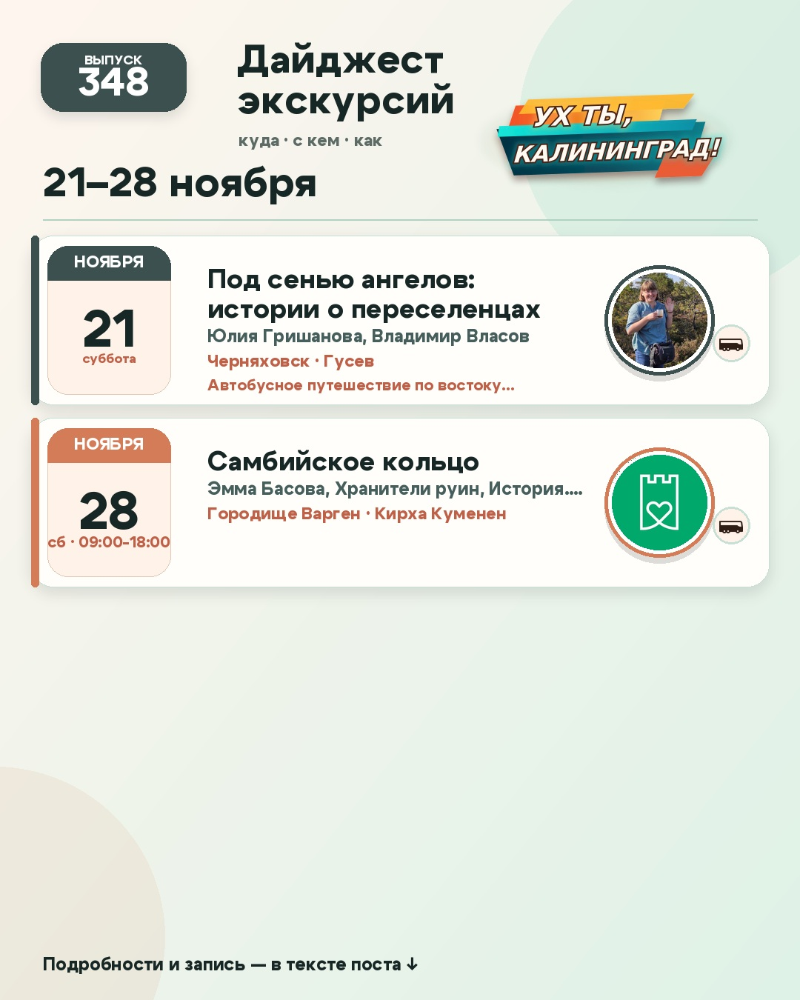
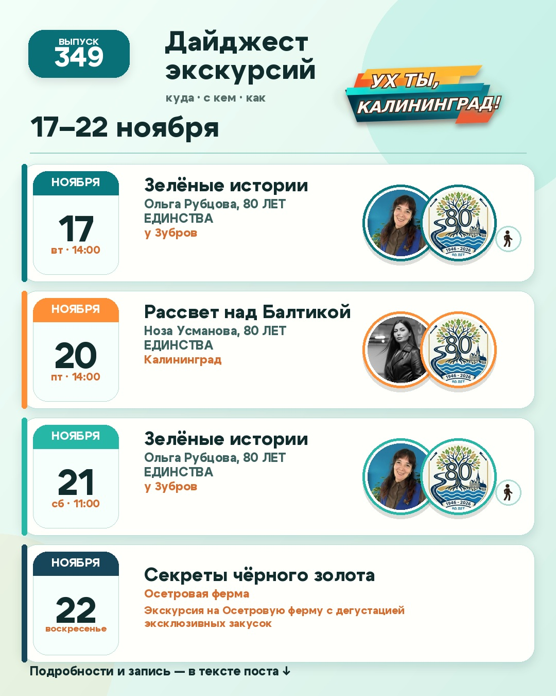
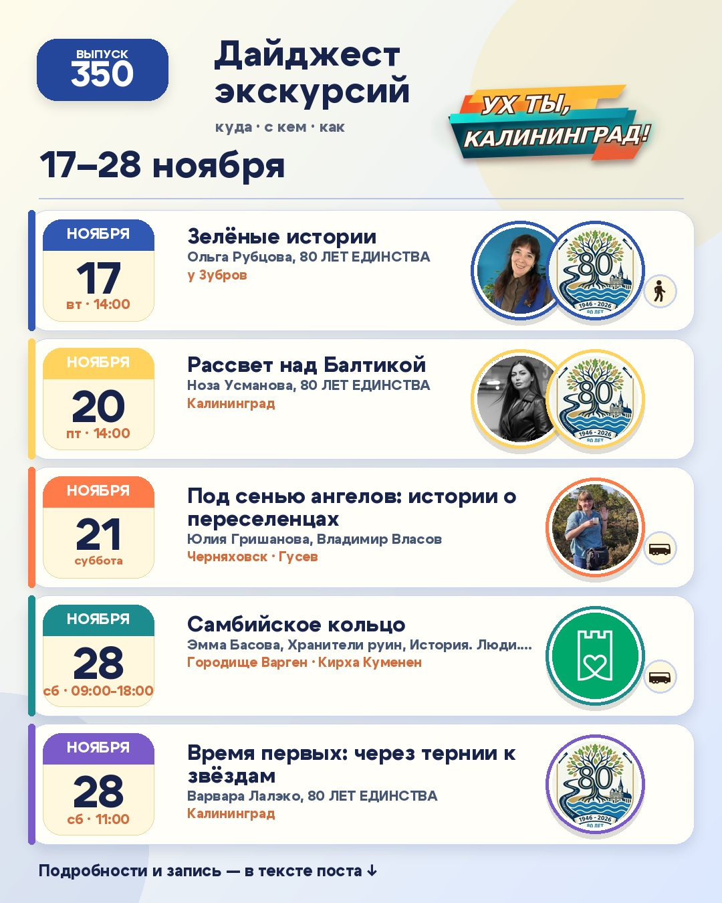

# Дайджесты экскурсий после второго разбора Fable

16 ноября 2026 года. Три последовательных запуска штатного автора и сборщика дали три текста и три карточки 1080 × 1350. Во всех ответил `gpt-6.1-sol` с первой попытки. Тексты, выбор фотографий и карточки оставлены как их собрал бот. Перейти к [№348](#348), [№349](#349) или [№350](#350).

| Выпуск | Состав | Ответ модели и сборка | Подменено упоминаний гидов с личным ID |
| --- | --- | ---: | ---: |
| 348 | Две автобусные экскурсии | 63,76 с | 1 из 1 |
| 349 | Три экскурсии, четыре сеанса | 55,18 с | 2 из 2 |
| 350 | Пять экскурсий, включая маршрут с кратким исходным анонсом | 98,27 с | 4 из 4 |

**Как воспроизведена работа генератора.** Для сравнения с предыдущим разбором взяты те же реальные строки из [сохранённой выборки](../vk-narrative-review-2026-11-16/verified-final-rows.json), сохранённые фотографии и ранее полученные короткие ссылки VK на те же адреса. Для «Рассвета над Балтикой» новый модуль мониторинга получил описание с сайта ТИЦ и записал его в отдельную SQLite. Генератор прочитал его штатно. Время, цена и ссылка на запись пришли из ноябрьского анонса. При повторе использовались штатные функции запуска модели, сборки текста и создания карточки. Свежий отбор из рабочей базы ежедневным расписанием и доставка этих трёх карточек на стену остаются отдельными проверками.

**Проверка стены, 16 ноября.** Для итогового №348 сервис принял карточку. При запросе сервера загрузки фотографий VK вернул код авторизации 5 до создания записи. Повторное чтение операции подтвердило этот результат. В публичной ленте последней оставалась предыдущая публикация от 20:41 по Калининграду, с зачином «Руины в посёлке Русское». Для трёх вариантов ниже ссылок на опубликованные записи пока нет. [Тестовое сообщество](https://vk.ru/club243343951)

[Проверенная версия кода](https://github.com/onedayonemasterpiece/events-bot-new/commit/10948e1855390dc53547aa5a620c6a9e50e29358) · [Вердикт Fable во втором раунде](../vk-narrative-fable-verdict-round-2-2026-11-16.md) · [Исследование семи групп веб-источников](../web-sources-2026-11-16.md)

**Что стоит оценить редактору.** В №348 обе темы из зачина раскрыты в своих экскурсиях. Открытый парк и будущий музей в кирхе Рудау различены. На карточке у первой экскурсии видна фотография Юлии, у второй — эмблема «Хранителей руин». В №349 появился подтверждённый материал о Ленинском проспекте, но две последние фразы о ферме загромождают короткий анонс. В №350 общий зачин охватывает все пять экскурсий, при этом «Ещё пройдёт через выпуск Ленинский проспект» читается как перечисление. У «Времени первых» известны название, гид и строка программы. Проверить, достаточно ли упоминания гида для связи зачина с этим абзацем. В «Самбийском кольце» музей в Шатрове и реставрация конюшни теперь приписаны своим объектам.

**Что сверить Fable.** У каждого выпуска есть исходный текст для стены, вход Sol вместе с источниками и сырой ответ до сборки. Проверить, что опорная деталь действительно представляет экскурсию, что вся фраза о месте или участнике подтверждена источником и что сохранены условия записи. Отдельно оценить авторское «я» и повторы между выпусками. На редких маршрутах сравнить информационность короткой строки с риском приписать ей программу другой экскурсии.

**Упоминания и хештеги.** Ссылки в текстах для стены ведут на разрешённые тестовые аккаунты. Два имени с разным написанием могут вести на одного тестового получателя. У Эммы Басовой в этих данных есть ID сообщества, у Эммы и Владимира Власова нет подтверждённого личного числового ID. Видимое имя остаётся в тексте. Для VK и Telegram выбран общий тег `#экскурсия`. Сравнения частотности нет.

**Сверка запуска.** У первого комплекта №348 журнал сохранил родительский Git HEAD перед фиксацией уже использованного кода. SHA-256 четырёх файлов автора, сборщика и мониторинга совпадают во всех трёх журналах и с версией по ссылке выше. На объединённом коде прошли 169 профильных тестов.

## 348

ЭКСКУРСИИ 21–28 НОЯБРЯ 
Кирха Рудау на маршруте по Самбии — как орденский замок становится музеем? Ещё поедем к слиянию Анграпы и Писсы, а в пути разберёмся, почему переселенцы разных веков оставляли родные места.

ПОД СЕНЬЮ АНГЕЛОВ: ИСТОРИИ О ПЕРЕСЕЛЕНЦАХ 
На слияние Анграпы и Писсы посмотрим в поездке по востоку области с остановками в Черняховске и Гусеве. В пути [id1134828279|Юлия Гришанова] и Владимир Власов разберут причины, по которым люди оставляли место рождения и искали новую родину. Речь о разных столетиях. От колонистов Средневековья до советских поселенцев прошлого века — для меня такой размах важен: он не даёт свести историю переселенчества к одному поколению. В поездку включены поздний завтрак и обед. 
21 ноября (сб) 
💳 4800 руб (сопровождение, поздний завтрак, обед, все входы) · 🔗 Подробности: vk.cc/d3owKd

САМБИЙСКОЕ КОЛЬЦО 
Кирха Рудау, прежде орденский замок, уже окружена историческим парком: территорию открыли для посетителей в прошлом году. В восстановленном здании готовят музей. Поедем и к кирхе Куменена с древними росписями на стенах: её заброшенную территорию «Хранители руин» вместе с Татьяной Суншуровой превратили в парк. Ведёт Эмма Басова, которая участвовала в создании 65 фильмов об области в проекте «История. Люди. Память». В её рассказе будут и прошлое Самбии, и подробности работы над документальными фильмами. 
28 ноября (сб), 09:00-18:00 
💳 4000 рублей с человека (входные билеты включены, обед оплачивается отдельно — 600 рублей) · 🔗 Подробности: vk.cc/d3X1ID

А в вашей семье сохранился рассказ о том, почему решили переехать в Калининградскую область?

Это дайджест экскурсий по Калининградской области от «Ух ты, Калининград!».

#экскурсия #Калининград #УхтыКалининград #Черняховск #Гусев

[Точный текст для VK](C/wall-text.txt) · [Вход, источники и ответ Sol](C/generation.json) · [Проверка упоминаний](C/coverage.json) · [Полная карточка](C/card-1.png)

## 349

ЭКСКУРСИИ 17–22 НОЯБРЯ 
Зелёные шары в голых кронах — омела, о которой пойдёт речь на прогулке по Хуфену. А ещё поедем смотреть, как выращивают икру на осетровой ферме, и обратимся к истории первых переселенцев на маршруте по Ленинскому проспекту.

ЗЕЛЁНЫЕ ИСТОРИИ 
Зелёные шары омелы обходятся без корней в земле: воду и минеральные соли растение берёт из ветвей дерева-хозяина, а фотосинтезирует само. Вот это соседство меня и задевает: одна крона, а способы жить в ней разные. С [id858363572|Ольгой Рубцовой] пройдёмся от «Борющихся зубров» через Хуфен вдоль Паркового ручья в Центральный парк — неспешно, с историями о платанах, сбрасывающих кору, и гинкго. У ручья сохранились потомки декоративных растений, которые высаживали немецкие садовники. Дома сгорели, а растения остались. 
17 ноября (вт), 14:00 · 21 ноября (сб), 11:00 
💳 500 рублей · 🔗 Запись: vk.cc/d3XqaE

РАССВЕТ НАД БАЛТИКОЙ 
По Ленинскому проспекту проходит маршрут о строителях и первых переселенцах, восстанавливавших край после войны. Его ведёт [id858363572|Ноза Усманова]. В описании маршрута рядом стоят гудок первого эшелона и истории наших космонавтов — такой размах у рассказа о послевоенном крае. Общая тема здесь — труд людей разных народов, благодаря которому на месте руин снова появилась жизнь. 
20 ноября (пт), 14:00 
💳 500 рублей · 🔗 Запись: vk.cc/d3XqaE

СЕКРЕТЫ ЧЁРНОГО ЗОЛОТА 
Как выращивают икру, предлагают увидеть на осетровой ферме; здесь же покажут, как готовят блюда. Будет и дегустация закусок. Мне нравится возможность сопоставить рассказ о рыбе с тем, что можно попробовать: у кулинарной части есть продолжение за пределами тарелки. В анонсе обещают рассказать всё об осетрах, но отдельных вопросов и подробной программы не приводят. 
22 ноября (вс) 
☎ Запись по телефону: +7 (911) 858-58-49

Вы замечаете омелу в голых кронах — и на каких улицах Калининграда она чаще попадается вам на глаза?

Это дайджест экскурсий по Калининградской области от «Ух ты, Калининград!».

#экскурсия #Калининград #УхтыКалининград

[Точный текст для VK](A/wall-text.txt) · [Вход, источники и ответ Sol](A/generation.json) · [Проверка упоминаний](A/coverage.json) · [Полная карточка](A/card-1.png)

## 350

ЭКСКУРСИИ 17–28 НОЯБРЯ 
Зелёные шары в голых кронах на прогулке по Хуфену — это омела. Ещё пройдёт через выпуск Ленинский проспект с историями строителей, а к слиянию Анграпы и Писсы поедем с разговором о переселенцах. В другой поездке рассмотрим росписи кирхи Куменена, а ещё одну экскурсию проведёт [id858363572|Варвара Лалэко].

ЗЕЛЁНЫЕ ИСТОРИИ 
Зелёные шары получают воду прямо из ветвей дерева-хозяина, а фотосинтезом омела занимается сама. До земли её корни не добираются. Мне нравится эта поправка к привычному виду дерева: зелень в его кроне может жить отдельной жизнью. С [id858363572|Ольгой Рубцовой] пройдём от «Борющихся зубров» через Хуфен вдоль ручья в Центральный парк — с вопросами о сбрасывающих кору платанах и о том, где растёт гинкго. В овраге Паркового ручья речь пойдёт об утраченном Юльхентале: дома исчезли, а потомки садовых растений остались. 
17 ноября (вт), 14:00 
💳 500 рублей · 🔗 Запись: vk.cc/d3XqaE

РАССВЕТ НАД БАЛТИКОЙ 
Ленинский проспект на этом маршруте связан с трудом строителей и мечтами первых переселенцев. [id858363572|Ноза Усманова] ведёт экскурсию о том, как люди разных народов поднимали край из руин; её историческая дуга тянется от первого эшелона до наших космонавтов. Масштаб немаленький. Я ценю такой повод посмотреть на проспект через людей, которые его строили: за привычной улицей проступает их работа. 
20 ноября (пт), 14:00 
💳 500 рублей · 🔗 Запись: vk.cc/d3XqaE

ПОД СЕНЬЮ АНГЕЛОВ: ИСТОРИИ О ПЕРЕСЕЛЕНЦАХ 
К слиянию Анграпы и Писсы поедем через восток области, с остановками в Черняховске и Гусеве. В пути [id858363572|Юлия Гришанова] и Владимир Власов проведут разговор о переселенцах — от средневековых колонистов до советских поселенцев прошлого века. Что заставляло людей покидать место рождения и искать другую родину? Это главный вопрос поездки. Поздний завтрак и обед включены в программу. 
21 ноября (сб) 
💳 4800 руб (сопровождение, поздний завтрак, обед, все входы) · 🔗 Подробности: vk.cc/d3owKd

САМБИЙСКОЕ КОЛЬЦО 
Древние росписи кирхи Куменена сохранились на стенах, а прежде заброшенная территория вокруг стала парком благодаря «Хранителям руин» и Татьяне Суншуровой. Поедем по Самбии с Эммой Басовой, участницей создания документальных фильмов об области: в пути будут и истории съёмок. В Русском осмотрим остатки кирхи Гермау, которая прежде была замком. В Шатрово заглянем в музей повседневной жизни «Вайденен» и познакомимся с Александром Лопатко, собирателем артефактов и восстановителем старой конюшни. Часть средств пойдёт на уход за руинами. 
28 ноября (сб), 09:00-18:00 
💳 4000 рублей с человека (входные билеты включены, обед оплачивается отдельно — 600 рублей) · 🔗 Подробности: vk.cc/d3X1ID

ВРЕМЯ ПЕРВЫХ: ЧЕРЕЗ ТЕРНИИ К ЗВЁЗДАМ 
[id858363572|Варвара Лалэко] проводит экскурсию в программе проекта «80 лет единства». 
28 ноября (сб), 11:00 
💳 500 рублей · 🔗 Запись: vk.cc/d3XqaE

Вы замечали омелу в голых кронах Калининграда — на каких улицах она вам попадалась?

Это дайджест экскурсий по Калининградской области от «Ух ты, Калининград!».

#экскурсия #Калининград #УхтыКалининград #Черняховск #Гусев

[Точный текст для VK](F/wall-text.txt) · [Вход, источники и ответ Sol](F/generation.json) · [Проверка упоминаний](F/coverage.json) · [Полная карточка](F/card-1.png)
