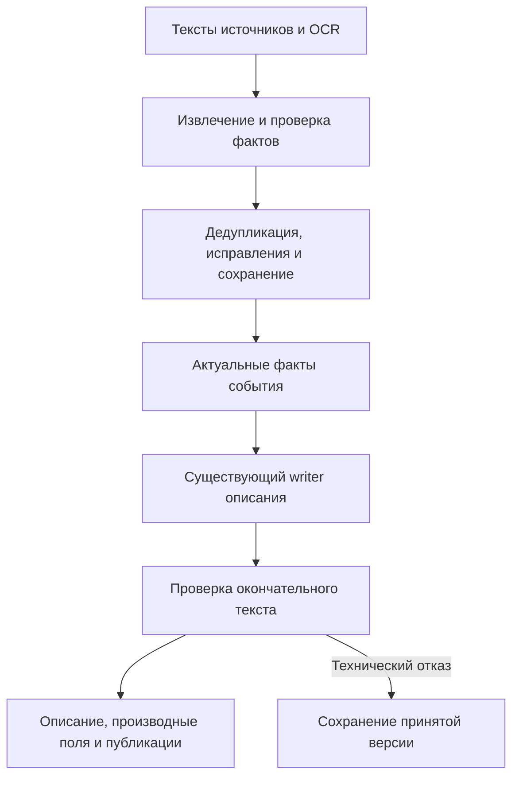

# Smart Update: корректный тюнинг fact-first и проверка VK CAPTCHA

**Дата:** 20 ноября 2026 года. **Статус:** завершённый аудит и передача на ревью/реализацию; изменения поведения из этого документа ещё не выпущены.

**Автор анализа:** ChatGPT; независимые направления проверки — субагенты `preservation`, `grounding`, `alerts`. Требования владельца приведены отдельно от выводов автора. Этот документ можно передать Opus для критического разбора либо непосредственно назначить кодовому агенту. Внешнее ревью Opus в этом запуске не проводилось.

**Связанный инцидент:** [INC-2026-11-17-smart-update-import-quality](../../reports/incidents/INC-2026-11-17-smart-update-import-quality.md). Этот файл уточняет архитектурный вывод отчёта от 19 ноября; исторические результаты измерений, выпусков и адресных ремонтов остаются в том отчёте.

## 1. Вывод и исправление моего прежнего решения

Владелец прав относительно действовавшего контракта Smart Update: **источники разбираются на факты; подтверждённые факты согласуются и дедуплицируются; описание заново пишется из всего актуального содержательного набора**. Прежнее описание — результат удачной генерации, который можно сохранить при техническом отказе. Оно не должно постоянно служить дополнительным доказательством для новой прозы.

Мой PR #1067 действительно изменил этот контракт. Для существующего события с непустым описанием он принимает текст из semantic merge старой прозы и нового источника, а существующий fact-first writer обходит. Это не просто неточная формулировка отчёта и не редкий fallback. Ветка намеренно закреплена кодом, prompt и тестом. **Рекомендация считать такой маршрут окончательным решением отозвана.**

При этом полный откат #1067 также неверен: он вернёт подтверждённую генерацию из неполных фактов и отменит полезные защиты. Исправление состоит из двух связанных частей в существующей системе: восстановить полноту и сохранность подтверждённых фактов; вернуть их единственному автору итогового описания. Простое удаление одного `elif before_description` снова обеднит карточки.

Проверка кода, свежих данных и уже сохранённых модельных трасс выявила следующие причины:

1. **Факты теряются до writer.** Извлечённые данные режутся по количеству и длине; содержательная фраза может целиком исчезнуть из-за слова «записи» или совпадения с городом.
2. **Факты одного источника заменяются текущим batch.** Неполный повторный результат либо служебная note способны вытеснить предыдущий набор на ветках, дошедших до записи.
3. **Обновление одновременно пишет прозу и возвращает delta фактов.** Проза содержит программу, а возвращённый набор — лишь организатора, ссылку и условия. Следующий fact writer работает с этим бедным входом.
4. **Исправленная вручную публикация не означает исправленный ledger.** На 20 ноября у двух вчера восстановленных описаний программа по-прежнему отсутствует в журнале фактов.
5. **Технический отказ LLM может переключить создание на менее строгий rewrite.** Поэтому связь уведомлений о сбоях с потерями/выдумками реальна, хотя каждый отдельный warning не доказывает потерю.
6. **Наблюдаемые сейчас CAPTCHA не объясняются автоматическим редактированием VK-постов.** Все шесть ошибок за проверенные сутки относятся к `docs.save` при загрузке календарного файла для комментария.

Система уже содержит rich extraction, разделение фактов, trust/conflict policy, fact writer, derived fields и проверки. Новый конвейер, «движок хуков», очередь или дополнительная модель-судья не требуются.

## 2. Что проверено и что не менялось

### 2.1. Версии и активный маршрут

| Объект | Подтверждённое состояние |
| --- | --- |
| Main до PR #1067 | `af7eb547e509e5bd3d45d0971ba79d3a915e8c08` |
| Merge PR #1067 / R1 | `d020e342fe9facd007b26734723a5215ff923df3` |
| Проверенный main 20 ноября | `bbe6baa03230db8f0c149330f1e9a3fb05d4a1a4` |
| Production, чтение 20 ноября 10:15 UTC / 12:15 Калининград | `5b27b87c0a8b7aaa39f119f9c939a9a2b19f76d1`; `ready=true`, `db=ok`, `issues=[]` |
| Сопоставление кода | SHA-256 шести основных файлов runtime совпали с exact main; для VK дополнительно сверены девять профильных blobs |
| `SMART_UPDATE_FACT_FIRST` | Переменная отсутствует; действует default `1` |
| `SMART_UPDATE_G4_SPLIT_CREATE` | `1` |
| `SMART_UPDATE_G4_LOLLIPOP_LIGHT_CREATE` | `1`, но ветка требует выключенного split-create, поэтому сейчас не исполняется |
| `SMART_UPDATE_FORCE_STAGED_GEMINI` | `0` |

Следовательно, нельзя объяснять текущую работу ограничением 700–1100 символов из неактивной lollipop-ветки. Активен rich split-create. [Выбор ветки][routing].

Чтение четырёх карточек выполнено 20 ноября в 10:19 UTC / 12:19 Калининград через SQLite `mode=ro` и `query_only`, в одном согласованном чтении. Для фактов не применялось усечение выдачи.

### 2.2. Метод и границы доказательств

- Сравнены exact commits до/после #1067, текущий код, активные runtime flags и хеши файлов.
- Повторно разобраны **фактические prompt/response** замороженных прогонов 19 ноября. Новых вызовов моделей не было. Эти прогоны не выдаются за точную реконструкцию исторического импорта 16–17 ноября.
- Прочитаны текущие описания, все строки фактов и метаданные источников четырёх выбранных проблемных карточек.
- Для VK прочитаны сохранённые runtime-логи за фиксированные 24/48 часов, состояния трёх jobs и их live post keys; узкий operational ledger проверен только для `wall.edit`.
- Исходный код продукта, тесты, настройки, БД, импорты и социальные публикации в этом запуске **не изменялись**. Диагностические скрипты лишь читали данные и сохраняли ограниченные evidence projections. Изменения текущей поставки — документация.

Четыре карточки — целевой разбор механизма, не случайная выборка всей афиши. Историческая слепая разметка 44 пар из отобранных 62 и разбор 29 VK URL остаются в [отчёте 19 ноября][old-report]. Их нельзя превращать в процент испорченных карточек всей системы. Доказанная возможность потери в коде также не равна измеренной частоте её срабатывания.

## 3. Контракт, который следует сохранить

### 3.1. Факты — это содержательная основа события

Фактами здесь являются не только дата, место и цена. К ним относятся участники и их роли, произведения, действия посетителя, темы и примеры, состав программы, содержательная предыстория, числа, ограничения и условия участия. Именно эти сведения дают автору текста материал для интересного лида.

Основной документ [fact-first.md][contract] изначально закрепляет:

- источники фактов — сохранённые тексты источников и OCR афиш;
- старое legacy-описание допускается как вход извлечения атомарных фактов при отсутствии исходной базы;
- публичное описание создаётся из `facts_text_clean`;
- narrative, infoblock и отбрасываемый промошум различаются; корзины сейчас вычисляются из плоского журнала, а не хранятся новыми сущностями.

Сохранённый первоисточник предпочтительнее старой сгенерированной прозы. При восстановлении неполной карточки нельзя автоматически объявлять все прежние удачные формулировки доказанными фактами.

### 3.2. Что означает «фактов стало больше»

Смысловой триггер — изменение **актуального подтверждённого набора**, а не рост числа строк или появление ещё одного URL.

| Входное изменение | Ожидаемое поведение |
| --- | --- |
| Те же участник, роль, действие и условия другими словами | Дедупликация/поддержка прежнего факта; стилистическое переписывание не требуется |
| Новый подтверждённый участник, произведение, занятие или пример | Включить в актуальный набор и заново написать описание |
| Существенное условие: предоплата, ограничения тарифа, что включено | Учесть в фактах и в предназначенном для читателя представлении |
| В коротком новом анонсе нет старого пункта программы | Это не отмена; ранее подтверждённый пункт сохраняется |
| Источник прямо отменяет, заменяет или переносит пункт при допустимом доверии | Старую версию исключить из актуального набора; отразить подтверждённое изменение |
| Добавлена афиша без новых сведений | Обновить медиа/источник, не переписывать описание ради нового batch |
| Writer ранее добавил эффектную, но не подтверждённую фразу | Она не становится фактом вследствие нахождения в старом описании |
| Предыдущая генерация не удалась, факты уже сохранены | Повтор должен иметь возможность завершить описание; «все duplicate» не должно навсегда блокировать незавершённое обновление |

Это означает и появление новых сведений, и исправление старых. Простое правило «только если число фактов выросло» не подходит для отмены или замены.

### 3.3. Последняя принятая версия и истина — разные роли

При техническом отказе нормально оставить прежние `description`, `short_description`, `search_digest`. Это защищает читателя от деградации. Но следующий успешный writer должен получать согласованные факты, а не использовать прежний текст как разрешение повторить недоказанные утверждения.

Явная отмена/перенос — особый контроль: сохранение прежней прозы не должно повторно публиковать уже опровергнутую программу. Следует сохранить существующие правила reschedule и защиты публикации, в том числе R3, и явно проверить этот сценарий при реализации. Не нужен новый универсальный слой состояний.

Целевая связь существующих компонентов:



Это схема ответственности, а не предложение новых сервисов или обязательного дополнительного LLM-вызова на каждом шаге.

## 4. Где PR #1067 изменил правильный принцип

### 4.1. До и после

До #1067 после согласования нового источника собирались `facts_before_list + added_facts + legacy_facts`, после чего `_llm_fact_first_description_md_bounded` писал описание. При успешной fact-first генерации `merge_data.description` не становился публичным текстом. [Предыдущий код][before-r1].

После #1067 для непустого `before_description` работает другая ветка:

1. Берётся `clean_description` из `_llm_merge_event`.
2. Coverage получает факты **и** прежнее описание, кандидат, OCR.
3. Если verdict принят, сохраняется merge draft.
4. Устанавливается `merge_fact_first_used=True`.
5. Fact writer, находящийся в следующем `elif`, не вызывается.

Это подтверждено [веткой L22111–22241][merge-bypass], [merge prompt][merge-prompt] и [coverage prompt][merge-coverage]. Одинаковое имя флага `merge_fact_first_used` не делает результат fact-first по смыслу.

Тест `test_smart_update_merge_coverage.py` прямо проверяет отсутствие старой программы в `facts_text_clean` и `second_writer.assert_not_awaited()`. Поэтому зелёный результат охраняет неверный контракт. Его следует изменить вместе с реализацией, сохранив содержательные отрицательные проверки. [Тест][wrong-test].

### 4.2. Что сохранить при адресной коррекции

| Сохранить | Изменить |
| --- | --- |
| `None`/malformed coverage не считается PASS | Источник истины coverage не должен расширяться прежней прозой |
| Прежние принятые поля сохраняются при техническом отказе | Merge draft не публикуется вместо fact writer |
| Детерминированная дедупликация перед проверкой | Проверка относится к окончательному сохраняемому тексту, включая revise |
| Защита short/digest от rejected bundle и candidate fallback | Производные поля не живут по отдельной фактологической версии |
| Исправление unknown `is_free`, ошибочной классификации цены | Узкие исключения не заменяют полноценное разделение содержания и логистики |
| Исправления уведомлений/terminal outcomes и R2 identity | Не откатывать независимые исправления вместе с narrative-веткой |
| R3: запрет поздней разрушительной LLM-перезаписи Telegraph | Не возвращать второй семантический writer на этапе рендера |

Дополнительно у существующего fact writer прочитана граница: после `missing/extra` он может вернуть revised текст после проверки policy issues без повторной проверки factual coverage. Это не основание строить новый каскад проверок. Это требование использовать существующую bounded-проверку для **того текста, который действительно будет принят**. [Revise path][revise].

## 5. Фактическая полнота четырёх карточек на 20 ноября

| Карточка и первоисточник | Текущее description в БД | Строки `EventSourceFact` | Что обнаружено |
| --- | --- | --- | --- |
| **10973, «ЭкоГЭ»**, [kenigatom/509](https://t.me/kenigatom/509) | 67 знаков | 21 | В первоисточнике 1913 знаков и пять занятий. В ledger есть общая информация о марафоне, организаторе, записи и реквизитах; пяти занятий нет |
| **11064, «Здоровье начинается со стоп»**, [VK …_30](https://vk.com/wall-236106900_30) | 1196 знаков после адресного ремонта 19 ноября | 15 | Источник 1756 знаков содержит ведущих, программу и предоплату. Ledger содержит реквизиты/повторы/служебные заметки, без этой программы. Short всё ещё «Цена: 1500 ₽» |
| **11107, «В поисках Мнемозины»**, [koihm/6349](https://t.me/koihm/6349), [koihm/6367](https://t.me/koihm/6367) | 259 знаков | 38 | Пять источников; записаны три художника, Алексей Чебыкин отсутствует. Большое число строк не означает полный состав. Встреча 19 ноября уже прошла |
| **11245, конное шоу «Приключение Вани»**, [VK …_5882](https://vk.com/wall-18582168_5882) | 1772 знака после ремонта | 8: шесть `added`, две `note` | Источник 1768 знаков сохранён. Ledger содержит дату/время/место/диапазон цены/ссылку/тип, но не программу, роли и четыре тарифных условия |

В строках журнала есть duplicates, реквизиты, media notes; это **не число уникальных содержательных фактов**. Наличие 38 строк у музея не доказывает полноты, как наличие 8 строк у конного шоу не показывает объём исходной программы.

У конного шоу старый location-факт содержит Калининград, хотя canonical city ранее исправлен на Комсомольск. Историческая строка журнала сама по себе не доказывает, что она должна стать текущей истиной writer. Этот пример подчёркивает необходимость выбирать актуальную версию фактов с учётом принятых структурных исправлений.

Главный практический результат чтения: **восстановленные вчера descriptions 11064 и 11245 остаются уязвимыми к генерации из неполного ledger**. Ремонт видимого текста был полезен, но не завершил исправление источника будущих описаний. Evidence: `four-events-fact-ledger-readonly-20261120.json`, полный хеш в разделе 12.

## 6. Где именно теряется информация

### 6.1. Несогласованные пределы: 40 → 30 → 18

Rich extraction допускает до 40 фактов. Flattening идёт в порядке `core → context → people → program → logistics`. Split writer получает первые 30, а CREATE записывает `(extracted_facts or [])[:18]`. Отдельная нормализация обрезает текст факта до 180 символов. [Rich schema и flatten][rich-schema], [writer input][split-writer], [CREATE persistence][create-ledger], [нормализация][fact-normalize].

Следствия различаются:

- Описание способно содержать деталь, которая была передана writer, но уже не сохранена для следующего обновления.
- Хвост программы/условий находится после core/context/people и особенно уязвим к позиционному срезу.
- Длинный факт со списком или условием способен потерять окончание ещё до генерации.

Это подтверждённые ограничения кода. **Не доказано**, что срез 18 или 30 объясняет каждый разобранный исторический пропуск. Для «ЭкоГЭ» и практикума ниже показан иной, непосредственный факт: фактический вход writer уже был бедным.

Минимальный тюнинг: единый согласованный пакет принятых фактов для сохранения и генерации; лимит операторского сообщения не должен резать хранимое содержание. Для контроля стоимости использовать существующие bounded extraction и writer, атомарность фактов и реальные бюджеты, а не бесконтрольное увеличение всех лимитов. Если пакет не удалось извлечь полностью, частичный ответ не должен молча объявляться полноценной заменой предыдущего набора.

### 6.2. Повторная запись может удалить ранее принятые факты

`_record_source_facts` перед вставкой удаляет **все** `EventSourceFact` того же `source_id`. В модели это журнал итерации источника; он не гарантирует накопления полного актуального набора. В нём также нет сохранённой `evidence_quote`: после проверки объекты flatten превращаются в строки. [Модель][fact-model], [helper записи][record-facts].

Прочитаны два caller, для которых это существенно:

- Обычный merge даже без пригодного LLM merge формирует deterministic anchors/duplicate notes и затем вызывает этот заменяющий helper. [Ветка][merge-record].
- `_accept_final_probe_match` передаёт тому же helper одну служебную note «Матчинг: authoritative final duplicate probe». [Вызов][final-probe].

Точная формулировка риска: **попытка, дошедшая до такой записи, может заменить богатый source batch неполным**. Не любой exact replay делает это: он способен закончиться раньше по fingerprint/NOOP. Историческая частота данного стирания не измерена; сегодня оно специально не воспроизводилось.

Минимальная коррекция относится к семантике записи существующего ledger. Поддержка источника, anchors-only и технический отказ не являются доказательством удаления его программы. При этом нельзя реализовать вечное объединение строк без обработки явных отмен: подтверждённое опровержение обязано изменить актуальный набор.

### 6.3. Legacy backfill не восстанавливает частично заполненный ledger

`_ensure_legacy_description_fact` возвращает пустой результат, если уже существует хотя бы один обычный `added/duplicate` факт не-legacy источника. Поэтому даже «Тип: лекция» блокирует этот путь. Наличие ранее созданных legacy facts также закрывает повторный backfill; seed при записи ограничен 18 строками. [Код][legacy-backfill].

Этот механизм задуман для старых событий без фактов. Он не решает случай «часть фактов уже есть, подробная программа осталась только в сохранённом первоисточнике».

Минимальный ремонт исторических карточек — адресное доизвлечение недостающих сведений **из имеющихся оригинальных источников/OCR** через существующий extractor. Не требуется превращать каждый merge в повторное чтение всей истории и не требуется массово назначать старой прозе высокий trust.

### 6.4. Удаление логистики удаляет содержание

`_facts_text_clean_from_facts` способен исключить целый факт по ticket/price/URL/age признаку или если внутри встречается одна из anchor-строк события. Это больше, чем удаление повторяющейся строки даты/адреса. [Классификация и фильтр][fact-filter].

**Реальный пример — Арсеева, 11098.** В сохранённом baseline rich extraction вернул:

> В программе будут представлены уникальные авторские записи и воспоминания.

Поддерживающая цитата источника: «а так же уникальные авторские записи, воспоминания». В реальном входе `split_description_writer.facts_text_clean` этой строки уже нет. Регулярное выражение `_FACT_FIRST_TICKET_WORD_RE` содержит `запис\w*`: авторские записи классифицируются как запись на мероприятие. [Регулярное выражение][ticket-regex].

Это проверенный случай, когда hook не нужно придумывать: он уже был извлечён и затем потерян. В источнике отдельно говорится о 85-летии; **«85 записей» там нет**.

Другой пример — статический контрпример к anchor substring: «главный архитектор Калининграда» может быть удалён вместе с ролью из-за city anchor «Калининград». Его не следует выдавать за воспроизведённый runtime-инцидент.

Существенные условия вроде предоплаты, семейного тарифа, ограничения катания для малышей или включённых в билет занятий тоже нельзя убирать из обеих проекций. Обычный инфоблок с min/max ценой, `is_free` и ticket URL не передаёт все эти отношения.

Минимальная коррекция: использовать смысловые категории существующего extraction/bucketing, а deterministic-фильтрам оставить однозначный шум и простые дубли реквизитов. Не добавлять исключение для конкретной Арсеевой, города или тарифа; не заменять старый список регулярных выражений ещё большим.

### 6.5. Доказательства у extractor и verifier расходятся

Merge prompt разрешает `evidence_quote` из `candidate.text`, `raw_excerpt` и `poster_texts`. При flatten/verifier на прочитанной ветке передаётся только `_strip_promo_lines(candidate.source_text)`. Факт, действительно находящийся лишь в OCR, может получить `quote_not_in_source`. В CREATE уже существует сборка корпуса с текстом и OCR. [Merge prompt][merge-prompt], [вызов проверки][merge-grounding], [CREATE corpus][create-grounding].

Это статически подтверждённое расхождение контрактов; доля исторических отказов именно по этой причине не вычислена. Минимальная коррекция — передавать prompt и verifier один разрешённый корпус **того же события/сеанса**, включая OCR. Сгенерированный producer excerpt не становится первоисточником лишь потому, что стоит рядом с ним. Для `event_type_decision` такое различие уже прямо сформулировано в текущем prompt.

Глобально смягчать сопоставление имён нельзя: предыдущие 24 контроли показали, что общий префикс/морфология возвращают часть правильных склонений, но одновременно принимают чужую роль и составное ложное имя. Исторические 435 lexical refusals не имеют восстановленных точных пар «факт + использованная цитата»; обещание перепроверить все 435 по одному исправленному ключу сейчас недоказуемо. [Исторический разбор][old-report].

### 6.6. Запись конфликта не равна выбору актуальной версии

Основной read собирает `added/duplicate`, исключая legacy и собственные managed VK-проекции. `conflict_facts` записываются отдельно как `conflict`. Само наличие этой записи не удаляет старое противоречащее `added` другого источника из следующего чтения. [Чтение][facts-before], [запись][merge-record].

Поэтому «сохранять все старые факты» недостаточно. Требуется использовать существующие trust/correction решения при построении набора для writer: новый краткий анонс не отменяет старый пункт, но прямое подтверждённое исправление должно исключить опровергнутую версию.

Здесь не предлагается новая fact DB, универсальная система версий или граф знаний. Исполнитель должен сначала сделать согласованными нынешние read/write и результат существующего reconciliation. Необходимость новой структуры пока не доказана.

## 7. Разбор реальных сохранённых входов writer

В этом разделе анализируются замороженные прогоны **19 ноября**, повторно прочитанные 20 ноября. Они дают входы и выходы конкретных стадий, но не являются новой оценкой качества моделей.

### 7.1. «ЭкоГЭ», 10973: writer получил два факта

Baseline имел полный новый источник [kenigatom/509](https://t.me/kenigatom/509). Старый `event_before.facts` пяти занятий не содержал.

Первый merge написал описание со всеми пятью занятиями. Однако его `added_facts` содержал только организатора, ссылку и бесплатность/запись, а `duplicate_facts` — даты и партнёра. Фактический вход последующего `fact_first_desc` состоял из двух строк:

1. `Фестиваль: ЭкоГЭ`.
2. Факт об организаторе.

Пяти занятий не было ни в одном пункте входа writer. Coverage затем сочла выражение «Федеральный экологический марафон» лишним относительно этого бедного набора, и результат схлопнулся к одной фразе об организаторе.

Final merge с preservation сохранил занятия в тексте, **но не восстановил их в сохранённом наборе facts**. Это объясняет, почему текстовый workaround выглядел успешным и всё же не исправлял причину.

**Минимальное изменение:** полнота fact delta и восстановление частичного historical ledger. Приёмка смотрит на наличие пяти занятий в фактическом входе writer и в принятом наборе после повторного импорта, а не лишь на итоговую длину описания.

### 7.2. Практикум, 11064: сначала только цена, затем невидимая предоплата

В baseline старый ledger содержал реквизиты. Первому merge в старом source text были доступны ведущие и программа, и он написал содержательное описание. Но его новый факт свёлся к экскурсии с 14:00. Последующий `fact_first_desc` получил:

```text
Цена: 1500 ₽
```

Из одного ценового факта невозможно восстановить два метода, ведущих и программу. Ошибка относится к подготовке набора и маршруту, а не к недостаточно творческому writer.

В final merge обнаружена другая точная граница. Полный сохранённый источник содержит «Запись: по предоплате». Но реальный `event_before.source_texts[0]` обрезан на 1200 символах, **до этой строки**, после раздела «Для кого».

Вход coverage:

- `facts_text_clean=[]`;
- прежнее описание из одной общей фразы;
- короткий новый TG-кандидат;
- OCR, обрезанный до 400 символов.

Предоплаты нет ни в одном из этих входов. Следовательно, моя прежняя формулировка «проверяющий пропустил предоплату» была неполной: **первичная потеря произошла до writer и reviewer, при подготовке контекста и фактов**. Ещё один reviewer не восстановит невидимое условие. [Ограничения merge payload][merge-payload].

**Минимальное изменение:** полные подтверждённые условия в фактах; использовать original source/OCR на этапе извлечения, а не рассчитывать на первые 1200 символов старой прозы/источника при каждом последующем merge.

### 7.3. Арсеева, 11098: извлечённый hook и небезопасный fallback

Baseline показывает потерю «авторских записей и воспоминаний» между extraction и writer, описанную выше.

В candidate того же frozen-сравнения reviewer вернул недословную цитату; bundle был снят. Затем producer excerpt приписал ведущему исполнительскую роль. Значит хорошая extraction не обеспечивает сохранность, если после её отказа выбранный fallback получает более слабые требования.

**Минимальное изменение:** смысловой bucket сохраняет записи; fallback не публикует новое описание с недоказанной ролью. Для чужого сеанса и ошибочной роли negative controls обязательны.

### 7.4. Ярмарка, 11105: LLM failure влияет на истинность, а не только на полноту

Сохранённая последовательность:

```text
rich_facts_extract=None
rich_facts_extract=None
rewrite
rich_facts_extract=None
```

`rewrite` написал «Посещение ярмарки бесплатно» и служебный блок `facts`; это оказалось в Event, при отсутствии содержательных ledger facts. В текущем коде при `bundle=None` не устанавливается `_split_create`, после чего достижимы повторный extraction и legacy rewrite. [Bundle и отказ][split-bundle], [fallback routing][fallback-routing].

Это подтверждённый механизм, связывающий сбой модели и качество. Он не доказывает, что любой LLM warning портит событие или что именно новые строки candidate впервые создали данный путь.

**Минимальное изменение:** единая граница фактической приёмки для основного и запасного пути. Для существующего события сохраняется принятый текст; для создания используется имеющийся явный исход недоступности/непринятия с существующим восстановлением, а не unchecked rewrite. Не закрывать путь ценой тихой окончательной потери события.

## 8. Как сделать текст сильнее в существующей системе

### 8.1. Что уже есть

Существующий prompt fact writer требует конкретный лид, связное повествование, сохранение имён, перечней, чисел и условий, отсутствие выдуманных сцен и рекламных призывов. Для бедного набора предусмотрены один-два коротких абзаца, без принудительных секций. Для насыщенного — группировка материала, а не механическое переписывание списка. [Prompt][writer-prompt].

Бюджет уже зависит от суммарного объёма фактов: примерно `facts_chars × 1.10 + 420`, с нижней/верхней границей; token budget также ограничен. Это существующий механизм адаптации, не требующий нового сервиса длины текста. [Бюджет][writer-budget].

Проблема: текущие запреты логистики местами конфликтуют с требованием сохранять существенные условия, а фактический вход уже обеднён. Сначала исправляется это, затем оценивается необходимость редакционного тюнинга.

### 8.2. Что должен выбирать лид

Hook — конкретная отличительная деталь из подтверждённых фактов:

- в «ЭкоГЭ» — реальные действия в оранжерее/лаборатории и работа с пробами, когда они включены в набор;
- у Арсеевой — авторские записи и воспоминания;
- у практикума — сопоставление конкретных подходов, ведущие и действия участника;
- у конного шоу — действительный сюжет/действие и участие зрителя, а не придуманные впечатления.

Это критерии выбора материала, **не готовые опубликованные переписывания**. Формулировки должны соответствовать принятому набору данного события.

Сильный лид не оправдывает пропуск оставшейся программы. Значимые имена, роли, числа и условия должны сохраняться в подходящей части представления. Простая дата/адрес может находиться в инфоблоке; семейный тариф или предоплата должны оставаться доступными читателю полностью, а не исчезать потому, что где-то есть цена.

### 8.3. Небольшой редакционный контракт

1. Лид сообщает конкретное действие, предмет, произведение или вопрос, отличающий событие от других.
2. Связанные факты собираются в предложения/абзацы; список остаётся там, где это настоящая программа или перечень.
3. Длина следует за количеством **полезной информации**. Короткий достоверный анонс не раздувается; насыщенный источник не сжимается до общего «состоится встреча».
4. Не добавляются «атмосфера», гарантированные эмоции, «уникальность» и роль участника без основания.
5. Не требуется одинаковая эффектная конструкция для каждой карточки; убираются клише, CTA и повторение названия вместо содержания.
6. `short_description` и `search_digest` соответствуют принятой фактологической версии. У практикума нынешний short «Цена: 1500 ₽» показывает, почему проверки одного body недостаточно.

Качество проверяется по сохранённым отличительным деталям, точности и читабельности. Число символов и количество зелёных тестов не являются самостоятельной метрикой качества.

## 9. VK: что в действительности вызывает CAPTCHA

### 9.1. Проверенное окно и реальные исходы

Основное окно: **19 ноября 10:14:12 — 20 ноября 10:14:12 UTC**, то есть **12:14:12 — 12:14:12 по Калининграду**. Для поиска `wall.edit` дополнительно прочитаны предшествующие 24 часа; десять log-файлов покрывают все 48 часов, выдача не усечена.

| Наблюдение за основные 24 часа | Количество | Что именно доказано |
| --- | ---: | --- |
| `automatic_existing_post_skipped` | 37 | Автоматический путь пропускал уже managed live/postponed посты |
| Исходящие `wall.edit` markers | 0 | В этом окне признаков сетевого вызова редактирования нет |
| `wall.post` HTTP responses | 34 | Это транспортные ответы, не 34 доказанно опубликованных поста |
| `post_to_vk` success receipts | 32 | В логах отдельно зарегистрирован успешный исход публикации |
| `docs.save` HTTP 200 | 33 | HTTP 200 сам по себе не означает успешную операцию VK |
| Provider CAPTCHA code 14 | 6 | Все шесть — `docs.save`, actor `user` |
| `vk_captcha requested` после await Telegram send | 6 | Отправка шести уведомлений подтверждена sender ack; чтение владельцем не доказано |
| `calendar_comment delivered` | 27 | Зафиксированы успешные календарные комментарии; путь не сломан повсеместно |

Эти счётчики относятся к разным стадиям/операциям. Их нельзя вычитать друг из друга для получения числа «потерянных событий».

Источник шести CAPTCHA — существующая цепочка:

`calendar_bytes → загрузка text/calendar → docs.save → wall.createComment`.

Это добавление календарного `.ics` в комментарий под событием. Это **не редактирование текста поста**. [Загрузка календаря][calendar-upload], [отправка уведомления][captcha-notify].

Шесть отказов сгруппированы в три задания, по два CAPTCHA-отказа:

| Событие / job | CAPTCHA UTC 19 ноября | CAPTCHA, Калининград | Итог сохранённого job |
| --- | --- | --- | --- |
| [11246 / 165019 — паблик-ток](https://vk.com/wall-231920894_15396) | 14:27:23, 15:01:57 | 16:27:23, 17:01:57 | `captcha_attempts=2`, `error`, `terminal_reason=failed` |
| [11250 / 165038 — PRO Женщин](https://vk.com/wall-231920894_15400) | 16:08:50, 16:21:17 | 18:08:50, 18:21:17 | То же |
| [11251 / 165040 — ездовые собаки](https://vk.com/wall-231920894_15401) | 16:31:58, 16:53:33 | 18:31:58, 18:53:33 | То же |

По соответствующим **live** VK post keys `15396 / 15400 / 15401` нет состояния сохранённого календарного документа/комментария. У карточек сохранены канонические ссылки на основные посты; независимое чтение их публичной видимости в этом запуске не выполнялось. Дополнительный календарный комментарий не имеет подтверждённой доставки. В payload оставались прежние postponed IDs `15395 / 15398 / 15399`, поэтому проверка только по ним дала бы ошибочный вывод о canonical состоянии.

`next_run_at` у этих terminal jobs использует дальний sentinel 2036 года. Это завершение после достижения лимита двух CAPTCHA-отказов, а не обнаруженный бесконечный retry. Всего у этих jobs наблюдалось 5/3/5 стартов, включая timeout/504; число два относится именно к `captcha_attempts`. Автовосстановление CAPTCHA через 10–12 минут не означает, что календарный документ в итоге опубликован. Оно проверяет чтение `wall.get`, затем возобновляет outbox; успешное чтение не доказывает доступность записи `docs.save`. В окне шесть recovery-success/resume-маркеров, после которых дополнительные попытки снова получали CAPTCHA. Это конкретная граница восстановительного механизма, а не повод добавлять ещё попытки. [Политика попыток][calendar-attempts], [auto recovery][captcha-recovery].

### 9.2. Что известно о редактировании

С [PR #978](https://github.com/onedayonemasterpiece/events-bot-new/pull/978), commit `751159d20c1e0de25c5602c6d4f2fbf9eb9609f0`, автоматическая публикация работает initial-only: `job_sync_vk_source_post` возвращается для уже управляемого поста. Ручные/явные пути редактирования в коде остаются. [Автоматический skip][vk-initial-only], [helper wall.edit][wall-edit].

В дополнительных предыдущих сутках найден **один** исходящий `wall.edit`: 18 ноября 16:20:12.477 UTC; HTTP 200 — 16:20:13.744. Это **до R1–R3 от 19 ноября**. Дальше есть чтение `wall.getById`, но нет достаточного semantic receipt об успешном редактировании. Узкое чтение operational tables `social_provider_vk_attempt`/`social_provider_vk_operation` за те же 48 часов не нашло строк `wall.edit`.

Итог: **caller, target и provider-level результат единственной попытки остаются UNKNOWN**. HTTP 200 недостаточно, чтобы заявить «редактирование работает». Но и шесть текущих CAPTCHA не дают оснований заявить «редактирование ломает публикации»: у них другой метод.

### 9.3. Минимальные решения

- **Сейчас сохранить initial-only автоматическую политику.** Не включать массовые edits и не удалять вслепую рабочие явные пути.
- Разбирать `docs.save` календарных комментариев отдельно от семантики Smart Update. Сохранить успешный основной пост, ограничение попыток и dedupe; не лечить этот сбой повторной публикацией события.
- Считать итог пользовательской операции: «пост опубликован, календарный комментарий не добавлен». Повторное уведомление по тому же нерешённому дополнительному шагу не должно изображать новую потерю события. Точный patch планируется в существующем job/CAPTCHA owner, без новой очереди или глобального error framework.
- Уточняющий новый пост допустим как отдельное продуктовое действие при **существенном подтверждённом изменении фактов**. Он не нужен при стилистическом улучшении, новом duplicate-source или ошибке загрузки календаря. Использовать существующие publication/idempotency/spacing правила; автоматический новый поток уточнений этим документом не вводится. Typed `PUBLISH/SCHEDULE → wall.post` уже имеет provider guid, operational idempotency и проверку созданного объекта, но не наследует автоматически slot reservation обычного `post_to_vk`: интервал/слот требуется учесть явно. [Существующая отправка][typed-publish], [readback объекта][typed-readback].
- Если конкретный кодовый patch затронет ручное редактирование, сначала получить semantic outcome именно этого пути. В текущем аудите дополнительный live `wall.edit` ради проверки не выполнялся.

Выводы этого раздела не измеряют число всех LLM-уведомлений владельцу. CAPTCHA — отдельный тип сообщений. Исторический разбор `notify_llm_incident`, VK ❌ и Telegram import reports сохранён в основном инциденте; свежая выборка здесь относится только к VK provider/CAPTCHA.

## 10. Укрупнённые задачи на доработку

Все задачи ниже — **сформулированные работы, не уже внедрённые исправления**. Главный порядок: T1 и необходимые части T3 → T2 → T4 → адресное восстановление T6. T5 можно выполнять независимо. Для `smart_event_update.py` нужен один владелец изменяемого пути, чтобы параллельные агенты не переписывали одни и те же ветки.

### T1. Полный актуальный набор фактов в существующем ledger

**Цель:** новый источник обогащает событие; неполный/неудачный повтор не уничтожает подтверждённую программу.

**Граница изменения:** rich flatten, CREATE persistence, `_record_source_facts` и его обычный/final-probe callers, чтение актуальных фактов с учётом существующих conflict/trust решений. Без новой таблицы и без переписывания identity/matching.

**Конкретные изменения:** согласовать наборы extraction/persistence/writer; убрать молчаливое усечение сохранённого подтверждённого пакета до 18; не заменять прежний подтверждённый набор неполным результатом повторного разбора, включая непустой содержательный batch и anchors-only/note-only; отсутствие прежнего факта в новом результате не считать отменой; при явном исправлении выбирать подтверждённую актуальную версию.

**Контроли:** Eco 10973; полный ledger → duplicate support → LLM unavailable → новый факт; отдельная отмена пункта. Если сохранены A, B, C, а повтор вернул только A, B без опровержения C, факт C сохраняется; при подтверждённой отмене C он исключается из актуального набора. Факт, который принял writer, доступен следующему обновлению; неподтверждённая версия не сохраняется навсегда «для полноты».

**Граница готовности:** доказаны состав принятого набора и поведение повторной записи, а не только красивый body. Неполная историческая карточка восстанавливается адресно из retained source, а не из автоматически легитимизированной старой прозы.

### T2. Один существующий fact writer после согласования фактов

**Цель:** description создаётся заново при смысловом изменении актуальных фактов, как предусмотрено Smart Update.

**Граница изменения:** ветка L22111–22241, merge/coverage prompts, соответствующий тест. Существующий reconciliation продолжает определять `added/duplicate/conflict`; не требуется новый оркестратор.

**Конкретные изменения:** убрать публикацию `merge_data.description` и опору coverage на старую прозу как самостоятельное доказательство; передать полный актуальный набор существующему writer; сохранить accepted text при техническом отказе; обеспечить возможность завершить ранее неудачную генерацию при повторе уже записанных фактов. Ненужное сочинение второго публичного body в том же merge-контракте не должно становиться обязательным дополнительным writer.

**Контроли:** изменить `second_writer.assert_not_awaited()` на проверку правильного входа и использования результата fact writer; отклонённый draft не попадает в description/short/digest; duplicate-only успешный повтор не переписывает текст; явная отмена не оставляет опровергнутую программу.

**Граница готовности:** accepted body объясним исключительно актуальными фактами; текст semantic merge не просачивается через fallback или derived fields.

### T3. Содержательные факты и единый корпус evidence

**Цель:** hook, программа и условия доходят до writer целиком, а неверные имена/роли остаются отклонёнными.

**Граница изменения:** существующие extraction/bucketing/grounding функции. Семантика исправляется LLM-first в имеющемся контракте; deterministic guard остаётся для однозначного routing/grounding, без списка исключений под примеры.

**Конкретные изменения:** согласовать text/OCR corpus между prompt и verifier; отличать авторские записи от регистрации; не удалять всю роль из-за city substring; не терять часть длинного атомарного факта; явно распределять важные условия в body/infoblock так, чтобы читатель получил полное условие.

**Контроли:** Арсеева 11098; предоплата 11064; тарифные ограничения 11245; museum 11107 с четырьмя именами своего сеанса; ложная Елена Осколкова, чужая роль и другой сеанс; корректный OCR-only факт; неверное число и недословная цитата. Эти контроли не являются поручением расширить аудит на всю систему.

**Граница готовности:** верные детали сохранены, отрицательные контроли не приняты. Ни произвольный `confidence >= 0.9`, ни единый префикс слов не служат самостоятельным доказательством.

### T4. Принятие окончательного текста, fallback и редакционный тюнинг

**Цель:** технический отказ не открывает более слабую границу качества; сильный текст использует все полезные факты без клише и воды.

**Граница изменения:** существующий bounded writer/coverage/revise, split-create fallback и derived fields. Сохранить R3 без позднего повторного LLM rewrite при Telegraph render.

**Конкретные изменения:** проверяется окончательная сохраняемая версия, включая revise; `None`/malformed не становится PASS; отказ extraction/reviewer не позволяет публиковать неподтверждённый producer rewrite. Для создания остаётся явный recoverable исход существующего контура, чтобы защита текста не превращалась в тихую потерю события. Редакционные изменения ограничиваются выбором фактического лида, связностью, сохранением программы/ролей/условий и адаптацией объёма.

**Контроли:** ярмарка 11105 с цепочкой `None`; Арсеева с bad quote; sparse source; насыщенная программа; missing/extra после revise; отказ derived stage. Short практикума должен стать содержательным только после принятия соответствующей версии фактов/текста.

**Граница готовности:** нет нового утверждения о бесплатности/роли из запасного текста; нет повторного уничтожения деталей поздним formatter/writer; техническая ошибка имеет понятный исход, а не бесконтрольный цикл моделей.

### T5. VK: частичный исход календарного комментария и уведомления

**Цель:** пользователь видит один понятный результат операции, а CAPTCHA дополнительного календарного шага не выглядит как потеря основного поста.

**Граница изменения:** `vk_calendar_comments.py`, существующий job owner и CAPTCHA notification path. Автоматический initial-only постинг не меняется этим исправлением.

**Контроли:** jobs 165019/165038/165040 и live keys 15396/15400/15401; сохранён успешный основной пост; максимум существующих попыток; повторный unresolved challenge не создаёт новый инцидент о том же посте; 27 успешных calendar deliveries остаются допустимым результатом.

**Граница готовности:** исправление доказано на существующей границе отправки/terminal outcome; число сообщений не уменьшается путём скрытия недоставленного основного поста. Актуальный CAPTCHA challenge и возможность его решения сохраняются: одинаковый post ID сам по себе не доказывает, что два code 14 относятся к одному и тому же challenge. Не требуется создавать новый пост, чтобы исправить `docs.save`.

Вопрос уточняющих постов при новых фактах ведётся отдельно: сформулировать существенный delta и использовать текущие публикационные ограничения. Наличие одной `wall.edit` попытки с UNKNOWN результатом не закрывает этот вопрос.

### T6. Адресное восстановление карточек после T1–T4

**Цель:** исправление дойдёт до читателя и выдержит следующий импорт.

**Граница:** 10973, 11064, 11245 — первоначальный фиксированный набор; 11107 используется как исторический grounding-control, поскольку событие 19 ноября уже прошло. Фактическая актуальность остальных событий повторно проверяется перед публикацией.

**Порядок:** оригинальный retained source/OCR → подтверждённые недостающие факты → согласование с актуальными → новое описание и derived → существующие проекции → readback. Сверять сохранённый набор после повторного входа, чтобы не ограничиться косметическим ремонтом body.

**Граница готовности:** источник, ledger, description, short и публичная страница согласованы; известны фактические provider/public outcomes. Для VK не предпринимать массовые edits. Новая уточняющая публикация имеет смысл лишь при подтверждённой существенной информации и по существующим правилам.

## 11. Передача Opus или кодовому агенту

### 11.1. Если документ передан на анализ

Проверить четыре решения, каждое с конкретной ссылкой/контрпримером:

1. Верно ли отделены сохранение принятого текста при отказе и использование старой прозы как истины?
2. Достаточны ли изменения существующего ledger/read/write и routing, чтобы восстановить fact-first без новой подсистемы?
3. Корректно ли обработаны явная отмена, частичный batch, повтор после failed writer и fallback создания?
4. Подтверждают ли приведённые VK evidence сохранение initial-only и отдельную работу по календарному `docs.save`?

Результат ревью должен разделять подтверждённый дефект, риск по коду и предположение. Не требуется ещё раз пересказывать все 18 старых вопросов Opus, запускать модельный турнир или объявлять отсутствие данных новым дефектом.

### 11.2. Если документ сразу назначен на реализацию

- Сначала сверить актуальный main/runtime с зафиксированными refs; прочитать действующие `AGENTS.md`, feature docs, incident и release policy.
- Использовать изолированный checkout/worktree. Общий DevCoveer checkout во время аудита был dirty и принадлежал другой работе; его не переключали и не сбрасывали.
- Для Smart Update назначить одного владельца T1–T4, при необходимости независимого reviewer. T5 допускает отдельного исполнителя без конкурирующих изменений того же файла/контракта.
- Начать с одного различающего сценария ниже; изменять существующие функции. Не добавлять новую обобщённую систему фактов, «умный» retry framework, очередь, флаг, второй проверяющий слой или словарь исключений.
- Изменённые модельные prompts проверять на фиксированных реальных источниках через общий production-подобный клиент и лимитер. Frozen mock не доказывает качество живой модели; HTTP 200 не доказывает semantic outcome.
- Применять обычную release policy для конкретного patch. Этот документ не является утверждением, что исправления уже готовы, тесты пройдены или live-публикация разрешена без контекста задачи.
- Обновить этот же handoff фактическими commit/PR, ограниченными проверками и публичными receipts. Не создавать ещё один конкурирующий «главный отчёт».

### 11.3. Один различающий сквозной сценарий

Использовать существующую миниатюру Eco с полным сохранённым первоисточником и неполным старым ledger, затем реальный содержательный delta.

1. Доизвлечённые подтверждённые пункты программы находятся в актуальном наборе.
2. Writer получает их все, а не старое description в качестве тайного источника.
3. Публикуется результат этого writer; `merge_data.description` игнорируется как публичный body.
4. Повторная поддержка и недоступный merge не стирают принятую программу.
5. Невалидная проверка сохраняет прежние принятые поля; повтор может завершить генерацию.
6. Явная отмена одного пункта исключает именно его, сохраняя остальные.
7. Новый short/digest и фактическая публичная проекция соответствуют принятой версии.

Это один основной контракт с отрицательными вариантами, не поручение построить новый тестовый стенд. **20 ноября сценарий не запускался.**

Для проверки качества изменённого пути достаточно начать с затронутых frozen-кейсов Eco, практикум, Арсеева и ярмарка, добавляя остальные существующие контроли при конкретном риске patch. Слепая оценка использует отсутствие потерь/новых ошибок, точность ролей и условий, конкретность лида и отсутствие воды. Её результат не подменяется длиной и количеством PASS. Для изменения grounding сохраняются отрицательные музейные контроли; для изменения публикации — реальные terminal/provider receipts. Увеличивать объём прогона без оставшегося конкретного риска не требуется.

### 11.4. Что сознательно не предлагается

- Полный revert #1067, отключение Smart Update или замена mature fact-first новой архитектурой.
- Публикация prose merge как постоянная защита неполного ledger.
- Новые fact tables/knowledge graph/оркестратор/очереди до доказательства, что нынешний контракт невозможно согласовать.
- Бесконечное наращивание prompts, budgets, retries и числа judges.
- Общий префикс или морфология как единственная проверка правильности имени, роли и сеанса.
- Исключения для конкретного названия, цены, фамилии или слова.
- Массовая перегенерация/переимпорт всех карточек и автоматическое редактирование всех VK-постов.
- Новый пост из-за чисто стилистической правки или сбоя календарного комментария.
- Показатель «текст стал длиннее» как доказательство улучшения.

Применён skill `devserver-simplicity`: один существующий владелец каждой границы, минимальное связное исправление причины, ограниченные реальные контроли, отсутствие нового слоя без доказанной необходимости.

## 12. Evidence, воспроизводимость и оставшиеся неизвестные

### 12.1. Где лежит исходный материал

Новые ограниченные projections на DevCoveer:

`/home/dev/artifacts/events-bot-new/20261120T101657Z-smart-update-fact-first-review-20261120`

Повторно использованные frozen результаты 19 ноября:

`/home/dev/artifacts/events-bot-new/20261119T092426Z-smart-update-opus-20261119`

В старом retained root находятся `ab-baseline.json`, `ab-candidate.json`, `ab-merge_final.json`, `ab-suite.json`, `source-corpus.json` и evidence адресных ремонтов. Полные архивы не копировались. В новых JSON сохранены идентификаторы/хеши frozen-файлов, input hash случая, выбранные stage responses и фактические входы. Уникальные контрпримеры и нужные выдержки уже изложены в этом MD, чтобы внешний reviewer мог оценить вывод без доступа к DevCoveer.

| Evidence-файл в новом retained root | SHA-256 |
| --- | --- |
| `four-events-fact-ledger-readonly-20261120.json` | `1a4425f84677ad92ccac73b99b928f2e8a0f74b1fe7bd154f88a0c12fdd2fece` |
| `preservation-fact-first-route-evidence.json` | `6fc3ba344c3eb3e1272619c52e734fa02b1ab7e8974d4c38dfa2e0d41d38b6ab` |
| `grounding20-ab-baseline-10973.json` | `e480bb16d82952e33e98f1b0e0d48cd8f1caf1b8bfb3f0bb05606c4e0ff4b686` |
| `grounding20-ab-baseline-11064.json` | `cf159d99d1e621bb5cfda9b43f9d86b4af7afc39663be6017745a6eccc027045` |
| `grounding20-ab-baseline-11098.json` | `26ffe2467479e68256c6d5150bce8d6cd320e3ec557808692ee0241679180db5` |
| `grounding20-ab-candidate-11098.json` | `7b0479c98a9fc9b3251e05193ba89f510f0bb04a76becc0a099296d71117de11` |
| `grounding20-ab-merge_final-10973.json` | `8613395e3564c04732500b5a8db3eae6366babb7cd007c0592548125a6647dc0` |
| `grounding20-ab-merge_final-11064.json` | `3ec5019a7596076c872f0960a30ff36804364d9192132e39f9698f64ef3760a0` |
| `grounding20-ab-candidate-11105.json` | `6ceb47e5220bd9cd613e3d9fa9ecd52cffda5c6a5cf83e957277ad021ca9d986` |
| `vk-captcha-final-evidence-20261120.json` | `ab06905c7854094916d64eecf517a4f9afb17a3fcee805fa32beebccf0a82a33` |
| `vk-captcha-audit-manifest-20261120.json` | `ed9c15a0bf707ec3e1c93464305a373314eb982d96281724b60ad7aa7cb5faef` |
| `vk-captcha-log-projection-20261120.json` | `d43de4c51de3c02a1cd5c703e30afa3bb323f0ae6e1ef1c89a76d66afb0d97f3` |

Отдельно `runtime-and-source-baseline-20261120.json` содержит наблюдение runtime, flags и побайтовое сравнение. SHA-256 `smart_event_update.py` в main и runtime:

`4d1dce5c8ae4d8aa7a7fb737d31bce73304c42f96e51c32ab693c6f6de4b2893`.

Первичный bootstrap ошибочно прочитал имена `DESCRIPTION_MAX_CHARS`/`REWRITE_MAX_TOKENS` без префикса. Эти поля **не использованы для вывода о конфигурации**. Второе чтение проверило правильные `SMART_UPDATE_DESCRIPTION_MAX_CHARS`, `SMART_UPDATE_REWRITE_MAX_TOKENS`, `SMART_UPDATE_LLM_DISABLED`, `SMART_UPDATE_MERGE_CANDIDATE_TEXT_MAX_CHARS`: они отсутствуют, применяются соответствующие defaults кода. Указание оставлено для воспроизводимости, а не как новая продуктовая проблема.

Для календарных jobs использовать `corrected_live_calendar_state` из final evidence. Ранняя проверка по postponed payload ID не является итоговым выводом.

### 12.2. Что остаётся неизвестным

- Распространённость каждого найденного механизма на всей афише. Целевая выборка и старые 44 отобранные пары не дают популяционной доли.
- Сколько исторических наборов фактов было заменено anchors-only/note-only batch; возможность показана кодом, свежий destructive replay не выполнялся.
- Какая доля 435 старых lexical refusals относится к склонению, роли, другому сеансу или неполному evidence corpus.
- Качество **ещё не изменённых** prompts на рабочей модели; сегодня новых модельных прогонов не было.
- Caller/target/provider-level успех единственного `wall.edit` 18 ноября.
- Факт прочтения владельцем шести CAPTCHA-уведомлений и суточное число всех прочих LLM/import сообщений.
- Публичная доступность трёх VK-постов в момент этого аудита: сохранены canonical IDs/URLs и runtime evidence, независимого HTTP/provider readback не выполнялось.

Эти неизвестные не блокируют вывод о неправильной R1-ветке, неполном ledger, фильтрации записей и фактическом методе CAPTCHA. Они ограничивают масштаб утверждений и план будущей проверки конкретного patch.

### 12.3. Статус завершения

Глубокий разбор выполнен; минимальные задачи сформулированы с примерами, границами и критериями приёмки. **Продуктовый код и публикационная политика в этом запуске сохранены.** Инцидент не закрыт: адресная коррекция fact-first, восстановление фактов и доставка улучшений читателю остаются работой следующей реализации.

Этот handoff заменяет прежний вывод «оставить semantic merge текста и убрать второй writer» как рекомендацию. Независимые исправления и достоверные исторические receipts предыдущего отчёта сохраняются.

## Ссылки на проверенный код

Все ссылки ниже закреплены за exact main `bbe6baa…`, кроме явно указанного состояния до R1. Номера строк относятся к этой версии.

[old-report]: https://github.com/onedayonemasterpiece/events-bot-new/blob/bbe6baa03230db8f0c149330f1e9a3fb05d4a1a4/docs/reports/incidents/INC-2026-11-17-smart-update-import-quality.md
[contract]: https://github.com/onedayonemasterpiece/events-bot-new/blob/bbe6baa03230db8f0c149330f1e9a3fb05d4a1a4/docs/features/smart-event-update/fact-first.md#L9-L47
[routing]: https://github.com/onedayonemasterpiece/events-bot-new/blob/bbe6baa03230db8f0c149330f1e9a3fb05d4a1a4/smart_event_update.py#L20607-L20647
[before-r1]: https://github.com/onedayonemasterpiece/events-bot-new/blob/af7eb547e509e5bd3d45d0971ba79d3a915e8c08/smart_event_update.py#L22057-L22155
[merge-bypass]: https://github.com/onedayonemasterpiece/events-bot-new/blob/bbe6baa03230db8f0c149330f1e9a3fb05d4a1a4/smart_event_update.py#L22111-L22241
[merge-prompt]: https://github.com/onedayonemasterpiece/events-bot-new/blob/bbe6baa03230db8f0c149330f1e9a3fb05d4a1a4/smart_event_update.py#L14223-L14310
[merge-coverage]: https://github.com/onedayonemasterpiece/events-bot-new/blob/bbe6baa03230db8f0c149330f1e9a3fb05d4a1a4/smart_event_update.py#L4908-L4938
[wrong-test]: https://github.com/onedayonemasterpiece/events-bot-new/blob/bbe6baa03230db8f0c149330f1e9a3fb05d4a1a4/tests/test_smart_update_merge_coverage.py#L96-L118
[revise]: https://github.com/onedayonemasterpiece/events-bot-new/blob/bbe6baa03230db8f0c149330f1e9a3fb05d4a1a4/smart_event_update.py#L5361-L5397
[rich-schema]: https://github.com/onedayonemasterpiece/events-bot-new/blob/bbe6baa03230db8f0c149330f1e9a3fb05d4a1a4/smart_event_update.py#L4450-L4519
[split-writer]: https://github.com/onedayonemasterpiece/events-bot-new/blob/bbe6baa03230db8f0c149330f1e9a3fb05d4a1a4/smart_event_update.py#L4697-L4752
[create-ledger]: https://github.com/onedayonemasterpiece/events-bot-new/blob/bbe6baa03230db8f0c149330f1e9a3fb05d4a1a4/smart_event_update.py#L21208-L21234
[fact-normalize]: https://github.com/onedayonemasterpiece/events-bot-new/blob/bbe6baa03230db8f0c149330f1e9a3fb05d4a1a4/smart_event_update.py#L8601-L8609
[fact-model]: https://github.com/onedayonemasterpiece/events-bot-new/blob/bbe6baa03230db8f0c149330f1e9a3fb05d4a1a4/models.py#L1226-L1245
[record-facts]: https://github.com/onedayonemasterpiece/events-bot-new/blob/bbe6baa03230db8f0c149330f1e9a3fb05d4a1a4/smart_event_update.py#L23837-L23896
[merge-record]: https://github.com/onedayonemasterpiece/events-bot-new/blob/bbe6baa03230db8f0c149330f1e9a3fb05d4a1a4/smart_event_update.py#L22852-L22967
[final-probe]: https://github.com/onedayonemasterpiece/events-bot-new/blob/bbe6baa03230db8f0c149330f1e9a3fb05d4a1a4/smart_event_update.py#L17763-L17773
[legacy-backfill]: https://github.com/onedayonemasterpiece/events-bot-new/blob/bbe6baa03230db8f0c149330f1e9a3fb05d4a1a4/smart_event_update.py#L12574-L12743
[fact-filter]: https://github.com/onedayonemasterpiece/events-bot-new/blob/bbe6baa03230db8f0c149330f1e9a3fb05d4a1a4/smart_event_update.py#L4188-L4265
[ticket-regex]: https://github.com/onedayonemasterpiece/events-bot-new/blob/bbe6baa03230db8f0c149330f1e9a3fb05d4a1a4/smart_event_update.py#L4151-L4153
[merge-grounding]: https://github.com/onedayonemasterpiece/events-bot-new/blob/bbe6baa03230db8f0c149330f1e9a3fb05d4a1a4/smart_event_update.py#L21935-L21958
[create-grounding]: https://github.com/onedayonemasterpiece/events-bot-new/blob/bbe6baa03230db8f0c149330f1e9a3fb05d4a1a4/smart_event_update.py#L11143-L11155
[facts-before]: https://github.com/onedayonemasterpiece/events-bot-new/blob/bbe6baa03230db8f0c149330f1e9a3fb05d4a1a4/smart_event_update.py#L21856-L21886
[merge-payload]: https://github.com/onedayonemasterpiece/events-bot-new/blob/bbe6baa03230db8f0c149330f1e9a3fb05d4a1a4/smart_event_update.py#L14157-L14221
[split-bundle]: https://github.com/onedayonemasterpiece/events-bot-new/blob/bbe6baa03230db8f0c149330f1e9a3fb05d4a1a4/smart_event_update.py#L4854-L4905
[fallback-routing]: https://github.com/onedayonemasterpiece/events-bot-new/blob/bbe6baa03230db8f0c149330f1e9a3fb05d4a1a4/smart_event_update.py#L20643-L20738
[writer-prompt]: https://github.com/onedayonemasterpiece/events-bot-new/blob/bbe6baa03230db8f0c149330f1e9a3fb05d4a1a4/smart_event_update.py#L4342-L4422
[writer-budget]: https://github.com/onedayonemasterpiece/events-bot-new/blob/bbe6baa03230db8f0c149330f1e9a3fb05d4a1a4/smart_event_update.py#L4315-L4339
[calendar-upload]: https://github.com/onedayonemasterpiece/events-bot-new/blob/bbe6baa03230db8f0c149330f1e9a3fb05d4a1a4/vk_calendar_comments.py#L110-L155
[captcha-notify]: https://github.com/onedayonemasterpiece/events-bot-new/blob/bbe6baa03230db8f0c149330f1e9a3fb05d4a1a4/main.py#L5455-L5507
[calendar-attempts]: https://github.com/onedayonemasterpiece/events-bot-new/blob/bbe6baa03230db8f0c149330f1e9a3fb05d4a1a4/main.py#L20735-L20750
[captcha-recovery]: https://github.com/onedayonemasterpiece/events-bot-new/blob/bbe6baa03230db8f0c149330f1e9a3fb05d4a1a4/main.py#L5705-L5770
[vk-initial-only]: https://github.com/onedayonemasterpiece/events-bot-new/blob/bbe6baa03230db8f0c149330f1e9a3fb05d4a1a4/main.py#L23862-L23880
[wall-edit]: https://github.com/onedayonemasterpiece/events-bot-new/blob/bbe6baa03230db8f0c149330f1e9a3fb05d4a1a4/main_part2.py#L7894-L7985
[typed-publish]: https://github.com/onedayonemasterpiece/events-bot-new/blob/bbe6baa03230db8f0c149330f1e9a3fb05d4a1a4/private_events_mcp_vk_adapter.py#L2552-L2566
[typed-readback]: https://github.com/onedayonemasterpiece/events-bot-new/blob/bbe6baa03230db8f0c149330f1e9a3fb05d4a1a4/private_events_mcp_vk_adapter.py#L2594-L2659
