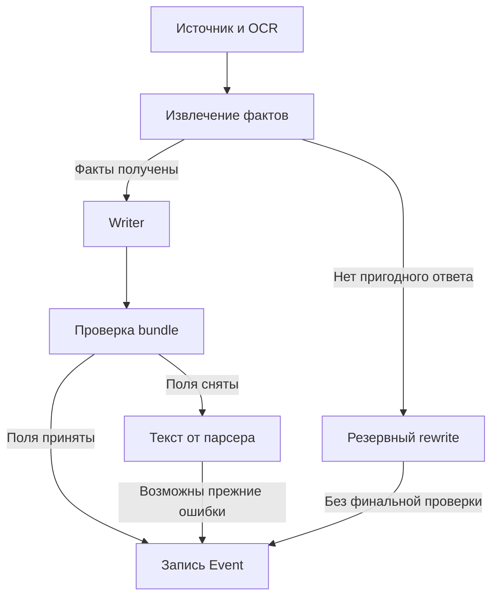

# Smart Update: потери событий, содержания и уведомления при импорте

**INC-2026-11-17-smart-update-import-quality · повторный аудит 19 ноября 2026 года.**

Автор технического анализа и редакционной разметки — **ChatGPT**, с независимыми проверками субагентов `preservation`, `grounding` и `alerts`. Наблюдения Максима: описания становятся бедными, при импорте приходит много сообщений о проблемах LLM. Замечания Opus использованы как проверяемые вопросы; приведённые ниже новые числа и выводы принадлежат автору аудита, а не Максиму или Opus.

Это единый документ для проверки в Opus и контроля исполнения кодовым агентом. Он заменяет выводы [редакции от 17 ноября](https://github.com/onedayonemasterpiece/events-bot-new/blob/65f65e90c286cd212e0b44cd2db5a0a7af3ce38e/docs/reports/incidents/INC-2026-11-17-smart-update-import-quality.md), сохраняя ссылку на исторические свидетельства. В частности, **29 источников без прямой связи не означают 29 потерянных событий; 62 коротких описания не означают 62 плохие карточки; рост числа прошедших тестов не измеряет качество афиши.**

## Результат и границы завершённости

Основной механизм обеднения при повторном импорте подтверждён: существующий semantic merge уже составляет текст с учётом прежнего описания, затем второй writer заменяет его текстом из неполного ledger. Проверка покрытия проверяет этот неполный список, поэтому сама помогает удалить полезную программу. В живом прогоне действующего кода программа «ЭкоГЭ» из пяти занятий снова схлопнулась до общей фразы. Исправление использует готовый merge и ту же проверку покрытия с прежним описанием; второй writer в этом маршруте удалён.

Проверка реальных страниц выявила ещё одну независимую потерю: renderer Telegraph заново вызывал LLM для удаления «дублирующей» логистики и вырезал из уже принятого полного описания тарифные ограничения, предоплату и контакты. Этот проход удалён. После выпуска и адресной пересборки публичные страницы **11064 и 11245** прочитаны по HTTP: все 13 и 15 проверок содержания соответственно прошли. Конное шоу 11245 также появилось как новая публичная VK-запись; ID подтверждён у провайдера. Это законченные ремонты конкретного текста, а не утверждение об исправлении всей афиши.

Проверка масштаба дала два отдельных результата:

- Среди **44 ранее не разбиравшихся связей карточка → пост** из исходных 62 кандидатов: 22 потери конкретной детали, 5 ошибок, 16 допустимых сокращений и 1 первоначально неопределённый случай. Последний после отдельного просмотра исходной афиши оказался ошибкой даты. Это отобранная проблемная группа, не оценка доли дефектов всей афиши.
- Среди **29 VK URL без прямой связи**: 14 URL относятся к событиям, уже представленным другими источниками; 3 URL относятся к дефектам существующих карточек; 4 не являются анонсами будущего события; 1 содержит противоречивый розыгрыш. Оставшиеся **7 URL содержат 6 отсутствующих программ, то есть 8 календарных единиц**. Для части из них время или площадка ещё не подтверждены.

Простая замена обрезки токенов на единый префикс или морфологию **отклонена до выпуска**: на фиксированных контролях она исправляет часть склонений, но пропускает новые ложные роли и имена. Исторические 435 отказов нельзя честно назвать полностью перепроверенными: точные пары «факт + использованная цитата» не сохранялись. Во всех шести восстановленных reviewer-цепочках из семи проблемных ответ завершился `STOP`; гипотеза о транкации reviewer не подтвердилась.

**Статус этой редакции:** [PR #1067](https://github.com/onedayonemasterpiece/events-bot-new/pull/1067) объединён с main и выпущен в RunCoveer **19 ноября в 12:55 по Калининграду**. Исправление коллизии повторного входа [PR #1095](https://github.com/onedayonemasterpiece/events-bot-new/pull/1095) выпущено в **13:31**. Проверка реальной публикации выявила дополнительный разрушающий LLM-проход; его удаление и согласованная защита переноса [PR #1096](https://github.com/onedayonemasterpiece/events-bot-new/pull/1096) выпущены в **14:26**. Текущий подтверждённый runtime — `5b27b87c0a8b7aaa39f119f9c939a9a2b19f76d1`; readiness показал `ready=true`, `db=ok`, `issues=[]`. Инцидент остаётся открытым из-за потерянных событий, неполного grounding и старых публичных карточек. Доставка кода и восстановление конкретных публикаций учитываются отдельно ниже.

## Основа проверки

| Свидетельство | Что именно проверено | Ограничение |
|---|---|---|
| Код | `origin/main` на старте: `af7eb547e509e5bd3d45d0971ba79d3a915e8c08`; runtime на старте аудита: `dba325c3aa8f51775ac22f84c5c379146d87015c` | Между ними документирование предыдущего выпуска; базовый Smart Update совпал по SHA-256 с файлом контейнера |
| PR #1067 | Старая голова `65f65e90…` объединена с актуальным main, затем добавлены текущие исправления | Проверки старого PR не выданы за проверки новой интеграции |
| Историческое окно | 14 ноября 13:06 — 17 ноября 13:06 по Калининграду; правая граница исключена | Технические времена корреляции в приложениях указаны в UTC |
| Исходная выборка | Восстановлены прежние 62 кандидата из сохранённой операции `op_b28eb63d11fb2034a6cd52eb` | Не пересчитывалась удобная новая выборка после изменения БД |
| Разметка публикаций | Полные сохранённые источники/OCR и актуальные публичные посты; 44 оценки зафиксированы до просмотра свидетельств об этапах | 43 уникальных поста, общие исходники у нескольких сеансов; у отдельных источников есть обновления 18–19 ноября |
| Отсутствующие события | Все 29 полных источников, candidate/draft/OCR, 193 карточки на целевых датах, 129 соседних/пересекающихся карточек, поиск по участникам и тексту | Наборы пересекаются; не сумма 322 уникальных карточек |
| Reviewer | Сохранившиеся runtime-логи, correlation UID, usage, 17 candidate payload, parse-debug и trace-хранилища | Семантические JSON и цитаты исторических reviewer не найдены |
| Telegram | Штатная общая E2E-сессия через `telegram-e2e-run`, только диалог с ботом | Это не superadmin; пустой диалог этой роли не доказывает отсутствие уведомлений у Максима |
| Живое сравнение | 12 зафиксированных входов, реальные Gemini/Gemma и существующий общий клиент/лимитер; отдельные SQLite | Это Smart Update от сохранённого входного пакета, не повторный crawler/OCR и не изменение production-карточек |

Секреты и токены не публиковались. Исходные тексты, ответы модели и протоколы сохранены в существующем каталоге артефактов DevCoveer; в документе — проверенные различия, короткие примеры, ссылки и идентификаторы.

## A. Масштаб и приоритеты

### A1. Слепое чтение 44 из 62 кандидатов

**Факт.** Все 44 ранее не обсуждавшиеся карточки прочитаны. Порядок зафиксирован `random.Random(20261119)`. До фиксации смысловой разметки проверяющий не читал логи и не распределял карточки по предполагаемым программным причинам. Из 62 исключены 18 уже обсуждавшихся случаев: повторное чтение знакомых дефектов не названо слепой проверкой.

| Первоначальный вердикт | Количество | Доля только среди 44 |
|---|---:|---:|
| Потеря конкретной детали | 22 | 50,0% |
| Новая ошибка/неподтверждённое утверждение | 5 | 11,4% |
| Допустимое сокращение | 16 | 36,4% |
| Недостаточно данных на момент фиксации | 1 | 2,3% |

Потери различаются по тяжести. У `11124` исчезли пять участников вечеринки; у `11091` — предметы, которые человек сделает на мастер-классе; у `11048` — хутор XIX века, колядки и часть состава. У `11017` сама программа сохранена, но потеряны возраст соответствующего сеанса и пояснение тарифов/трансфера. `11122` и `10969` отмечены как небольшие потери. Поэтому число 22 не означает 22 полностью испорченных рассказа.

Ошибки первоначальной разметки: `11099` — VK id превратился в телефон; `10486` — чужая дата пробного занятия осталась в карточке другого дня; `10997` — актовый зал БФУ стал площадкой «Остров Канта»; `11078` — читка названа спектаклем; `11063` — трибьют представлен как выступление самой «Пошлой Молли». Для последнего уточняющий источник появился 19 ноября: наличие этой информации в момент первой публикации не утверждается.

После фиксации отдельно просмотрена афиша `11030`: на ней **16 ноября, 18:00**, в посте — **16–21 ноября**. Это шестая подтверждённая ошибка в текущем чтении; первоначальная неопределённая оценка сохранена в регистре, а не переписана задним числом.

**Как проверено.** Полный регистр всех 44 сравнений со ссылками находится в приложении 1. У 11 карточек имелся старый description и частичные примеры ledger; они прочитаны после разметки. Это не полный ledger, и отсутствие детали в его фрагменте не использовано как доказательство, что экстрактор её никогда не видел.

**Минимальное решение.** Приёмка по конкретным отличительным деталям, ошибкам, ясности и отсутствию пустых обещаний. Длина — только сигнал для отбора. Распределение дефектов этих 44 сравнений по пяти этапам с точными процентами **не установлено**: нет полного исторического входа/выхода каждого этапа. Доказанные механизмы представлены отдельными трассируемыми случаями в B, а не подменены догадками по длине.

### A2. Что действительно не появилось среди 29 VK-источников

**Факт.** Отсутствие точного URL в `event_source` было слишком слабым основанием для оценки продуктовой потери. Проверка других источников изменила картину:

| Результат | URL |
|---|---:|
| Событие есть через другой источник | 14 |
| Есть карточка, но пропущено обновление срока/ошибочна площадка | 3 |
| Не анонс будущего участия | 4 |
| Розыгрыш с конфликтующими датами; дополнительный концерт не доказан | 1 |
| Полностью или частично отсутствует программа | 7 |
| **Всего** | **29** |

**Шесть отсутствующих программ / восемь календарных единиц:**

| Программа | Отсутствующее участие | Что ограничивает немедленное восстановление |
|---|---|---|
| Ретротрамвай | 21 и 28 ноября, 12:00, Южный вокзал — два сеанса | В source город указан; один кандидат ошибочно получил `missing_target_city`, второй technical error |
| «Латино джаз», ансамбль «Акцент» | 28 ноября, КОИХМ — один концерт | Пост указывает 16:00, актуальная официальная афиша — 15:00; нельзя молча выбрать время |
| Конное шоу «Приключение Вани» | 29 ноября, 15:00, Rauschen — один сеанс | Не сливать с показом 31 октября или другим спектаклем EDELWEISS 21 ноября |
| «Замок Лохштедт и его фрески» | 4 декабря, 15:00, музей Брахерта — одна лекция | Отдельное будущее событие, не содержание старой экскурсии |
| Дрифтвуд с Натальей Ивановой | 21–22 ноября, Домик Счастья, Светлогорск — одна двухдневная программа | Время в прочитанных источниках не установлено |
| PortDeBras | BASIC 21 ноября и WORKSHOP 22 ноября — два отдельно посещаемых блока | Два поста об одной программе; место и время не подтверждены даже на странице организатора |

Примеры ложных «потерь» исходного подсчёта: «Гранд концерт» уже находится в `9502`, несмотря на дефис в другом написании; три источника Андрея Бойко относятся к `10876`; три публикации WestHoReCa — к существующему форуму `7691`; все пять спектаклей из подборки найдены. Геодиктант есть в `10997`, но с ошибочной площадкой. Отдельно подтверждены **пять устаревших сроков действующих выставок** — выставка про цирк и четыре выставки музейного дайджеста. Полный регистр 29 URL приведён в приложении 2.

Это исходный срез до восстановления. После второго выпуска штатный импорт конного шоу создал `11245` 19 ноября в **13:37 по Калининграду**; результат и отдельная проверка публикации приведены в D12. Первоначальная классификация 29 источников сохранена, чтобы восстановление одного сеанса не переписывало исходную оценку.

**Ретротрамвай дополнительно перепроверен перед передачей задачи.** Свежий [первичный пост музея](https://vk.com/wall-67464547_2565), опубликованный 26 октября, явно перечисляет **7, 14, 21 и 28 ноября 2026 года**, начало 12:00 и сбор у входа в Южный вокзал. Год не восстановлен догадкой. Read-only срез **19 ноября 12:03:25 UTC** не нашёл двух будущих сеансов 21/28 ноября ни по URL, ни по трамвайным названиям/описаниям/месту/билетной ссылке; результаты не усечены. Исторический VKInbox — **28690**, owner `-67464547`, post `2565`.

Полный исходник и просмотренная афиша сохранены в `retrotram-multi-occurrence-intake-input-20261119.json` и связанных артефактах. Штатный MCP-create в проверенном runtime имеет `require_single_event=True`; полный пост содержит несколько сеансов. Такой prepare/commit не запускался, URL и даты не менялись ради одного события. Конкретная задача восстановления — точечный повтор **существующего многособытийного VK intake** с исходной identity, двумя будущими сеансами, проверкой отсутствия дублей и readback публикаций. Новый bulk API не добавлялся. Пропуски остаются открытыми и не скрыты созданием другого события.

**Почему нет retry.** `mark_carrier_outcome(FAILED_TECHNICAL)` ставит терминальный статус и очищает `vk_inbox.next_attempt_at`; `release_due_deferred` выбирает только `deferred`. У 29 inbox нет даты следующей попытки, хотя у packet сохранились старые timestamps. Среди 32 candidate-state строк: 12 `FAILED_TECHNICAL`, 11 `RETRY_SCHEDULED`, 9 `REJECTED_PRODUCT_POLICY`, у всех `attempts=1`. Десять RETRY содержат `identity_final_retry`, один — истёкший `attempt_started`. Запись RETRY не доказывает работающий consumer и выполненную вторую попытку.

Из 29 причин четыре явно содержат `llm_unavailable`, десять являются непрозрачными technical-кодами, один относится к занятой попытке, четырнадцать — к семантическим/grounding-отказам. При этом `llm_unavailable` может означать непригодный семантический ответ, а не только временный сбой сети или квоты. **Количество источников, которые точно спас бы обычный повтор, не установлено.**

**Минимальное решение.** Не восстанавливать прежний `schedule_retry` как есть: его контракт — повтор с ограниченной задержкой, но **без конечного числа попыток**. Фоновый identity retry consumer ранее снят по решению владельца. Предмет оставшейся задачи — сохранить тип доказанного транспортного сбоя и использовать ограниченный существующий provider retry до commit; для истёкшей аренды — существующее восстановление владельца операции. Отказы смысла и product policy не должны превращаться в бесконечную очередь. Это отдельная открытая задача с конкретными шестью программами, а не заявленный выполненным retry-fix.

### A3. Что важнее читателю

**Вывод по наблюдаемым случаям, не измеренная конверсия.** Сначала — ближайшие отсутствующие события и неверные дата/время/место: человек вообще не узнает о возможности участия либо приедет не туда. Далее — предотвращение повторного уничтожения уже принятой программы, затем полнота новых описаний. Уведомления важны как средство увидеть незавершённый импорт, но сами по себе не восстанавливают ни событие, ни программу.

Основания: восемь отсутствующих календарных единиц; шесть текущих ошибок в выбранной группе 44; пять устаревших сроков выставок; 22 разные по тяжести потери деталей. Эти наборы имеют разные знаменатели и пересечения. Сравнивать их как «5% против 40% всей афиши» нельзя. Количественная оценка распространённости во всей афише остаётся отдельным случайным аудитом, а не дополнительным фильтром коротких текстов.

## B. Корневые причины

### B4–B5. Склонения, полное имя и неверные роли

**Факт.** Ошибка 5/6-префикса существует: длина словоформы меняет ключ. «Алексей/Алексеем», «Чебыкин/Чебыкиным» способны потерять совпадение. Но лексическое пересечение не доказывает, что роль, имя и дата принадлежат одному человеку и одному событию. «Елена Осколкова» проходит при наличии Елены Зеленской и Екатерины Осколковой; все слова из общего абзаца не образуют подтверждённое полное имя.

**Как проверено.** Из 435 исторических lexical-отказов восстановлены 417 строк с фактом до 180 символов, ещё 7 ранних excerpts; для 11 остался только счётчик. **Точных исторических пар fact + evidence_quote — ноль.** Поэтому нельзя назвать число исправленных исторических отказов и их false-positive rate. Воспроизводимое сравнение проведено на 24 фиксированных контролях: десять истинных и четырнадцать ложных. Использованы реальные источники с явно выбранными аудитором цитатами и обозначенные синтетические отрицательные контроли.

| Представление токена | Истинные приняты | Истинные потеряны | Ложные приняты |
|---|---:|---:|---:|
| Текущий 5/6 | 7 | 3 | 4 |
| Единый prefix5 | 9 | 1 | 8 |
| Единый prefix6 | 6 | 4 | 6 |
| pymorphy3, первый разбор | 8 | 2 | 7 |
| pymorphy3, все леммы | 10 | 0 | 8 |

На том же музейном абзаце единые prefix5 и prefix6 спасают художника Алексея, но впервые принимают **«куратор Алексей Чебыкин»**, хотя роль не подтверждена. Морфология принимает дирижёра вместо скрипачки. Первый разбор pymorphy3 даже не объединяет узкую пару Чебыкин/Чебыкиным: выбирает разные леммы. В production pymorphy3 **не установлен**, requirements его не объявляет; опциональная ветка `VK_USE_PYMORPHY` в `vk_intake.py` не означает доступную общую зависимость.

**Решение.** Ни один из пяти вариантов не удовлетворил условию «только улучшение», поэтому общий token patch не внесён. Проверка всех частей имени необходима, но совпадения частей в разных местах недостаточно. Открытая задача объединяет полное имя, роль и принадлежность конкретному сеансу; контроли — все четыре художника 19 ноября, ложная Елена Осколкова, ложный куратор Алексей, Юлия Пономарчук из встречи 12 ноября, числовые/цитатные отрицательные случаи.

**Три строки старого PR про список в падеже источника удалены из кандидата на выпуск** (`496bf15`). Общий create A/B не прошёл требование отсутствия ухудшений; улучшение отдельного музейного ответа не доказывает пользу этой инструкции. Фиксированный полный список проходит обычный rich-facts entry, но синтетическое соответствие инструкции не доказывает поведение модели. Тест сохранён как проверка буквального списка, чужого имени и неверного числа, без утверждения о compliance модели. Matcher этим не исправлен.

### B6. `llm_evidence_not_verbatim` и MAX_TOKENS

**Факт.** У шести из семи исторических отказов восстановлена цепочка stage-start → единственный logical UID → provider receipt → отказ проверки. Все шесть reviewer завершились **`STOP`**, с output 284, 297, 128, 279, 131 и 171 токеном при cap 500. Седьмой случай 14 ноября 14:31 UTC уже за границей текущей ротации; осталась terminal-запись.

Практикум о стопах показывает, почему важно не смешивать стадии. 15 ноября 17:57:07 UTC `rich_facts_extract`, UID `cd721814…`, получил `MAX_TOKENS` при 1385 токенах, затем fallback того же логического запроса завершился `STOP`, 1349. В 17:57:29 стартовал **другой** reviewer, UID `43b432c2…`; он вернул `STOP`, 297 токенов, в 17:57:31.800. Отказ `llm_evidence_not_verbatim` появился через 2 мс. Транкация экстрактора не является доказательством транкации reviewer.

**Что не восстановлено.** Две реальные исторические цитаты reviewer предъявить нельзя: сам JSON не записывался. Проверены runtime-логи, 17 candidate payload, 11 parse-debug файлов общим объёмом 1,69 МБ, trace-схемы и соответствующие каталоги артефактов. Текущий trace содержит стадии, модели, время и usage, но не semantic output. Этот пробел в наблюдаемости не замещён вымышленными цитатами. В новом живом A/B точные ответы и цитаты уже сохранены.

**Почему снимаются все поля.** У reviewer один плоский `evidence_quotes`, без привязки к `description/facts/short/search_digest`. Пустые quotes и хотя бы одна ненайденная quote дают один общий reason. После этого нельзя надёжно определить, какое конкретно поле осталось подтверждённым. Снятие всех заполненных публичных полей следует из текущего контракта; нормализация пустых строк не исправляет его.

**Минимальное решение.** Не увеличивать cap наугад и не разрешать неточные цитаты. Для следующего изменения использовать тот же reviewer с привязкой evidence к отвергаемому полю; сохранять подтверждённые независимые поля только при валидном поле-специфическом вердикте. До внедрения — точные input/output в существующем eval-артефакте и отдельные причины empty_quotes/quote_not_found. Это остаётся открытым изменением контракта, не новым сервисом и не ещё одним reviewer.

### B7. Общее сохранение программы при повторном импорте

**Факт.** Узкая регулярка цены не защищает «ЭкоГЭ»: содержательный новый факт о маршруте от оранжереи до лаборатории тоже может вытеснить четыре других занятия. Причина — два конкурирующих writer: первый видит прежнее описание, второй получает неполный ledger и перезаписывает результат. На рабочей модели исходный код воспроизвёл схлопывание программы даже при полном исходном анонсе в новом входе.

**Внесённое изменение.** Для непустого прежнего описания оставлен существующий semantic merge. Его результат проверяет **существующий** coverage reviewer, которому переданы прежнее описание, факты, текст/OCR кандидата, уровень доверия и конфликтующие якоря. При missing/extra, недоступности или неправильной форме ответа остаются прежние description/short_description/search_digest. Подтверждённые факты и структурные изменения продолжают обрабатываться. Поздний rich rewrite не обходит отказ. Второй writer по ledger и специальная защита только от строки цены в этом маршруте удалены.

Правило сформулировано по смыслу: молчание нового анонса не отменяет прежний пункт программы. Явные исправление, замена и отмена из источника этого события при не меньшем доверии могут убрать опровергнутый пункт. Реклама, чужие события, повторы и реквизиты отдельного инфоблока не становятся обязательной частью рассказа только потому, что раньше оказались в нём.

**Какие случаи сломало бы безусловное «ничего не удалять».** Перенос, замена участника, отмена мастер-класса, исправление ранее выдуманной роли, удаление чужого сеанса и устаревших условий. Поэтому guard не сравнивает длину и не делает старый текст неприкосновенной строкой. Он проверяет новый merge с прямым разрешением доказанного исправления. Это семантическое решение модели с конкретными положительными и отрицательными контролями, а не математическая гарантия сохранения каждого утверждения.

### B8. Пустой coverage-ответ

**Факт.** До исправления `fact_first_cov=None` оставлял `missing=[]` и `extra=[]`, и отсутствие ответа превращалось в принятие текста. Opus прав: это был пропуск в первом PR.

**Внесённое изменение.** Ответ принят только как объект с ровно двумя массивами строк `missing` и `extra`. `None`, неправильная структура или exception не означают PASS. При повторном импорте правильный результат — прежний публичный текст и его производные поля. При новом/пустом описании helper возвращает `None`, после чего действует существующий fallback создания; непроверенный writer не помечается прошедшим coverage.

Проверены четыре различающих отказа на базе до изменения: хороший merge снова перезаписывался общей фразой; missing терял прежнюю программу; недоступный reviewer терял программу; `None` принимал текст. После изменения соответствующие контроли проходят. Ответы LLM в этих тестах заданы фикстурами: это доказательство маршрутизации, не качества рабочего Gemini.

### B9. Уверенность 0,9

**Факт.** Порог унаследован из существующих контрактов. Калибровки, показывающей чувствительность/специфичность на размеченных ответах, не найдено. Самооценка модели не является вероятностью правильности.

В живом baseline музейный reviewer выдал `grounded`, **confidence=1.0**, не заметив Юлию Пономарчук из предыдущей встречи в составе 19 ноября. Все процитированные слова действительно были в источнике. Это прямой контрпример к трактовке «1,0 значит проверено событие и роли» и одновременно демонстрация проблемы принадлежности факта конкретному сеансу.

**Решение.** Не снижать и не повышать порог без данных. В механической части сохранён прежний порог, без утверждения о его эффективности. Приёмка опирается на source/field binding и размеченные контроли. Отдельная калибровка допустима только на накопленных точных ответах и независимых labels; новый скоринговый сервис ради этого не предлагается.

## C. Уведомления — исходная жалоба

### C10. Какие сообщения действительно получает Максим

**Установлено по коду до этого исправления:** есть разные независимые отправители. Поэтому подсчёт `WARNING` в LLM-журнале не отвечает на вопрос о Telegram. Таблица описывает исходную схему, а изменение batch-уведомлений приведено в C11.

| Путь | Что происходит | Фактическое число доставок Максиму в сутки |
|---|---|---|
| `notify_llm_incident`, WARNING | Запись в журнал, без Telegram send | Сам этот путь WARNING не отправляет |
| `notify_llm_incident`, CRITICAL | Отправка superadmin; дополнительно оператору при наличии update-контекста, с существующим dedup 600 секунд | Не установлено для исторического окна |
| Ошибки отдельного VK-поста | Отдельный ответ с ошибкой; batch дополнительно собирает итог | Не установлено; число terminal source outcomes не равно сообщениям |
| Progress/unified report VK | При ручном пакетном импорте сообщения по отдельным источникам плюс финальный summary | Маршрут шума воспроизведён; историческая доставка не подтверждена |
| Telegram import report | Отчёт операции со своими ошибками | Не установлено; это отдельный путь, не `notify_llm_incident` |

**Как проверено.** Прочитан указанный Slack-тред: там исходная просьба и уже отправленный 17 ноября ответ аудита, без примеров уведомлений. На DevCoveer найден и использован действующий общий Telegram E2E launcher, а не сделан вывод «нет проектного .env — нет доступа». Прочитан только его диалог с production-ботом за исходные 72 часа и последние 24 часа; достигнута нижняя граница истории. Но роль не является superadmin. У 22 VK и 11 TG операций `operator_id=0` — системный placeholder, `chat_id=NULL`; это не установленная личность Максима или другого оператора. **Пустая история этой сессии не означает нулевую доставку Максиму.**

Из старого окна сохранены 678 warning-записей, 349 из них относятся к Smart Update. Эти warning не отправляются в Telegram. Из 990 логических вызовов с переключением модели/квоты 799 завершились успешно. Эти числа показывают нагрузку и восстановление клиента, но не количество пользовательских тревог. Отметка `delivered`, добавленная первым PR, полезна для будущего учёта подтверждённых отправок; сама она шум не уменьшает.

**Оставшийся конкретный запрос к владельцу:** 3–5 примеров уведомлений со временем или текстом. Они нужны для определения, какие из независимых потоков Максим называет «валом», и для проверки после выпуска. Кодовая работа по установленному batch-шуму выполнена без ожидания этих примеров. Скриншоты не заменяют уже проведённый аудит и не объявлены блокером всего исправления.

### C11. Один результат на пакет импорта

**Подтверждённая причина.** `run_vk_auto_import` всегда является пакетным путём, даже при limit=1; ручная команда по умолчанию может разбирать всю очередь. Одиночный выбранный пост идёт через другой `_vkrev_import_flow`. Поэтому сохранение per-row push внутри manual batch не требовалось ради ответа на одиночный импорт.

До исправления контрольный пакет из трёх строк — created, merged, technical error — давал **семь сообщений**. Scheduled-режим уже скрывал часть progress, но timeout и unexpected exception всё равно отправляли отдельные ошибки. Итоговый отчёт содержал счётчики, не раскрывая все нужные ссылки.

Изменения: `40f0e37` → `d42919c` → `4bafe41`; независимо найденный аварийный выход закрыт `049d63b`, сохранение batch reason в ограниченном ops receipt — `01d3400`. Ручной/scheduled/catchup пакет использует общий итог. Удалены batch-only renderer, per-row push и промежуточные сообщения; это сокращение существующего пути, а не новый агрегатор.

Независимый review выявил реальный дефект промежуточной реализации: после сохранённой row error исключение следующего `pick_next` обходило summary и оставляло ноль сообщений. Исправление доводит ошибку подготовки/очереди до существующего summary и `finish_ops_run`; parent cancellation фиксирует `canceled`, затем повторно поднимает `CancelledError`. Невыбранная строка остаётся pending, прерванная claimed — locked/unresolved для прежнего recovery, без выдуманного terminal count. Независимая приёмка исходных stimuli дала 6/6 PASS, включая row URL, обе причины и terminal ops status. Это исправление наблюдаемой аварийной ветки, не обещание доставки при полном отключении процесса или Telegram.

Схема использует существующий batch report: исход операции, число созданных/обновлённых событий и импортированных/отвергнутых/технически неудачных источников, ссылки на результат и источник, terminal reason для неудач. Неудача не переименовывается в успешное завершение; запись `partial/failed` и журнал ошибки доставки остаются. Изолированная ручная обработка одного выбранного источника сохраняет свой ответ. Самостоятельные CRITICAL инфраструктуры не подавляются вслепую.

«Один отчёт» означает один логический результат. При превышении Telegram-лимита он делится **существующим** `split_text`; ссылки и ошибки не обрезаются ради одного физического сообщения. Новых таблиц, таймеров агрегации, очередей уведомлений и режимов нет. Фактическое снижение числа сообщений у Максима до получения его примеров и наблюдения новой операции не заявлено.

## D. Что увидит читатель

### D12. Почему исправление БД не исправляет старый VK-пост

**Факт и продуктовое решение.** В [PR #978](https://github.com/onedayonemasterpiece/events-bot-new/pull/978), commit `751159d20c1e0de25c5602c6d4f2fbf9eb9609f0`, 15 ноября автоматическая публикация переведена на первоначальные объявления. Повторные wall.edit и работа с фотографиями вызывали CAPTCHA и блокировали новые публикации. `job_sync_vk_source_post` при уже управляемой записи возвращается до API. Ручной edit flow оставлен.

Следовательно, обеднение БД может не испортить уже хороший VK-текст, а улучшение БД может не улучшить уже плохой VK-текст. Это подтверждено «ЭкоГЭ»: в публичном VK сохранилась программа, в БД она исчезла. У практикума публичная аннотация и Telegraph тоже различались. Сравнивать сегодня только БД с source недостаточно.

**Что сделано.** Устаревший раздел Smart Update README, обещавший автоматическое редактирование существующих VK-постов, исправлен под действующий worker. Девять тестов с прежними ожиданиями приведены к намеренному решению PR #978. Автоматический массовый wall.edit не возвращён.

**Восстановление карточек.** Для ближайших событий использован раздельный критерий: canonical Event принят; source/факты приняты; Telegraph обновлён и прочитан; VK либо явно отредактирован через штатную разрешённую операцию и прочитан, либо остаётся старым. Наличие JobOutbox само по себе не является подтверждением публикации.

**Фактическое состояние ремонта на момент подготовки выпуска.** Для музея 11107 выполнен typed `event_edit_prepare` с корректным составом четырёх художников; сервер вернул `PUBLIC_TEXT_FACT_UNRESOLVED`, preparation/commit не состоялся. Алексей есть в первичном анонсе, но отсутствует в принятом ledger. Отказ не обойдён прямым SQL, другим редактором или изменением авторизации. В рабочей карточке после анонса 18 ноября уже правильное 18:00/default=false, но по-прежнему только три художника. Для «ЭкоГЭ» в живом shadow подтверждено сохранение программы на исправленном маршруте; это **не запись в production 10973** и не исправление старой карточки. Массовое восстановление не объявлено выполненным. Этот долг остаётся P0 с конкретными IDs/источниками и проверяемой границей безопасного replay.

Для практикума **11064** восстановлен полный редакторский текст по первичному [посту музея](https://vk.com/wall-236106900_30), EventSource 15222143. Его source_text в текущей БД совпал с замороженным корпусом. Сохранены Инна Борисова и Дмитрий Кисурин с их ролями, сравнение ТКМ и аюрведы именно как темы выступлений, упражнения/самомассаж, чай, фотосессия, подарки, лекция 12:00–14:00 и экскурсия 14:00–15:00, цена 1500 ₽, **запись по предоплате** и три способа телефонной связи. Неподтверждённые возраст, размер предоплаты или доплата за экскурсию не добавлены.

Один `event_edit_prepare` с `preserve_original` реально прошёл; сервис вернул `auto_approved`, matching commit принят **19 ноября в 13:56 по Калининграду**, canonical revision `ebbb50293a03c91108a9cd1995126851b65c2adb486f87687c50e92cdf950aa8`. Поэтому предполагаемый недостаток контекста verifier здесь не выдан за наблюдённый отказ. У музея отказ фактический, у практикума операция успешна. Telegraph получил этот revision в 11:56:50.591 UTC; проверка публичного текста, производных полей и старого VK учитывается отдельно, без обещания, что accepted description автоматически исправил все поверхности.

До R3 HTTP-readback **11:59:07 UTC** по-прежнему терял интервалы лекции/экскурсии, предоплату и часть контактов, хотя canonical содержал весь принятый текст. После R3 job 158433 закончил пересборку в **12:28:11 UTC**. Независимый GET **12:33:01 UTC**, HTTP 200, подтвердил **все 1196 символов принятого описания** после нормализации пробелов: оба ведущих, программа, 12:00–14:00 и 14:00–15:00, 1500 ₽, предоплата, ограничение мест, личные сообщения и три телефона. Все 13 строк приёмочной матрицы прошли. [Результат для читателя](https://telegra.ph/Lekciya-praktikum-Zdorove-nachinaetsya-so-stop-dialog-Indii-i-Kitaya-11-15). HTML 15 121 bytes, SHA-256 `7d9de00d4db66ec33ed1c484251822207b7d7dc7ae154eefc2556bdec75ad063`.

Оставшийся долг этого ремонта — производные поля. Старый общий digest всё ещё виден над полным текстом; в точном срезе до R3 short оставался «Цена: 1500 ₽». Typed description-edit не обновил их автоматически. Поэтому восстановление длинной страницы подтверждено, а согласованность short/digest и всех старых публикаций не объявлена завершённой.

Ограничения штатного повторного импорта установлены конкретно. `/tg` может дать `metrics_only`, а Smart Update — `noop_exact_source_replay` до LLM по совпавшему fingerprint даже при `check_source_url=False`. `/rebuild_event --regen-desc` пишет по уже сохранённым facts и не возвращает отсутствующего художника. `/vk_requeue_imported N` слишком широк для одной карточки. Нельзя подменять URL, пробелы, source type или удалять receipts, чтобы обойти эти защиты.

Typed event-create использует обычный parser + полный SU, но не содержит `target_event_id`; это не гарантированный exact-ID replay. Для «ЭкоГЭ» у manual/forward intake есть дополнительный реальный риск: диапазоны невыставочных/неярмарочных событий разворачиваются в дневные карточки. Поэтому безопасный маршрут для него проходит через исходную границу Telegram Monitoring → candidate с исходным диапазоном → SU. Требование exact source-bound восстановления сформулировано в отдельной задаче с критериями, без прямого SQL-переписывания Event и без обхода независимого approval редактирования.

**Обычный импорт после выпуска выявил отдельную корневую причину.** Для [конного шоу «Приключение Вани»](https://vk.com/wall-18582168_5882) свежий текст подтверждает 29 ноября, 15:00, Rauschen; узкий поиск по дате/названию и точному URL не нашёл карточку. Штатные typed prepare/commit выполнены с неизменённым текстом. В 10:58:15 UTC операция завершилась `SMART_UPDATE_NOT_ACCEPTED`: Event ID, публикационных jobs и candidate receipts нет. Исходная фотография не была доступна для проверенного staging, поэтому запрос был явно текстовым.

Свежая трасса разделила причины: первый Gemma вернул 503, но штатный Gemini fallback успешно разобрал **одно** событие на правильные дату и время. Затем регистрация попытки упала с `candidate_key_identity_collision`. Read-only SELECT конкретной строки `29768` показал прежний `source_type=vk`; MCP передаёт `manual`. Canonical URL, occurrence, ordinal и intent совпадают, ключ кандидата тот же, accepted Event отсутствует. Hash кандидата учитывает URL и occurrence, а проверка сохранённой идентичности дополнительно сравнивала способ входа. Именно этот конфликт заблокировал восстановление; временный 503 был уже преодолён. Транзакция регистрации откатилась, attempts остался 1. Пустой список receipts объясняется отсутствием новой строки попытки и фильтром adapter по текущей операции. Повтор до исправления причины не выполнялся.

**Этот дефект исправлен и выпущен в #1095.** В `begin_candidate_attempt` для непустого canonical URL сохранено строгое сравнение URL, occurrence и intent; `source_type` обновляется как происхождение текущего входа после guard, в той же транзакции. Для отсутствующего/пустого URL прежняя проверка типа остаётся. MCP продолжает передавать `manual`, fingerprint по-прежнему учитывает тип. URL, ключи, source receipts, leases и правила authority/approval не подменялись. Production diff — **+9/−5 строк**, без нового retry worker, таблицы или флага.

Приёмка: одинаковые входы дали **5 FAIL / 10 PASS до исправления и 15 PASS после**; отдельно прошёл профильный набор из 108 проверок. В независимых двух full-facade контролях старый принятый VK-кандидат повторно поступал как manual от партнёра с чужой либо приостановленной authority. После исправления запрос дошёл до настоящей проверки прав и был отвергнут: полные Event/EventSource сохранились, domain receipt остался NULL. До исправления оба сценария останавливались раньше на коллизии. Эти пересекающиеся наборы не складываются в метрику качества описаний. Контроль нового source provenance и регрессии первого выпуска добавлены в обязательный CI.

Это **не новая автоматическая повторная попытка для всех 29 источников**. Исправлена возможность штатного повторного входа конкретного источника через другой intake. Дальнейшие semantic/identity решения и полный Smart Update остаются обязательными; код не гарантирует принятие любого обновления и не стирает различия fingerprint между VK и manual.

**Фактический повтор после устранения причины.** До второго commit повторно прочитан тот же свежий VK-пост: текст не изменился. Узкий read-only срез в 11:31:37 UTC не нашёл EventSource этого URL/ключа и нужного сеанса среди всех 24 событий 29 ноября. После подтверждённого выпуска #1095 выполнен один новый prepare/commit через тот же штатный интерфейс. В **11:37:02 UTC / 13:37:02 Калининград** операция принята: `CREATED`, `shortlist_empty`, Event **11245**, 29 ноября 15:00, «Конный центр Rauschen». Сохранён durable candidate receipt с исходным ключом. Это реальное восстановление отсутствовавшей canonical карточки, не shadow-прогон.

В readback 11:39:35 UTC Telegraph имеет `transport=published`, `revision=up_to_date`, равные current/applied revision и provider receipt от 11:37:10.582 UTC: [опубликованная страница](https://telegra.ph/Konnoe-shou-Priklyuchenie-Vani-11-19). Независимый HTTP GET в 11:41:25 UTC прочитал опубликованный HTML. Программа, участники, интерактивы, призы и фотосессия сохранились, но **п. Комсомольск, обязательная бронь и категории льготных билетов были потеряны**, а canonical city ошибочно стал Калининградом. Наличие карточки поэтому не выдано за полный ремонт. Полный исходник в source_text сохранился; происхождение каждой потери по одному сокращённому перечню fact IDs не установлено.

Этот конкретный результат исправлен через существующий typed `event_reschedule_prepare/commit`, потому что изменение населённого пункта не разрешено в обычном description-only edit. Дата и время не менялись. Proposal содержал `city=Комсомольск`, адрес Калининградская 2А и **точный полный исходный текст** с `preserve_original`; canonical consistency gate прошёл, действующая политика сервиса вернула `auto_approved`, matching commit — `accepted`. Авторизация, facts и receipts прямым SQL не менялись; новый пользовательский перенос события не выдумывался. Это ручное восстановление по источнику, не доказательство улучшения writer.

В 11:45:25 UTC новый revision `004813dceedcadd52fd3226efb2bc7427abdd50c8758ccf17c712dc0bde0f636` уже применён в Telegraph: receipt **11:44:51.920804 UTC**, `published/up_to_date`. Telegram и VK пока queued; VK job 164970 содержит `vk_initial_waiting_related`, next run 11:46:43 UTC, attempts 0. URL исходного поста, показанный status tool в поле VK, **не является нашей публикацией**. Исходный create был text-only; последующее появление фотографии в media review отдельно от исходного запроса и не доказывает перенос оригинального постера. Полный исходник сохраняет и рекламные обороты автора — это восстановление фактов, редакционная цель по-прежнему отдельна.

**Повторное чтение публикации выявило ещё одну общую причину.** HTTP GET после коррекции в **11:46:08 UTC** подтвердил Комсомольск, обязательную бронь и 150 мест, но снова не содержал ни четырёх тарифных строк, ни телефона. Точный read-only срез Event в **11:49:29 UTC** подтвердил обратное: `description` полностью, символ в символ равен исходным 1772 символам; все условия в БД есть. Это потеря **после принятия canonical**, а не повторный сбой извлечения.

Граница установлена в `main.py::update_telegraph_event_page`: перед HTML-builder выполняется `_llm_remove_infoblock_logistics` с label `telegraph_render_remove_logistics`. Его инструкция удаляет точные цены и контакты, предполагая, что структурная шапка их уже показывает. Но шапка умеет показать только min/max/free/link и не выражает «от четырёх человек», «до трёх лет без катания», бесплатность для отдельной категории и тариф сопровождающего. Ответ этого дополнительного writer принимался без coverage. Поэтому даже `preserve_original` в canonical не обеспечивал сохранность публичного текста. Артефакты before/after и current canonical сохранены раздельно; новый код и его проверка описаны в разделе выпуска.

**VK восстановленного события проверен у провайдера.** Внутренний receipt пометил `published/up_to_date` уже в 12:06:38 UTC и выдал URL 15390. Но один точный `wall.getById` в **12:13:46 UTC** вернул `post_type=postpone`, будущую дату **12:17:00 UTC** и полный текст. После слота прежний ID перестал разрешаться. Один ограниченный readback owner-ленты, 20 записей, в **12:22:18 UTC** нашёл ровно одно совпадение: [публичный пост 15392](https://vk.com/wall-231920894_15392), `post_type=post`, `postponed_id=15390`, дата 12:17:00. Полный body точно равен отложенному варианту; SHA-256 обоих `751d82a4fba0a7e6ebdc8f6bedefafbbe44d77ab291515623aa8c92d74f5ea6c`. Город, программа, все тарифы/льготы, бронь и контакты сохранились. Новая отправка не выполнялась.

Это одновременно доказательство ремонта и отдельный дефект учёта доставки: состояние `published` было преждевременным, а номер отложенной записи не равен номеру публичной. В коде уже есть `_recover_managed_vk_live_url` и отложенный calendar-comment путь с поиском `postponed_id`, поэтому отсутствие механизма сверки не утверждается. Но recovery обновляет Event/EventSource, а `record_worker_receipt` записывает публикационный receipt по одному URL/успешному worker outcome. Семантика scheduled/live и актуализация receipt остаются отдельной задачей на существующем пути. Состояние Telegram при этом не подтверждено: job содержит URL, но durable publication receipt отсутствует, оба точных чтения вернули пустой текст. Наличие URL не переименовано в проверенную публикацию.

**Конечная приёмка Telegraph 11245 после R3.** Единственный финальный GET **19 ноября в 12:46:06.785 UTC / 14:46 по Калининграду**, HTTP 200, подтвердил полный источник в [статье](https://telegra.ph/Konnoe-shou-Priklyuchenie-Vani-11-19). Все **15 проверок** прошли: взрослый/детский билет 1000; семейный от четырёх человек по 800; дети до трёх лет бесплатно **без катания**; «Балтийское долголетие» бесплатно, сопровождающим 800; обязательная бронь, 150 мест, телефон; Комсомольск и адрес; 29 ноября 15:00; команда, роли и полная программа. После нормализации регистра, пробелов, пунктуации и эмодзи полная последовательность слов сохранённого источника присутствует в статье. Побайтовое равенство оформленного HTML исходнику не заявляется.

HTML — **16 068 bytes**, SHA-256 `e3dfdd4dfaced65565667aeada78f7b508ed87f521e7af34632807c04ed289bb`; сохранены `horse11245-after-r3-20261119.html/.json`, `horse11245-after-r3-matrix-20261119.json` и `horse11245-after-r3-acceptance-20261119.md`. Исходная опечатка «800 рулей» и рекламные обороты сохранены; это ремонт полноты, а не финальная редакционная переработка. Прежний short остаётся отдельно от long. На странице одна иллюстрация с прежним CDN URL; соответствие исходному постеру не доказано, полнота медиакомплекта не объявлена проверенной.

### D13. Разное время в ВК и Telegraph

**Факт.** VK скрывает время при `time_is_default=true`. Telegraph передавал `ev.time` в summary независимо от этого признака. Поэтому 18:00, считавшееся системой неподтверждённым default, могло появляться только на одной поверхности. Ошибочен именно вывод default как подтверждённого времени, независимо от того, что этот default случайно совпал с настоящим временем источника.

**Исправлено.** Summary Telegraph, подпись календарного события, ежедневная рекомендация и список связанных дат используют существующий `time_is_default`. Подтверждённое время сохраняется; default не публикуется. Проверены обе ветки, включая связанный сеанс и реальный summary renderer: 8 проверок прошли.

На свежем срезе музейной `11107` уже `18:00`, `time_is_default=0` после анонсов 18 ноября. Поэтому старое расхождение не объявлено неизменным текущим состоянием. Отдельная проблема разбора `18.00` относится к извлечению времени. Замена regex на любой `[:.]` не внесена: точки встречаются в датах, ценах и чужих сеансах; форматтерный fix не объявлен исправлением парсера.

### D14. Почему KenigEvents вернул 404

**Проверено 19 ноября.** `https://kenigevents.ru/` отвечает 200 и показывает страницу запуска, а не текущую афишу; sitemap содержит пять старых клубных URL, без событий выборки. `preview-build.json` не найден. В runtime включён `STATIC_SITE_BUILD_PROFILE=related-only`.

В [StaticSiteBuilder](../../../kaggle/StaticSiteBuilder/static_site_builder.py) ветка `related-only` пишет `event_related.json` и receipt и возвращается до полной Astro-публикации сайта. Документация static-site также фиксирует отдельный предварительный контур и выключенное по умолчанию продвижение сайта.

**Вывод.** Три вычисленных URL нельзя было считать существовавшими публичными карточками. Данных для диагноза «неверный slug» нет; текущий корневой сайт не публикует этот полный набор событий. HTTP 404 не является доказательством, что Smart Update потерял описание. Полная публикация сайта не включалась в обход отдельного release-процесса; задача импортного текста не расширена до запуска сайта.

## E. Выпуск, проверка и сознательно исключённая сложность

### E15. Какие части отделены при проверке

| Изменение | Характер | Доказательство |
|---|---|---|
| `is_free=null` при неизвестной платности полного rewrite | Механический контракт входа | Отсутствие ложного `false` в writer input; отдельные free/paid решения сохраняются |
| Удаление short/digest, полученных из отвергнутого ledger fallback | Механическая зависимость полей | Регрессионные контроли частичного/полного отказа |
| `llm_incident.delivered` | Диагностика успешной отправки | Тест результата send и адресата; не объявлен noise-fix |
| `fact_first_cov=None/malformed` | Исправление ложного PASS | Различающий тест до/после |
| `time_is_default` | Единый вывод существующего признака | Подтверждённое/default время, связанный сеанс, публичный renderer |
| Один batch report VK | Маршрутизация уведомлений | Реальный batch runner с fixture terminal outcomes; ссылки, reasons, chunking, send-failure |
| Source provenance при повторном входе одного URL | Детерминированная согласованность candidate key и identity guard | Различающие state/facade проверки, независимые authority negatives и созданная live-карточка 11245 после прежнего отказа |
| Отображение принятого body без позднего LLM-переписывания | Удаление потери между canonical и HTML; прежний текст при переносе проверяет существующий gate | Различающие renderer/reschedule тесты и полная HTTP-приёмка 11064/11245 после R3 |
| Сохранение программы при merge | Изменение маршрута и семантического контракта | Regression tests, независимый adversarial review и живой A/B |
| Инструкция буквального списка имён | Изменение поведения экстрактора — **откатано до выпуска** | Живой A/B неоднороден; matcher не считается исправленным |
| Обработка частичного reviewer-отказа | Контракт семантического решения — **общая задача остаётся открытой** | Исторические цепочки и живые fallback cases; field-specific evidence ещё не внедрён, confidence не калиброван |

Технически механические изменения можно отделить и выпускать раньше семантических. Здесь они проверены отдельными группами и коммитами, а выпуск привязан к конечному проверенному дереву. Идущий импорт не используется как повод ждать: решение владельца от 12 ноября это прямо разрешает. Сборка только из exact merged main, после обязательных gate; предыдущий образ и env/data сохраняются для отката. Статус конкретного выпуска указан в начале документа, а не подразумевается наличием PR.

### E16. Старые девять красных тестов

**Факт.** `test_duplicate_source_preserves_narrative_and_managed_vk` ожидал вызов автоматического VK sync, хотя PR #978 сознательно ввёл skip. Все девять падали на старом main и старом PR по этой устаревшей причине. Оставлять их красными и рядом рекламировать рост 210 → 232 было неправильной подачей.

**Исправлено.** Ожидания VK приведены к `not awaited` для managed posts, narrative/anchor/gallery assertions сохранены. Отдельно проверено, что неизменный duplicate не пишет новую программу. Новые тесты объясняют конкретный исправленный путь; их количество не используется как продуктовая метрика. При независимом review найдены и устранены регрессии повторной отмены после exception и дублирования абзаца; также закрыта ранняя legacy-cleanup ветка кратких полей. Точные результаты конечного коммита приведены в release receipt.

### E17. Реальное сравнение на 12 фиксированных входах

**Запуск выполнен через рабочий GoogleAIClient и общий атомарный лимитер на RunCoveer.** Нового provider client, обхода квот, лишнего account или замены модели заглушками нет. Использованы текущие Gemini facts/writer/grounding и Gemma merge/coverage/derived маршруты с их штатными fallback; набор не переименован в «чистый Gemini», когда фактически работают обе модели.

| Вход | Режим | Происхождение пакета |
|---|---|---|
| Музей, 11107 | create | Сохранённый candidate 30133, koihm/6349 |
| Практикум о стопах, 11064 | merge | Сохранённый candidate 29965, kldevents/5761; до — реальная опубликованная аннотация |
| «ЭкоГЭ», 10973 | merge | Восстановлен из полного kenigatom/509 и canonical anchors; до — опубликованная программа пяти занятий |
| Ярмарка, 11105 | create | Сохранённый candidate 30127 |
| Bender, 11093 | create | Сохранённый candidate 30042 |
| «Красный фонарь», 11071 | create | Сохранённый candidate 29990; прошлое событие разрешено только в изолированном eval |
| Перенос лекции, 11110 | create | Сохранённый candidate 30143 |
| «Лыфарь фест», 11137 | create | Сохранённый candidate 30326 |
| «Евгений Онегин», 11059 | create | Сохранённый candidate 29750 |
| Вечер памяти Ирины Арсеевой, 11098 | create | Сохранённый candidate 30066 |
| «РОК vs ПОП», 11053 | create, положительный контроль | Сохранённый candidate 29721 |
| «Сияние Рождества», 11037 | create, положительный контроль | Полный исходник филармонии и canonical anchors |

**10 сохранённых candidate payload и 2 реконструированных входа** обозначены явно. Это не точный исторический replay «ЭкоГЭ» из собственного короткого Telegram-поста. У двух merge-case отдельная БД заполнена существующим Event, опубликованным before-text и первым source/facts. Для каждого входа сохранён SHA-256; входы вариантов совпадают. Параметры моделей не подбирались отдельно под улучшенный вариант.

Ограничения sandbox: отдельная SQLite на случай, `schedule_tasks=False`, внешние публикации запрещены; отключены только медиа-персистенс и topic classification, не относящиеся к текстовому сравнению. Внутренние JobOutbox rows в этих отдельных БД могли появляться, но workers для них не запускаются. Production DB, source receipts и публикации этим сравнением не изменялись. Оно начинается на входе Smart Update и не проверяет заново crawler, upstream parser или OCR.

Тексты переданы независимому проверяющему как случайно переставленные пары без названий веток. Критерии: отличительные детали своего события, полнота состава/программы, ошибки роли/даты/места/цены, допустимые отмены, ясность рассказа, шаблонные и пустые фразы. Увеличение длины само по себе не является улучшением. Один ответ модели на вариант не даёт статистической оценки accuracy и не устраняет вариативность провайдера.

**Зафиксированная слепая оценка 12 пар:** кандидат предпочтён в 5, baseline в 3, в 2 ничья, в 2 нет безопасного общего победителя. Это оценка конкретных ответов одного запуска, не статистическая точность и не доказательство причинности каждого отличия.

| Случай | Слепой итог после раскрытия карты | Что действительно произошло |
|---|---|---|
| Лыфарь 11137 | Нет безопасного победителя | Baseline почти не сообщает программу; candidate сохраняет 5 из 8 групп, но приписывает поддержку MEOW RECORDS по логотипу |
| ЭкоГЭ 10973 | Кандидат | Baseline потерял принятую программу; candidate сохранил 5 этапов |
| Ярмарка 11105 | Baseline | Candidate выдумал бесплатный вход и вывел служебный facts-блок |
| Сияние Рождества 11037 | Ничья | Оба сохраняют полезную программу; различия не обосновывают общий выигрыш |
| РОК vs ПОП 11053 | Кандидат | Сохранены 12 из 14 репертуарных имён против трёх у baseline; КиШ и Демо потеряны у обоих |
| Онегин 11059 | Ничья | Безопасного общего преимущества по существенным деталям нет; входные anchors оцениваются отдельно |
| Bender11093 | Кандидат | Сохранены конкретные участники вместо общего объявления; полнота трибьют-программы всё ещё недостаточна |
| Красный фонарь 11071 | Baseline | Основной description обеднён; значительная часть сведений сохранилась только в digest. Поддержка фонда потеряна |
| Перенос лекции 11110 | Кандидат | Основные описания одинаково бедны; преимущество только в завершённом названии цикла в digest. Чужая лекция не перенесена ни в одном варианте |
| Арсеева 11098 | Baseline | Ведущему приписана неподтверждённая исполнительская роль; основной description стал беднее, хотя digest сохранил несколько деталей, отсутствующих у baseline |
| Музей 11107 | Кандидат | Все 4 художника своего сеанса; baseline включил Юлию из 12 ноября и потерял Елену/Алексея. Но candidate дошёл до producer fallback после bad quote; исправление matcher не доказано |
| Практикум 11064 | Первоначально неопределённо | Baseline схлопнул смысл в цену; в blind-пакете не было полного старого source, поэтому добавленные candidate детали сначала не имели предъявленного доказательства |

**Уточнение практикума после фиксации разметки.** Дополнительно предъявлен полный прежний source: он прямо содержит обоих ведущих и их роли, самомассаж, чай, фотосессию, подарки, предоплату и экскурсию. Поэтому эти детали **не объявляются галлюцинациями**. Первичная неопределённая оценка не переписана задним числом; дополнение хранится отдельно.

**Конечный merge проверен ещё раз на 4c570f.** На тех же двух frozen входах: у 10973 сохранились все пять занятий, добавлены подтверждённые бесплатность/запись; у 11064 сохранена основная программа первичного источника, служебного facts-блока нет. При этом **условие записи по предоплате не перенесено**: source прямо сообщает «Запись: по предоплате», а результат — «участие оплачивается отдельно». Coverage вернул пустые missing/extra и эту потерю не обнаружил. Это практический дефект, а не только стиль. Остаются и редакционные недостатки: short содержит «китай ской», в long есть клише. Результат подтверждает улучшение полноты основной программы, **не полное сохранение условий посещения и не завершённую редакционную переработку**. Удаление трёх create-prompt строк после этого не меняет merge-маршрут; эти два прогона не вызывали rich_facts_extract.

**Новый доказанный механизм при сбое LLM.** У ярмарки candidate два rich_facts_extract вернули None, затем label=`rewrite` выдал неподтверждённую бесплатность и внутренний facts-блок; ещё одна попытка extraction снова вернула None. Этот резервный текст попал в Event без финальной source-проверки. У Арсеевой rejected bundle сменился producer excerpt, в котором уже была неверная роль. Эти ответы доказывают связь сбоев с потерей/подменой информации. Они не доказывают, что причину создали именно новые строки PR: обе обходные ветки существуют в baseline. Поэтому корректное решение — убрать неподтверждённое изменение create prompt и оставить открытой общую задачу: **всякий выбранный публичный fallback проходит тот же контракт grounding, либо сохраняется уже принятый текст/явный непроверенный исход; после отказа не запускается бесконтрольный writer.** Новая специальная регулярка «бесплатно» эту причину не закрывает.

**Модельная приёмка разделена.** General create candidate целиком не принят; спорная инструкция откатана. Merge preservation принят по различающим regression tests, независимому review и 2 реальным контрольным случаям. Для оставшихся механических create-изменений проверен контракт полей, без заявления об общем росте качества новых карточек.

Текущая незакрытая граница создания карточки показана ниже. Это схема двух наблюдавшихся обходных путей, не вся система импорта:

### Как выглядит редакционная цель

Ниже два **редакторских ориентира по первичным источникам, не опубликованные ремонты**. Они показывают, что «интересно» означает конкретную тему и действие, а не обязательный объём текста.

**Музей, источник koihm/6367.** «Как экскурсии по промышленным предприятиям превращаются в художественные работы? На встрече “В поисках Мнемозины” об этом расскажут Таисия Казанцева, Елена Зеленская, Екатерина Осколкова и Алексей Чебыкин — участники проекта “Морской. Индустриальный. Наш”. Художники объяснят, какие смыслы вложили в свои произведения, и обсудят с гостями индустриальное наследие региона». Здесь четыре подтверждённых участника и предмет разговора; тема работы Юлии с предыдущей встречи не присвоена всей группе.

**ЭкоГЭ, источник kenigatom/509.** «За пять дней школьники пройдут путь от экологических вопросов до собственных лабораторных исследований. В программе — атомный практикум “Осознанное потребление”, лекция и игра “Адреналин”; работа в оранжерее Ботанического сада; экспедиция в дендропарк с отбором проб воды и почвы. Собранные образцы участники исследуют в лабораториях КГТУ, а завершат марафон всероссийской проверочной работой “ЭкоГЭ”». Все пять занятий остались, общие обещания “ярких эмоций” не добавлены. Даты и условия выводятся из подтверждённых структурных полей, без повторного выдумывания в body.

### E18. Что сознательно не сделано

Применён [devserver-simplicity](https://github.com/onedayonemasterpiece/codex-devcoveer-mcp/blob/main/skills/devserver-simplicity/SKILL.md): новый механизм допускается только для наблюдаемого сбоя, если существующий нельзя исправить проще.

- Не возвращён бесконечный `schedule_retry` и снятый фоновый identity consumer. Непригодный семантический ответ не назван временным сетевым сбоем.
- Не добавлена pymorphy3 как новая production-зависимость: контроль показал новые ложные принятия. Не снижен lexical threshold.
- Не добавлены списки слов «отмена/перенос», превращающие регулярку в владельца смыслового решения.
- Не введён второй/третий reviewer для сохранения программы. Использованы merge и coverage, удалён конкурирующий writer.
- Не построен новый агрегатор уведомлений с БД, таймерами или очередью; использован существующий report.
- Не введено правило «короче X знаков — дописать». Оно портило бы 16 допустимых сокращений из разметки.
- Не увеличен token cap в надежде исправить bad quote: шесть reviewer закончились STOP ниже прежнего лимита.
- Не восстановлены автоматические правки всех VK-постов и не произведены SQL-исправления публичных Event в обход штатных решений.
- Не запущена полная публикация KenigEvents только ради трёх диагностических 404.
- Не добавлена отдельная инфраструктура оценки: фиксированные source cases, точные артефакты и существующие тесты достаточны для этого изменения.

## Укрупнённые задачи и приёмка

| Приоритет / задача | Наблюдаемый дефект и конкретные примеры | Минимальная граница решения | Критерий завершения | Статус 19.11 |
|---|---|---|---|---|
| P0. Восстановить ближайшее участие и практические данные | Ретротрамвай 21/28.11; Дрифтвуд 21–22.11; PortDeBras 21/22.11; пять сроков выставок; площадка Геодиктанта 10997 | Источник → штатный bounded intake/repair с сохранением occurrence; подтвердить спорные время/место | Существуют правильные canonical IDs/сроки без дублей; публичные поверхности прочитаны; неизвестные данные не придуманы | Открыто: безопасное восстановление подтверждённых пропусков не завершено |
| P0. Не уничтожать принятую программу при merge | «ЭкоГЭ» 10973; практикум 11064; явная отмена после reviewer exception | Один merge + существующий coverage с previous_description; корректная обработка duplicate/cleanup | Все пять занятий сохранены без отмены; доказанная отмена проходит и после exception; short/digest не обходят отказ; положительные контроли не хуже | Код выпущен; основные программы двух контролей сохранены, полнота условий посещения не гарантирована |
| P0. Сохранить принятые условия в публичном renderer | 11245: canonical хранит 4 категории тарифов и телефон, Telegraph удаляет их даже после preserve_original; 11064 теряет интервалы и предоплату | Отображать принятый body без повторного semantic writer; прежний body проверяется тем же существующим gate при смене anchors | Все тарифы/ограничения/бронь доходят до HTML; обычная шапка сохранена; перенос не оставляет противоречащий новым реквизитам body | **Выполнено для проверенного маршрута:** #1096 в runtime; long 11064 — 13/13, long 11245 — 15/15 живых проверок. Остальные старые страницы не пересобирались массово |
| P0. Довести исправление до уже опубликованных событий | Музей 11107 сегодня; практикум 11064 на 21.11; ярмарка 11105 на 21.11; short/digest после typed description-edit устарели | Exact source-bound replay или разрешённый typed edit с отдельным public readback; согласованное обновление существующих производных полей после принятого body, без массового wall.edit | Названы все 4 художника без Юлии 12.11; нет выдуманной платности; short/digest не противоречат принятому long; для каждой поверхности подтверждён фактический статус | **Частично:** long 11064/11245 исправлены, новый VK 11245 опубликован. Музей блокируется gate; ярмарка, производные поля и старые VK остаются открытыми |
| P1. Правильно подтверждать имя, роль и сеанс | 435 lexical reasons; Алексей Чебыкин; Елена Осколкова; роль куратора; Юлия 12.11 | Целая сущность и relation к occurrence внутри существующего grounding; сохранить numeric/quote guards | Все 4 настоящих художника приняты, splice/ложные роли/чужая дата отвергнуты, существующие positives сохранены; реплей только с точными quotes | Открыто; ухудшающие варианты matcher не выпущены |
| P1. Общая граница публичного текста и поле-специфический reviewer | 7 bad-quote резервов; Bender; «Красный фонарь»; реальный fallback ярмарки с выдуманной бесплатностью; Арсеева с неверной ролью | Тот же grounding-контракт применяется и к выбранному fallback; evidence привязан к полю; явные empty/invalid outcomes | Резервный writer/producer excerpt не обходят проверку; одна плохая цитата не уничтожает независимое подтверждённое поле; сомнительное поле не публикуется; сохранены 2+ настоящих input/output | Открыто; подтверждено на реальных ответах fallback |
| P1. Техническая попытка имеет конечный проверяемый исход | 40 source terminals; 29 без прямой связи; stale RETRY при attempts=1; воспроизведённый конфликт vk/manual | Отличать provider transient/expired claim от semantic rejection, использовать существующие bounded механизмы; source provenance не меняет идентичность непустого URL | Тест transient до commit, запрет дубля после commit, истёкшая lease восстановлена, semantic reject не крутится; нет «RETRY», который никто не выполняет | Коллизия исправлена и выпущена #1095, реальный повтор создал 11245; общая конечная retry-политика остаётся открытой |
| P1. Результат импорта вместо серии push | Контрольный пакет из трёх fixture-источников до исправления отправлял семь сообщений; независимые TG reports/CRITICAL | Один existing batch report с URLs/reasons; одиночный flow и необходимые terminal failures сохранены | Manual/scheduled/catchup дают один логический итог, длинный пакет ничего не теряет; подтверждены типы фактических уведомлений владельца | Batch-код выпущен; фактическая доставка владельцу требует контрольного обычного импорта |
| P1. Receipt отражает фактическое состояние публикации | 11245: published до слота, отложенный VK 15390 стал публичным 15392; Event URL обновлён, receipt сохранил старый; TG job done без receipt | Использовать уже существующий postponed/live recovery и provider metadata, синхронизировать публикационный receipt; не создавать ещё одну очередь | Scheduled не считается published; новый live ID отражён в receipt; done без доказательства остаётся unknown; проверены обычная публикация и перенос ID | Открыто; полный VK body и реальный public ID установлены readback |
| P1. Парсер завершает попытку проверяемым результатом | Ops 12666 без collect; текущий ParseTheatres output падает на libatk после apt timeout; registry не хранит provider version | Исправить установку/проверку браузерных зависимостей в существующем notebook; связать запуск, provider version и output в существующем registry, затем адресный collect только своего результата | Браузер реально запускается; неудачная установка даёт явный terminal outcome; output относится к конкретной попытке; чужой/устаревший результат не импортируется; нет нового фонового retry worker | Открыто; причина текущего лога установлена, JSON нет, принадлежность версии сохранённой попытке не доказана |
| P1. Писать интересное описание по проверенным деталям | 22 потери в 44; 11124, 11091, 11048; штампы у музея/ярмарки | В существующем writer выделять собственные детали и связи, а не добавлять общие обещания; сохранение состава и программы | Слепая оценка source→пост: полезная причина пойти, конкретное действие/тема/участник, отсутствие «незабываемого погружения» и новых утверждений; короткие хорошие контроли сохранены | Открыто; исходная разметка и слепые пары сохранены |
| P2. Единая корректность времени | default 18:00 только на Telegraph; 18.00 в source | Выполненный formatter fix отдельно от occurrence-aware извлечения времени | Default скрыт на всех поверхностях; подтверждённое время видно; даты/цены/чужие сеансы не распознаются как start | Formatter выпущен; неоднозначное извлечение времени остаётся открытым |

Статус каждой задачи определяется receipts этого документа. Локальный коммит не равен merged main; merged main не равен runtime; runtime не равен исправленной старой публикации. Незакрытые строки остаются явным списком исполнения для следующего кодового агента, без заявления, что весь инцидент уже устранён.

## Выпуск и фактическая приёмка

### Первый выпуск: сохранение содержания и итог импорта

| Проверка | Полученный результат |
|---|---|
| GitHub | PR #1067 выведен из draft и объединён; tested head `2f3097d2c8e7df1e422e3a64fa5da6c0d308116e`, merge `d020e342fe9facd007b26734723a5215ff923df3` |
| Обязательный CI | [Run 44508339436](https://github.com/onedayonemasterpiece/events-bot-new/actions/runs/44508339436): `guide-visual-delivery`, `smart-update-identity-state-machine`, `static-browser-release-gate`, `python-ci` — все success; дополнительные три workflow также success |
| Соответствие проверенного кода | GitHub compare tested head → merge вернул `files=[]`: дерево объединённого коммита совпало с проверенным |
| Образ | `runcoveer/events:smart-update-quality-20261119`, immutable ID `sha256:4d59310e4b81234f337dd5662f7b97979d6f0fbe9e183037e0c33d3c7f7c37bb` |
| Сборка | Existing source-layer builder; текущий runtime — предок кандидата, dependency inputs не менялись. Сверены bytes/mode/symlinks всех **4619 tracked files**; неправильных/устаревших файлов нет |
| Отдельный static manifest | 934 файла, digest `a685dfe944c8f6f5d0b96a729fffb9f16be12acba0e68f718fbacf9201afc38d`; он не подменяет полную проверку приложения |
| Изолированный preflight | `network=none`, отдельная пустая БД, production data не монтировались; HTTP 200, `ok=true`, намеренно `ready=false`, `db=skipped`, `issues=[]`; временный контейнер удалён |
| Переключение | Только service `events`, 19.11.2026 10:55:15 UTC / 12:55:15 Калининград. Effective env и mounts совпали; контейнер Kotopogoda не заменён |
| Живой результат | 10:57:06 UTC / 12:57:06 Калининград: baked SHA совпал, `ready=true`, `db=ok`, `issues=[]`, restart count 0; TG/VK scheduling, add-event и JobOutbox workers — `ok` |
| Прерванные фоновые операции | До переключения были `video_partner_eco` Ops 12655/12657 без записанного video session. Startup cleanup завершил их как `crashed`; штатный watchdog без ручного запуска начал новую Ops 12659 в 11:05:33 UTC. Readback 11:07:25 подтвердил `running`; это возобновление попытки, не подтверждённый готовый ролик/handoff |
| Откат | Прежний `runcoveer/events:guide-celebration-20261118`, immutable ID `sha256:64c22434c84369114317b89229fef7d28e6e528cc87d2e6143d1db108390a865`, сохранён; backup Compose лежит в release directory `events-d020e342fe9facd007b26734723a5215ff923df3`. Возврат только image pin Events по действующему runbook, без отката БД |

Это подтверждает доставку исправленного маршрута и работоспособность сервиса. Измеренное число уведомлений именно Максиму после обычного следующего пакетного импорта пока не получено; fixture-счётчики не названы live-доставками. Также сохранение программы в двух рабочих модельных контролях не переименовано в полную приёмку всех условий посещения или исправление всех старых карточек.

### Второй выпуск: устранён блокер штатного восстановления

[PR #1095](https://github.com/onedayonemasterpiece/events-bot-new/pull/1095) проверен [CI 44514553408](https://github.com/onedayonemasterpiece/events-bot-new/actions/runs/44514553408): все четыре обязательных job — success на head `84aadf6a0d2a811ea9769f80a6e25dceb7bde76f`, уже с новыми постоянными regression gates. Merge `e2263ef169fb29978c5d7bb6c431a7b3ea665c17` имеет то же проверенное дерево. Полностью сверены **4620 tracked files**, manifest пересчитан; dependency inputs не изменились.

Образ второго выпуска — `runcoveer/events:smart-update-quality-20261119-r2`, immutable ID `sha256:ca86a68309969fba23c95050984f5dea9f17ccb7aaa31a92182bfd04e369c388`. Отдельный preflight прошёл с изолированными данными и без сети. Events-only cutover завершён **11:31:53 UTC / 13:31:53 Калининград**; полное равенство effective env/mounts и неизменность Kotopogoda проверены. В **11:32:19 UTC / 13:32:19 Калининград**: `ready=true`, `db=ok`, `issues=[]`, restart count 0, baked SHA соответствует merge. Для отката именно второго изменения сохранён образ первого выпуска `sha256:4d59310e4b81234f337dd5662f7b97979d6f0fbe9e183037e0c33d3c7f7c37bb`.

Отдельный неизменный архив приёмки второго исправления — `cross-ingress-evidence.zip`, 9 файлов, SHA-256 `414226eed6788b3255fea57c93ce567d7222f7102f1ca25dbd9f9ec375741979`. Трасса исходного отказа и точная projection строки 29768 сохранены отдельно; временные preparation references и приватный MCP endpoint в публичный документ не включены.

Фоновые операции проверены отдельным bounded readback **11:36:21 UTC**. Ops 12659 (`video_partner_eco`) и 12661 (`guide_monitoring`) получили `crashed` при startup cleanup в 11:32:12. При этом удалённый guide-run `c18a453bf5dc` продолжает тот же запуск: неизменные registry/push receipt version 28, callback после cutover в 11:32:43, затем 14 завершённых источников/32 поста в 11:36:14 против 7/19 до переключения. Новый launch intent не создан. Result-файл и recovery import ещё не готовы, поэтому это подтверждение непрерывности сканирования, не завершённого импорта. Eco к этому snapshot ещё ожидал первого штатного watchdog-интервала после restart; готовый ролик/handoff не заявлен. Полный артефакт `r2-active-ops-12659-12661-readback-20261119.json` — 37 309 bytes, SHA-256 `c2b63fb488841560e5c7969fa7154a47c7af9d98dfb0d780226b019d0df3c263`.

Один последующий срез **11:46:21 UTC** подтвердил новую штатную Eco Ops **12663**, старт 11:42:14, статус `running`, те же `popular_review_eco`/`partner_eco_nature_001`. Старые строки не переименовывались в успешные. Sessions/ledger ещё пусты: возобновление попытки доказано, готовый ролик и handoff — нет. Артефакт `r2-video-ops12659-after-watchdog-20261119.json`, SHA-256 `157520a2b24846b5a3c801d3dd39a347e020506bd050252ad23617863fca7b10`.

### Третье исправление: принятый текст сохраняется при отображении

[PR #1096](https://github.com/onedayonemasterpiece/events-bot-new/pull/1096) удаляет дополнительный `telegraph_render_remove_logistics` из `update_telegraph_event_page`. Принятое описание передаётся в прежний HTML-builder; venue normalization, sanitizer, форматирование отзывов и структурная шапка сохранены. Сведения, которых уже нет в canonical, этот маршрут не возвращает.

При независимой проверке выявлен риск такого упрощения: typed reschedule без явного `description` мог оставить в body прежнюю дату/адрес или сообщение об отсрочке. Companion использует **тот же существующий `canonical_text_gate`** в `preserve_original` для унаследованного description/source_text против новых реквизитов, до frozen operation и записи Event. В проверку включены `time_is_default` и `lifecycle_status`; признак default передаётся в настоящий payload reviewer. Текст не переписывается, cancelled-политика не меняется. Отказ/непригодный verdict не становится разрешением на сохранение противоречия. Точность семантического verdict этим механическим изменением не объявлена гарантированной.

Один bounded production-срез за **1–19 ноября** нашёл всего один принятый MCP-reschedule — нынешний 11245, с явно переданным description. Переносов активных событий только по полям в этом окне **0**, выборка не усечена; потребность в backfill по этому конкретному пути/окну не обнаружена. Другие UI/import-пути и более ранние операции этим выводом не охвачены.

Production diff — **net −22 строки**: renderer +3/−38, companion +13. Нет новых состояний, flags, queues, retry workers, клиентов или редакторов. Перенос без нового body использует существующую проверку в месте принятия изменения; страница не вызывает этот writer при каждом отображении/пересборке.

Различающие проверки: renderer **2 FAIL/3 PASS → 5 PASS**; перенос без нового body **5 FAIL/2 PASS → 7 PASS**; подтверждение времени и возобновление postponed **2 FAIL → 2 PASS**. Единый конечный локальный набор — **52 PASS, 27.31 s** на `3f182cf566dd473f00b48bdcb8d227d3b633d5bb`; четыре предупреждения относятся к существующему Python 3.12 SQLite datetime adapter. Публикуемый squash `c62a3c0455dab2154137f4724fde2ca85b67f19d` имеет те же проверенные файлы, отличается только release image pin. Полный исходный текст остаётся в каталоге свидетельств; Git-fixture — составленная своими словами фактическая проекция, явно отделённая от полного live corpus. Проверки используют управляемые ответы модели для доказательства маршрута/отказа до записи, не новой accuracy.

Шесть ошибок дополнительного `test_source_images.py` воспроизведены на неизменённом e2263ef: два старых HTML expectations и четыре fixture с тремя колонками вместо четырёх. Этот файл не менялся, результаты не прибавлены к 52 проверкам. Полные логи, manifests, итоговый patch и receipts двух принятых ремонтов сохранены: **`r3-evidence.zip`, 19 файлов, SHA-256 `244c2ae728f615b71bdc60f0de049f91758171c546c6e64bb6af59caf4b9558d`**.

**Фактический выпуск R3.** [CI 44522462079](https://github.com/onedayonemasterpiece/events-bot-new/actions/runs/44522462079) завершён success: все четыре обязательных job зелёные на `c62a3c0455dab2154137f4724fde2ca85b67f19d`, дополнительный Unusual health также success. PR #1096 объединён в merge `5b27b87c0a8b7aaa39f119f9c939a9a2b19f76d1`; перед сборкой проверено равенство дерева tested head → merge. Сверены **4621 tracked files**, заменено 9, лишних файлов нет. Dependency inputs не изменились; static manifest 934 файла пересчитан отдельно.

Образ `runcoveer/events:smart-update-quality-20261119-r3`, immutable ID `sha256:c5f33a53ce883eca36d5efbc67fb0ea506fddb1e4a6db91a2741aac71a88b027`. Изолированный preflight прошёл. Events-only cutover завершён **12:26:30 UTC / 14:26:30 Калининград**; в **12:26:56 UTC** live readiness: `ready=true`, `db=ok`, `issues=[]`, restart count 0. Env/mounts и Kotopogoda сохранены. Для отката R3 оставлен R2 image `sha256:ca86a68309969fba23c95050984f5dea9f17ccb7aaa31a92182bfd04e369c388`.

В **12:27:35 UTC** адресно возвращены в существующую очередь только два `telegraph_build`: 164968 для 11245 и 158433 для 11064. До и после вызова проверены текущая версия, SHA описания и принятая typed operation; canonical не менялся. Это пересборка принятого текста, без parser, fact-first regeneration, переимпорта или изменения старых VK-постов. По каждому заданию результат проверяется отдельно: `requeued` не назван публикацией.

Задание 11064 опубликовало страницу в 12:28:11 UTC, полная HTTP-приёмка описана в D12. Первое задание 11245 завершилось `done/superseded`: target `004813dc…0f636` уже не совпал с current `d84ce9ef…676ad3`, поэтому новая публикация тогда не состоялась. Один read-only срез в **12:35:46 UTC** подтвердил неизменность полного body, source, short/digest, даты, времени, города, адреса и цен. Из 36 revision-полей 17 имеют доступный before и совпадают, 19 имеют UNKNOWN before; конкретную причину смены hash установить нельзя. Публикационные URL в этот hash не входят, поэтому смена VK ID не объявлена причиной.

После известного terminal `superseded` в **12:37:48 UTC** выполнена одна адресная пересборка текущей версии 11245: перед вызовом существующего `enqueue_job` проверены current hash, SHA body, основные реквизиты и точное совпадение всех полей принятого proposal. Ни canonical, ни исходный typed receipt не изменялись; version guard не отключался. В **12:39:48.801 UTC** Telegraph записал `published/up_to_date` на текущий `d84ce9ef09745fda28535dea677a2a1e57b9d664cf1a9482ddb637d3db676ad3`. Это отдельное наблюдаемое завершение, не переименование первого superseded в успех.

Независимый финальный HTTP GET в **12:46:06 UTC** подтвердил все 15 проверок полного текста 11245, включая четыре категории тарифов и телефон. Вместе с 13/13 проверками 11064 это подтверждает устранение наблюдённой потери между принятой БД и Telegraph для двух восстановленных страниц. Остальные каналы, производные поля, редакционный стиль и исходный медиакомплект имеют отдельные ограничения в D12.

### Фоновые операции после третьего выпуска: незакрытый результат

Перед переключением выполнялись Ops **12666** (`parse`) и **12667** (`video_partner_eco`). Срез **12:30:12 UTC** показал: parser завершился `error` в **12:26:22**, до cutover, с `run did not reach terminal status` и нулевыми итоговыми метриками; video получил `crashed` в **12:26:49** при startup cleanup. Новый video attempt/session на момент этого среза не появился. Найденная session 1651 FAILED в 12:19:46 относится к предыдущей попытке, до старта 12667 в 12:22:15; она не приписана текущему выпуску. Штатный video watchdog существует, но завершение или возобновление 12667 здесь не подтверждено.

Для parser сохранены pipeline run `7dda43689bc24605bee0b63f6606941d`, registry/ledger key `parser:ParseTheatres:ParseTheatres-1795090513`, kernel `richss777/parse-theatres`, registry creation **12:15:16 UTC**. В `/data/kaggle_jobs.json` нет provider version/session ID/push receipt. `ENABLE_KAGGLE_RECOVERY=0`; существующая специальная guide-recovery не возобновляет этот parser. `ENABLE_SOURCE_PARSING=1` разрешает будущий обычный запуск, но не доказывает продолжение сохранённого.

Один read-only provider status в **12:34:48 UTC** вернул **ERROR** по kernel ref. Ограниченный download результатов в **12:38 UTC** показал только `parse-theatres.log`, **JSON-результатов нет**. В существующем `resume_source_parsing_jobs` нет фильтра одного run, а обработка ERROR может удалить registry. `_process_parsing_files` умеет принять готовые файлы, но самостоятельно не доказывает их provider version. Эти операции не вызывались; новый push, kernel run, import и глобальное включение recovery не выполнялись.

Один последующий download указанного лога в **12:46:50 UTC** установил конкретную последовательность: timeout соединений с `archive.ubuntu.com:80`/`security.ubuntu.com:80` → не скачан пакет libatk → `E: Unable to fetch some archives` → исполнение всё равно дошло до `BrowserType.launch` → **`libatk-1.0.so.0: cannot open shared object file`** → `TargetClosedError`. Это ошибка подготовки браузерных зависимостей в полученном output; оснований относить её к LLM нет.

Строгая граница атрибуции сохранена: 1995 записей лога содержат лишь относительное время 11.165–769.336 s; pipeline run-id, run token, provider version, session ID и абсолютные timestamps отсутствуют. Причина ошибки скачанной текущей сессии установлена, но принадлежность лога конкретной сохранённой версии от 12:15 **не доказана**. Относительное время не пересчитано в вымышленное UTC. Нет доказательства, что рестарт вызвал эту provider-ошибку; нет и доказательства успешного collect после рестарта.

Полный лог `r3-parse-theatres-error-log-20261119.txt` — 330 602 bytes, SHA-256 `b10d048ccde7cba6da0ca8b85fbe1b75ba0940525d2a0d2b9b9101deb1e6a191`; receipt `r3-parse-theatres-error-log-inspection-20261119.json` — SHA-256 `a6577628dd9fc8a50ee8342b2d13b7c397f532697ae1bac20785ee9f038165b4`. Состояние/граница collect сохранены в `r3-active-ops-12666-12667-readback-20261119.json`, `r3-parse-theatres-provider-status-20261119.json` и `r3-parse-theatres-output-inspection-20261119.json`. Конкретное продолжение — исправить подготовку зависимостей и привязку результата к попытке в существующем пути; эта незакрытая задача включена в общий список выше.

## Артефакты, воспроизводимость и сообщения

Основной каталог текущего запуска на DevCoveer: `/home/dev/artifacts/events-bot-new/20261119T092426Z-smart-update-opus-20261119`. Он содержит frozen suite, исходные source snapshots, реальный harness, ответы/trace baseline и candidate, image-build/preflight/cutover receipts и полный `runtime-after.json`. Дополнительно сохранён архив **58 файлов** независимых разметок, контрольных входов и проверок: `audit-evidence.zip`, SHA-256 `c6a3fb6bf649e92f1692634a784e8805ed3bd912e612ab681c3073653a05ca4a`; у каждого файла есть отдельный hash в `audit-evidence-manifest.json`. Идентификатор работы — `work_c047b08d3307b3c731cb66a5`, инцидент реестра — `inc_0e0c1797bf3f80b07fcc6a0c`.

Приложения ниже включают полный регистр 44, полный регистр 29,24 token-контроля и 6 reviewer-цепочек. Машинные JSON сохранены отдельно для воспроизводимости; секреты и внутренние key aliases в публичный документ не входят. Проверочный source-code имеет собственные Git SHA; описание проверок не зависит от последующей подвижной ветки main.

По исходной просьбе **один** структурированный ответ с атрибуцией ChatGPT уже отправлен [в заданный Slack-тред 17 ноября](https://mira-projects.slack.com/archives/C0C9LS6L3J8/p1794918426491109?thread_ts=1794916091.259689&cid=C0C9LS6L3J8). Этот повторный аудит не отправлял второе сообщение. Новые выводы собраны здесь для Opus и контроля доработок.

## Приложение 1. Все 44 сравнённые карточки

| № / event ID | Публикация и источник | Вердикт | Проверенное отличие |
|---|---|---|---|
| 1 / 11048 | [Пост](https://vk.com/wall-231920894_14557) · [Источник](https://t.me/kldevents/5735) | Деталь потеряна | Утрачено, как устроен спектакль — хутор XIX века и живая музыка с колядками. Из полного состава остались Максим Кузнецов, инструменталисты и ансамбль, исчезли шесть названных актёров/солистов. Сокращение стало общим описанием детского праздника. |
| 2 / 10935 | [Пост](https://vk.com/wall-231920894_14712) · [Источник](https://vk.com/wall-149955604_25503) | Допустимое сокращение | Название уже сообщает, что это трибьют Максу Коржу. Длительность и световое шоу сохранены, остальное преимущественно рекламные обещания, призыв петь хиты и слэм. В источнике отсутствует название коллектива, его нельзя считать потерянным. |
| 3 / 11003 | [Пост](https://vk.com/wall-231920894_14466) · [Источник](https://vk.com/wall-35373633_29188) | Допустимое сокращение | Сохранены смысл диктанта, организатор, дата, время, выбранная калининградская площадка и бесплатность. История музейных карт служит вступлением, а Светлогорск — другой площадкой. Полезное уточнение о свободном приходе без регистрации опущено, но содержание события остаётся понятным. |
| 4 / 11079 | [Пост](https://vk.com/wall-231920894_14893) · [Источник](https://vk.com/wall-214027639_12188) | Допустимое сокращение | Объёмный вход — афиша нескольких шоу. Для этой карточки содержатся только название, жанр и условия участия. Сохранены классический квиз, команда, дата, время и площадка. Фактов об особой теме или ведущем в данном источнике нет. |
| 5 / 11113 | [Пост](https://vk.com/wall-231920894_14932) · [Источник](https://t.me/kulturnaya_chaika/8757) | Деталь потеряна | Опущены конкретные способы участия — лекции, мастер-классы, кино и квест по шести точкам с созданием карты-коллажа. Исчезли темы лекций о Родченко, техноискусстве и фэшн-фотографии. Общая тема фотографии сохранилась. |
| 6 / 11049 | [Пост](https://vk.com/wall-231920894_14575) · [Источник](https://t.me/kldevents/5734) | Деталь потеряна | Сохранены три композитора и органистка. Четыре названных вокалиста с голосами превращены в общую категорию. Утрачен состав, по которому можно отличить этот концерт от других программ Ave Maria. |
| 7 / 11011 | [Пост](https://vk.com/wall-231920894_14693) · [Источник](https://vk.com/wall-36550887_3625) | Деталь потеряна | Сохранён семейный альбом как основа экскурсии. Утрачены имя ведущей и авторство фотографий Мии Брахерт, а также конкретный приём экскурсии — сравнение прежнего и современного дома. Источник с именем ведущей и Мией был в корпусе до границы аудита. |
| 8 / 11094 | [Пост](https://vk.com/wall-231920894_14828) · [Источник](https://vk.com/wall-214027639_12189) | Допустимое сокращение | Конкретный состав комиков и темы не названы в источнике — длинный вход складывается из соседних шоу. Публикация даёт краткое объяснение жанра, а собственные дату, время и место сохраняет. |
| 9 / 10968 | [Пост](https://vk.com/wall-231920894_14503) · [Источник](https://t.me/tretyakovka_kaliningrad/4281) | Допустимое сокращение | В собственной строке многособытийной афиши сказано только об автопортрете и опоре на собрание галереи. Оба признака сохранены. Остальные мастер-классы в полном входе относятся к другим событиям. |
| 10 / 11065 | [Пост](https://vk.com/wall-231920894_14720) · [Источник](https://vk.com/wall-236106900_399) | Допустимое сокращение | Предстоящая часть источника передана полностью по смыслу. Большая часть исходного текста описывает прошедшую октябрьскую ночь, конкретная тема ноября ещё обещана позже. Разворачивать прошлую экскурсию в будущую программу было бы недостоверно. |
| 11 / 11080 | [Пост](https://vk.com/wall-231920894_14808) · [Источник](https://vk.com/wall-214027639_12188) | Допустимое сокращение | У события в карусели есть характерный музыкальный формат и основные условия, но нет собственной подробной программы. Отличительный формат сохранён. Остальной объём относится к соседним шоу. |
| 12 / 11068 | [Пост](https://vk.com/wall-231920894_14756) · [Источник](https://t.me/mesto_sily_bar/2097) | Допустимое сокращение | Подтверждены фильм, дата и время. Почти весь объём OCR — актёрские и производственные титры постера. Они не обязывают превращать объявление о кинопросмотре в перечень съёмочной группы. |
| 13 / 11106 | [Пост](https://vk.com/wall-231920894_14914) · [Источник](https://t.me/gusmuseum/4766) | Деталь потеряна | Описание дважды повторяет имя. Пропала связь с авторским выставочным пространством «Не выставка», которое сам художник показывает и объясняет. Источник не даёт произведений или точной темы, поэтому потерей считаю именно предмет экскурсии, а не весь рекламный текст. |
| 14 / 11018 | [Пост](https://vk.com/wall-231920894_14950) · [Источник](https://t.me/agropark39/2495) | Деталь потеряна | Сохранены интерактив, дискотека и пузыри, но исчезли Гринч с козой Зойкой и изготовление подарка. Для сеанса 15:00 не указана адресная группа 8–14 лет. Разница цен связана с трансфером, в публикации она выглядит общим диапазоном. |
| 15 / 11074 | [Пост](https://vk.com/wall-231920894_14769) · [Источник](https://vk.com/wall-194927034_5027) | Деталь потеряна | Комбинация концерта и ужина сохранена. Пропали имя Константина Сорокина, состав ужина из трёх блюд и марципановый кофе — единственные конкретные особенности гастрономической части. Танец свёрнут в «элементы танца». В источнике нет прямо названного фламенко, приписывать этот жанр нельзя. |
| 16 / 11012 | [Пост](https://vk.com/wall-231920894_14697) · [Источник](https://vk.com/wall-26231813_11233) | Допустимое сокращение | Сохранены произведение, оркестр и дирижёр, время и место согласуются со вторым источником и афишами. Исторический контекст 1937 года мог бы обогатить лид, но его отсутствие не уничтожает отличие концерта. Основной исходный объём — эмоциональные характеристики музыки. |
| 17 / 11066 | [Пост](https://vk.com/wall-231920894_14744) · [Источник](https://t.me/klassster/20202) | Допустимое сокращение | Трибьют, имя проекта/исполнителя, музыкальное направление, дата, время и цена сохранены. Большой вход в основном содержит рекламу, розыгрыш билетов и перечень прежних проектов продюсера. Их удаление не обедняет текущую программу. |
| 18 / 11092 | [Пост](https://vk.com/wall-231920894_14896) · [Источник](https://vk.com/wall-22492449_23295) | Деталь потеряна | Исчезли выбор конкретного изделия, калининградские мотивы, двухчасовая длительность и доступность без подготовки. Осталась профессиональная терминология, которую новичок может не понимать. История ремесла сохранена, но практический результат занятия потерян. |
| 19 / 10975 | [Пост](https://vk.com/wall-231920894_14518) · [Источник](https://t.me/kenigatom/509) | Допустимое сокращение | Карточка описывает только финальную проверочную работу 20 ноября. Эта строка передана полностью. Опыт с водой, лаборатории и оранжерея относятся к другим дням марафона и не обязаны быть внутри этой отдельной карточки. |
| 20 / 10996 | [Пост](https://vk.com/wall-231920894_14487) · [Источник](https://vk.com/wall-9118984_25636) | Деталь потеряна | Источник посвящён конкретному предложению для пары на постоянных выставках по четвергам после 18:00. В публикации исчезло само условие второго билета и время закрытия кассы, вместо этого дан общий пересказ названия экспозиции. Читатель не узнаёт, почему выделен именно этот вечер. |
| 21 / 11101 | [Пост](https://vk.com/wall-231920894_14898) · [Источник](https://t.me/kulturnaya_chaika/8755) | Деталь потеряна | Сохранён исполнитель, но исчезли адресат — дети, литературная основа — северные сказки Писахова, и длительность 40 минут. Единственный абзац выглядит технической записью о поставщике спектакля. |
| 22 / 10964 | [Пост](https://vk.com/wall-231920894_14740) · [Источник](https://t.me/tretyakovka_kaliningrad/4281) | Допустимое сокращение | Собственная строка многособытийной афиши сохранена полностью. Семейный формат, возраст и дерево названы. Богатый общий вход не содержит дополнительных деталей именно этого занятия. |
| 23 / 10965 | [Пост](https://vk.com/wall-231920894_14482) · [Источник](https://t.me/tretyakovka_kaliningrad/4281) | Деталь потеряна | Конкретный результат — собственная оптическая игрушка — исчез. Физиологический принцип инерции зрения заменён общей формулировкой об анимации. Это значимая потеря даже при одной исходной строке о событии. |
| 24 / 11030 | [Пост](https://vk.com/wall-231920894_14671) · [Источник](https://vk.com/wall-228087066_1001) | Недостаточно данных | Сохранённый источник описывает неделю мероприятий и не содержит названия актёрского мастер-класса, его программы или отдельной даты. OCR в карточке отсутствует. Нельзя проверить, существовало ли собственное описание на изображении и корректно ли превращён недельный диапазон в даты занятия. |
| 25 / 11099 | [Пост](https://vk.com/wall-231920894_14851) · [Источник](https://vk.com/wall-209690359_8639) | Новая ошибка | В исходнике нет телефонного номера: контакт дан как VK id298581448, тогда как карточка публикует tel:+798581448. Это новая неверная контактная информация. Из содержательного описания также исчезли чтение стихов и конкретный механизм знакомства в зале через наклейки, вместо них оставлена общая атмосфера; различие бесплатного входа для зрителей и оплаты микрофона сведено к диапазону. |
| 26 / 10486 | [Пост](https://vk.com/wall-231920894_14511) · [Источник](https://t.me/meowafisha/9080) | Новая ошибка | В карточке занятия 3 декабря опубликован заголовок вводного занятия 9 ноября. Источник явно разделяет пробное занятие и последующий курс: эта связь потеряна, две даты выглядят противоречиво. Описание почти целиком стало вступительной фразой; исчезло, что участники разыгрывают сюжеты без сценария, получают новые роли и готовят отчётное выступление. |
| 27 / 11077 | [Пост](https://vk.com/wall-231920894_14786) · [Источник](https://vk.com/wall-43887582_14862) | Допустимое сокращение | Собственная строка будущего события даёт жанр, название, режиссёра, дату и время; всё сохранено, регистрация также дана. Большая часть исходника — отзыв о другой, уже прошедшей читке, её участниках и разговоре с её автором. Переносить их в будущую комедию было бы ошибкой. |
| 28 / 11069 | [Пост](https://vk.com/wall-231920894_14761) · [Источник](https://t.me/agropark39/2503) | Деталь потеряна | Персонажи и две длительности сохранены, но исчезли конкретные занятия после представления и изготовление собственного подарка. Потеряна адресность школьным группам, исключение 26–27 декабря и информация об отсутствии питания. Карточка выглядит как общий открытый период 10–30 декабря, хотя источник описывает групповой продукт с исключёнными днями. |
| 29 / 11090 | [Пост](https://vk.com/wall-231920894_15003) · [Источник](https://vk.com/wall-228087066_1010) | Допустимое сокращение | Ключевой навык и польза занятия переданы, конкретной программы упражнений или имени педагога в источнике нет. Описание типовое, но источник тоже описывает занятие общо; искусственно обогащать его деталями нельзя. Дата 20 ноября соответствует ближайшей указанной пятнице. |
| 30 / 11078 | [Пост](https://vk.com/wall-231920894_14856) · [Источник](https://vk.com/wall-43887582_14862) | Новая ошибка | В источнике будущие события названы читками. Карточка утверждает формат спектакля, которого источник для этой сказки не подтверждает. Ранее описанное превращение в театральный эскиз относилось к другой пьесе «Жизнь за лайк»; переносить его на будущую сказку нельзя. Имя режиссёра, название, дата, бесплатный вход и регистрация сохранены. |
| 31 / 10756 | [Пост](https://vk.com/wall-231920894_14529) · [Источник](https://vk.com/wall-211204375_4278) | Деталь потеряна | Единственная характеристика собственной строки афиши — семейная аудитория и музыкальный формат — исчезла. Вместо неё опубликовано повторное объяснение, что литературное произведение служит литературным источником. Остальные длинные строки OCR относятся к другим событиям. Сложный сюжет по одному названию восстанавливать нельзя. |
| 32 / 11097 | [Пост](https://vk.com/wall-231920894_14829) · [Источник](https://kaliningrad.qtickets.events/274902-netvorking-3d) | Допустимое сокращение | Адресность и конкретный способ знакомства сохранены. Удаление повторного объяснения пользы делового нетворкинга не убирает отличительную программу — источник её не раскрывает. Технический «контракт источника» в объёмной выгрузке не является публичным содержанием события. |
| 33 / 9106 | [Пост](https://vk.com/wall-231920894_14529) · [Источник](https://vk.com/wall-211204375_4278) | Деталь потеряна | Из семейного мюзикла получилось общее повторное пояснение литературной основы. Семейная аудитория и музыкальный формат не переданы; в текущей билетной странице также есть длительность, которой в публикации нет. |
| 34 / 11017 | [Пост](https://vk.com/wall-231920894_14773) · [Источник](https://t.me/agropark39/2495) | Деталь потеряна | Содержательная программа передана достаточно хорошо, включая персонажей и подарок. Но для именно этой сессии потеряна адресность 5–8 лет; диапазон цены скрывает, что разница — трансфер, а не произвольные ценовые категории. Это потеря условий выбора сессии, а не пример бедного повествования. |
| 35 / 11122 | [Пост](https://vk.com/wall-231920894_14947) · [Источник](https://t.me/meowafisha/9187) | Деталь потеряна | Название темы и имя сохранены, но единственный собственный контекст лектора — историк моды и её профессиональная специализация — исчез. Обязательный бесплатный билет/регистрация также не переданы. Источник не раскрывает подробный план именно этой лекции; потерю программы ей приписывать нельзя. |
| 36 / 11063 | [Пост](https://vk.com/wall-231920894_14722) · [Источник](https://vk.com/wall-238448315_142) | Новая ошибка | Карточка прямо обещает выступление группы «Пошлая Молли», тогда как текущий сохранённый источник уточняет, что это трибьют команды «МОЛОДОСТЬ». Сам факт трибьюта важнее сохранённых двадцати песен и светового шоу: здесь изменено ожидание от исполнителя. |
| 37 / 11019 | [Пост](https://vk.com/wall-231920894_14685) · [Источник](https://t.me/kulturnaya_chaika/8746) | Деталь потеряна | Исчез конкретный художественный предмет — личность, увиденная через отношения с партнёром, другими людьми и собой. Осталась наиболее абстрактная фраза про завершение этапа и апроприацию. Для посещения потеряны открытие 21 ноября в 17:00 и различие условий: 350 ₽ только в день открытия, в другие дни медиации по расписанию за 600 ₽. Период и единая цена создают неверное ожидание свободного ежедневного посещения за 350 ₽. |
| 38 / 10895 | [Пост](https://vk.com/wall-231920894_14527) · [Источник](https://vk.com/wall-26560795_13410) | Допустимое сокращение | Переданы состав сотрудничества и главный названный музыкант. Большая часть исходника относится к четырём другим вечерам фестиваля; их программы, инструменты и участники здесь были бы чужими. Собственная строка не даёт репертуара. |
| 39 / 11070 | [Пост](https://vk.com/wall-231920894_14775) · [Источник](https://t.me/kldevents/5769) | Деталь потеряна | Персонажи сохранены, но исчезло собственноручное изготовление подарка. Для сессии 12:30 также не переданы возраст 5–8 лет и смысл разницы цен. Это конкретные сведения, а не только рекламный язык. |
| 40 / 11124 | [Пост](https://vk.com/wall-231920894_14952) · [Источник](https://t.me/meowafisha/9196) | Деталь потеряна | Из текста и OCR полностью исчезли все пять названных участников вечеринки; вместо этой проверяемой конкретики добавлена фраза об «особой атмосфере» и «формате события». Также отсутствуют время окончания и 18+. Это явная потеря собственного содержательного состава события, не объяснимая удалением соседних анонсов. |
| 41 / 11091 | [Пост](https://vk.com/wall-231920894_14826) · [Источник](https://vk.com/wall-22492449_23295) | Деталь потеряна | Карточка убрала конкретные результаты работы — часы, витраж или подсвечник, местные мотивы, два часа и отсутствие необходимости в подготовке. При этом в описании осталось юридическое наименование организатора. Самое полезное для выбора занятия заменилось общим обозначением техники. |
| 42 / 10997 | [Пост](https://vk.com/wall-231920894_14506) · [Источник](https://vk.com/wall-194393485_101) | Новая ошибка | Названа неверная площадка «Остров Канта» вместо актового зала БФУ имени Иммануила Канта; адрес при этом оставлен университетский. Это конкретная ошибка идентификации места, не вопрос краткости. Из описания исчезли возможность поговорить с экспертом и задать вопросы, а также призовой розыгрыш до диктанта. Гостя и его специальность передали. |
| 43 / 10873 | [Пост](https://vk.com/wall-231920894_14538) · [Источник](https://vk.com/wall-234425705_390) | Деталь потеряна | Описание повторяет название и не сообщает, что можно прийти без танцевального опыта и там обучат. Для участия полезны оставшиеся за пределами карточки длительность 90 минут, сбор на крыльце и ограничение 30 человек. Главная потеря — доступность новичкам, а не перечисление всех инструкций к будущему балу. |
| 44 / 10969 | [Пост](https://vk.com/wall-231920894_14624) · [Источник](https://t.me/tretyakovka_kaliningrad/4281) | Деталь потеряна | Из собственной короткой строки события удалён предмет лекции — изменения облика именно Калининграда. Общая «история развития городской среды» может означать любую страну и город. Имя сохранено, но отличительная местная тема заменена абстрактным пересказом. |

## Приложение 2. Все 29 источников без прямой связи

| №29 / №40 | Исходник и личная классификация | Проверка совпадения из других источников | Вывод | Сохранённая причина операционного исхода |
|---|---|---|---|---|
| 1 / 3 | [Пост](https://vk.com/wall-1379575_5764) — **Событие**. «Ограбление по-бразильски», 26.11 19:00, «Заря». | Есть **10717**, та же дата, время и кинотеатр; [другой источник](https://t.me/zaryakinoteatr/1066). | Самостоятельное событие сохранено; не прикрепился дополнительный источник. | `location_grounding_review:llm_repair_value_not_grounded` |
| 2 / 6 | [Пост](https://vk.com/wall-221061373_9532) — **Реклама / итоги розыгрыша**. «Последнее пристанище миллениалов», 28.11 21:00, Длинный дом Каупа, Романово. Основное содержание — выдача призов. | Есть **10739**, совпадают дата/время/площадка; [исходный анонс](https://vk.com/wall-221061373_9262). | Новой карточки не требуется. Технический busy-outcome мешает присоединению контекста. | `candidate_attempt_in_progress` |
| 3 / 7 | [Пост](https://vk.com/wall-211204375_4291) — **Событие**. Гранд-концерт, 28.11 19:00, Дом искусств. | Есть **9502 «Гранд концерт»**, добавлен 02.10; [билетный источник](https://domiskusstv.edinoepole.ru/widget/events/1022/event_seats). Совпадает также ID1022 в ссылке исходника. | Событие сохранено. Точное название с дефисом пропускало эту карточку; описание существующей карточки бедное. | `smart_update_processing_error` |
| 4 / 8 | [Пост](https://vk.com/wall-67464547_2565) — **События серии**. Экскурсия на ретротрамвае, 21 и 28.11 12:00, сбор у Южного вокзала Калининграда. 7 и 14.11 уже прошли к обработке. | Совпадений на 21/28.11 нет. Найденные трамвайные лекции 2025 и летние аудиоспектакли 2026 не совпадают по дате/формату. | **Отсутствуют 2 будущих сеанса**. В тексте город указан явно, но первый кандидат получил missing_target_city; второй — processing_error. | `occurrence_scope_review:llm_scope_missing_target_city` |
| 5 / 9 | [Пост](https://vk.com/wall-29891284_15004) — **Событие**. «Латино джаз», «Акцент», Станислав Матковский,28.11 16:00, КОИХМ. | Нет карточки 28.11 в КОИХМ. **8681** —18.09 в City Jazz Club, другая площадка/дата. Текущая [афиша музея](https://koihm.ru/afisha) подтверждает 28.11, но показывает 15:00. | **Отсутствует 1 концерт**. Время перед восстановлением требует сверки: исходник 16:00/сайт 15:00. | `smart_update_processing_error` |
| 6 / 10 | [Пост](https://vk.com/wall-9118984_25642) — **Контекст действующей выставки**. История клоуна + «Весёлые картинки. Цирк, театр, карнавал», работает до 29.11; будни, экскурсии 11:00. | Есть **8638**, тот же музей и выставка, но end_date=01.11; [старый источник](https://t.me/kaliningradartmuseum/8234). | **Не обновлён срок** уже существующей выставки. Не считаю её новой потерянной выставкой или каждый экскурсионный день отдельным событием. | `anchor_role_review:llm_missing_date` |
| 7 / 11 | [Пост](https://vk.com/wall394310405_342) — **Контекст / не анонс**. Старое видео «Калининград с высоты 3 километров». Нет будущего участия, даты и площадки. | Самостоятельного события в публикации нет. | Технический исход классификации; **потери события нет**. | `VERIFICATION_TECHNICAL_ERROR: source parse did not reach a complete typed decision` |
| 8 / 12 | [Пост](https://vk.com/wall-18582168_5882) — **Событие**. Конное шоу «Приключение Вани»,29.11 15:00, Rauschen, Комсомольск, Калининградская 2 А; EDELWEISS. | **10127** — тот же спектакль 31.10; **10943** — EDELWEISS21.11 17:00. Ни одно не покрывает 29.11. | **В исходном срезе отсутствовал 1 сеанс 29.11**. После #1095 создан `11245`; подробная приёмка в D12. Не следует сливать с предыдущим показом по одному названию/труппе. | `SMART_UPDATE_UNRESOLVED:identity_final_retry:distinct_not_grounded` |
| 9 / 13 | [Пост](https://vk.com/wall-29891284_15050) — **Контекст действующей выставки**. «Морской. Индустриальный. Наш», КОИХМ, до 30.11. | Есть **10271**,31.10–30.11, [другой музейный анонс](https://vk.com/wall-29891284_14900). | Самостоятельное событие и срок сохранены; дополнительный источник/контекст не принят. | `SMART_UPDATE_UNRESOLVED:identity_final_retry:merge_identity_blocking_conflict` |
| 10 / 15 | [Пост](https://vk.com/wall-238448315_170) — **Реклама; дата неопределённа**. Розыгрыш билетов на трибьют «Пошлая Молли»: текст 21.11, обе сохранённые афиши 20.11. Проверены OCR-данные обоих вложений. | Есть **10934**20.11 18:00, «Бастион», [отдельный источник площадки](https://vk.com/wall-149955604_25505); также 11063 на 20.11. | **Не считаю 21.11 доказанным потерянным концертом**. Здесь защитный отказ имеет содержательное основание. | `occurrence_scope_review:llm_uncertain` |
| 11 / 16 | [Пост](https://vk.com/wall-230256776_97) — **Событие / репост**. «Привет от Михаила Ивановича!», Андрей Бойко,18.11, библиотека гостиницы «Чайка». | Есть **10876**18.11 19:00, та же гостиница; [другой репост](https://vk.com/wall394310405_3967). | Событие сохранено. Это первый из 3 не присоединённых источников одного вечера. | `SMART_UPDATE_UNRESOLVED:identity_final_retry:merge_identity_llm_unavailable` |
| 12 / 17 | [Пост](https://vk.com/wall-238278238_24) — **Событие**. Тот же вечер Андрея Бойко 18.11 19:00, Пугачёва 13, гостиница «Чайка». | Та же **10876**, совпали тема, организатор, дата, адрес. | Событие сохранено; второй источник одного вечера. | `SMART_UPDATE_UNRESOLVED:identity_final_retry:merge_identity_blocking_conflict` |
| 13 / 18 | [Пост](https://vk.com/wall-236380304_155) — **Событие / репост**. Повтор предыдущего анонса 18.11. | Та же **10876**, совпали текст, дата и площадка. | Событие сохранено; третий источник одного вечера. Не 3 потери. | `SMART_UPDATE_UNRESOLVED:identity_final_retry:merge_identity_blocking_conflict` |
| 14 / 19 | [Пост](https://vk.com/wall17660870_776) — **Контекст / не анонс**. Вложение — запись песни «Сердце пацана», без будущего концерта. | Самостоятельного события в публикации нет. | Технический исход классификации; **потери события нет**. | `VERIFICATION_TECHNICAL_ERROR: source parse did not reach a complete typed decision` |
| 15 / 21 | [Пост](https://vk.com/wall-165347784_5339) — **Событие с рекламной подачей**. WestHoReCa,19–20.11, Ростех Арена; предложение посетить форум и промокод. | Есть **7691**,19–20.11, Ростех Арена, создан 16.08; [другой источник](https://t.me/rostec_arena/3529). Также 11084/11085. | Форум сохранён; новый источник не присоединён. Найдены отдельные дубли форума. | `SMART_UPDATE_UNRESOLVED:identity_final_retry:merge_identity_blocking_conflict` |
| 16 / 22 | [Пост](https://vk.com/wall-165347784_2617) — **Контекст программы**. Спикер WestHoReCa Татьяна Осадчук, туристическая премия «Маршрут построен», тот же форум 19–20.11. | Тот же **7691**. У самостоятельного выступления в посте не выделены достаточные дата/время/зал. | Это потенциальное дополнение программы, **не ещё один отсутствующий форум**. | `SMART_UPDATE_UNRESOLVED:identity_final_retry:merge_distinct_not_grounded` |
| 17 / 23 | [Пост](https://vk.com/wall-215797992_2400) — **Контекст программы / реклама участника**. Участие мастерской, творческие активности/спикеры WestHoReCa19–20.11. | Тот же **7691**, та же арена и даты. | Не присоединён контекст. Отдельное отсутствующее событие из этого поста не доказано. | `SMART_UPDATE_UNRESOLVED:identity_final_retry:merge_identity_llm_unavailable` |
| 18 / 24 | [Пост](https://vk.com/wall-218373883_995) — **Подборка самостоятельных лекций**. «Клуб краеведов», Дом-музей Брахерта:20.11 «Хроники новой земли»,27.11 «Миссионерство»,04.12 «Замок Лохштедт и его фрески», все 15:00. | **10932/10933** покрывают 20/27.11 из [другого источника](https://vk.com/wall-36550887_3646). На 04.12 совпадения нет. | **Отсутствует только 1 из 3 лекций**,04.12. По кандидатам 04.12 — scope_not_verbatim;27.11 — missing_location, хотя её другая карточка уже есть. | `occurrence_scope_review:llm_scope_not_verbatim` |
| 19 / 25 | [Пост](https://vk.com/wall-212760444_6452) — **Событие**. «Предметная фотосъёмка», Светлана Андрюхина,21.11 11:30, Третьяковская галерея, Парадная набережная 3. | Есть **10509** из [билетной системы](https://kaliningrad.tretyakovgallery.ru/tickets#/buy/event/52763/2026-11-21/11:30:00), **10963** из [Telegram](https://t.me/tretyakovka_kaliningrad/4281); **10916** ошибочно 20:00. | Событие сохранено. Дополнительно обнаружены дубли и конфликт времени у одной карточки. | `location_grounding_review:llm_repair_missing_name` |
| 20 / 28 | [Пост](https://vk.com/wall593038513_286) — **Событие / репост**. Географический диктант 22.11, БФУ, Озерова 57, гость Олег Басс; регистрация 10:30. | Есть **10997**, из [другого репоста](https://vk.com/wall-194393485_101): совпадают текст, адрес, гость и дата. Но location_name ошибочно «Остров Канта». | **Дефект площадки**, не отсутствие события.11003/11153 на площадке Музея Мирового океана — другие записи и не замена БФУ. | `SMART_UPDATE_UNRESOLVED:identity_final_retry:merge_identity_llm_unavailable` |
| 21 / 29 | [Пост](https://vk.com/wall-237910923_41) — **Событие**. Дрифтвуд с Натальей Ивановой 21–22.11, «Домик Счастья». Город подтверждён чтением [группы источника](https://vk.com/club237910923): Светлогорск, Гагарина 9 б. | Совпадений по названию, мастеру, площадке и датам нет; все карточки 21/22.11 просмотрены. | **Отсутствует 1 двухдневная программа**. Текст не доказывает два независимо посещаемых сеанса; время неизвестно. | `TECHNICAL_ERROR: source parse did not reach a complete typed decision` |
| 22 / 30 | [Пост](https://vk.com/wall138279712_1286) — **События двухдневного семинара**. PortDeBras:21.11 BASIC с Верой Львовой,22.11 WORKSHOP с Борисом Городенским; Калининград, можно выбрать один день. | Совпадений нет. [Страница организатора](https://gorodensky.taplink.ws/p/11a36f7/) также прочитана: подтверждены обе даты и отдельное участие; площадка/время не указаны. | **Отсутствуют 2 самостоятельных блока**. Для безопасной публикации ещё требуется площадка; первый кандидат отклонён missing_location, второй — llm_unavailable. | `occurrence_scope_review:llm_unavailable` |
| 23 / 31 | [Пост](https://vk.com/wall138279712_1284) — **События / повтор анонса**. Тот же PortDeBras21–22.11, те же преподаватели и программа. | Те же отсутствующие 2 блока, что в предыдущей строке. | Второй источник; **дополнительных потерь не прибавляет**. | `TECHNICAL_ERROR: source parse did not reach a complete typed decision` |
| 24 / 32 | [Пост](https://vk.com/wall-29891284_15065) — **Недельная подборка / контекст выставок**. КОИХМ 16–22.11: Левитан, Италия и действующие выставки. | Есть **11022**Левитан 19.11, **10342**Италия 22.11, **10801**«Красавицы», **10271**«Морской». У **10854/10857/10858/11007** выставок end_date=15.11, хотя они упомянуты в следующей неделе. | **4 устаревших срока выставок**, а не 8 отсутствующих новых событий. Официальный сайт дополнительно подтверждает поздние сроки 3 выставок; «История любви» показана как действующая без конечной даты. | `VERIFICATION_TECHNICAL_ERROR: source parse did not reach a complete typed decision` |
| 25 / 34 | [Пост](https://vk.com/wall234964635_1281) — **Контекст / не анонс**. Фотографии прошедшей школьной фотосессии; нет приглашения/будущей даты. | Самостоятельного события в публикации нет. | Технический исход классификации; **потери события нет**. | `VERIFICATION_TECHNICAL_ERROR: source parse did not reach a complete typed decision` |
| 26 / 36 | [Пост](https://vk.com/wall-229570191_335) — **Контекст действующей выставки**. Отчёт об открытии «Багаж истории», выставка до 25.11, Славск, ДК, Советская 23. | Есть **11100**,29.10–25.11, [другой пост того же организатора](https://vk.com/wall-229570191_340), создан 16.11. | Самостоятельное событие сохранено через другой источник. | `TECHNICAL_ERROR: source parse did not reach a complete typed decision` |
| 27 / 37 | [Пост](https://vk.com/wall-182104060_4956) — **Событие**. Международный этап 46-го студенческого фестиваля ВГИК, кинопоказ 17.11. | Есть **11132**17.11 19:00, Дом молодёжи, Октябрьская 76; [другой источник](https://vk.com/wall-171792861_4956), создан 17.11 04:17 UTC, до конца исходного окна. | Самостоятельное событие сохранено к исходному аудиту. | `SMART_UPDATE_UNRESOLVED:identity_final_retry:distinct_not_grounded` |
| 28 / 38 | [Пост](https://vk.com/wall-103565406_354) — **Контекст / не анонс**. Поздравление театра «Браво БИС» с 8 Марта, без будущего спектакля. | Самостоятельного события в публикации нет. | Технический исход классификации; **потери события нет**. | `VERIFICATION_TECHNICAL_ERROR: source parse did not reach a complete typed decision` |
| 29 / 40 | [Пост](https://vk.com/wall-132625599_20146) — **Подборка спектаклей**. Драмтеатр 17–22.11: «Примадонны», «Старший сын», «№13», «Похороните…», «Собачье сердце». | Все 5 есть: **9784/10350/9785/9786/10352** на 17/19/20/21/22.11. [Репертуар](https://dramteatr39.ru/spektakli) и отдельные источники карточек. | Самостоятельные события сохранены. В исходных draft были неверные default19:00 для 21/22.11; действующие карточки содержат 18:00. | `occurrence_scope_review:llm_uncertain` |

## Приложение 3. Все 24 контроля token matching

`A` — принято, `R` — отклонено; дробь — совпавшие/значимые токены. Expected оценивает истинность утверждения по сохранённому источнику, а не является историческим решением модели.

| Контроль | Expected | Current | Prefix5 | Prefix6 | Lemma top | Lemma all |
|---|---|---|---|---|---|---|
| museum_narrow_Таисия Казанцева | True | A 2/3 | A 2/3 | R 1/3 | A 2/3 | A 2/3 |
| museum_paragraph_Таисия Казанцева | True | A 3/3 | A 3/3 | A 2/3 | A 3/3 | A 3/3 |
| museum_narrow_Елена Зеленская | True | R 1/3 | R 1/3 | R 1/3 | A 2/3 | A 2/3 |
| museum_paragraph_Елена Зеленская | True | A 2/3 | A 2/3 | A 2/3 | A 3/3 | A 3/3 |
| museum_narrow_Екатерина Осколкова | True | A 2/3 | A 2/3 | A 2/3 | R 1/3 | A 2/3 |
| museum_paragraph_Екатерина Осколкова | True | A 3/3 | A 3/3 | A 3/3 | A 2/3 | A 3/3 |
| museum_narrow_Алексей Чебыкин | True | R 0/3 | A 2/3 | A 2/3 | R 1/3 | A 2/3 |
| museum_paragraph_Алексей Чебыкин | True | R 1/3 | A 3/3 | A 3/3 | A 2/3 | A 3/3 |
| museum_spliced_person | False | A 2/3 | A 2/3 | A 2/3 | A 2/3 | A 3/3 |
| museum_wrong_role_alexey | False | R 0/3 | A 2/3 | A 2/3 | R 1/3 | A 2/3 |
| museum_wrong_role_elena | False | R 1/3 | R 1/3 | R 1/3 | A 2/3 | A 2/3 |
| museum_wrong_role_full_source | False | R 1/3 | A 3/3 | A 3/3 | A 2/3 | A 3/3 |
| museum_wrong_date | False | R 0/6 | R 0/6 | R 0/6 | R 0/6 | R 0/6 |
| museum_foreign_date_and_role | False | A 6/6 | A 6/6 | A 6/6 | A 6/6 | A 6/6 |
| museum_invented_quote | False | R 0/3 | R 0/3 | R 0/3 | R 0/3 | R 0/3 |
| synthetic_wrong_role | False | R 0/3 | R 1/3 | R 1/3 | A 2/3 | A 2/3 |
| synthetic_prefix_name_collision | False | R 1/3 | A 2/3 | R 1/3 | R 1/3 | R 1/3 |
| synthetic_prefix_role_collision | False | R 1/3 | A 2/3 | R 1/3 | R 1/3 | R 1/3 |
| synthetic_inflection_positive | True | A 2/3 | A 2/3 | R 1/3 | A 3/3 | A 3/3 |
| synthetic_all_lemma_homonym | False | A 2/2 | A 2/2 | A 2/2 | A 2/2 | A 2/2 |
| synthetic_whole_pair_splice | False | A 3/3 | A 3/3 | A 3/3 | A 3/3 | A 3/3 |
| synthetic_wrong_number | False | R 0/5 | R 0/5 | R 0/5 | R 0/5 | R 0/5 |
| existing_positive | True | A 4/8 | A 7/8 | R 3/8 | A 7/8 | A 7/8 |
| existing_negative | False | R 1/7 | R 1/7 | R 1/7 | R 0/7 | R 0/7 |

## Приложение 4. Шесть восстановленных reviewer-цепочек

| Время результата UTC | Исходник | Logical request UID | Финальная модель | Output tokens / cap | Finish |
|---|---|---|---|---:|---|
| 2026-11-15 10:59:34,659 | https://vk.com/wall-1379575_5759 | `fa9ebb33-5af3-4b12-8ba2-2be39725091c` | gemini-3.1-flash-lite | 284 / 500 | STOP |
| 2026-11-15 17:57:31,802 | https://vk.com/wall-236106900_30 | `43b432c2-46c0-4b93-af58-a23c19edced2` | gemini-3.1-flash-lite | 297 / 500 | STOP |
| 2026-11-16 04:20:54,869 | https://vk.com/wall-43887582_14877 | `b6793112-7bcd-49ba-9469-3435b0bd1c39` | gemini-3.5-flash-lite | 128 / 500 | STOP |
| 2026-11-16 04:23:16,846 | https://vk.com/wall-43887582_14877 | `ae3d628b-ffde-4507-84d2-8f01c4c336ae` | gemini-3.1-flash-lite | 279 / 500 | STOP |
| 2026-11-16 10:57:24,234 | https://vk.com/wall-98943027_6772 | `6a7379fe-788a-4ccc-a442-461079b2b8ca` | gemini-3.1-flash-lite | 131 / 500 | STOP |
| 2026-11-17 00:12:22,222 | https://t.me/kulturnaya_chaika/8757 | `8310a5d0-3cbe-4c33-9ec3-1eab0e886321` | gemini-3.1-flash-lite | 171 / 500 | STOP |
