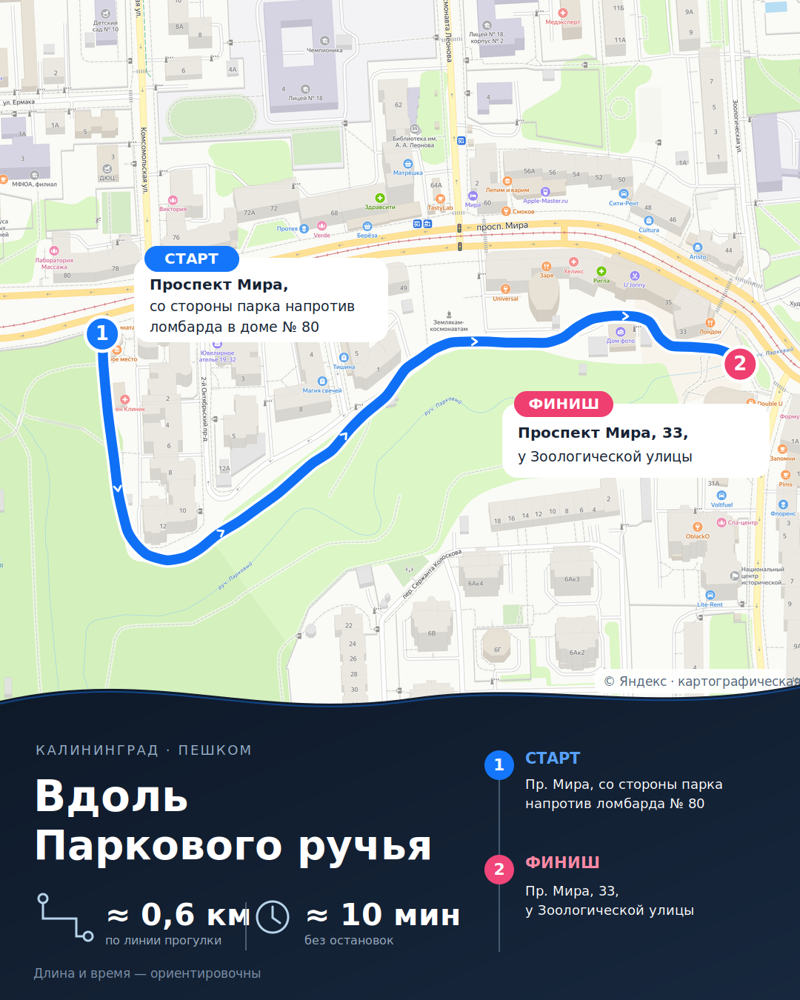
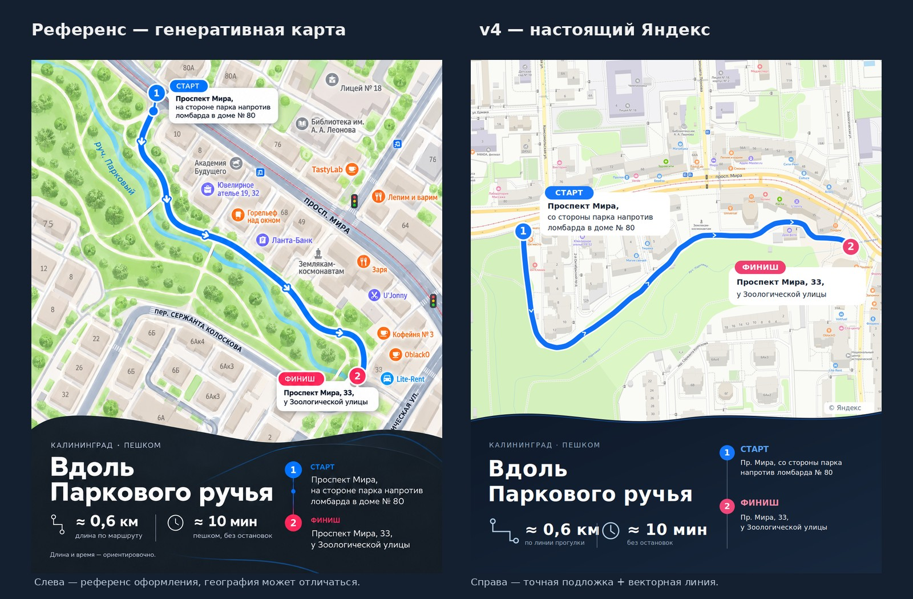

# Генератор карт прогулок для dot — образец v4 перед разработкой

**1 ноября 2026.** Подготовлен настоящий дизайн-образец для владельца и Claude Opus. **Статус: Draft, не реализация и не публикация.** [PR № 757](https://github.com/onedayonemasterpiece/events-bot-new/pull/757).

## 1. Смотреть: актуальный v4

[Полный PNG, 1080 × 1350](assets/route-map-v4-4x5-deterministic.png) · [Карта с исходной полилинией до сглаживания](assets/route-map-v4-centerline-qa.png) · [Чистая подложка](assets/route-map-v4-clean-crop.png) · [Векторный слой SVG](assets/route-map-v4-overlay.svg) · [GeoJSON с 42 точками](assets/route-map-v4-trace.geojson).

**Сравнение с понравившимся владельцу визуальным референсом:**

[Открыть сравнение](assets/route-map-v4-comparison-to-reference.jpg). Слева — художественный ориентир; исходная геометрия города на генеративном изображении не подтверждена. Справа — настоящая подложка Яндекса, по которой проложена отдельная векторная линия.

## 2. Какие требования выполнены

| Критерий | v4 | Что ещё не доказано |
| --- | --- | --- |
| Здания, улицы, названия | Сняты с Яндекс Карт, не дорисованы моделью; только мягкая глобальная коррекция цветов | Фактическая проходимость каждого дворового участка |
| Формат карусели | **4:5, 1080 × 1350** | Владелец должен принять визуальный стиль |
| Ориентация | **Север сверху**, все подписи горизонтальны | Нативный поворот в виджете не удалось подтвердить |
| Чёткость | Исходный растр **3500 × 3100, DPR 2**, масштаб **18** | Текущий инструмент bridge не принимает DPR/viewport напрямую |
| Линия | 42 точки, кубические Безье, синий штрих и белая обводка | Линия проверена визуально по изображению, не на местности |
| Скругления и стрелки | Плавные кривые, белые шевроны внутри линии | Можно уточнить толщину и частоту |
| Маркеры | Круги 1/2, цветные плашки и адресные карточки | Адресные выходы необходимо сверить |
| Метрики | **≈ 0,6 км и ≈ 10 минут** | Это авторская схема, не длина маршрута Яндекса |

В v3 поворот готового PNG на 80° повернул также все надписи. Для v4 проверена попытка управления картой в виджете с Ctrl: наблюдалось перемещение, **не** нативное вращение. Поэтому выбран вариант north-up, как рекомендовал Opus. На сайте Яндекса существуют способы вращать карту, но их доступность в текущем виджете не доказана.

### Воспроизводимые параметры

- Источник — официальный виджет Яндекса: https://yandex.ru/map-widget/v1/?ll=20.4817,54.7201&z=18&l=map, ответ HTTP 200.
- Съёмка — Chromium / headless Playwright, окно 1750 × 1550 CSS-пикселей, device scale factor 2. Это **отдельный проверочный браузерный прогон на dev-хосте**, а не уже готовый параметр MCP bridge.
- Взята область исходного изображения x=230…3200, y=180…2820 (физические пиксели). Она уменьшена **равномерно** до 1080 × 960; информационная панель собрана отдельно.
- Регистрация старого масштаба 17 с масштабом 18 проверена по фрагментам карты: x18 = 2 × x17 − 395; y18 = 2 × y17 + 66 (CSS-пиксели для проверенных кадров).
- На 42 географических точках длина приблизительно **593,5 м**. Время при 4 км/ч — **8,9 минуты**. Сглаживание кубическими кривыми даёт максимальное отклонение от исходной полилинии **0,99 пикселя** в новой композиции.

Стиль и географию теперь можно обсуждать раздельно: нужно исправить трек — корректируем вершины; нужно исправить оформление — корректируем SVG. Изображение не является доказательством доступности проходов.

## 3. Навигационная ссылка: найдены оба проблемных участка

Открыты живые пешеходные построения Яндекса, в том числе с пропуском промежуточных точек.

| Набор точек | Расстояние Яндекса |
| --- | ---: |
| Только старт → финиш | **420 м** (прямое соединение по улицам) |
| Все 10 исходных опор | **1,16 км** |
| Западные опоры | **680 м** |
| Восточные опоры | **480 м** |
| Запад после сокращения до трёх точек | **570 м** |
| Восток только между началом и концом участка | **262 м** |
| Весь маршрут, сокращённый до четырёх опор | **830 м** |

Скриншоты проверки: [все десять точек](assets/route-map-v4-nav-full10-review.jpg), [западный участок](assets/route-map-v4-nav-west-part-review.jpg), [восточный участок](assets/route-map-v4-nav-east-part-review.jpg).

**Где расходится:** на западе Яндекс использует связи через 2-й Октябрьский проезд вместо непрерывного авторского обхода вдоль парка; на востоке ведёт по связям у проспекта Мира, а не полностью по нарисованному проходу за домами 37–39/33А.

Удаление опор не дало решения в пределах предложенных Opus 10–15%: **830 м против 593,5 м, расхождение около 40%**. Пока нельзя представить ссылку на 830 м как навигацию по той же прогулке длиной 0,6 км.

[Упрощённая ссылка на четыре точки — только для проверки](https://yandex.ru/maps/?rtext=54.720301,20.478700~54.719016,20.479483~54.720245,20.482015~54.720289,20.484923&rtt=pd).

Нужно либо подтвердить реальную проходимость задуманного пути, либо пересмотреть геометрию прогулки в сторону существующих пешеходных связей Яндекса. Это решение влияет на содержание поста, а не только на оформление.

## 4. Генеративный вариант А: что доказано и чего нет

Сравнение выше показывает, насколько художественный референс отличается от реальной карты по подаче. В предыдущих генерациях модель перерисовывала город; этот результат **не** может служить навигационной подложкой.

Новый **контролируемый эксперимент** (подать DPR 2-скриншот в image-to-image модель с запретом изменять геометрию, наложить два изображения с 50% прозрачностью) **в этом раунде не выполнен**: инструмент такого редактирования в рабочей сессии недоступен. Прежняя генерация с другим заданием не подменяет этот тест. Не утверждаем, будто вариант А окончательно опровергнут новым экспериментом.

Для практического MVP предлагаю детерминированный вариант Б, а генеративный тест считать отдельной необязательной исследовательской работой.

## 5. Что предлагаю реализовать для dot

**Один короткий навык route-map и один небольшой renderer в уже существующей инфраструктуре.**

1. dot получает рисунок и пояснение, определяет маршрут и подробно ставит точки вдоль видимых пешеходных проходов. Сквозь дома и ручей без перехода линии быть не должно.
2. my-browser-bridge захватывает настоящую карту Яндекса без лишних панелей. Чтобы воспроизвести качество v4, достаточно добавить настройку **размера кадра и DPR 2** в существующий браузерный захват, а не новый сервис.
3. Один SVG/HTML renderer накладывает плавную линию, стрелки, маркеры, адресные выноски и нижний блок. Вход — изображение и точки; выход — PNG 4:5, длина, время и ссылка на проверенное построение.
4. dot сравнивает реальный маршрут Яндекса с авторской линией. При расхождении не выдаёт два разных пути за один и тот же.
5. PNG передаётся в VibePublish через **работающий workspace import**. Прямой импорт артефакта bridge ранее дал browser_artifact_invalid — отдельный дефект, не требующий нового файлового сервиса в этой задаче.

**Не делать:** новую GIS-базу, очередь, второй renderer, дополнительный картографический сервис, сложную систему статусов и автоматические проверки зданий без точных полигонов.

## 6. Предмет консультации с владельцем и Opus

**Дизайн:** подходит ли новый v4 по толщине линии, размеру пинов/выносок, стрелкам и оформлению панели? Теперь его можно оценивать на подлинной карте, отдельно от рисованного референса.

**Геометрия:** подтверждён ли фактический проход вокруг дома № 10 и за зданиями 37–39/33А до Мира, 33? На снимке показаны визуальные проходы, но состояние и доступность на местности не подтверждались.

**Навигация:** если ссылка обязательно должна повторять карту, маршрут потребует согласованного изменения. Если достаточно иллюстративного описания, нельзя выдавать длинную альтернативу Яндекса за ту же тропу.

**Решение о разработке:** после принятия дизайна и маршрута можно реализовывать один небольшой renderer, без «космолёта». PR остаётся Draft, в production ничего не менялось.

---

*История отклонённых v1–v3 и полный исходный отзыв Claude Opus остаются в Git-истории данного файла. Эта редакция намеренно сокращена до актуальной карточки, проверок и открытых решений.*
