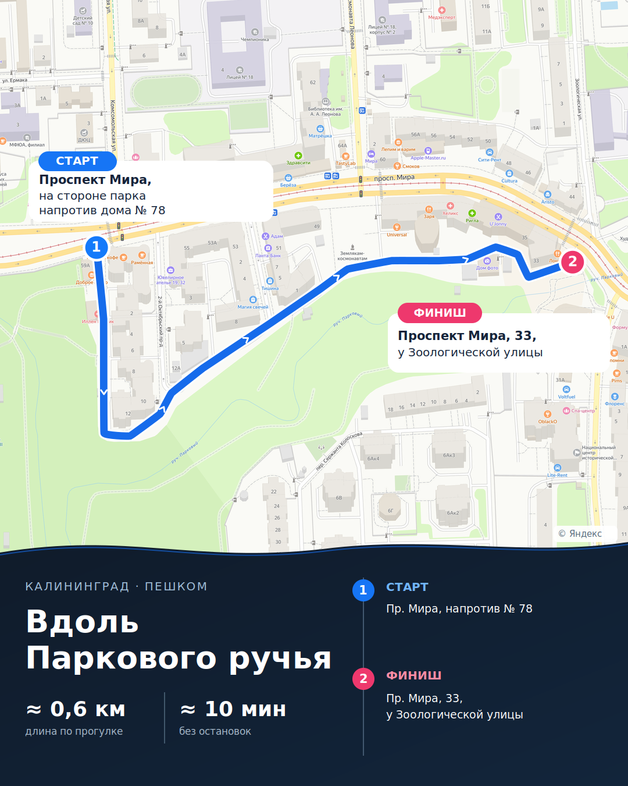
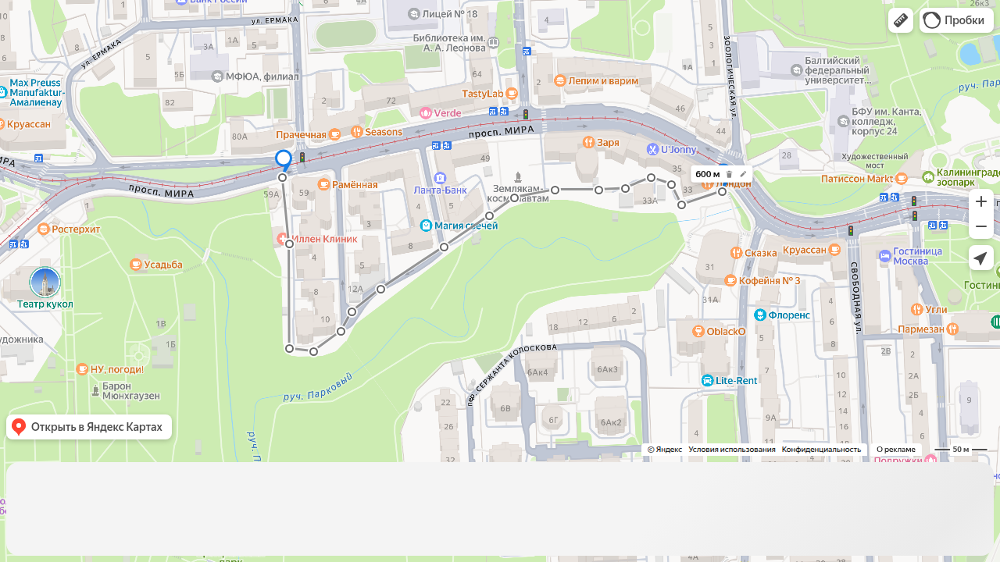

# Генератор карт маршрутов для dot — проверенный пример v5 и ссылки для постов

**2 ноября 2026 • актуальный результат анализа, без выпуска в production.** [Draft PR №757](https://github.com/onedayonemasterpiece/events-bot-new/pull/757). Главный вывод: **одна точная авторская полилиния — источник истины для картинки, ссылки-линейки Яндекса и расстояния**. Не путать её с маршрутом, который самостоятельно рассчитывает навигатор.

## 1. Новый пример на карте Яндекса: v5

[Карточка 4:5 целиком](assets/route-map-v5-4x5-owner-ruler.png) · [Та же линия на чистой карте, со всеми вершинами](assets/route-map-v5-author-ruler-qa.png) · [SVG-наложение](assets/route-map-v5-overlay.svg) · [Сохранённые координаты и ссылки](assets/route-map-v5-links.json).

В v4 линия была построена из моих приблизительных 42 точек, поэтому местами уходила с дорожек. **v5 построен из предоставленной владельцем линейки Яндекса**, которая гораздо лучше совпадает с его замыслом. Старт перенесён на сторону парка **напротив дома №78**: (20.478906, 54.720380). Финиш — (20.484944, 54.720273), у Мира, 33 / Зоологической. Относительно v4 крайние точки сместились примерно на 38 и 44 пикселя карточки. Подложка — исходный Yandex PNG, геометрия зданий не менялась.

**Факты:** 17 точек; 598,6 м по Haversine; в линейке Яндекса показано **600 м**; ≈10 минут без остановок. Плавность SVG ограничена отклонением до ≈2,1 пикселя от авторской ломаной. Это не доказательство фактической доступности каждого прохода на местности — но лучшее воспроизведение предоставленных владельцем точек, чем прежняя трассировка.

## 2. Главный продуктовый вывод — выдавать два разных типа ссылок

**Авторская линия = параметр rl, режим «Линейка».** Первая пара — абсолютные **долгота, широта**, последующие пары — приращения долготы/широты относительно предыдущей. Провайдер не прокладывает путь сам. **Для публикации прогулки это основной URL**: он показывает именно заданную геометрию. Можно добавить pt с маркерами старта, финиша и остановок.

**Навигация = rtext + rtt.** Координаты здесь уже **широта, долгота**, между точками Яндекс строит свой путь. Этот URL полезен только после сравнения получившейся трассы. Коды видов передвижения по официальной документации: pedestrian **pd**, bicycle **bc**, automobile **auto**. [Документация Яндекса по URL](https://yandex.com/dev/yandex-apps-launch-maps/doc/en/concepts/yandexmaps-web), [управление линейкой](https://www.yandex.ru/support/maps/ru/concept/map-control).

**Важная оговорка:** формат rl взят из самой рабочей ссылки UI Яндекса и подтверждён живой проверкой, но **не описан в публичной схеме URL запуска** столь же явно, как rtext. Координатную полилинию нужно хранить отдельно, чтобы можно было восстановить ссылку, если Яндекс изменит формат.

## 3. Реальные примеры, которые можно открыть

| Вариант | Геометрия | Живая проверка | Назначение |
| --- | --- | --- | --- |
| [**Основная ссылка — Яндекс, линейка + старт/финиш**](https://yandex.ru/maps/22/kaliningrad/?ll=20.481789,54.719623&rl=20.478906,54.720380~0.000089,-0.000524~0.000006,-0.000836~0.000329,-0.000022~0.000380,0.000161~0.000146,0.000154~0.000399,0.000183~0.000868,0.000334~0.000627,0.000249~0.000342,0.000143~0.000558,0.000062~0.000596,0.000000~0.000361,0.000011~0.000361,0.000088~0.000279,-0.000055~0.000139,-0.000165~0.000558,0.000110&z=17.76&pt=20.478906,54.720380~20.484944,54.720273) | **17 точек, 598,6 м** | HTTP 200 через официальный виджет; показывает **600 м** | **Основной выбор для поста** |
| [Яндекс, сжатая линейка](https://yandex.ru/maps/22/kaliningrad/?ll=20.481789,54.719623&rl=20.478906,54.720380~0.000089,-0.000524~0.000006,-0.000836~0.000329,-0.000022~0.000380,0.000161~0.000146,0.000154~0.000399,0.000183~0.001837,0.000726~0.000558,0.000062~0.000957,0.000011~0.000361,0.000088~0.000279,-0.000055~0.000139,-0.000165~0.000558,0.000110&z=17.76) | **14 точек, ≈598 м** | Виджет HTTP 200, тоже **600 м** | Необязательное компактное представление |
| [Яндекс, пешеходная навигация по 10 точкам владельца, в направлении запад→восток](https://yandex.ru/maps/22/kaliningrad/?rtext=54.720343,20.478938~54.718986,20.479039~54.719140,20.479723~54.719808,20.481085~54.720270,20.482524~54.720255,20.483347~54.720365,20.483696~54.720358,20.484158~54.720175,20.484367~54.720365,20.485007&rtt=pd) | Путь строит Яндекс | **820 м, 9 мин** | **Не выдавать за ту же прогулку 600 м** |
| [Яндекс, 8 навигационных опор из авторской линейки](https://yandex.ru/maps/22/kaliningrad/?rtext=54.720380,20.478906~54.719020,20.479001~54.718998,20.479330~54.719496,20.480255~54.720222,20.482092~54.720383,20.483968~54.720163,20.484386~54.720273,20.484944&rtt=pd) | Путь строит Яндекс | **1,08 км, 11 мин** | Контроль: меньшим числом опор проблему не решить |
| [2ГИС, 6 точек из примера владельца](https://2gis.ru/kaliningrad/directions/tab/pedestrian/points/20.478887%2C54.720404%3B5630238268588082%7C20.478989%2C54.719092%3B70030076284532914%7C20.479797%2C54.719204%3B5630238268591127%7C20.481135%2C54.719818%3B5630238268591122%7C20.482881%2C54.720175%3B70000001055913103%7C20.485076%2C54.720314?m=20.482898%2C54.720135%2F17) | 6 POI/промежуточных точек с ID 2ГИС | Формат соответствует примерам 2ГИС; **живой просмотр остановлен CAPTCHA** | Дополнительный маршрут, не основной URL |

Скриншот реальной проверки линейки: 

Ссылка полной страницы Yandex /maps на нашем headless browser ответила **429**; зато штатный **map-widget/v1 открыл тот же параметр rl с HTTP 200 и длиной 600 м**. Приведённые длины rtext также получены из живого интерфейса виджета. Скриншоты из прежнего раунда показывают характер обходов на [западе](assets/route-map-v4-nav-west-part-review.jpg) и [востоке](assets/route-map-v4-nav-east-part-review.jpg). **Ссылка 2ГИС оставлена ровно в том виде, который дал владелец: её работоспособность для других пользователей мы не выдумываем и при CAPTCHA не обходим защиту.**

**Рекомендация по точкам:** исходные 17 — сохранить. RDP-упрощение с точностью 1 м оставляет 14 точек с максимальным расхождением ≈0,83 м на исходных вершинах; при допуске 4 м остаётся 10, но путь уже отклоняется до 3,9 м и может срезать тропинку. Разница длин URL **428 vs 331 символ** не оправдывает упрощения источника ради публикации. Новые реальные повороты добавлять точками по дорожкам; простая вставка точек посреди прямого отрезка сама точность не повышает.

## 4. Сокращение ссылок для VK и Telegram

**Telegram.** Короткий URL не нужен: в текст или подпись поставить кликабельный текст **«Маршрут на карте»** с полной ссылкой rl. Telegram скрывает длину за текстом гиперссылки. В результате dot возвращает отдельно видимый текст, исходный URL и подготовленный вариант разметки для используемого публикационного адаптера.

**VK.** Использовать уже имеющийся **vk.cc**, без собственной инфраструктуры. В events-bot есть [shortlinks.py](https://github.com/onedayonemasterpiece/events-bot-new/blob/main/shortlinks.py): он обращается к VK API методом **utils.getShortLink**, но его существующие helper-методы привязаны к Event и полям билетных ссылок. **Нельзя создавать фиктивный Event для карты.** Достаточно маленького общего вызова существующего VK API-адаптера с параметром url и извлечением short_url/key, без нового токена и таблицы; его вызов может происходить при подготовке VK-поста, а не при генерации картинки. Исходная длинная ссылка сохраняется как fallback при отказе VK. [Схема метода VK](https://github.com/VKCOM/vk-api-schema/blob/master/utils/methods.json).

**Фактическая приёмка VK:** в [прототипе](route_map_links_prototype.py) проверены вызов utils.getShortLink через инъекцию существующего API-адаптера и разбор ответа. **Живую короткую vk.cc-ссылку создать не удалось:** dev-окружение не имеет доступного продуктового VK-токена, а сохранённый браузерный профиль открыл страницу входа. Не выдумывать ключ или утверждать, что redirect проверен. Следующий реальный E2E — через действующую авторизованную производственную интеграцию, затем проверить разрешение созданной ссылки. При отсутствии сокращения сохранять полноразмерную ссылку, не останавливая подготовку картинки.

**Свой домен пока не нужен.** Telegram умеет скрывать URL, а VK уже имеет vk.cc. Собственный сокращатель на kenigevents.ru создаст отдельные обязательства по редиректам, стабильности и защите от злоупотреблений. Возвращаться к нему только если действительно нужны брендированные ссылки/единая аналитика вне VK.

## 5. Велосипедные и автомобильные маршруты — заложить правильно

**Один и тот же формат геометрии** работает во всех трёх режимах, но сама трасса различается: пешеходную парковую линию **нельзя автоматически объявить автомобильной**. Для bike и car построение идёт по подходящим дорогам; rtext получает rtt=bc или rtt=auto, а rtext=... по-прежнему может перестраиваться провайдером. Основной rl остаётся **авторской схемой** независимо от транспорта.

Отдельно от сотен геометрических точек различать **ключевые точки прохождения (via)** и **точки реальной остановки/осмотра (stop)**. Для stop хранить координаты безопасного места, где остановиться/выйти, текст ориентира, при необходимости точку самого объекта и продолжительность осмотра. На картинке — номер или специальная иконка; в ссылке Яндекса — **pt-маркеры**, в посте — короткий список «Остановка 1…». Для автомобиля обязательно подтвердить возможность законной парковки/остановки, для велосипеда — доступный подъезд. Не выводить время поездки и посещений по формуле пешего темпа 4 км/ч: время в движении берётся из подходящего маршрутизатора, время осмотра учитывается отдельно.

**2ГИС** официально поддерживает вкладки **pedestrian / bicycle / car** и многоопорные маршруты. Но URL с POI-идентификаторами создавать только из реально полученных данных: случайные ID придумывать нельзя. [Официальные deeplink-примеры 2ГИС](https://help.2gis.ru/question/razrabotchikam-zapusk-ideystviya-vmobilnom-prilozhenii-cherez-deeplink).

## 6. Минимальная схема использования dot

**Снаружи один запрос:** «Сделай карту прогулки по этому скриншоту и пояснению».

**Внутри одна небольшая операция route_map.generate** с подготовленной dot геометрией. dot распознаёт карту и рисунок, при необходимости уточняет опорные координаты, а инструмент выполняет **детерминированно** четыре вещи: (1) захватывает чистый Яндекс в тихом browser mode/DPR 2; (2) рисует PNG 4:5, метки/POI/кривые; (3) из **того же массива координат** строит rl, длину и варианты ссылок, без самостоятельного изменения трассы; (4) возвращает результат для текста публикации.

Один минимальный контракт, без новой БД и очереди:

    route_map.generate(
      trace_lon_lat=[...], mode="walk|bike|car",
      start_label="...", finish_label="...",
      stops=[{type:"stop", lon:..., lat:..., label:"...", visit_minutes:...}],
      title="...", source_image=optional)
    -> {png, trace, distance_m, yandex_ruler_url,
        yandex_navigation_candidate, two_gis_url_if_verified,
        tg_post_link, vk_post_link_if_shortened, text_for_post}

Выход **yandex_navigation_candidate** не заменяет yandex_ruler_url: если Яндекс уводит в обход, авторский rl остаётся правильным отображением замысла. Все ссылки используют одинаковые старт/финиш и направление. Не вводить статусные машины «needs_review», географическую БД, второй рендерер, отдельный short-link-сервис или «гейты пересечения зданий» без надёжных данных.

**Проверенный заготовочный код:** [route_map_links_prototype.py](route_map_links_prototype.py) — стандартная библиотека Python; поддерживает обратимое чтение/запись rl, длину, RDP, rtext для pd/bc/auto, URL 2ГИС с подтверждёнными POI ID и адаптер для существующего VK utils.getShortLink. Команда **python route_map_links_prototype.py --self-test** прошла. [Файл конкретных ссылок и 17 координат](assets/route-map-v5-links.json).

## 7. Что именно осталось до старта реализации

**Владелец/Opus:** оценить новый v5 по сравнению с v4 и точность 17 точек, особенно крайнюю восточную часть и вход/выход; подтвердить, что **основная ссылка на авторскую линию rl** удовлетворяет задаче публикации, даже если rtext прокладывает другой путь.

**Технические короткие проверки перед приёмкой функции:** один реальный VK utils.getShortLink → vk.cc → переход по адресу в авторизованной интеграции; проверка 2ГИС при обычном доступе; сквозной PNG → VibePublish. Для первоначальной задачи уже подтверждено, что изображение поступает в VibePublish через существующий workspace-import — создавать новый файловый endpoint не требуется.

**Итог:** у dot один геометрический источник, один рендерер и готовые длинные/короткие ссылки для постов. **Основную проблему несовпадения с Яндекс-навигацией больше не нужно решать новыми обходными маршрутизаторами:** для авторских прогулок публикуется rl-линия, а rtext — только как дополнительная навигация с проверенным совпадением.
